# JD Smith Insurance — Page content for the quotation, overview and supporting pages

Content source: the live site https://jdsmithinsurance.com/ (all pages downloaded and checked on 2026-10-18).
This file holds the text, calls to action (CTAs) and photos for every page in the new header and footer
(`js/components.js`). Use it to build each page. It is a content brief only: nothing in it is linked from the site.

**Not in this file:** the pages that are already built (`index.html`, `jds-get_a_quote.htm`, `jds-staff.htm`,
`jds-job_postings.htm`, `jds-staff_videos.htm`).

**Related files:** `SITE_MAP.md` (source of truth for pages and quote methods) · `STAKEHOLDER_NOTES.txt`
(open questions for the office; every irregularity found while writing this file is logged there) · `CLAUDE.md`.

---

## How to use this file

### Page order (information architecture)
Every **quotation page** (an insurance product page) uses the same order, so visitors can act straight away
and again once they have read the details:

1. **Hero:** H1, subheading and hero photo.
2. **Quote options (top CTA):** the same quote method(s) as that item on *Get a free quote*.
3. **Information:** why choose us, coverage, eligibility, prices, testimonials and FAQs, in that order.
4. **Quote options (bottom CTA):** a repeat of block 2, followed by the contact block.
5. **Related links:** sibling products, the category overview, forms and articles.

Every **overview page** (Personal, Small Business, Commercial, Life & Health) lists the products in its category
in the same order as the header menu, each with a one-line summary, a photo and links to "Learn more" (the info
page) and "Get a quote" (the quote method).

**Supporting pages** (Resources, About, legal) have a hero, the full page text, and a soft CTA at the end
("Contact your broker" or "Get a free quote").

### Quote options must match *Get a free quote*
The CTA blocks are copied from `jds-get_a_quote.htm`, which follows `SITE_MAP.md` section 1. If a quote method
changes, update all three: `SITE_MAP.md`, `jds-get_a_quote.htm` and this file. Phone numbers are always `tel:`
links, with a comma pause for an extension (`tel:+19057647868,232`). The PDF applications are in the project's
`Applications/` folder (restored from the backup on 2026-10-18). The forms are still served from the live site
(`https://jdsmithinsurance.com/...`).

### Photos
- `images/original/...` are copies of the photos on the live page (with a link to the live file). Most are small
  (100–400 px wide, hero banners 1000×400) and look soft on large screens.
- `images/suggested/<key>.jpg` are higher-resolution replacements (2000 px wide) from Unsplash, under the
  free Unsplash License (no attribution required, but credit is appreciated). Each one links to its Unsplash page.
- Real JD Smith photos (staff, office, community, racing team, church fire, CWB presentation, school and camp
  photos) are **kept**: a stock photo cannot replace them. Ask the office for the full-size originals
  (STAKEHOLDER_NOTES section 6).
- Title graphics (`title_*.gif`), buttons, small logos, bracket gifs and "Quote me" buttons are not listed.
  They are images of text: use real headings and buttons instead.

### Shared elements (do not repeat on each page)
- **Header and footer:** come from `js/components.js`. The page order in this file follows the header menus.
- **Standard contact block** (used under every bottom CTA):
  JD Smith & Associates Insurance Brokers Inc. · 105 West Beaver Creek Rd., Richmond Hill, ON L4B 1C6 ·
  Toll free [1-800-917-SAVE (7283)](tel:18009177283) · Local [905-764-7868](tel:9057647868) · Fax 905-764-9618 ·
  Mon–Thu 9:00–4:00, Fri 9:00–3:00 · [Contact your broker](jds-staff.htm)
- **Tagline:** the live site shows "Commercial and Personal Insurance Solutions Since 1979" on every page. Use it once, in the header area or the homepage hero, not on each page.

---

## Page index (matches the header menus)

| # | Menu › item | Page | Type |
|---|---|---|---|
| **A** | **Personal** | | |
| A0 | All personal insurance | `jds-quote_me.htm` | Overview |
| A1 | Auto insurance | `jds-quote_auto.htm` | Quotation |
| A2 | Home insurance | `jds-quote_home.htm` | Quotation |
| A3 | Boat insurance | external: boatinsurancecanada.ca | External (no page) |
| A4 | UberX ride-sharing | `uberx.htm` | Quotation (with form) |
| A5 | Ontario auto reform 2026 › What is changing | `jds-auto_reform.htm` (+ 4 sub-pages) | Supporting |
| A6 | Ontario auto reform 2026 › Accident benefits explained | `jds-client_auto_insurance_changes_2016.htm` | Supporting (with CTA) |
| **B** | **Small Business** | | |
| B0 | Business quotes online 24/7 | `small_business_online.htm` | Overview |
| B1 | Barbers & hairstylists | `small_business_barber_hairstylist.htm` | Quotation |
| B2 | Builder's risk | `small_business_builders_risk.htm` | Quotation |
| B3 | Health & fitness | `small_business_health_fitness.htm` | Quotation |
| B4 | Non-profit liability | `small_business_non_profit.htm` | Quotation |
| B5 | Photography services | `small_business_photography.htm` | Quotation |
| B6 | Professional liability | `small_business_professional_liability.htm` | Quotation |
| B7 | Special events | `small_business_special_events.htm` | Quotation |
| **C** | **Commercial** | | |
| C0 | Get started › All commercial insurance | `jds-corporate.htm` | Overview |
| C1 | Faith & non-profit › Churches | `jds-church.htm` | Quotation |
| C2 | Faith & non-profit › Camps | `jds-camp-insurance.htm` | Quotation |
| C3 | Faith & non-profit › Schools | `jds-school_insurance.htm` | Quotation |
| C4 | Faith & non-profit › Non-profits | `jds-packages_non_profit_companies.htm` (+ `charity_village_group_insurance.htm`) | Quotation |
| C5 | Trades & industry › Contractors | `jds-packages_contractors.htm` | Quotation |
| C6 | Trades & industry › Landscapers & snow removal | `jds-packages_landscape_snow_removal.htm` | Quotation |
| C7 | Trades & industry › Welding & steel | `jds-packages_metals_welding.htm` | Quotation |
| C8 | Trades & industry › Canadian Welding Bureau | `jds-packages_cwb_insurance.htm` | Quotation |
| C9 | Trades & industry › Tool & die | `jds-packages_tool_and_die.htm` | Quotation |
| C10 | Trades & industry › Windows & doors | `jds-packages_doors_windows.htm` | Quotation |
| C11 | Trades & industry › NDT / NDE | `jds-packages_non_destructive_testing.htm` | Quotation |
| C12 | Transport & trade › Car & truck fleets | `jds-packages_fleet_insurance.htm` | Quotation |
| C13 | Transport & trade › Marine & overland cargo | `jds-packages_marine_overland_insurance.htm` | Quotation |
| C14 | Transport & trade › Customs bonds | `jds-customs_bonding.htm` | Quotation |
| C15 | Transport & trade › Retail & wholesale | `jds-packages_retail_wholesale.htm` | Quotation |
| C16 | Specialty › Cyber liability | `jds-cyber_liability_insurance.htm` | Quotation |
| C17 | Specialty › Renewable energy | `jds-packages_renewable_energy.htm` | Quotation |
| C18 | Specialty › Golf & hole-in-one | `jds-hole-in-one.htm` | Quotation |
| C19 | Specialty › Corporate clients | `jds-corporate_clients.htm` | Supporting (with CTA) |
| C20 | Get started › Business quote request | `jds-quote.htm` | Quote form |
| C21 | Renewable energy quote form (linked from C17) | `jds-renewable_energy_quote.htm` | Quote form |
| C22 | Get started › Application forms | `jds-applications.htm` | Forms library |
| **D** | **Life & Health** | | |
| D1 | Life insurance & planning (also the category overview) | `jds-life_health.htm` | Overview + Quotation |
| D2 | Group insurance | `jds-life_groups.htm` | Quotation |
| D3 | Mortgage insurance | `jds-life_mortgage_insurance.htm` | Quotation |
| D4 | Critical illness | `jds-life_insurance_critical_illness.htm` | Quotation |
| **E** | **Resources** | | |
| E1 | For clients › Claims (+ claim stories) | `jds-claims.htm` | Supporting |
| E2 | For clients › Online payments | `jds-online_payments.htm` | Supporting |
| E3 | For clients › Insurance companies | `jds-insurance_companies.htm` | Supporting |
| E4 | Advice › 12 ways to save | `jds-12waystosave.htm` | Supporting |
| E5 | Advice › 20 hot topics | `jds-hot_topics.htm` | Supporting |
| E6 | Advice › Ask a broker | `jds-ask_broker.htm` | Supporting |
| E7 | Advice › Winter storage tips | `jds-winter_storage.htm` | Supporting |
| E8 | Reading › News & humour (+ articles) | `jds-news.htm` | Supporting |
| E9 | Reading › Reflection & encouragement (+ meditations, Dario's thoughts) | `jds-meditations.htm` | Supporting |
| **F** | **About** (Staff, Staff videos and Jobs are already built) | | |
| F1 | Core values (incl. RIBO broker facts) | `jds-values.htm` | Supporting |
| F2 | The broker advantage | `jds-advantage.htm` | Supporting |
| F3 | Community | `jds-community.htm` | Supporting |
| F4 | Car racing team (+ race reports) | `jds-racing_team.htm` | Supporting |
| **G** | **Footer legal links** | | |
| G1 | Code of consumer rights | `jds-code_consumer_rights.htm` | Legal |
| G2 | Privacy statement | `jds-privacy_statement.htm` | Legal |
| G3 | Terms of use | `jds-terms_of_use.htm` | Legal |
| G4 | E. & O. E. disclaimer | `jds-disclaimer.htm` | Legal |
| **H** | **Live pages not in the new menus** | `jds-products.htm` etc. | Retire or redirect |
| **Appendix** | Article pages (news, meditations, claim stories, race reports, newsletters) | | Supporting |

---

# A. PERSONAL

---

## A0. All personal insurance — overview
`jds-quote_me.htm` · Menu: Personal › All personal insurance · Footer: Personal › All personal insurance
**Live page:** [jds-quote_me.htm](https://jdsmithinsurance.com/jds-quote_me.htm) · **Current &lt;title&gt;:** "Quick Insurance Quotes Online or by Fax" · **Meta description:** "J.D. Smith Insurance Brokers provides auto, home, boat, corporate, business and group rate insurance quotes."
**Suggested &lt;title&gt;:** Personal Insurance in Ontario: Auto, Home, Boat & UberX | JD Smith Insurance

### 1. Hero
- **H1:** Personal insurance
- **Subheading:** Auto, home and boat insurance for Ontario residents. 12,264 clients experience our personal service, competitive rates and quality products.
- **Hero photo (original):**  *(original 1000×400 · [live](https://jdsmithinsurance.com/images/insurance_parents_piggyback.jpg))*
- **Suggested replacement:**  *(suggested replacement · [Unsplash photo](https://unsplash.com/photos/man-photographs-children-leaning-out-of-car-window-sSr73PqtbYo) · free Unsplash License)*

### 2. Quote options (top CTA)
Lead-in: "Our staff will give you a quick quote. Call us at 1-800-917-SAVE (7283)."

| Insurance | How to get your quote | Button(s) |
|---|---|---|
| Auto insurance | Online · about 7 minutes. Compare rates from 8 insurance companies. For Ontario drivers with 3 tickets or fewer. | [Start online auto quote](https://webrater.appliedsystems.com/WR/Default.aspx?GC=JDSMITH&LOB=AUTO&LANG=EN) |
| Home insurance | By phone. Our staff will give you a quick quote. Toronto homes south of Eglinton need pre-approval. | [Call 1-800-917-7283](tel:18009177283) |
| UberX ride-sharing | Short form. The endorsement that lets you carry paying passengers. | [Fill in the quote form](https://jdsmithinsurance.com/uberx.htm) |
| Boat insurance | Partner site. Cruisers, yachts, sailboats and personal water craft. | [Get a boat quote](http://www.boatinsurancecanada.ca) |
| Extra accident benefits | By phone. Price optional accident benefits coverage on your auto policy. | [Call 1-800-917-7283](tel:18009177283) |

**Notice banner (above the cards):** IMPORTANT — All auto policies in Ontario have changed as of July 2026. [Learn what's different](jds-auto_reform.htm)

### 3. Products (cards, in header order)

**Auto insurance** → [Learn more](jds-quote_auto.htm) · [Start online auto quote](https://webrater.appliedsystems.com/WR/Default.aspx?GC=JDSMITH&LOB=AUTO&LANG=EN)
 *(original 168×75 · [live](https://jdsmithinsurance.com/images/Windstar1-1a.jpg))*
- For residents of Ontario
- Great rates from our brokers
- Takes less than 7 minutes
- We give you a rate comparison of 8 insurance companies
- We quote various deductibles and discounts
- Maximum 3 tickets

**Home insurance** → [Learn more](jds-quote_home.htm) · [Call 1-800-917-7283](tel:18009177283)
 *(original 126×75 · [live](https://jdsmithinsurance.com/images/House2.jpg))*
- For residents of Ontario
- Great rates from our brokers
- Takes less than 7 minutes *(the live text; but home quotes are by phone only, see STAKEHOLDER_NOTES)*
- We give a rate comparison of many insurance companies
- Scheduled personal property
- Seasonal residences

**Boat insurance** → [Get a boat quote](http://www.boatinsurancecanada.ca) (partner site)
 *(original 120×75 · [live](https://jdsmithinsurance.com/images/boatinsurance_1.jpg))*
- Cruisers
- Yachts
- Sailboats
- Personal water craft, etc.

**UberX ride-sharing** → [Learn more and get a quote](uberx.htm)
- The endorsement that lets you carry paying passengers when under contract for a ride-sharing company.

**Ontario auto reform 2026** → [What is changing](jds-auto_reform.htm) · [Accident benefits explained](jds-client_auto_insurance_changes_2016.htm)

**Discount note:** PLEASE CALL OUR OFFICE TO BE SURE YOU HAVE ALL THE DISCOUNTS AVAILABLE.

### 4. Information: The top 10 most stolen cars in Ontario
We recommend that **you install an after-market tracker** on all of the following vehicles.

According to the Toronto Police, the [most commonly stolen vehicles](https://info.rates.ca/acton/ct/39960/s-0985-2211/Bct/q-0587/l-03cc:b864f/ct8_0/1/lu?sid=TV2%3AuVPjipu63) are those with a push-to-start ignition. The city of Ottawa has also seen a [rise in vehicle thefts this year](https://info.rates.ca/acton/ct/39960/s-0985-2211/Bct/q-0587/l-03cc:b864f/ct8_1/1/lu?sid=TV2%3AuVPjipu63), with more than 1,500 vehicles reported stolen within the first nine months of 2022.

This year, SUVs dominate the list of most stolen vehicles, followed by pickup trucks and cars. [In Ontario](https://info.rates.ca/acton/ct/39960/s-0985-2211/Bct/q-0587/l-03cc:b864f/ct8_2/1/lu?sid=TV2%3AuVPjipu63), criminals tend to seek these vehicles:

1. Lexus RX Series
2. Honda CR-V
3. Ford F-150 Series
4. Toyota Highlander
5. Honda Civic
6. Land Rover Range Rover Sport
7. Honda Accord
8. Chevrolet GMC Silverado/Sierra 1500 Series
9. RAM 1500 Series
10. Toyota Tacoma

*(The figures are from 2022. Ask the office whether to keep or update this list.)*

**Trust strip:** An independent insurance broker covers you best. (RIBO logo, `images/RIBO-4.jpg` is already in the project.)

### 5. Quote options (bottom CTA)
| Insurance | How to get your quote | Button(s) |
|---|---|---|
| Auto insurance | Online · about 7 minutes. Compare rates from 8 insurance companies. For Ontario drivers with 3 tickets or fewer. | [Start online auto quote](https://webrater.appliedsystems.com/WR/Default.aspx?GC=JDSMITH&LOB=AUTO&LANG=EN) |
| Home insurance | By phone. Our staff will give you a quick quote. Toronto homes south of Eglinton need pre-approval. | [Call 1-800-917-7283](tel:18009177283) |
| UberX ride-sharing | Short form. The endorsement that lets you carry paying passengers. | [Fill in the quote form](https://jdsmithinsurance.com/uberx.htm) |
| Boat insurance | Partner site. Cruisers, yachts, sailboats and personal water craft. | [Get a boat quote](http://www.boatinsurancecanada.ca) |
| Extra accident benefits | By phone. Price optional accident benefits coverage on your auto policy. | [Call 1-800-917-7283](tel:18009177283) |

Contact block (standard).

---

## A1. Auto insurance
`jds-quote_auto.htm` · Menu: Personal › Auto insurance
**Live page:** [jds-quote_auto.htm](https://jdsmithinsurance.com/jds-quote_auto.htm) · **Current &lt;title&gt;:** "Get An Online Quote For Auto Insurance" · **Meta description:** "J.D. Smith Insurance Brokers provides online auto quotation capability to compare competitive auto insurance rates from 5 companies."
**Suggested &lt;title&gt;:** Auto Insurance Quotes in Ontario: Compare 8 Insurers | JD Smith Insurance
**Suggested meta:** Compare auto insurance rates from 8 companies in about 7 minutes. Ontario drivers, independent RIBO brokers since 1979.

### 1. Hero
- **H1:** Auto insurance
- **Subheading:** We survey the market: 8 insurance companies to choose from. We have great rates and very broad coverage available in Ontario.
- **Hero photo (original):**  *(original 1000×400 · [live](https://jdsmithinsurance.com/images/happy_couple_in_car.jpg))*
- **Suggested replacement:**  *(suggested replacement · [Unsplash photo](https://unsplash.com/photos/a-person-driving-a-car-on-a-road-with-traffic-lights-Gl9fJzqlVMQ) · free Unsplash License)*
- **Notice banner:** IMPORTANT — All auto policies in Ontario have changed as of July 2026. [Click for more information](jds-auto_reform.htm)

### 2. Quote options (top CTA)
- **Primary:** [Start online auto quote](https://webrater.appliedsystems.com/WR/Default.aspx?GC=JDSMITH&LOB=AUTO&LANG=EN) — online, about 7 minutes, compares 8 insurance companies (Ontario drivers, 3 tickets or fewer)
- **Secondary:** [Call 1-800-917-7283](tel:18009177283) — "Our staff will give you a quick quote"

Promo graphic linked to the rater on the live page:  *(original 350×162 · [live](https://jdsmithinsurance.com/images/super_amazing_rates_01.jpg))* *(an image of text; replace with a real button)*

### 3. Information

**Why quote with us**
 *(original 108×122 · [live](https://jdsmithinsurance.com/images/girl_reception_CSR_3.jpg))*  *(original 108×117 · [live](https://jdsmithinsurance.com/images/girl_csr_large.jpg))*
"I want to save you $$$ and find better coverage. There are 24 friendly brokers here to serve you."
*(The home page says 34 brokers and the Broker advantage page says "over 30 licensed brokers". Use one number: see STAKEHOLDER_NOTES.)*

**For auto quotes (eligibility):**
- You should have a good driving record.
- Have no more than 3 tickets in 3 years.
- You must have a "G2" licence for at least 1 year.
- **Not more than 1 at-fault claim in the past 5 years.**
- **To get additional combined policy DISCOUNTS, contact our office.**

**Driving tips (external articles from Hagerty)**
- [5 tips to prepare your vintage ride for storage](https://www.hagerty.com/articles-videos/articles/2019/10/29/5-tips-to-prepare-your-vintage-ride-for-storage?utm_source=SFMC&utm_medium=email&utm_content=19_November_2_Weekend_News)
- [Click here for 6 winter driving reminders](https://www.hagerty.com/media/driving/6-winter-driving-reminders-even-if-you-dont-get-snow/) 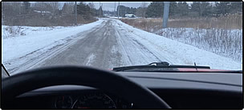 *(original 304×138 · [live](https://jdsmithinsurance.com/images/winter_tips_01.jpg))*

### 4. Quote options (bottom CTA)
"CALL US FOR A QUOTE — 1-800-917-SAVE"

- **Primary:** [Start online auto quote](https://webrater.appliedsystems.com/WR/Default.aspx?GC=JDSMITH&LOB=AUTO&LANG=EN) — online, about 7 minutes, compares 8 insurance companies (Ontario drivers, 3 tickets or fewer)
- **Secondary:** [Call 1-800-917-7283](tel:18009177283) — "Our staff will give you a quick quote"

Contact block (standard).

### 5. Related links
[Ontario auto reform 2026](jds-auto_reform.htm) · [Accident benefits explained](jds-client_auto_insurance_changes_2016.htm) · [UberX ride-sharing](uberx.htm) · [Home insurance](jds-quote_home.htm) (ask about combined home & auto discounts) · [12 ways to save](jds-12waystosave.htm) · [Winter storage tips](jds-winter_storage.htm) · [Claims: when you have an auto accident](jds-claims.htm)

---

## A2. Home insurance
`jds-quote_home.htm` · Menu: Personal › Home insurance
**Live page:** [jds-quote_home.htm](https://jdsmithinsurance.com/jds-quote_home.htm) · **Current &lt;title&gt;:** "Get An Online Quote For Home Insurance" · **Meta description:** "J.D. Smith Insurance Brokers provides online home insurance quotation capability to compare competitive auto insurance rates from 5 companies."
**Suggested &lt;title&gt;:** Home Insurance Quotes in Ontario | JD Smith Insurance *(the current title promises an online quote that does not exist)*
**Suggested meta:** A quick home insurance quote by phone from independent Ontario brokers. We compare many insurance companies for you.

### 1. Hero
- **H1:** Home insurance
- **Subheading:** Our staff will give you a quick quote. We have great rates and very broad coverage available in Ontario.
- **Hero photo (original):**  *(original 1000×400 · [live](https://jdsmithinsurance.com/images/family_in_front_of_home.jpg))*
- **Suggested replacement:** 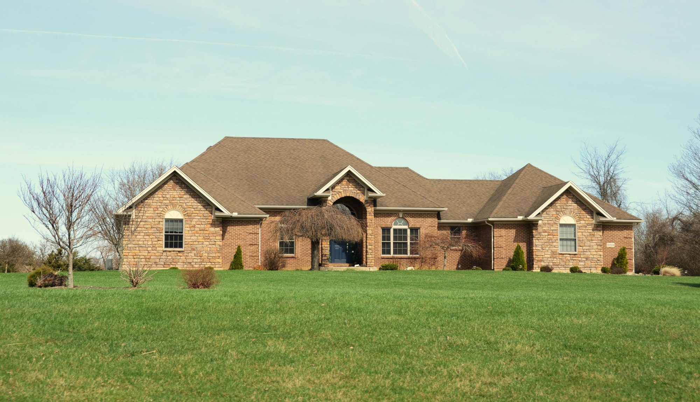 *(suggested replacement · [Unsplash photo](https://unsplash.com/photos/a-large-brick-house-with-a-manicured-lawn-IUyOE1E3Z9U) · free Unsplash License)*

### 2. Quote options (top CTA)
- **Primary:** [Call 1-800-917-7283](tel:18009177283) — "Our staff will give you a quick quote" (by phone; there is no online home quote tool)
- Note under the button: Toronto homes south of Eglinton need pre-approval.

### 3. Information

**Why quote with us**
 *(original 122×167 · [live](https://jdsmithinsurance.com/images/JD_pic3-b.gif))*  *(original 108×117 · [live](https://jdsmithinsurance.com/images/girl_csr_large.jpg))*
"I want to save you $$$ and find better coverage. There are 34 friendly brokers here to serve you."

**Please read the following carefully:**
- Great rates from our brokers.
- We give a rate comparison of many insurance companies.
- **Chieftain Insurance** has lower rates, but you must ask for a $1,000 **deductible**.

**For home quotes (eligibility):**
- You must have a good "loss" history of no more than 1 claim in 5 years.
- We cannot insure homes in Toronto that are south of Eglinton Ave. unless they are pre-approved by our insurance company.

**Tip box:** BE SURE TO ANSWER THE QUESTIONS HONESTLY AND CORRECTLY AND YOU WILL FIND THE QUOTE SYSTEM VERY ACCURATE.

**Protect your home: install a backflow prevention valve**
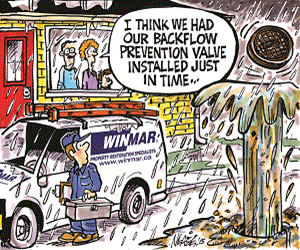 *(original 300×250 · [live](https://jdsmithinsurance.com/images/claims_backflow_valve.jpg))*
At JD Smith Insurance, we recommend everyone have a backflow prevention valve installed. Claims like this are never good. Effluent everywhere. Some policies will not even cover this damage, so check with your personal broker.

**Helpful reading**
- [What your burglar won't tell you](jds-burglars_advice.htm)
- [JDS – Intact blog](https://www.intact.ca/blog/en/home.html): water damage tips, COVID-19 tips on opening your business  *(original 267×125 · [live](https://jdsmithinsurance.com/images/intact_blog_01.jpg))*

### 4. Quote options (bottom CTA)
- **Primary:** [Call 1-800-917-7283](tel:18009177283) — "Our staff will give you a quick quote" (by phone; there is no online home quote tool)
- Note under the button: Toronto homes south of Eglinton need pre-approval.

Contact block (standard).

### 5. Related links
[Auto insurance](jds-quote_auto.htm) (ask about combined discounts) · [Boat insurance](http://www.boatinsurancecanada.ca) · [Claims: reporting your home claim](jds-claims.htm) · [12 ways to save](jds-12waystosave.htm)

---

## A3. Boat insurance (external)
Menu: Personal › Boat insurance → http://www.boatinsurancecanada.ca (opens in a new tab). **No page to build.**
Boat insurance Canada is part of the JDS Financial Group (see [Core values](jds-values.htm)).

- Card text (for the overview and the homepage): Quick boat insurance quotes for cruisers, yachts, sailboats and personal water craft.
- **CTA:** - **Primary:** [Get a boat quote](http://www.boatinsurancecanada.ca) — partner site (opens in a new tab)
- **Secondary:** [Call 1-800-917-7283](tel:18009177283)
- **Card photo (original):**  *(original 120×75 · [live](https://jdsmithinsurance.com/images/boatinsurance_1.jpg))*
- **Suggested replacement:** 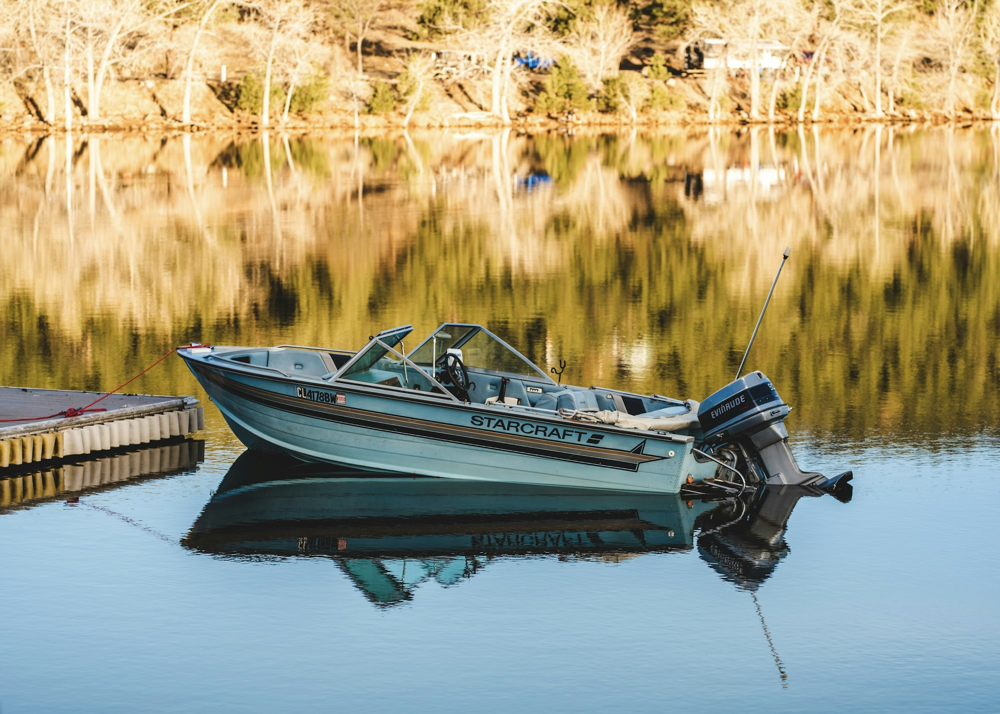 *(suggested replacement · [Unsplash photo](https://unsplash.com/photos/a-small-boat-sitting-on-top-of-a-lake-next-to-a-dock-cENgsQUQbCg) · free Unsplash License)*

---

## A4. UberX ride-sharing insurance
`uberx.htm` · Menu: Personal › UberX ride-sharing
**Live page:** [uberx.htm](https://jdsmithinsurance.com/uberx.htm) · **Current &lt;title&gt;:** "Untitled Document"
**Suggested &lt;title&gt;:** UberX & Ride-Sharing Insurance for Ontario Drivers | JD Smith Insurance

### 1. Hero
- **H1:** UberX ride-sharing insurance
- **Subheading:** Special coverage for Ontario drivers. Our policy TRANSFERS the risk from the part-time driver to the insurer, allowing drivers to carry paying passengers when under contract for a transportation network company.
- **Hero photos (original, a 4-part banner):**  *(original 1000×40 · [live](https://jdsmithinsurance.com/images_uber/ride_sharing_insurance_upper.jpg))*  *(original 280×200 · [live](https://jdsmithinsurance.com/images_uber/ride_sharing_insurance_left.jpg))*  *(original 590×200 · [live](https://jdsmithinsurance.com/images_uber/ride_sharing_insurance_right.jpg))*  *(original 1000×160 · [live](https://jdsmithinsurance.com/images_uber/ride_sharing_insurance_lower.jpg))*
- **Suggested replacement:**  *(suggested replacement · [Unsplash photo](https://unsplash.com/photos/man-in-black-jacket-driving-car-during-daytime-a8r2KKLSntA) · free Unsplash License)*
- **Hero links on the live page:** Sample rates (#rates) · News flash (#news) · [Sign up with Uber](https://get.uber.com/)

### 2. Quote options (top CTA)
- **Primary:** [Fill in the quote form](#uberx-quote-form) — the short form on this page (see "Quote form" below)
- **Secondary:** [Call 1-800-917-7283](tel:18009177283)

### 3. Information

**We can help**
WARNING — Your present policy does not give coverage for you or your Uber client.
Recent bodily injury and property damage claims in Ottawa were denied. This puts you and all your assets at a huge risk if someone sues you personally. We at J D Smith Insurance can help.

**Who is eligible?**
Most good Uber drivers will be eligible for coverage.
- You must be licensed for a minimum of six years in Canada or the USA.
- Your automobile can have a maximum of eight passengers.
- Operates for ride-sharing service for only up to 20 hours per week.
- No other commercial use of the vehicle is permitted.
- The automobile cannot be registered as a taxi, limousine or any other public transportation.

Coverage limits are available from 1 to 5 million for third-party coverage.

**Ontario only — sample ride-share rates** (estimated UberX endorsement cost)

| Geographic area | Car year/make/model/driver | 10 hours a week driving | 20 hours a week driving |
|---|---|---|---|
| Hamilton & London | 2012 Chev Malibu – best driving record | $583 approx. | $729 approx. |
| Toronto GTA Central | 2010 Toyota – best driving record | $692 approx. | $865 approx. |
| Toronto GTA Suburbs | 2012 Chrysler Van – best driving record | $536 approx. | $806 approx. |
| Northern Ontario | 2019 Ford Focus – best driving record | $372 approx. | $465 approx. |

This endorsement allows you to carry passengers. It will help protect you if you are sued in an accident with a ride-sharing driver. The rates may vary, and are based on:
- The value of your vehicle
- Your driving record
- The optional coverage you choose
- We must insure the vehicle and add this unique endorsement

OUR STAFF WILL ASSIST YOU with pricing and coverage. WE HAVE MONTHLY payment options.

**Quote form** — "For a QUICK quote, enter the information below and click the submit button."
Fields (in order): Your name · Address · City · Postal code · Email address · Cell phone number · Rate category of ride-sharing activity (Under 10 hours per week / Maximum of 20 hours per week) · Make of your vehicle · Model of your vehicle · Year of your vehicle · Number of traffic tickets in past 3 years · Number of accidents in past 3 years · Number of insurance claims in past 3 years · Number of years insured in Ontario · Number of vehicles in the household · Your present insurance company · Your Uber web site · Best time to call you · [Submit]
*(The live form posts over plain http://, see SITE_MAP notes. Send it over https when rebuilt.)*

**News flash regarding Uber** *(dated news story: consider moving it to News & humour or removing it)*
JD Smith Insurance has the solution for Uber drivers. The Toronto Taxi Alliance says Uber drivers must provide proof of insurance.

Would you take your Uber driver's word that they're properly insured? The Toronto Taxi Alliance (TTA) is arguing the ride-share company can't be relied on to use the honour system, and should be required to prove their insurance coverage to the city before being allowed to operate.

The TTA is arguing that a new committee proposal is too lax on Uber's insurance requirements which would require that drivers only provide proof of insurance to their ride-share employers while taxi drivers must provide proof to the city in order to have their plates renewed.

Whether the proposal from Toronto's Licencing and Standards Committee will be passed will be determined this week, as council begins today on whether Uber will be legalized to operate in the city. The proposal, which Uber argues is too stringent, would also require drivers to pay a non-refundable $20,000 licencing fee, as well as take out a $2-million personal liability policy and $5-million commercial policy.

However, the ride-share insurance market is fairly non-competitive in Canada. Aviva is the only existing provider of coverage, and only up to a maximum of 20 hours per week. The TTA argues drivers are failing to take out any additional coverage at all.

Uber has threatened to exit the city altogether should the proposal pass into a bylaw. Currently 20,000 UberX drivers operate in Toronto.

### 4. Quote options (bottom CTA)
- **Primary:** [Fill in the quote form](#uberx-quote-form) — the short form on this page (see "Quote form" below)
- **Secondary:** [Call 1-800-917-7283](tel:18009177283)

Contact block (standard).

### 5. Related links
[Auto insurance](jds-quote_auto.htm) · [Ontario auto reform 2026](jds-auto_reform.htm)

---

## A5. Ontario auto reform 2026 — What is changing
`jds-auto_reform.htm` · Menu: Personal › Ontario auto reform 2026 › What is changing · Also the site-wide notice banner target
**Live page:** [jds-auto_reform.htm](https://jdsmithinsurance.com/jds-auto_reform.htm) · **Current &lt;title&gt;:** "JD Smith Insurance Brokers Code of Consumer Rights"
**Suggested &lt;title&gt;:** Ontario Auto Insurance Changes, July 2026 | JD Smith Insurance *(all five auto reform pages currently use the Code of Consumer Rights title)*

### 1. Hero
- **H1:** Important auto reform now in place
- **Subheading:** All auto policies in Ontario have changed as of July 2026. At JD Smith Insurance, we want you to stay informed and make wise choices for your auto insurance coverage.
- **Hero photo (original):**  *(original 1000×400 · [live](https://jdsmithinsurance.com/images/disclaimer_front.jpg))* *(the disclaimer banner, which does not fit this page)*
- **Suggested replacement:**  *(suggested replacement · [Unsplash photo](https://unsplash.com/photos/person-with-white-watch-driving-car-inqfXtFueYQ) · free Unsplash License)*

### 2. CTA (top)
- **Primary:** [Talk to your broker](jds-staff.htm) — "If you have any questions, or wish to make changes, please talk to your broker."
- **Secondary:** [Call 1-800-917-7283](tel:18009177283) (price extra accident benefits)
- **Sub-navigation (4 cards):** [Fact sheet](jds-auto_reform_fact_sheet.htm) · [Q&A](jds-auto_reform_Q_A.htm) · [Self assessment](jds-auto_reform_self_asses.htm) · [Customer scenarios](jds-auto_reform_scenarios.htm)

### 3. Information (full text)
IMPORTANT AUTO REFORM NOW IN PLACE

At J D Smith Insurance.com, we want you to stay informed and make wise choices for your Auto Insurance Coverage.

**All Auto Policies In Ontario Have Changed as of July 2026.**

In an attempt to give consumers more choice and perhaps, to save a few dollars, the government has changed the Accident choices on all auto policies.

For claim examples and how Accident Insurance options work, review these links.

[Auto Reform Fact Sheet](jds-auto_reform_fact_sheet.htm)

[Auto Reform Q&A](jds-auto_reform_Q_A.htm)

[Auto Reform Self Assessment](jds-auto_reform_self_asses.htm)

[Auto Reform Customer Scenarios](jds-auto_reform_scenarios.htm)

Commercial or Business Use Vehicles

Your employer may have reduced Accident Benefit Coverage's for their drivers. Please check with your employer. You do not want to have an accident with the company truck or vehicle and find out he has reduced the coverage to protect you in a major accident. We would recommend your company continue with as much coverage to protect employees as possible.

Personal Vehicles

Prior to July 2026 you have had an option to choose coverage for you and your vehicle for Liability limits, your collision deductible,the loss of use option, and the replacement value option for new cars. But the Accident Benefits available in an accident, have been standard coverage's. Now you have a choice with the Accident Benefits and limits,that are available to you. We recommend you continue with all the good coverage's you currently have and perhaps consider increasing some of them.

If you had a serious accident and could not work, you would want to have the best coverage possible. We at JDS tell our clients, it is not worth removing coverage to save just a few dollars.

Please read though the below brief outline of the new Ontario Plan.

NOTE - If you have any questions, or wish to make changes, please talk to your Broker.

CHANGES TO ONTARIO AUTO INSURANCE

Ontario is updating its auto insurance rules to give you more control over your coverage. Starting July 1, 2026, some accident benefits that were once included in every auto policy will become optional, allowing you to choose the coverage that best suits your needs.

What are Statutory Accident Benefits (SABs)?

Statutory Accident Benefits (SABs) can provide financial support to help cover costs if you are injured in a car accident.
They can provide assistance for medical treatment, rehabilitation, and income replacement, regardless of who caused the accident.

What's Staying the Same?

Basic medical, rehabilitation, and attendant care benefits will remain included in all policies to help you recover after an accident.
You can still choose to purchase or increase benefits and coverages, such as supplementary medical, rehabilitation, caregiver support, and indexation benefits.

What's Becoming Optional?

The following auto insurance accident benefits will become optional:
- **Income replacement:** Helps replace income you or another covered person may lose because of an auto accident.

- **Non-earner:** If you or another covered person is a student or unemployed and an auto accident keeps you from leading a normal life, this benefit can provide financial support while you recover.

- **Caregiver benefits:** Helps cover caregiving expenses if you or another covered person is injured in an auto accident and can no longer provide care for a household member, such as a child or aging parent, who needs it.

- **Lost educational expenses:** If an auto accident keeps you or another covered person from attending school or an education program, this benefit can help cover the costs you have lost.

- **Expenses of visitors:** Helps cover reasonable and necessary expenses of visitors, such as a sibling or parents, if you or another covered person is injured in an auto accident.

- **Housekeeping and home maintenance:** Helps cover costs if you or another covered person is unable to perform the housekeeping and home maintenance tasks normally done before an auto accident.

- **Damage to personal items:** Helps cover the cost to repair or replace personal items (e.g., clothing, prescription eyewear, hearing aids, etc.) damaged in an auto accident.

- **Death benefits:** Compensates some family members if you or another covered person die due to an auto accident.

- **Funeral benefits:** Helps cover some funeral costs if you or another covered person die due to an auto accident.

Who is Affected by These Changes?

From July 1, 2026, the optional benefits will apply to:
- The insured person.

- Their spouse and dependents of the insured person.

- Drivers listed in the policy.

Some people, like pedestrians, cyclists, and certain passengers, who were previously covered may no longer be eligible for accident benefits.

What This Means for You?

**Existing Customers:** Your policy will renew with your current coverage unless you agree with your insurer in writing to decline the benefits or to make changes to them. However, who is covered under your policy for newly optional benefits will change on July 1, 2026, regardless of renewal effective date, as described in the list above. Review your coverage to determine whether adjustments are needed.
**New Customers:** If you're buying or renewing a policy after July 1, 2026, you will have the option to choose your desired benefits. Be sure to ask your insurer or broker about what's included in your quote.

**Commercial Customers:** Speak to your insurer or broker to learn more about how this change impacts you or your employees.

What Should You Do Now?

- Review your current coverage: Understand what benefits are already included.

- Check your workplace benefits: You may have similar coverage through your employer or private insurance.

- Assess your needs: Consider what coverage will best meet your needs.

- Speak with your insurer: Your insurer or broker can help you navigate these changes and decide what's right for you.

For claim examples and how Accident Insurance options work, review these links.

[Auto Reform Fact Sheet](jds-auto_reform_fact_sheet.htm)
[Auto Reform Q&A](jds-auto_reform_Q_A.htm)

[Auto Reform Self Assessment](jds-auto_reform_self_asses.htm)

[Auto Reform Customer Scenarios](jds-auto_reform_scenarios.htm)

### 4. CTA (bottom)
Same as the top CTA, plus [Start online auto quote](https://webrater.appliedsystems.com/WR/Default.aspx?GC=JDSMITH&LOB=AUTO&LANG=EN).

### A5.1 Sub-page: Auto reform fact sheet — `jds-auto_reform_fact_sheet.htm`
**Live page:** [jds-auto_reform_fact_sheet.htm](https://jdsmithinsurance.com/jds-auto_reform_fact_sheet.htm) · **Current &lt;title&gt;:** "JD Smith Insurance Brokers Code of Consumer Rights"
Hero: same as A5. H1: Fact sheet: 2026 accident benefits reforms. Subheading: What Ontario drivers need to know.
FACT SHEET
2026 Accident Benefits Reforms
What Ontario drivers need to know

What are Statutory Accident Benefits?

Statutory Accident Benefits (SABs) can provide financial support if you are injured in an auto accident. These benefits can be available regardless of who caused the accident and can cover things like medical treatment, rehabilitation and income if you can't work because of your injuries.

What's changing?

Starting July 1, 2026, Ontario drivers will have more choice and control over their coverage. While certain essential benefits will remain mandatory, many others will be optional and can be selected or removed when purchasing or renewing your policy.
If you're an existing customer, your policy will renew with the same coverage and limits, unless you agree with your insurer in writing to decline the benefits or make changes to them. However, who is covered under your policy for newly optional benefits will change on July 1, 2026, regardless of renewal effective date. Before making changes, check if your personal or work benefits already provide similar coverage.

Customers who are purchasing or renewing a policy on or after July 1, 2026, can choose which optional accident benefits they would like to purchase.

Essential accident benefits coverage remains.

Standard medical, rehabilitation and attendant care benefits will continue to be included in all auto insurance policies. These benefits are available regardless of who caused the accident. They cover medical expenses, therapy, and personal care assistance for injuries from an accident including doctor visits, physiotherapy, and help with daily activities like bathing and dressing.

Optional benefits you can now choose to add.

The following auto insurance accident benefits will become optional. You can choose to remove or add these to your policy, for yourself or other covered persons, depending on your needs.

Optional benefit | What it covers | Coverage limits

Income replacement | Helps replace income you or another covered person may lose because of an auto accident. | Insurers to populate with coverage limits

Non-earner | If you or another covered person is a student or unemployed and an auto accident keeps you from leading a normal life, this benefit can provide financial support while you recover. | Insurers to populate with coverage limits

Caregiver benefits | Helps cover caregiving expenses if you or another covered person is injured in an auto accident and can no longer provide care for a household member, such as a child or aging parent, who needs it. | Insurers to populate with coverage limits

Lost educational expenses | If an auto accident keeps you or another covered person from attending school or an education program, this benefit can help cover the costs you have lost. | Insurers to populate with coverage limits

Expenses of visitors | Helps cover reasonable and necessary expenses of visitors, such as a sibling or parents, if you or another covered person is injured in an auto accident. | Insurers to populate with coverage limits

Housekeeping and home maintenance | Helps cover costs if you or another covered person is unable to perform the housekeeping and home maintenance tasks normally done before an auto accident. | Insurers to populate with coverage limits

Damage to personal items | Helps cover the cost to repair or replace personal items (e.g., clothing, prescription eyewear, hearing aids, etc.) damaged in an auto accident. | Insurers to populate with coverage limits

Death benefits | Compensates some family members if you or another covered person die due to an auto accident. | Insurers to populate with coverage limits

Funeral benefits | Helps cover some funeral costs if you or another covered person die due to an auto accident. | Insurers to populate with coverage limits

Benefits that will remain optional.

You can still choose to add the following benefits to your policy:

Optional benefit | What it covers | Coverage limits

Supplementary medical, rehabilitation and attendant care benefits | Helps cover expenses for medical benefits beyond the standard limits. | Insurers to populate with coverage limits

Dependant care benefits | Helps cover reasonable and necessary additional expenses associated with caring for dependants such as a child, spouse, or aging parent. | Insurers to populate with coverage limits

Indexation benefits | Helps to ensure certain weekly benefit payments and monetary limits are adjusted annually to reflect changes in the cost of living. | Insurers to populate with coverage limits

Who is covered?

Although existing policies will renew with the same coverage and limits, who is covered under policies for newly optional accident benefits **will change on July 1, 2026, regardless of renewal effective date** .
Optional accident benefits under your auto policy will only cover the following individuals:

- The named insured.

- The spouse of the named insured.

- Dependants of the named insured and of the named insured's spouse.

- Persons specified in the policy as drivers of the automobile.

What steps should I take?

- What steps should I take? Review your current coverage to understand what benefits you have today in your auto insurance policy.

- Review coverage you may already have through your workplace, private benefits plan, or life and health insurance providers.

- Think about your needs. Consider which coverage is right for you.

- Speak to your insurer or broker to learn more about your options.

Make informed decisions; choose the benefits that best fit your needs and budget.

Need more information or assistance?

Call us at 1-800-917-SAVE (7283), or 905-764-7868.

Disclaimer

The descriptions of the statutory accident benefits in this document is a summary of the statutory accident benefits in Ontario Regulation 34/10 (the "SABS"). Do not rely on this summary alone. For full details, refer to the SABS or speak with your insurer or broker.

For other claim examples and how Accident Insurance options work, review these links.

[Auto Reform Q&A](jds-auto_reform_Q_A.htm)

[Auto Reform Self Assessment](jds-auto_reform_self_asses.htm)

[Auto Reform Customer Scenarios](jds-auto_reform_scenarios.htm)

### A5.2 Sub-page: Auto reform Q&A — `jds-auto_reform_Q_A.htm`
**Live page:** [jds-auto_reform_Q_A.htm](https://jdsmithinsurance.com/jds-auto_reform_Q_A.htm) · **Current &lt;title&gt;:** "JD Smith Insurance Brokers Code of Consumer Rights"
Hero: same as A5. H1: Auto reform Q&A. Subheading: Commonly asked questions about the SABS optionality changes. *(Build the 21 questions as an accordion.)*
AUTO REFORM Q&A
Commonly asked questions about SABS optionality changes

**1. What changes are coming to accident benefits on July 1, 2026?**

Starting July 1, 2026, Ontario is making changes to auto insurance to give drivers more choice and flexibility. Drivers will be able to choose benefits to fit their needs. Medical, rehabilitation and attendant care benefits will remain mandatory to ensure everyone has access to essential recovery support. All other accident benefit coverages, such as income replacement, will become optional. Who is covered for these optional benefits under your policy will also change.

2. Who is covered?

Starting July 1, 2026, newly optional benefits under your auto policy will only apply to:
- The named insured.

- The spouse of the named insured.

- Dependants of the named insured and of the named insured's spouse.

- Persons specified in the policy as drivers of the automobile.

3. Which accident benefits will be optional and what will remain mandatory?

Standard medical, rehabilitation and attendant care benefits will continue to be included in all auto insurance policies. These benefits are available regardless of who caused the accident. They cover medical expenses, therapy, and personal care assistance for injuries from an accident including doctor visits, physiotherapy, and help with daily activities like bathing and dressing.
To provide drivers with more choice and flexibility, all other accident benefits will be optional, including:

- **Income replacement:** Helps replace income you or another covered person may lose because of an auto accident.

- **Non-earner:** If you or another covered person is a student or unemployed and an auto accident keeps you from leading a normal life, this benefit can provide financial support while you recover.

- **Caregiver benefits:** Helps cover caregiving expenses if you or another covered person is injured in an auto accident and can no longer provide care for a household member, such as a child or aging parent, who needs it.

- **Lost educational expenses:** If an auto accident keeps you or another covered person from attending school or an education program, this benefit can help cover the costs you have lost.

- **Expenses of visitors:** Helps cover reasonable and necessary expenses of visitors, such as a sibling or parents, if you or another covered person is injured in an auto accident.

- **Housekeeping and home maintenance:** Helps cover costs if you or another covered person is unable to perform the housekeeping and home maintenance tasks normally done before an auto accident.

- **Damage to personal items:** Helps cover the cost to repair or replace personal items (e.g., clothing, prescription eyewear, hearing aids, etc.) damaged in an auto accident.

- **Death benefits:** Compensates some family members if you or another covered person die due to an auto accident.

- **Funeral benefits:** Helps cover some funeral costs if you or another covered person die due to an auto accident.

Supplementary medical, rehabilitation and attendant care benefits, dependant care benefits, and indexation will continue to be optional.

4. Who can purchase optional benefits under an auto insurance policy?

Every policyholder can add or remove optional accident benefits from their policy.

5. Why would someone choose to add or remove or decline optional benefits?

Some Ontarians already pay for benefits through their employer or private insurance plans. These reforms eliminate a one-size-fits-all approach, and consumers will no longer have to pay for benefits they may already have elsewhere or do not want to buy.
Starting July 1, 2026, you can tailor your auto insurance to fit your personal situation. That means you will not have to pay for optional benefits you do not need, and you can choose to add optional benefits that provide extra protection for you and your family.

6. How does removing optional benefits affect my insurance premiums?

Ontario's is making changes to auto insurance that puts consumers in the driver's seat – providing you with more choice and control over your coverage to fit your needs. If you choose to remove benefits that have now become optional from your existing coverage, it may impact your premium.

7. What steps should I follow to determine which optional benefits suit my needs and confirm if I have the appropriate coverage??

Before deciding to remove or add optional benefits, you should take the following steps:
- **Review your current coverage (if you are an existing customer).** Know what benefits you already have today through your auto insurance policy.

- **Review your workplace or private benefits plan.** You may already have coverage through your employer, private benefits plan, or life and health insurance providers.

- **Think about your needs.** Consider which coverage is right for you and whether opting out is practical.

- **Speak to your insurer or broker.** They can help explain your options in relation to your auto insurance coverage.

Make informed decisions; choose the benefits that best fit your needs.

8. Where can I find more information about optional insurance coverage?

To learn more about optional benefits, speak with your insurer or broker. You may also visit the IBAO website or view our fact sheet for more information.

9. What information do I need to know before speaking to my insurer or broker?

Before speaking with your insurer or broker, you should review your current auto insurance policy to better understand what coverage you currently have and think about your needs. Thoroughly review your personal or work benefits to see if they already provide similar coverage.
To help you get started, you can view our self-assessment checklist [here](jds-auto_reform_self_asses.htm) .

10. What if I have an existing policy? Will these changes affect me?

Yes, if you're a renewing customer, all accident benefits except medical, rehabilitation, and attendant care will become optional. Your policy will renew automatically with your current coverage and limits, unless you agree with your insurer in writing to decline certain benefits or make changes to them. You can review and update your coverage based on your needs. Before making changes, check if your personal or work benefits already provide similar coverage.
Although your current policy will renew with the same coverage and limits, who is covered for newly optional accident benefits under your policy **will change on July 1, 2026, regardless of renewal effective date** .

11. How will this impact me if I'm buying insurance for the first time or starting a new policy on or after July 1, 2026?

Customers who are purchasing or renewing a policy on or after July 1, 2026, can choose which optional accident benefits they would like to purchase. Ask your insurer or broker which benefits are included in your quote. You may want to add optional benefits to your policy based on your needs.

12. Can I change my optional benefits after I've selected them?

You may need to change your optional accident benefits if your situation changes, such as starting a new job, having children, or taking on caregiving responsibilities. You can change your optional benefits at any time, but only the coverage in place at the time of an auto accident will apply to your claim. To update your coverage, contact your insurer or broker to review your options and make sure your policy reflects your current needs.

13. Can I remove optional benefits from my policy if I no longer need them?

Yes, you can choose to remove or update your auto insurance coverage by agreeing with your insurer in writing to decline certain benefits or make changes to them. Before deciding to remove or add coverage, review your current policy to understand what you're covered for, think about your needs and thoroughly review if your personal or work benefits already provide similar coverage. Speak to your insurer or broker to explore your options and choose the benefits that best fit your needs.

14. Can I remove or add optional benefits if I start a new policy?

If you are shopping for a new policy on or after July 1, 2026, you may choose which optional accident benefits you'd like to purchase. Ask your insurer or broker which benefits are included in your quote. You may want to add optional benefits to your policy based on your needs.

15. How can I add optional benefits to my policy?

Speak to your insurer or broker to add the optional accident benefits to your auto insurance policy.

16. Will these changes affect all drivers / types of auto insurance policies?

Yes, the changes to accident benefits optionality will impact all drivers and auto insurance policies in Ontario, including personal private passenger, commercial, motorcycle, snowmobile, and all-terrain vehicle policies.

17. Do accident benefits, including the optional coverages I purchased, apply when renting a car?

You may be covered for certain accident benefits coverage when renting a car. Remember to review your auto insurance policy and the rental contract to understand what you're covered for.

18. Will passengers in my car still be covered if I opt-out of certain coverages?

As of July 1, 2026, optional accident benefits coverage will only apply to the named insured, their spouse, dependants of the named insured and of the named insured's spouse, and listed drivers. Passengers injured in an auto accident will not be covered for optional benefits unless they fall into one of these groups under an auto insurance policy that includes optional benefits. However, standard accident benefits will still apply to all passengers.

19. What happens to uninsured pedestrians and cyclists?

Standard accident benefits will still apply to uninsured pedestrians and cyclists. Optional accident benefits coverage will only apply to the named insured, their spouse, dependants of the named insured, the name insured's spouse, and listed drivers. Pedestrians and cyclists injured in an auto accident will not be covered for optional benefits unless they fall into one of these groups under an auto insurance policy that includes optional benefits.

20. What should I do if I have an ongoing claim when the changes take effect?

There is no impact to ongoing claims, the auto insurance coverage you had at the time of the accident applies to your claim.

21. If I have both auto insurance and a supplementary health insurance plan, which one do I claim from first if I'm injured in an auto accident?

If you are injured in an auto accident, you may have coverage through both your auto insurance and your supplementary health insurance plan. Starting July 1, 2026, Ontario is making changes to ensure that auto insurance will pay first for medical or rehabilitation benefits (except for medication costs) for any injury sustained in an auto accident. This means your auto insurance provider will cover these costs before your workplace or private health plan, helping you preserve those benefits for other life events.

Need more information or assistance?

Call us at 1-800-917-SAVE (7283), or 905-764-7868.

Disclaimer

The descriptions of the statutory accident benefits in this document is a summary of the statutory accident benefits in Ontario Regulation 34/10 (the "SABS"). Do not rely on this summary alone. For full details, refer to the SABS or speak with your insurer or broker.

For other claim examples and how Accident Insurance options work, review these links.

[Auto Reform Fact Sheet](jds-auto_reform_fact_sheet.htm)
[Auto Reform Self Assessment](jds-auto_reform_self_asses.htm)

[Auto Reform Customer Scenarios](jds-auto_reform_scenarios.htm)

### A5.3 Sub-page: Auto reform self assessment — `jds-auto_reform_self_asses.htm`
**Live page:** [jds-auto_reform_self_asses.htm](https://jdsmithinsurance.com/jds-auto_reform_self_asses.htm) · **Current &lt;title&gt;:** "JD Smith Insurance Brokers Code of Consumer Rights"
Hero: same as A5. H1: Auto reform self assessment. Subheading: For optional accident benefits. *(Build the questions as a checklist with tick boxes.)*
AUTO REFORM SELF ASSESSMENT
For optional accident benefits

Starting July 1, 2026, Ontario is changing auto insurance to give you more flexibility and control over your coverage. To learn more about the changes to optional accident benefits, what each benefit includes and who is covered can be found [here](jds-auto_reform_fact_sheet.htm) .

This checklist can help you decide which optional benefits may be right for you or others covered under your policy. You may be able to add or remove these benefits based on your needs.

How to use the self-assessment checklist:

- Read each set of questions carefully

- Tick the box if your answer is "yes" for you or others covered under your policy. Leave it blank if your answer is "no"

- If you check one or more boxes in a section, the benefit described may be worth considering

- Speak to your insurer or broker to review your coverage and learn more about your options

Before you begin:

If you have a private or workplace benefits plan, you may already have coverage for some of the following benefits. Before making changes to the optional benefits on your auto insurance policy, review your existing workplace or private plan or speak with your benefits advisor to confirm that you have appropriate coverage.

1. Income replacement benefit.

- Do you rely on your employment income to support yourself or others?

- If you were injured, would you not have access to disability benefits through your employer benefits or private disability insurance?

**What it covers:** Helps replace income you or another covered person may lose because of an auto accident.

2. Non-earner benefit.

- Are you a student, unemployed, or retired?

- Would an injury affect your ability to live independently or pursue education?

**What it covers:** If you or another covered person is a student or unemployed and an auto accident keeps you from leading a normal life, this benefit can provide financial support while you recover.

3. Caregiver benefit.

- Are you the primary caregiver for children, aging parents, or disabled family members?

- Are you a single parent?

**What it covers:** Helps cover caregiving expenses if you or another covered person is injured in an auto accident and can no longer provide care for a household member such as a child or aging parent, who needs it.

4. Lost educational expenses.

- Are you a full- or part-time student?

**What it covers:** If an auto accident keeps you or another covered person from attending school or an education program, this benefit can help cover the costs you have lost.

5. Expenses of visitors benefit.

- Do your family members live far away?

- Would your family need to visit you if you were seriously injured?

**What it covers:** Helps cover reasonable and necessary expenses of visitors, such as a sibling or parents, if you or another covered person is injured in an auto accident.

6. Housekeeping and home maintenance benefit.

- Would you need to hire someone to take over housekeeping duties if you were injured?

**What it covers:** Helps cover costs if you or another covered person is unable to perform the housekeeping and home maintenance tasks normally done before an auto accident.

7. Damage to personal items benefit.

- Do you regularly carry valuable items such as glasses, hearing aids, or mobility devices?

- Would replacing these items be costly if damaged in an accident?

**What it covers:** Helps cover the cost to repair or replace personal items (e.g., clothing, prescription eyewear, hearing aids, etc.) damaged in an auto accident.

8. Death benefit.

- Would your family need financial support to cover ongoing expenses if you passed away in an auto accident?

- Do you lack life insurance or other coverage for funeral expenses?

**What it covers:** Compensates some family members if you or another covered person die due to an auto accident.

9. Funeral benefit.

- Would your family struggle to cover funeral or burial expenses?

**What it covers:** Helps cover some funeral costs if you or another covered person die due to an auto accident.

10. Supplementary medical, rehabilitation and attendant care benefits.

- Do you think the standard coverage for medical, rehabilitation or attendant care may not be enough to meet your needs?

- Do you have a high-risk lifestyle, underlying health conditions, or limited access to care through other plans?

**What it covers:** Helps cover expenses for medical benefits beyond the standard limits.

11. Dependant care benefit.

- Do you have children or dependants who rely on you for daily care?

- Would an injury prevent you from working and caring for your dependants at the same time?

**What it covers:** Helps cover reasonable and necessary additional expenses associated with caring for dependants such as a child, spouse, or aging parent.

12. Indexation benefit.

- Are you concerned about the cost of living reducing the value of your benefits over time?

**What it covers:** Helps to ensure that certain weekly payments and monetary limits are adjusted annually to reflect changes in the cost of living.

Need more information or assistance?

Call us at 1-800-917-SAVE (7283), or 905-764-7868.

Disclaimer

The descriptions of the statutory accident benefits in this document is a summary of the statutory accident benefits in Ontario Regulation 34/10 (the "SABS"). Do not rely on this summary alone. For full details, refer to the SABS or speak with your insurer or broker.

For other claim examples and how Accident Insurance options work, review these links.

[Auto Reform Fact Sheet](jds-auto_reform_fact_sheet.htm)
[Auto Reform Q&A](jds-auto_reform_Q_A.htm)

[Auto Reform Customer Scenarios](jds-auto_reform_scenarios.htm)

### A5.4 Sub-page: Auto reform customer scenarios — `jds-auto_reform_scenarios.htm`
**Live page:** [jds-auto_reform_scenarios.htm](https://jdsmithinsurance.com/jds-auto_reform_scenarios.htm) · **Current &lt;title&gt;:** "JD Smith Insurance Brokers Code of Consumer Rights"
Hero: same as A5. H1: SABS customer scenarios. Subheading: Nine examples of how auto insurance can be tailored.
AUTO REFORM STATUTORY ACCIDENT BENEFITS
SABS Customer Scenarios

Starting July 1, 2026, Ontario is changing auto insurance to give you more options and control over your coverage. This means you can choose insurance that best meets your needs. To learn more about the optional benefits and what they cover, view our fact sheet [here](jds-auto_reform_fact_sheet.htm) .
Here are nine examples of life situations that show how auto insurance can be tailored to better protect individuals and families. **These examples are for illustrative purposes only and are not intended to reflect everyone's unique situation. Before making changes to your policy, think about your needs and circumstances, review your current coverage and speak to your insurer or broker** . It's also important to review your private or workplace benefits plans as you may already be covered elsewhere.

1. Alice: The Single Parent.

Alice manages a busy schedule. They work as a contractor while caring for two young children and juggling all household responsibilities on their own. They rely on their car daily for work, school pick-ups and drop-offs, extracurricular activities for their kids, errands, and more. Without employer benefits or much savings, even a short recovery from an injury could make daily life difficult.
An auto accident could make it hard to maintain income, childcare, and household routines, especially without any family nearby to support them. Optional benefits may help them maintain stability while they recover.

Optional benefits to consider:

- Income replacement: to help replace income they may lose because of an auto accident.

- Caregiver: to help cover caregiving expenses if they can no longer provide care for a household member such as their children.

- Expenses of visitors: to help cover reasonable and necessary expenses of visitors, such as a sibling or parents, if a covered person is injured in an auto accident.

- Housekeeping and home maintenance: to help cover costs if they are unable to perform the housekeeping and home maintenance tasks normally done before an auto accident.

- Death: to compensate some family members if a covered person dies due to an auto accident.

- Funeral: to help cover some funeral costs.

- Dependant care: to help cover reasonable and necessary expenses for caring for dependants.

- Indexation: to make sure that certain weekly payments and benefit limits increase annually to reflect the rising cost of living.

2. Bob: The Self-Employed Consultant.

Bob operates an independent IT consulting business from home. Their mornings usually start with a coffee and long drives to client sites across the province – part of running a business they've built from scratch. With their spouse working part-time, their household relies primarily on their income to cover the mortgage and household expenses. Since they are self-employed, they don't have access to a private employer plan and have not purchased additional disability or life insurance.
If they were injured in an auto accident, working could become impossible, and their household would face financial challenges. Personal items, such as their hearing aid, could also be damaged in the accident and require replacement. They may want to consider adding optional benefits to provide extra support for themselves and their family after an accident.

Optional benefits to consider:

- Income replacement: to help replace income they may lose because of an auto accident.

- Housekeeping and home maintenance: to help cover costs if they are unable to perform the housekeeping and home maintenance tasks normally done before an auto accident.

- Damage to personal items: to help cover the cost to repair or replace personal items (e.g., clothing, prescription eyewear, hearing aids, etc.) that were damaged in an auto accident.

- Death: to compensate some family members if a covered person dies due to an auto accident.

- Funeral: to help cover some funeral costs.

- Indexation: to make sure that certain weekly payments and benefit limits increase annually to reflect the rising cost of living.

3. Charlie: The Retired Surviving Spouse.

Charlie is happily retired after a long career as a project manager. They live a very active lifestyle, managing all the upkeep for their apartment and driving themselves to medical appointments, errands, and social activities. A pension is their only source of income. It provides stability for basic needs but leaves little room for unexpected costs such as paid household support and unplanned medical expenses.
They may need support with daily chores and home maintenance if they were injured in an auto accident. They may also need support from their children who live out of town. Considering optional coverages may give them peace of mind.

Optional benefits to consider:

- Non-earner: to help provide financial support while they recover.

- Expenses of visitors: to help cover reasonable and necessary expenses of visitors, such as children or siblings, if a covered person is injured in an auto accident.

- Housekeeping and home maintenance: to help cover costs if they are unable to perform the housekeeping and home maintenance tasks normally done before an auto accident.

- Damage to personal items: to help cover the cost to repair or replace personal items (e.g., clothing, prescription eyewear, hearing aids, etc.) that were damaged in an auto accident.

- Death: to compensate some family members if a covered person dies due to an auto accident.

- Funeral: to help cover some funeral costs.

- Supplementary medical, rehabilitation and attendant care benefits: to help cover expenses for medical benefits beyond the standard limits.

4. Dave & Eve: The Young Family.

With two toddlers, Dave & Eve manage a busy schedule and a tight household budget. Dave works in construction and drives long distances each day for work. Eve works part-time as a retail associate and provides primary care for their two young children and manages most of the housekeeping for the townhouse they're renting. They live paycheck to paycheck and do not have disability or life insurance.
If either were injured in an auto accident, the family could face significant financial hardship and challenges with caregiving responsibilities. They may want to consider adding optional benefits to their policy to better protect them and their family.

Optional benefits to consider:

- Income replacement: to help replace income they may lose because of an auto accident .

- Caregiver: to help cover caregiving expenses if they can no longer provide care for a household member such as their children .

- Housekeeping and home maintenance: to help cover costs if they are unable to perform the housekeeping and home maintenance tasks normally done before an auto accident.

- Death: to compensate some family members if a covered person dies due to an auto accident.

- Funeral: to help cover some funeral costs.

- Dependant care: to help cover reasonable and necessary expenses for caring for dependants.

- Indexation: to make sure that certain weekly payments and monetary limits are adjusted annually to reflect changes in the cost of living.

5. Fred: The Tradesperson.

Fred is an electrician by trade and serves as the primary earner for his family. They drive to job sites across the region. The work is physically demanding, and even a moderate injury sustained outside of work could prevent their continued employment. Their spouse is currently unemployed, so the family depends on Customer F's income to pay their bills, mortgage and household necessities. They have two very active teenagers who both live at home. Both children are listed on their automobile policy as drivers. Their eldest child just turned 19 and is enrolled in college. If they were injured in an auto accident, they may be unable to continue the college program.
Adding optional benefits to their coverage may help provide extra support for everyone covered under their policy.

Optional benefits to consider:

- Income replacement: to help replace income they may lose because of an auto accident.

- Lost educational expenses: to help cover costs they lose if an auto accident prevents them from attending school or an education program.

- Death: to compensate some family members if a covered person dies due to an auto accident.

- Funeral: to help cover some funeral costs.

- Dependant care: to help cover reasonable and necessary expenses for caring for dependants.

- Indexation: to make sure that certain weekly payments and monetary limits are adjusted annually to reflect changes in the cost of living.

6. Gina: The University Student.

At 21, Gina is in their final year of university and working part-time at a café. They rent an apartment close to campus with three roommates. They rely on their car to get to school, work, and activities.
If they were injured in an auto accident, they may be unable to continue their studies or maintain their part-time job. Their parents live in another city and would need to travel to provide care and support.

Optional benefits to consider:

- Income replacement: to help replace income they may lose because of an auto accident.

- Non-earner: to help provide financial support while they recover.

- Lost educational expenses: to help cover costs they lose if an auto accident prevents them from attending school or an education program.

- Expenses of visitors: to help cover reasonable and necessary expenses of visitors, such as a sibling or parents, if a covered person is injured in an auto accident.

- Death: to compensate some family members if a covered person dies due to an auto accident.

- Funeral: to help cover some funeral costs.

7. Henrietta: The Newcomer to Canada.

Henrietta recently immigrated to Canada with their partner and young child and are getting settled in their community. They just started a new job as an administrative assistant and do not yet qualify for workplace disability benefits. Their partner is working irregular hours while looking for more stable employment. They have limited savings and rely on their car for work and childcare needs.
If an auto accident caused an injury, their household could face financial difficulty covering lost income, childcare, and household responsibilities. For extra support, they may consider adding optional benefits to protect everyone covered under their policy.

Optional benefits to consider:

- Income replacement: to help replace income they may lose because of an auto accident.

- Caregiver: to help cover caregiving expenses if they can no longer provide care for a household member such as their children.

- Housekeeping and home maintenance: to help cover costs if they are unable to perform the housekeeping and home maintenance tasks normally done before an auto accident.

- Expenses of visitors: to help cover reasonable and necessary expenses of visitors, such as a sibling or parents, if a covered person is injured in an auto accident.

- Death: to compensate some family members if a covered person dies due to an auto accident.

- Funeral: to help cover some funeral costs.

- Dependant care: to help cover reasonable and necessary expenses for caring for dependants.

8. Isaac: The Delivery Driver.

Isaac spends most of their days on the road working full time for a local courier company. When not working, they enjoy relaxing at their apartment or spending time with their parents who live close by. While on the job, they use a company-owned vehicle to make deliveries that is insured under a commercial policy. Their income depends entirely on the ability to drive, so an injury from an auto accident in the course of work could stop earnings and create financial difficulty with rent and living expenses. The courier company provides only the mandatory auto insurance benefits as employers are not required to purchase optional benefits for their commercial policies. From the driver's perspective, adding optional benefits to their own personal policy could provide extra peace of mind by ensuring income support if an accident occurs.

Optional benefits to consider:

- Income replacement: to help replace income they may lose because of an auto accident.

- Death: to compensate some family members if a covered person dies due to an auto accident.

- Funeral: to help cover some funeral costs.

- Indexation: to make sure that certain weekly payments and monetary limits are adjusted annually to reflect changes in the cost of living.

9. Justine: The Office Worker.

Justine works full time for a large company and lives in the suburbs with their spouse and three children. Their employer provides extended health and disability benefits, which already offer some income, caregiving, dependant care, and housekeeping protection. Before adding optional benefits to their auto insurance policy, it's important to review what's already included in their workplace plan to avoid overlap and ensure they have the right level of protection.

Optional benefits to consider:

- Income replacement: to help replace income they may lose because of an auto accident.

- Death: to compensate some family members if a covered person dies due to an auto accident.

- Funeral: to help cover some funeral costs.

Need more information or assistance?

Call us at 1-800-917-SAVE (7283), or 905-764-7868.

Disclaimer

The descriptions of the statutory accident benefits in this document is a summary of the statutory accident benefits in Ontario Regulation 34/10 (the "SABS"). Do not rely on this summary alone. For full details, refer to the SABS or speak with your insurer or broker.

For other claim examples and how Accident Insurance options work, review these links.

[Auto Reform Fact Sheet](jds-auto_reform_fact_sheet.htm)
[Auto Reform Q&A](jds-auto_reform_Q_A.htm)

[Auto Reform Self Assessment](jds-auto_reform_self_asses.htm)

---

## A6. Accident benefits explained
`jds-client_auto_insurance_changes_2016.htm` · Menu: Personal › Ontario auto reform 2026 › Accident benefits explained
**Live page:** [jds-client_auto_insurance_changes_2016.htm](https://jdsmithinsurance.com/jds-client_auto_insurance_changes_2016.htm) · **Current &lt;title&gt;:** "J.D. Smith Insurance Brokers Client Newsletter" · **Meta description:** "Insurance news and information from J.D. Smith Insurance Brokers."
**Content warning:** this page was written for the 2016 changes. Some figures ($65,000 non-catastrophic, $1,000,000 catastrophic; winter tire discount dates) are out of date next to the July 2026 reform. Ask the office to review it (STAKEHOLDER_NOTES).

### 1. Hero
- **H1:** Accident benefits explained
- **Subheading:** Accident benefits were reduced a few years ago, and changes to give more options take effect in 2026. Read the previous changes carefully below.
- **Hero photo (original):**  *(original 1000×200 · [live](https://jdsmithinsurance.com/images/newsletter_front_2.jpg))*
- **Suggested replacement:**  *(suggested replacement · [Unsplash photo](https://unsplash.com/photos/a-man-getting-his-leg-examined-by-a-doctor-pbUWW-CBoqY) · free Unsplash License)*

### 2. Quote options (top CTA)
"If you wish to get a quote on coverage, call or email our office and we will get you the additional costs for the coverage you are interested in."

- **Primary:** [Call 1-800-917-7283](tel:18009177283) — price optional accident benefits coverage on your auto policy
- **Secondary:** [Contact your broker](jds-staff.htm) · [Start online auto quote](https://webrater.appliedsystems.com/WR/Default.aspx?GC=JDSMITH&LOB=AUTO&LANG=EN)

### 3. Information (full text)
ACCIDENT BENEFITS WERE REDUCED A FEW YEARS AGO & CHANGES TO GIVE MORE OPTIONS WILL BE MADE IN 2026
READ CAREFULLY THE CHANGES PREVIOUS BELOW. THE NEW CHANGES WILL FOLLOW LATER THIS YEAR

If you wish to get a quote on coverage call or email our office and we will get you the additional costs for the coverage you are interested in.

- [Ontario Auto Insurance is Changing](#1)
- [Customize Your Auto Insurance](#2)

**Ontario Auto Insurance Changes and Options are coming. Be sure to talk to your broker about options available to you.**

The provincial government, a few years ago, passed the Fighting Fraud and Reducing Automobile Insurance Rates Act to fight fraud and abuse within the system. The new measures were put in place not only to combat fraud, but to provide greater choice for consumers. The new changes in 2026 will come soon.

In a nutshell, new regulations include lower accident benefit limits in standard insurance policies, new options to increase coverage, new procedures for payment and a mandatory Winter Tire Discount (up to 5%) offered by insurance companies across Ontario.

Auto reform changes come into effect this year: the winter tire discount is effective as of January 1st while most changes come into effect June 1st.

Why does any of this matter?

Car insurance can sometimes come with negative connotation – monthly expenses could be used elsewhere (for that vacation you need, for example). It's perhaps only at renewal when you might think about the greater issues at play: insurance as a safety net, protecting against risk; insurance as a critical factor in individual and collective welfare. If you, a friend or loved one is involved in an accident, it's at that point your outlook changes to one of appreciation. What would have happened if a policy hadn't't been in place?

The opportunity with this new set of measures is to step back and reflect on what you really need. Does your employer provide a Group Insurance Plan? Look into what your policy covers… most benefit packages are limited to $500/year per practitioner, which can be exhausted quickly even in cases of minor accidents. If you have children or elderly parents that depend on you, who would care for them if you were injured? If you had to hire someone to carry out household responsibilities, how would you subsidize the expense?

Standard policies are just that – standard. They don't include benefits like dependant care, which reimburses additional expenses to care for your dependants. While auto insurance products are becoming more affordable for consumers, gaps might exist depending on your lifestyle. The good news is there's opportunity to fill those gaps by increasing coverage or adding options to cover specific areas of your life. Purchasing appropriate coverage is an investment in your family, your children, your parents… ultimately it's an investment in your lifestyle. What could be more important?

[Return to top](#start)

**Customize Your Auto Insurance**

Due to recent changes to auto insurance in Ontario, it's the right time to reassess the policy you haven't thought about in years. Your insurance company will be sending you an update in the mail, and we're here to follow up with a conversation about your needs.

Consumers should consider more than what's offered in a standard insurance policy. There are favourable options depending on your lifestyle. Consider updating your policy if:

- You're a primary caregiver of young children, elderly parents or disabled family members
- You earn more than $30,000 a year
- You're a snowbird
- You're responsible for housekeeping or home maintenance
- You have a pre-existing injury that requires regular treatments like physiotherapy or massage
- Your auto insurance policy is your only form of coverage (i.e. you don't have a group plan through an employer or spouse)

If you suffer catastrophic injury from a car accident (loss of limb, para/quadriplegic), standard Accident Benefits provide $1,000,000 for medical, rehabilitation and attendant care expenses. If your injury is less severe (broken bones, strains), available coverage is $65,000. These standard benefits were reduced by the Ontario government to help stabilize rates and provide more choice to consumers, but it's likely people will feel the impact of these reductions. In today's society, what's the value of a million dollars when the average price of detached homes in Toronto has risen 16 percent to $1.2 million? How far does a million dollars go, spread over a lifetime?

The good news is there are options. To become more financially prepared you can increase, extend and purchase additional Accident Benefit Coverage from your insurance broker depending on what you need – whether that's increasing coverage, extending it to cover minor injuries or adding benefits to cover unexpected cost. If you earn more than $30,000 a year, you can increase your income replacement coverage to $600, $800 or $1,000 (depending on your income).

While it's convenient to obtain a quick quote online, that quote won't provide the complete picture you need. Talk to your insurance broker about what's changed in your life this past year. How has your family's life changed? Instead of focusing on price, start with what your needs are, then weigh them from a price perspective together with other expenses to decide what's most important.

Know your options! And talk to your insurance broker about customizing your auto insurance. It could be the best decision you've ever made.

[Return to top](#start)

**J D Smith Insurance**

905-764-7868

1-800-917-SAVE(7283)

**Committed to Peace of Mind Insurance**

[Return to top](#start)

### 4. Quote options (bottom CTA)
- **Primary:** [Call 1-800-917-7283](tel:18009177283) — price optional accident benefits coverage on your auto policy
- **Secondary:** [Contact your broker](jds-staff.htm) · [Start online auto quote](https://webrater.appliedsystems.com/WR/Default.aspx?GC=JDSMITH&LOB=AUTO&LANG=EN)

Contact block (standard). Tagline: Committed to Peace of Mind Insurance.

---

# B. SMALL BUSINESS

Shared elements for B1–B7 (from the live pages):
- Eyebrow above each H1: "Small business online quotes 24/7" (the live pages show a small-business logo, `images/logo_small_business_01.jpg`, 150×100. It is an image of text, so use a text label instead).
- Promise line under each H1: "Quote & bind online in minutes, with documents sent to your inbox immediately."
- Abbreviations used on these pages: **E&O** = errors & omissions (professional liability) · **CGL** = commercial general liability · **COED** = contents of every description · **NOA** = non-owned auto · **D&O** = directors & officers.
- The live pages repeat "Get An Online Quote" up to 4 times. The new pages use the top and bottom CTA only.

---

## B0. Business quotes online 24/7 — overview
`small_business_online.htm` · Menu: Small Business › Business quotes online 24/7 · Also linked from Commercial (C0)
**Live page:** [small_business_online.htm](https://jdsmithinsurance.com/small_business_online.htm) · **Current &lt;title&gt;:** "Small Business Insurance Online 24/7" · **Meta description:** "J.D. Smith Insurance Brokers provides complete insurance coverages for churches and not-for-profit organizations."
**Suggested meta:** Over 450 small business insurance quotes online. Quote and buy in minutes, 24/7, with documents sent to your inbox. Independent Ontario brokers. *(the current meta is copied from the church page)*

### 1. Hero
- **H1:** Small business online quotes 24/7
- **Subheading:** Over 450 small business insurance quotes online. Quote & bind online in minutes, with documents sent to your inbox immediately.
- **Hero photo (original):**  *(original 1000×400 · [live](https://jdsmithinsurance.com/images/small_business_01.jpg))*
- **Suggested replacement:**  *(suggested replacement · [Unsplash photo](https://unsplash.com/photos/two-cafe-owners-proudly-stand-together-dU3KJqyYlO0) · free Unsplash License)*

### 2. Quote options (top CTA)
- **Primary:** [Start online business quote](https://jdsmithinsurance.securequotebot.com/) — quote & buy online 24/7, over 450 small business types; instant quote, pick how to pay, a broker then confirms your coverage
- **Direct links:** see the table below.

### 3. How it works (4 steps)
1. Describe your business
2. Enter coverage details
3. Instant quote
4. Choose payment method

Our office will review and confirm the coverages with you. Once the underwriters have confirmed your information, the coverage will be put in force and policy details and coverage wordings will be available online to you 24/7. You will receive a phone call and a follow-up welcome package from J D Smith Insurance.

### 4. Products (cards, in header order)
| Card | Coverage line | Highlight | Learn more | Quote |
|---|---|---|---|---|
| Barber & hairstylists package | E&O, CGL, COED | Starting premium $200 | [Learn more](small_business_barber_hairstylist.htm) | [Quote online](https://jdsmithinsurance.securequotebot.com/health-fitness-liability-individuals?operation=Hair%20Stylist) |
| Builder's risk | Property, soft costs, liability | Semi and unprotected risks are eligible | [Learn more](small_business_builders_risk.htm) | [Quote online](https://jdsmithinsurance.securequotebot.com/equipment-breakdown-construction) |
| Health & fitness services | E&O, CGL, COED | Starting premium $275 (individual), $750 (business) | [Learn more](small_business_health_fitness.htm) | [Quote online](https://jdsmithinsurance.securequotebot.com/health-fitness-liability-premises) |
| Non-profit liability | E&O, CGL, COED | Defence costs covered outside the limit | [Learn more](small_business_non_profit.htm) | [Quote online](https://jdsmithinsurance.securequotebot.com/nonprofit-liability) |
| Photography services | E&O, CGL, COED | Mobile equipment coverage available up to $20,000 | [Learn more](small_business_photography.htm) | [Quote online](https://jdsmithinsurance.securequotebot.com/professional-liability?operation=Photographer) |
| Professional liability | E&O, CGL, COED | Over 100 eligible classes | [Learn more](small_business_professional_liability.htm) | [Quote online](https://jdsmithinsurance.securequotebot.com/professional-liability) |
| Special events liability | Liability, NOA | Starting premium $100 | [Learn more](small_business_special_events.htm) | [Quote online](https://jdsmithinsurance.securequotebot.com/special-event) |

Card photos: use the hero photos of B1–B7 (original or suggested).

"Business not listed? [Start online business quote](https://jdsmithinsurance.securequotebot.com/) to choose from over 450 types, or see [Commercial insurance](jds-corporate.htm)."

### 5. Quote options (bottom CTA)
- **Primary:** [Start online business quote](https://jdsmithinsurance.securequotebot.com/) — quote & buy online 24/7, over 450 small business types; instant quote, pick how to pay, a broker then confirms your coverage
- **Direct links:** see the table below.

| Category | Business type | Note | Button(s) |
|---|---|---|---|
| Personal care & fitness | Barbers & hairstylists | From $200. | [Quote online](https://jdsmithinsurance.securequotebot.com/health-fitness-liability-individuals?operation=Hair%20Stylist) |
| Personal care & fitness | Health & fitness | From $275 for individuals, $750 for businesses. | [Quote online](https://jdsmithinsurance.securequotebot.com/health-fitness-liability-premises) |
| Professional & creative services | Professional liability | Over 100 eligible professions. | [Quote online](https://jdsmithinsurance.securequotebot.com/professional-liability) |
| Professional & creative services | Photography services | Covers mobile equipment up to $20,000. | [Quote online](https://jdsmithinsurance.securequotebot.com/professional-liability?operation=Photographer) |
| Construction | Builder's risk | Call afterwards to review your coverage. | [Quote online](https://jdsmithinsurance.securequotebot.com/equipment-breakdown-construction) · [PDF application (PDF)](Applications/builders_risk.pdf) |
| Events & community | Special events | From $100. | [Quote online](https://jdsmithinsurance.securequotebot.com/special-event) |
| Events & community | Non-profit liability | | [Quote online](https://jdsmithinsurance.securequotebot.com/nonprofit-liability) |

Contact block (standard).

---

## B1. Barbers & hairstylists package
`small_business_barber_hairstylist.htm` · Menu: Small Business › Barbers & hairstylists
**Live page:** [small_business_barber_hairstylist.htm](https://jdsmithinsurance.com/small_business_barber_hairstylist.htm) · **Current &lt;title&gt;:** "Small Business Barder & Hairstylist Insurance" · **Meta description:** "J.D. Smith Insurance Brokers provides complete insurance coverages for churches and not-for-profit organizations."
**Suggested &lt;title&gt;:** Barber & Hairstylist Insurance, Quote Online 24/7 | JD Smith Insurance *(the current title has a typo, "Barder")*

### 1. Hero
- **H1:** Barber & hairstylists package
- **Subheading:** The J D Smith Insurance barber & hairstylists package is inexpensive and provides broad coverage.
- **Hero photo (original):**  *(original 1000×400 · [live](https://jdsmithinsurance.com/images/barber_hairstylist_01.jpg))* *(the live alt text says "Health & Fitness Insurance": fix it)*
- **Suggested replacement:**  *(suggested replacement · [Unsplash photo](https://unsplash.com/photos/barbers-cutting-hair-in-a-modern-salon-BX8OTlmHOaI) · free Unsplash License)*

### 2. Quote options (top CTA)
- **Primary:** [Get an online quote](https://jdsmithinsurance.securequotebot.com/health-fitness-liability-individuals?operation=Hair%20Stylist) — quote & bind online in minutes, documents sent to your inbox immediately (from $200)
- **Secondary:** [Call 1-800-917-7283](tel:18009177283)

### 3. Information
Since COVID-19, it is important to manage your shop according to the provincial guidelines. The good news is our package should SAVE you important bottom-line dollars.

The JDS package has very competitive rates for CGL, E&O and COED (contents of every description) packages designed for just barbers or hairstylists in Canada. You may be a person that just rents a chair, or work from home but don't have your own fixed premises with leasehold improvements and employees. That's OK. Our package will work for you as well as a store with 20 employees.

**Testimonial**
> "Mr. Smith, that was easy. My policy renewal for my shop increased 18% with COVID and my broker said nothing he could do. I have been in business 14 years and never a claim. I went online here on Smith Insurance and saved 15% from last year. Great. I paid with Visa. Very easy. I will have you quote my car insurance next. Thanks." — Julio, Toronto

**Overview: coverage types**
- Professional liability
- General liability
- Contents & assets (incl. flake)
- Legal phone line
- Privacy and security breach

**Coverage**
| Coverage | Available limits | Premium |
|---|---|---|
| Errors & omissions | $2,000,000 · $5,000,000 | Starting from $275 *(the overview and quote page say "from $200": see STAKEHOLDER_NOTES 3.2)* |
| Commercial general liability | $2,000,000 · $5,000,000 | |
| Contents (COED), optional | $25,000 · $50,000 · $100,000 · $150,000 | Starting from $100 |
| Privacy breach expense, included | $25,000 | Included with your E&O policy |

### 4. Quote options (bottom CTA)
- **Primary:** [Get an online quote](https://jdsmithinsurance.securequotebot.com/health-fitness-liability-individuals?operation=Hair%20Stylist) — quote & bind online in minutes, documents sent to your inbox immediately (from $200)
- **Secondary:** [Call 1-800-917-7283](tel:18009177283)

Contact block (standard).

### 5. Related links
[Health & fitness](small_business_health_fitness.htm) · [All small business quotes](small_business_online.htm) · [Auto insurance](jds-quote_auto.htm)

---

## B2. Builder's risk
`small_business_builders_risk.htm` · Menu: Small Business › Builder's risk
**Live page:** [small_business_builders_risk.htm](https://jdsmithinsurance.com/small_business_builders_risk.htm) · **Current &lt;title&gt;:** "Small Business Builder's Risk Insurance" · **Meta description:** "J.D. Smith Insurance Brokers provides complete insurance coverages for churches and not-for-profit organizations."

### 1. Hero
- **H1:** Builder's risk insurance
- **Subheading:** Call us to review your quote and arrange coverage. Project-specific property coverage and premises liability for new construction and renovations.
- **Hero photo (original):**  *(original 1000×400 · [live](https://jdsmithinsurance.com/images/builder_risk_01.jpg))* *(live alt: "Health & Fitness Insurance")*
- **Suggested replacement:**  *(suggested replacement · [Unsplash photo](https://unsplash.com/photos/construction-worker-in-hard-hat-on-building-frame-X1P1_EDNnok) · free Unsplash License)*

### 2. Quote options (top CTA)
- **Primary:** [Get an online quote](https://jdsmithinsurance.securequotebot.com/equipment-breakdown-construction) — then call us to review your quote and arrange coverage
- **Secondary:** [PDF application (PDF)](Applications/builders_risk.pdf) · [Call 1-800-917-7283](tel:18009177283)

### 3. Information
Our JDS Builders Risk (Course of Construction) Package offers project-specific property coverage and premises liability with limits up to $2,000,000 for new construction and renovations. It is designed for residential and light commercial buildings with wood frame construction. This policy can be purchased by the building owner, general contractor and construction manager. **Note:** the policy period is available up to 24 months and allows backdating up to 14 days only.

**8 to 35 storey buildings or condos.** If your building is a large project, please call Mark at [905-907-1418](tel:+19059071418). We just completed a 25 storey condo project in Toronto. *(direct line unconfirmed: STAKEHOLDER_NOTES 2.5)*

**Testimonial**
> "Hi Richard. Thanks for the coverage. Your JDS policy saved me huge dollars and I will now be able to complete the building on budget. The coverage was quite broad. I am pleased." — Dave

**Overview: coverage types**
- Property: hard cost of completed project
- Soft costs
- Rental value
- Additional living expenses
- Change order coverage
- Equipment breakdown
- Sewer backup, flood and earthquake
- Premises liability

**Coverage**
| Coverage | Available limits | Premium |
|---|---|---|
| Completed project values | Up to $2,000,000 | Starting from $750 for residential projects · from $1,500 for commercial projects |
| Premises liability, optional | $1,000,000 · $2,000,000 | Starting from $250 |
| Additional living expenses | $5,000 (included) · $10,000 · $25,000 · $50,000 | |

**Additional coverages & extensions** (included with your policy)
- Property in transit $100,000
- Temporary structures $100,000
- Scaffoldings, construction forms and temporary fences $100,000
- Fire department charges $25,000
- Debris removal up to $100,000
- Pollutant cleanup and removal $50,000
- By-laws: demolition cost $100,000
- By-laws: increased cost of construction $100,000
- Inflation protection $50,000
- Extra and expediting expense $50,000
- Valuable papers, plans and records and software $25,000

**Applicable warranties\*** (included with your policy)
- Heating device warranty
- Hot work operations warranty
- Refuse, waste and debris removal warranty

\*Any other warranties that may be defined in the wordings but are not mentioned above will not be applicable to this product.

**Eligible projects include:**
- Light commercial buildings
- Multi-family residential up to 8 family units
- New construction
- Only wood frame construction
- Renovations and additions excluding existing structures
- Single family homes
- Up to 4 storey buildings

### 4. Quote options (bottom CTA)
- **Primary:** [Get an online quote](https://jdsmithinsurance.securequotebot.com/equipment-breakdown-construction) — then call us to review your quote and arrange coverage
- **Secondary:** [PDF application (PDF)](Applications/builders_risk.pdf) · [Call 1-800-917-7283](tel:18009177283)

Contact block (standard).

### 5. Related links
[Contractors](jds-packages_contractors.htm) · [Application forms: contractors](jds-applications.htm) · [All small business quotes](small_business_online.htm)

---

## B3. Health & fitness services
`small_business_health_fitness.htm` · Menu: Small Business › Health & fitness
**Live page:** [small_business_health_fitness.htm](https://jdsmithinsurance.com/small_business_health_fitness.htm) · **Current &lt;title&gt;:** "Small Business Health & Fitness Insurance" · **Meta description:** "J.D. Smith Insurance Brokers provides complete insurance coverages for churches and not-for-profit organizations."

### 1. Hero
- **H1:** Health & fitness services insurance
- **Subheading:** Very competitive rates for customizable E&O, CGL and COED packages for health, wellness and fitness practitioners.
- **Hero photo (original):**  *(original 1000×400 · [live](https://jdsmithinsurance.com/images/fitness_01.jpg))*
- **Suggested replacement:** 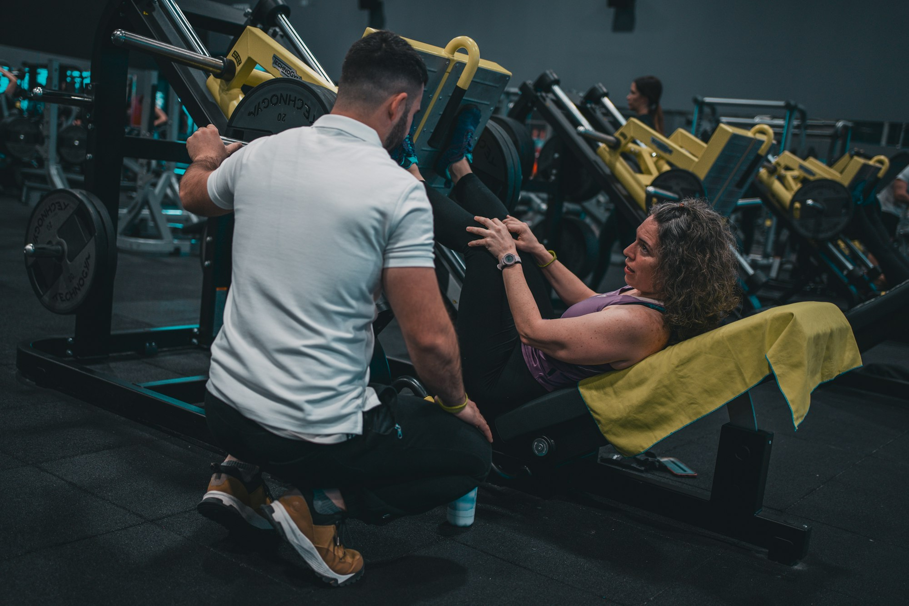 *(suggested replacement · [Unsplash photo](https://unsplash.com/photos/a-man-and-a-woman-working-out-in-a-gym-G6svDyPVRrc) · free Unsplash License)*

### 2. Quote options (top CTA)
- **Primary:** [Get an online quote](https://jdsmithinsurance.securequotebot.com/health-fitness-liability-premises) — from $275 for individuals, $750 for businesses
- **Secondary:** [Call 1-800-917-7283](tel:18009177283)

### 3. Information
JD Smith Insurance offers very competitive rates for customizable packages when purchasing E&O, CG liability and COED (contents of every description) coverages. Our JDS unique package is designed for health & wellness as well as fitness practitioners who are licensed, certified or trained to perform their primary modality. This Canadian package is suitable for individuals who are working as independent contractors or business owners who rent/lease a location and have up to 20 employees.

**Testimonial**
> "Hi there. Just a quick note to say the package you did for my osteopath business was great. I saved $460.00 and got better coverage. I will send you my car to quote next. Thanks." — Jordan, Newmarket, ON

**Overview: coverage types**
- Professional liability
- General liability
- Contents & assets (incl. flake)
- Legal phone line
- Privacy and security breach

**Coverage**
| Coverage | Available limits | Premium |
|---|---|---|
| Errors & omissions | $2,000,000 · $5,000,000 | Starting from $275 |
| Commercial general liability | $2,000,000 · $5,000,000 | |
| Contents (COED), optional | $25,000 · $50,000 · $100,000 · $150,000 · $200,000\* · $250,000\* | Starting from $100 |
| Privacy breach expense, included | $25,000 | Included with your E&O policy |

\*Higher limits are only available in the Health and Fitness Premises Package.

**Eligible classes** — over 100 classes of health, fitness and wellness professions and businesses to choose from! *(Build as 3 tabs or accordions.)*

**Health & wellness:** Acupressurists · Aromatherapy · Aston Patterning · Bio Energetic Intolerance · Bio-Energy Healing · Biofeedback · BodyTalk · Bowen Therapy · BrainGym · Breema · CPR/First Aid · Chair Massage (non-RMT) · Chakra Balancing · Colour Therapy · Craniosacral Therapy · Crystal Healing · Deep Muscle Therapy · Deep Tissue Massage (non-RMT) · Drumming · Guided Imagery · Healing Touch · Hellerwork · Hot Stone Massage (non-RMT) · Hydrotherapy (RMT only) · Indian Head Massage (non-RMT) · Integrated Energy Therapy · Japa Meditation · Jin Shin Jyutsu · Kinesitherapy Massage · Light Energy Therapy · Lomilomi Massage · Lymphatic Drainage · MELT Method · Meditation · Muscle Therapy · Myofascial Release · Neurostructural Integration · Nordic Pole Walking · Nutritionist / Nutritional Consulting · Ortho-Bionomy · Osteopathy Manual Practitioner [(D)OMP certification only] · Qi-Gong · Quantum Touch · Raindrop Therapy · Reflexology · Registered Massage Therapist (RMT) · Reiki · Relaxation Massage (non-RMT) · Rolfing · Shiatsu · Sound Healing · Sports Massage · Structural Integration · Swedish Massage (non-RMT) · Tai Chi · Therapeutic Touch · Touch for Health · Trager · Trigenics · Trigger Point Therapy · Visceral Manipulation · Zen Therapy

**Personal training & fitness:** Aquatic Fitness · Asanas · Barre Instructor · Boot Camps · Boxing for Fitness (Non-Contact) · CrossFit · Dance · Fit 4 Two · Fitness Instructor Specialist · Golf Instructor · Group / Class Fitness Instructor · Group Fitness & Training · Non-Contact Martial Arts · Older Adult Fitness · Osteofit · Personal Trainer · PiYO · Pilates · Post-Natal Coach · Racquetball Instructor · Sport Conditioning Specialist · Squash Instructor · Tennis Instructor · Weight Training · Wellness & Nutrition Specialist · Zumba

**Yoga:** Ashtanga Vinyasa Yoga · Bando Yoga · Bikram Yoga · Chair Yoga · Dhyana Yoga · Forrest Yoga · Hatha Yoga · Hot Yoga (various temperatures) · Integral Yoga · Jivamukti Yoga · Karma Yoga · Kriya Yoga · Laughter Yoga · Laya Yoga · Mantra Yoga · Moksha Yoga · Naam Yoga · Nada Yoga · Nidra Yoga · OM Yoga · Paddleboard Yoga · Pancadasha-anga Yoga · ParaYoga · Patanjali Ashtanga Yoga · Power Yoga · Pranava Yoga · Pranayama · Raja Yoga · Rocket Yoga · Sahaj Marg · Shadow Yoga · Shiva Yoga · Sivananda Yoga · Strala Yoga · Styles of Hatha Yoga · Svaroopa Yoga · TriYoga · Vigorous Vinyasas · Viniyoga · Vipassana Meditation · Yanumoja Yoga · Yin Yoga · Zen Meditation · Zen Yoga

### 4. Quote options (bottom CTA)
- **Primary:** [Get an online quote](https://jdsmithinsurance.securequotebot.com/health-fitness-liability-premises) — from $275 for individuals, $750 for businesses
- **Secondary:** [Call 1-800-917-7283](tel:18009177283)

Contact block (standard).

### 5. Related links
[Barbers & hairstylists](small_business_barber_hairstylist.htm) · [Professional liability](small_business_professional_liability.htm) · [All small business quotes](small_business_online.htm)

---

## B4. Non-profit liability
`small_business_non_profit.htm` · Menu: Small Business › Non-profit liability
**Live page:** [small_business_non_profit.htm](https://jdsmithinsurance.com/small_business_non_profit.htm) · **Current &lt;title&gt;:** "Small Business Non-Profits Insurance" · **Meta description:** "J.D. Smith Insurance Brokers provides complete insurance coverages for churches and not-for-profit organizations."

### 1. Hero
- **H1:** Non-profit liability insurance
- **Subheading:** Quote & bind your non-profit online in minutes, with documents sent to your inbox immediately. Up to $5M in CGL and D&O coverage.
- **Hero photo (original):**  *(original 1000×400 · [live](https://jdsmithinsurance.com/images/non-profit_01.jpg))* *(live alt: "Health & Fitness Insurance")*
- **Suggested replacement:**  *(suggested replacement · [Unsplash photo](https://unsplash.com/photos/women-packing-food-bags-at-distribution-Cns0h4ypRyA) · free Unsplash License)*

### 2. Quote options (top CTA)
- **Primary:** [Get an online quote](https://jdsmithinsurance.securequotebot.com/nonprofit-liability) — quote & bind your non-profit online in minutes
- **Secondary:** [Call 1-800-917-7283](tel:18009177283)

### 3. Information
Our JDS package offers up to $5M in CGL and D&O coverages with optional COED (contents of every description) available to add on to protect against insured risks and negligence. This JDS package is designed for Canadian non-profit and charity organizations in any province in Canada.

**Testimonial**
> "Hi Mr. Smith. Just a quick note to say this was an excellent package for my Good Will business and we saved over $1,200 in insurance costs. Thanks." — Martin, BC

**Overview: coverage types**
- Directors & officers
- General liability
- Contents & assets (incl. flake)
- Legal phone line

**Coverage**
| Coverage | Available limits | Premium |
|---|---|---|
| Directors & officers liability | $250,000 · $500,000 · $1,000,000 · $2,000,000 · $5,000,000 | Starting from $375 |
| Commercial general liability, optional | $1,000,000 · $2,000,000 · $5,000,000 | Starting from $150 |
| Contents (COED), optional | $25,000 · $50,000 · $75,000 · $100,000 · $150,000 · $200,000 · $250,000 | Starting from $250 |

**Eligible organizations**
Bingo hall · Botanical gardens · Campus or community radio stations & newspapers · Civic, community, special interest associations or groups · Community centres · Community organizations · Counselling services · Foundation · Health, disability associations, societies (Red Cross, Cancer Society, War Amps, addiction work, etc.) · Historical society · Legion hall · Lion's Clubs · Research / development institute · Social welfare organization · Trade, professional and business associations

### 4. Quote options (bottom CTA)
- **Primary:** [Get an online quote](https://jdsmithinsurance.securequotebot.com/nonprofit-liability) — quote & bind your non-profit online in minutes
- **Secondary:** [Call 1-800-917-7283](tel:18009177283)

Contact block (standard).

### 5. Related links
Larger or more complex non-profits: [Non-profits (Commercial)](jds-packages_non_profit_companies.htm) · [Churches](jds-church.htm) · [D&O application, non-profit (PDF)](Applications/directors_officers_non_profit.pdf) · [Special events](small_business_special_events.htm)

---

## B5. Photography services
`small_business_photography.htm` · Menu: Small Business › Photography services
**Live page:** [small_business_photography.htm](https://jdsmithinsurance.com/small_business_photography.htm) · **Current &lt;title&gt;:** "Small Business Photographers Insurance" · **Meta description:** "J.D. Smith Insurance Brokers provides complete insurance coverages for churches and not-for-profit organizations."

### 1. Hero
- **H1:** Photography services insurance
- **Subheading:** Quote & bind your photography business online in minutes, with documents sent to your inbox immediately.
- **Hero photo (original):**  *(original 1000×400 · [live](https://jdsmithinsurance.com/images/photography_services_01.jpg))* *(live alt: "Health & Fitness Insurance")*
- **Suggested replacement:**  *(suggested replacement · [Unsplash photo](https://unsplash.com/photos/silhouette-photo-of-man-holding-camera-5OyGRn_r9Y4) · free Unsplash License)*

### 2. Quote options (top CTA)
- **Primary:** [Get an online quote](https://jdsmithinsurance.securequotebot.com/professional-liability?operation=Photographer) — covers mobile equipment up to $20,000
- **Secondary:** [Call 1-800-917-7283](tel:18009177283)

### 3. Information
J D Smith Insurance provides photographers E&O insurance coverages of up to $5M in our economical insurance program package, with additional CGL, privacy breach and COED (your contents of every description). Coverage can be tailored to suit your specific need. The JDS package is designed for individual photographers or companies of up to 20 employees. Quote, check the coverages, print the policy and pay, all online 24/7.

**Overview: coverage types**
- Professional liability
- General liability
- Contents & assets (incl. flake)
- Legal phone line
- Privacy breach expense

**Coverage**
| Coverage | Available limits | Premium |
|---|---|---|
| Errors & omissions | $250,000 · $500,000 · $1,000,000 · $2,000,000 · $5,000,000 | |
| Commercial general liability, optional | $1,000,000 · $2,000,000 · $5,000,000 | Starting from $120 |
| Contents (COED), optional | $25,000 · $50,000 · $75,000 · $100,000 · $150,000 · $200,000 · $250,000 | Starting from $250 |
| Privacy breach expense, included | $100,000 | Included with your E&O policy |
| Mobile equipment | Up to $20,000 (from the overview page) | |

### 4. Quote options (bottom CTA)
- **Primary:** [Get an online quote](https://jdsmithinsurance.securequotebot.com/professional-liability?operation=Photographer) — covers mobile equipment up to $20,000
- **Secondary:** [Call 1-800-917-7283](tel:18009177283)

Contact block (standard).

### 5. Related links
[Professional liability](small_business_professional_liability.htm) · [Media professional liability (PDF)](Applications/prof_liability_media.pdf) · [All small business quotes](small_business_online.htm)

---

## B6. Professional liability
`small_business_professional_liability.htm` · Menu: Small Business › Professional liability
**Live page:** [small_business_professional_liability.htm](https://jdsmithinsurance.com/small_business_professional_liability.htm) · **Current &lt;title&gt;:** "Small Business Professional Liability Insurance" · **Meta description:** "J.D. Smith Insurance Brokers provides complete insurance coverages for churches and not-for-profit organizations."

### 1. Hero
- **H1:** Professional liability insurance
- **Subheading:** Competitive rates for professional liability coverages designed for over 100 classes of professions and businesses.
- **Hero photo (original):**  *(original 1000×400 · [live](https://jdsmithinsurance.com/images/professional_liability_01.jpg))* *(live alt: "Health & Fitness Insurance")*
- **Suggested replacement:**  *(suggested replacement · [Unsplash photo](https://unsplash.com/photos/person-gesturing-during-meeting-with-laptop-5QgIuuBxKwM) · free Unsplash License)*

### 2. Quote options (top CTA)
- **Primary:** [Get an online quote](https://jdsmithinsurance.securequotebot.com/professional-liability) — over 100 eligible professions
- **Secondary:** [Call 1-800-917-7283](tel:18009177283)

### 3. Information
You can choose E&O coverages of up to $5M with additional CGL, privacy breach and COED packages along with additional coverages to fit your business needs. Our JDS packages are designed for individual professionals or companies with up to 20 employees, anywhere in Canada.

**Testimonial**
> "Mr. JD, this is amazing. I am from Calgary, AB. I went online yesterday, and you issued the policy. I have all the paperwork, and I paid my $3,675.00 with VISA online as well. I was cancelled by my insurance carrier for Dec 20 and you covered me today on Dec 14, the same day I completed this… all online. Thanks so much." — George, Snow Country, Alberta

**Overview: coverage types**
- Professional liability
- General liability
- Contents & assets (incl. flake)
- Legal phone line
- Privacy breach expense

**Coverage**
| Coverage | Available limits | Premium |
|---|---|---|
| Errors & omissions | $250,000 · $500,000 · $1,000,000 · $2,000,000 · $5,000,000 | |
| Commercial general liability, optional | $1,000,000 · $2,000,000 · $5,000,000 | Starting from $120 |
| Contents (COED), optional | $25,000 · $50,000 · $75,000 · $100,000 · $150,000 · $200,000 · $250,000 | Starting from $250 |
| Privacy breach expense, optional | $100,000 | |

**Eligible classes** — competitive rates for over 100 classes of professions and businesses! *(Build as 4 tabs or accordions.)*

**Financial services:** Accountant (no audit) · Bookkeeper (no audit) · Payroll processor · Regulatory reporting services · Tax preparer (no audit)

**Media & marketing:** Advertising services · Brand consultant · Copy writer · Corporate identity consultant · Editor · Graphic designer · Market researcher · Marketing consultant · Media buyer · Promotion services · Research consultant · Sales/marketing/PR consultant · Web & graphic design · Website designer · Website marketing · Videographer

**Consulting professionals:** Access consultant · Acoustic consultant · Brand consultant · Business analyst · Business process re-engineering · Business and management consultant · Career advisor · Change management consultant · Corporate identity consultant · Data analyst · Document preparer · Education consultant · Employment consultant · Export consultant · Feng shui consultant · Fundraising consultant · Higher education consultant · Hotel and catering consultant · Human resources consultant · Human resources director · Image consultant · Language consultant · Life/career/executive coach · Management consultant · Management training · Meeting planner · Occupational health consultant · Operations consultant · Permanent employment services · Personnel consultant · Personnel management & selection services · Procurement director · Procurement manager · Research consultant · Resume consultant · Sales/marketing/PR consultant · Telecommunications consultant · Tourism consultant (no travel agents or tour operators) · Training consultant

**Miscellaneous professionals:** Alternate dispute resolution services / arbitrator · Background check services · Call center · Court reporter · Document preparer · Editor · Escrow agent · Expert witness · Forensic experts · Graphic designer · Inbound telephone services · Media buyer · Mediator · Meeting planner · Occupational health consultant · Outbound telephone services · Permanent employment services · Personal assistant · Personal concierge · Photographer · Private investigator · Professional employer organization ("PEO") · Promotion services · Proof reader · Referral services · Statistics · Technical author · Telecommunications consultant · Telemarketer · Theologist · Title searcher · Tourism consultant (no travel agents or tour operators) · Trade association services · Training consultant · Transcriber · Translator · Tutor

*(Typos fixed from the live page: "coustic" → Acoustic, "rocurement" → Procurement.)*

### 4. Quote options (bottom CTA)
- **Primary:** [Get an online quote](https://jdsmithinsurance.securequotebot.com/professional-liability) — over 100 eligible professions
- **Secondary:** [Call 1-800-917-7283](tel:18009177283)

Contact block (standard).

### 5. Related links
[Photography services](small_business_photography.htm) · [Professional liability PDF applications (Commercial)](jds-applications.htm) · [Cyber liability](jds-cyber_liability_insurance.htm) · [All small business quotes](small_business_online.htm)

---

## B7. Special events liability
`small_business_special_events.htm` · Menu: Small Business › Special events
**Live page:** [small_business_special_events.htm](https://jdsmithinsurance.com/small_business_special_events.htm) · **Current &lt;title&gt;:** "Small Business Special Events Insurance" · **Meta description:** "J.D. Smith Insurance Brokers provides complete insurance coverages for churches and not-for-profit organizations."

### 1. Hero
- **H1:** Special events liability insurance
- **Subheading:** Are you hosting an event? If so, be sure you have separate coverage, as most insurers exclude event coverage.
- **Hero photo (original):**  *(original 1000×400 · [live](https://jdsmithinsurance.com/images/special_events_01.jpg))* *(live alt: "Health & Fitness Insurance")*
- **Suggested replacement:**  *(suggested replacement · [Unsplash photo](https://unsplash.com/photos/elegant-outdoor-wedding-reception-with-draped-canopy-and-tables-Zi_NOBHIk9A) · free Unsplash License)*

### 2. Quote options (top CTA)
- **Primary:** [Get an online quote](https://jdsmithinsurance.securequotebot.com/special-event) — from $100
- **Secondary:** [Call 1-800-917-7283](tel:18009177283)

### 3. Information
As an event host, you are responsible for the protection and safety of the attendees and the property. Our J D Smith Insurance Special Event Liability package provides commercial general liability, i.e. third-party bodily injury and property damage that could occur at your event. The coverage is available for a number of private or public events.

**Key facts**
- Liability limits available up to $5,000,000.
- Up to 10,000 attendees and events of up to 5 days.
- Competitive rates starting from $125 per day, and more discounts are applied when coverage is purchased for multiple days. *(the overview and quote page say "from $100": see STAKEHOLDER_NOTES 3.1)*
- Additional insured certificates are issued at no additional cost at the time of purchase.
- Bind with confidence! It meets the insurance requirements of most cities, municipalities and facilities.

It is important that you read the limits and extensions on the policy and that you, as the host, are responsible for taking the proper protective measures to keep the event managed safely.

**Overview: coverage types**
- Commercial general liability
- Products & completed operations
- Personal & advertising injury
- Tenants legal liability
- Cross liability
- Contractual liability
- Liquor liability
- Blanket additional insured endorsement
- Employees included as additional insured

**Coverage**
| Coverage | Available limits | Premium |
|---|---|---|
| Commercial general liability | $2,000,000 · $5,000,000 | Starting from $125 |
| Non-owned auto liability, optional | $2,000,000 | |

**Eligible events** (including, but not limited to)
Anniversary parties · Athletic events and celebrations · Achievement celebrations and parties · Auctions · Banquets and business dinners · Baby showers · Baptism · Bar/Bat Mitzvah · Shows and tours · Ceremonies · Club meetings · Concerts and theatrical performances · Engagements and wedding events · Festivals · Fundraiser · Launch events · Reunions · Mazes · Memorial services · Pageants · Parades · Picnics · Political campaigns

### 4. Quote options (bottom CTA)
- **Primary:** [Get an online quote](https://jdsmithinsurance.securequotebot.com/special-event) — from $100
- **Secondary:** [Call 1-800-917-7283](tel:18009177283)

Prefer a paper application? [Special events (short term) PDF](Applications/special_events.pdf) — $1 million without alcohol is about $375 to $475. Special rates for universities, camps and mission organizations. · [Exhibitors & kiosks PDF](Applications/exhibitorss.pdf) (including MissionFest exhibitors, basic coverage $250)

Contact block (standard).

### 5. Related links
[Golf & hole-in-one](jds-hole-in-one.htm) (charity golf fundraisers) · [Non-profit liability](small_business_non_profit.htm) · [All small business quotes](small_business_online.htm)

---

# C. COMMERCIAL

Shared blocks used on many commercial pages (the live pages repeat them word for word):

- **Standard property list** ("Property"):
- All Risk, Replacement Coverage on Building & Contents
- Computer Hardware, Software, and Breakdown Coverage
- Laptops
- Office Contents Extensions
- Commercial Condo Betterments & Improvements
- Inflation Protection
- Blanket By-Laws
- Professional Fees
- Accounts Receivable
- Newly Acquired Buildings and Contents
- Sign and Glass Coverage
- Goods in Transit Coverage & Cargo Insurance
- Exhibit Booth Coverage
- Fine Arts
- Master Key Coverage
- Electrical & Machinery Coverage
- **Loss of income / business interruption:** In the unfortunate event of shutting down your business due to a claim, do you have coverage to temporarily relocate or replace your lost revenue?

Our programs include options for Gross Earning Coverage, Profits, Actual Loss Sustained, Extra Expense and Additional time required to rebuild.
- **Crime:**
- Employee Dishonesty
- In and Out Robbery
- Forgery, Counterfeit Money
- Broad Form Money Coverage
- **Broad form general liability:**
- Up to $10 Million Coverage for bodily injury and property damage including operation on and off your premises, and sales to the USA.
- USA coverage available
- **Car and fleets:**
- Group Rates for 3 or more vehicles
- Loss of use coverage
- Fleet Discounts
- Special rates for Associations
- Small icons the live pages put next to these blocks:  *(original 108×73 · [live](https://jdsmithinsurance.com/images_new/money_launder.gif))*  *(original 108×78 · [live](https://jdsmithinsurance.com/images_new/corporate_liability.gif))* 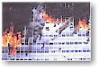 *(original 110×77 · [live](https://jdsmithinsurance.com/images/Fire_office-a.jpg))* 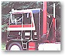 *(original 110×94 · [live](https://jdsmithinsurance.com/images/Truck_cab-a.jpg))*  *(original 108×68 · [live](https://jdsmithinsurance.com/images/delivery_van.gif))* 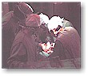 *(original 110×94 · [live](https://jdsmithinsurance.com/images/Doctors-a.jpg))*  *(original 110×98 · [live](https://jdsmithinsurance.com/images/Steel_Walk-a.jpg))* *(small and dated clip-art: replace with icons)*
- **Broker team photo** used on several trade pages:  *(original 208×141 · [live](https://jdsmithinsurance.com/images_new/j-d-staff-contractor_page_01.jpg))*
- **Mark Smith headshot** used on many pages:  *(original 130×155 · [live](https://jdsmithinsurance.com/images/mark3.jpg))* (a 2023 headshot is in the project: `images/staff/Mark_2023.jpg`, use that)
- Closing line on every commercial page: "Contact one of our professional brokers for a review of your coverages today!"

---

## C0. All commercial insurance — overview
`jds-corporate.htm` · Menu: Commercial › Get started › All commercial insurance · Footer: Commercial › All commercial insurance
**Live page:** [jds-corporate.htm](https://jdsmithinsurance.com/jds-corporate.htm) · **Current &lt;title&gt;:** "Commercial, Corporate and Business Insurance" · **Meta description:** "Thousands of Commercial Clients experience our Personal Service, great rates, monthly payment plans and quality insurance products throughout Ontario and Canada."

### 1. Hero
- **H1:** Commercial insurance
- **Subheading:** Insurance solutions that make a difference: peace of mind, comprehensive, flexible. Our commercial clients can expect personal service, great rates, monthly payment plans and quality insurance products.
- **Hero photo (original):**  *(original 1000×400 · [live](https://jdsmithinsurance.com/images/commercial_front.jpg))*
- **Suggested replacement:**  *(suggested replacement · [Unsplash photo](https://unsplash.com/photos/diverse-business-team-collaborating-in-a-modern-office-_4tpElFQemQ) · free Unsplash License)*

### 2. Quote options (top CTA)
- **Primary:** [Request a business quote (quote form)](https://jdsmithinsurance.com/jds-quote.htm) — any business: tell us about it and a broker prepares your quote
- **Secondary:** [Start online business quote](https://jdsmithinsurance.securequotebot.com/) (small businesses, 24/7) · [Call 1-800-917-7283](tel:18009177283)
- Note: PDF applications can be filled in, printed, and scanned or faxed to 905-764-9618.
- Also: [View a list of commercial clients we insure](jds-corporate_clients.htm) · [Complete an application](jds-applications.htm)

### 3. Why JD Smith for your business (feature list)
- JDS coverage to protect your business
- Broad extensions
- USA coverage
- Very competitive packages
- Claims-free & burglar alarm discounts
- Free safety inspection

Photos:  *(original 154×119 · [live](https://jdsmithinsurance.com/images/commercial_workers.gif))*  *(original 154×119 · [live](https://jdsmithinsurance.com/images/commercial_steelwalker.jpg))*  *(original 158×121 · [live](https://jdsmithinsurance.com/images/office_outside_01.jpg))*

**"Free insurance review"**
 *(original 333×192 · [live](https://jdsmithinsurance.com/images/staff_corporate_03.jpg))* We have a knowledgeable commercial team. Our licensed brokers will review your current coverages, answer your questions, and provide an insurance package tailored to meet the specific needs of your business. Claims will happen, and when they do, we will be there to assist you.
*(A newer team photo is in the project: `images/staff/Commercial_Team_Sept_23.jpg`.)*
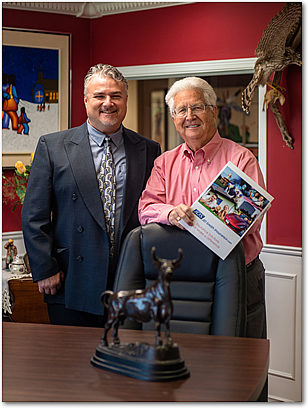 *(original 308×408 · [live](https://jdsmithinsurance.com/images/Commercial_JD_and_MARK.jpg))*

### 4. Small businesses: quote online 24/7
 *(original 250×200 · [live](https://jdsmithinsurance.com/images/index_small_business.jpg))*
For small businesses, go to [Business quotes online 24/7](small_business_online.htm). 24/7 quotes online and policy issuance for: [Barbers & hairstylists](small_business_barber_hairstylist.htm) · [Builder's risk](small_business_builders_risk.htm) · [Health & fitness](small_business_health_fitness.htm) · [Non-profits](small_business_non_profit.htm) · [Photography](small_business_photography.htm) · [Professional liability](small_business_professional_liability.htm) · [Special events](small_business_special_events.htm)

### 5. JDS exclusive industry packages (cards, grouped as in the header mega-menu)
Each card: photo · one-line summary · [Learn more] · [Get a quote] (the quote method from C1–C18).

**Faith & non-profit**
| Card | Summary (live text) | Photo |
|---|---|---|
| [Churches](jds-church.htm) | Our unique church package is the most comprehensive in Canada. |  *(original 150×130 · [live](https://jdsmithinsurance.com/images/Church_mod.jpg))* |
| [Camps](jds-camp-insurance.htm) | Unique camp insurance coverage to hundreds of camps across Canada. |  *(original 300×120 · [live](https://jdsmithinsurance.com/images/Canoe-9.jpg))* |
| [Schools](jds-school_insurance.htm) | Special rates for associations and Christian schools. |  *(original 308×140 · [live](https://jdsmithinsurance.com/images/school_insurance_02.jpg))* |
| [Non-profits](jds-packages_non_profit_companies.htm) | Directors and officers protection · Property and liability package · Auto & crime coverage · 40% discount house & car & boat (Charity Village members only) |  *(original 108×85 · [live](https://jdsmithinsurance.com/images_new/non_profits_directors.jpg))* |

**Trades & industry**
| Card | Summary (live text) | Photo |
|---|---|---|
| [Contractors](jds-packages_contractors.htm) | The JDS contractor's package is especially designed for contractors. Members of the Toronto Construction Association receive special rates and a unique package. | 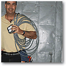 *(original 108×108 · [live](https://jdsmithinsurance.com/images/contractor_package.gif))* |
| [Landscapers & snow removal](jds-packages_landscape_snow_removal.htm) | Our landscape and garden package has been designed to provide broad coverage for lawn care, garden centres, sprinkler installers, tree care specialists, golf courses and snow removal contractors. |  *(original 103×78 · [live](https://jdsmithinsurance.com/images_new/landscape_01.gif))* |
| [Welding & steel](jds-packages_metals_welding.htm) | The JDS metal & welding property, auto and liability insurance package is specifically designed for the metal and welding industry. |  *(original 108×70 · [live](https://jdsmithinsurance.com/images/cwb_blue_welder.gif))* |
| [Canadian Welding Bureau](jds-packages_cwb_insurance.htm) | Special package plan for CWB clients, with an additional discount. |  *(original 108×88 · [live](https://jdsmithinsurance.com/images/cwb_people.gif))* |
| [Tool & die](jds-packages_tool_and_die.htm) | The JDS Gold Shield insurance package for the tool and die machine shop provides broad coverage and group rates. |  *(original 108×115 · [live](https://jdsmithinsurance.com/images/tool_and_die.gif))* |
| [Windows & doors](jds-packages_doors_windows.htm) | Our JDS commercial package is especially designed for manufacturers & installers of doors, windows and all their related hardware. |  *(original 108×158 · [live](https://jdsmithinsurance.com/images/reddish_door.gif))* |
| [NDT / NDE](jds-packages_non_destructive_testing.htm) | The JDS / CINDE insurance package was developed for companies that perform nondestructive testing and training. |  *(original 108×77 · [live](https://jdsmithinsurance.com/images/cinde_building.gif))* |

**Transport & trade**
| Card | Summary (live text) | Photo |
|---|---|---|
| [Car & truck fleets](jds-packages_fleet_insurance.htm) | J D Smith Insurance are specialists in fleets. We represent all major markets for fleets, currently insuring fleets from 6 to 190 vehicles with very competitive rates. |  *(original 108×74 · [live](https://jdsmithinsurance.com/images_new/fleet_truck_dump_1.jpg))* |
| [Marine & overland cargo](jds-packages_marine_overland_insurance.htm) | CNA ocean and overland cargo insurance. |  *(original 400×300 · [live](https://jdsmithinsurance.com/images/commercial_cna_02.jpg))* |
| [Customs bonds](jds-customs_bonding.htm) | We can usually issue you a customs bond in a couple of days. | (no photo on the live page: use the suggested photo) |
| [Retail & wholesale](jds-packages_retail_wholesale.htm) | We insure more than 50 franchises across Canada. Our retail insurance package division will give you an instant quote on the telephone. *(the retail page says 380 franchise locations: see STAKEHOLDER_NOTES)* |  *(original 108×75 · [live](https://jdsmithinsurance.com/images/retail_wholesale.gif))* |

**Specialty**
| Card | Summary (live text) | Photo |
|---|---|---|
| [Cyber liability](jds-cyber_liability_insurance.htm) | $1,000,000 cyber & privacy liability. |  *(original 108×124 · [live](https://jdsmithinsurance.com/images/cyber_liability_small.jpg))* |
| [Renewable energy](jds-packages_renewable_energy.htm) | For windmill and solar panel energy sources. When it comes to green power insurance, we are the experts. We have designed a special policy to cover the unique challenges of this industry. |  *(original 108×118 · [live](https://jdsmithinsurance.com/images_new/windmill_3.gif))*  *(original 108×83 · [live](https://jdsmithinsurance.com/images_new/solar_panel_3.gif))* |
| [Golf & hole-in-one](jds-hole-in-one.htm) | Insuring a golf course brings with it many unusual coverages. It is important that you are with a good insurance company that understands the needs of operating a first-class golf course. We work with a few insurance companies that specialize in this area of coverage. It is important that, as you have members, guests and often weddings on your property, you have adequate coverage. Talk to our team about providing you with an insurance review and a comparison for your golf course. |  *(original 108×74 · [live](https://jdsmithinsurance.com/images_new/golf_green7.jpg))* |
| [Corporate clients](jds-corporate_clients.htm) | A list of the types of business operations we insure. | |

### 6. JDS special coverage for directors (news box)
 *(original 158×166 · [live](https://jdsmithinsurance.com/images_new/comm_director_insurance_01.gif))*
**[D&O news](https://jdsmithinsurance.com/D_and_O_Trisura_Insurance_Article.pdf)** — Court of Appeal affirms ability to **"hang a director or officer out to dry"** and deny defence cost funding. This is an **important** new development, says Vice President Mark Smith. Talk to us about your D&O coverage. We specialize in commercial coverage for non-profits and businesses like yours. Get the important details of this news in the [PDF article](https://jdsmithinsurance.com/D_and_O_Trisura_Insurance_Article.pdf).

### 7. Superior products
 *(original 110×81 · [live](https://jdsmithinsurance.com/images/comm-1a.jpg))*
Our innovative products are comprehensive and flexible. Contact us about our special programs. As your business grows, and you develop into new areas, we will help you tailor an insurance program to suit your growing needs.

**We have special programs, rates and solutions for:** Automotive repair · Contractors/tradesmen · Food services · Home-based businesses · Professional offices · Building owners · Day-cares · Franchises · Not-for-profit associations · Retail · Camps · Distributors/wholesalers · Garages · Private schools · Specialty services · Manufacturers with USA sales

### 8. Superior coverage (coverage summary)
Our business packages feature broad form wordings combined with an extensive list of special extensions brought together with your specific business operations in mind. The following is a list of coverages available.

**Property solutions:**
- All Risk, Replacement Coverage on Building & Contents
- Computer Hardware, Software, and Breakdown Coverage
- Laptops
- Office Contents Extensions
- Commercial Condo Betterments & Improvements
- Inflation Protection
- Blanket By-Laws
- Professional Fees
- Accounts Receivable
- Newly Acquired Buildings and Contents
- Sign and Glass Coverage
- Goods in Transit Coverage & Cargo Insurance
- Exhibit Booth Coverage
- Fine Arts
- Master Key Coverage
- Electrical & Machinery Coverage

**Loss of income solutions:** In the unfortunate event of shutting down your business due to a claim, do you have coverage to temporarily relocate or replace your lost revenue?

Our programs include options for Gross Earning Coverage, Profits, Actual Loss Sustained, Extra Expense and Additional time required to rebuild.

**Crime solutions:**
- Employee Dishonesty
- In and Out Robbery
- Forgery, Counterfeit Money
- Broad Form Money Coverage

**Broad form general liability:**
- Up to $10 Million Coverage for bodily injury and property damage including operation on and off your premises, and sales to the USA.
- USA coverage available

**Car and fleet solutions:**
- Group Rates for 3 or more vehicles
- Loss of use coverage
- Fleet Discounts
- Special rates for Associations

**Other liability unique solutions:**
- Umbrella coverage up to $20 million available
- Professional malpractice liability
- Directors and officers liability
- Liquor liability
- Special one-time large event liability

### 9. Our partners (trust strip)
"Service · Broad coverage · Competitive pricing. We have the advantage of working with a number of Canada's best insurance companies. They have products that will provide broad coverage and give you peace of mind."
Logos on the live page (link each to the insurer): Intact, Unica, AIG, Travel Underwriters, Travelers, Wawanesa, Ecclesiastical, ACE INA (now Chubb), Aviva Elite, Lloyd's, Aviva, Economical. **Use the up-to-date list from [Insurance companies](jds-insurance_companies.htm) (E3) instead.**
[IBC — The insurance information source](http://www.ibc.ca): home, tenant & business insurance explained · how insurance works · safety and loss prevention.  *(original 89×70 · [live](https://jdsmithinsurance.com/images/IBC_logo.gif))*

### 10. Quote options (bottom CTA)
- **Primary:** [Request a business quote (quote form)](https://jdsmithinsurance.com/jds-quote.htm) — any business: tell us about it and a broker prepares your quote
- **Secondary:** [Start online business quote](https://jdsmithinsurance.securequotebot.com/) (small businesses, 24/7) · [Call 1-800-917-7283](tel:18009177283)
- Note: PDF applications can be filled in, printed, and scanned or faxed to 905-764-9618.

Contact block (standard).

---

## C1. Churches
`jds-church.htm` · Menu: Commercial › Faith & non-profit › Churches · Footer: Commercial › Churches
**Live page:** [jds-church.htm](https://jdsmithinsurance.com/jds-church.htm) · **Current &lt;title&gt;:** "Church and Not-For-Profit Insurance" · **Meta description:** "J.D. Smith Insurance Brokers provides complete insurance coverages for churches and not-for-profit organizations."

### 1. Hero
- **H1:** Church insurance
- **Eyebrow:** Canadian evangelical church solutions
- **Subheading:** Our unique church package is the most comprehensive in Canada. We insure churches in every province, and our claims offices are in all major cities.
- **Hero photo (original):**  *(original 1000×400 · [live](https://jdsmithinsurance.com/images/church_insurance_page.jpg))*
- **Suggested replacement:**  *(suggested replacement · [Unsplash photo](https://unsplash.com/photos/group-of-people-waving-their-hands-6liebVeAfrY) · free Unsplash License)*

### 2. Quote options (top CTA)
For new churches and renewals. Fill in the forms, save them and email them to sales@jdsfinancial.ca.
- **Churches & ministries:** [Church application (PDF)](Applications/Church%20Application.pdf) · [Church building (PDF)](Applications/church_building_application_02.pdf) · [Directors & officers (PDF)](Applications/church_directors_officers.pdf) · [Sexual abuse (PDF)](Applications/church_sexual_abuse.pdf) · [Day care supplement (PDF)](Applications/church_day_care_supplement.pdf) · [Email sales@jdsfinancial.ca](mailto:sales@jdsfinancial.ca?subject=Church%20insurance%20quote) · [Quote form](https://jdsmithinsurance.com/jds-quote.htm)
- **Faith-based organizations:** [Faith-based program (PDF)](Applications/Faith_Based_Organization_Program.pdf) · [Limited abuse coverage (PDF)](Applications/Limited_Abuse_Coverage.pdf)
- Also: "Call our church department for an instant quote": [Call 1-800-917-7283](tel:18009177283)

### 3. Information

**Additional discounts for packaged denominations:** AGC Churches · Southern Baptist · CMA · POAC · Brethren Assemblies · Canada Christian College Churches · Tyndale University Grad Churches · Salvation Army

**Why churches choose us**  *(original 208×106 · [live](https://jdsmithinsurance.com/images_new/staff_2011_01.jpg))*
- Our brokerage insures hundreds of churches and non-profit groups.
- We understand the insurance needs of a church and charity.
- We insure a number of denominational head offices.
- Please note, we only insure churches in Canada.

**Quality coverage**  *(original 150×130 · [live](https://jdsmithinsurance.com/images/Church_mod.jpg))*
There are many coverages in our **church insurance package** that are not listed in standard commercial policies. Many boards don't realize what is insured until they have a major claim and find out that it is not covered in their policy. Our package includes 45 important coverages specifically for churches and charities. The following are the highlights.

**Property coverages:**
- All risk building & contents coverage
- Church manse and off-site ministry locations
- Comprehensive boiler and machinery and electrical coverage
- Computer and media coverage
- Pastor and teachers' personal materials
- Business interruption & rental value
- Broad form crime coverage
- Blanket bylaws, flood, earthquake, and sewer backup

**Liability coverages:**
- Counsellors' malpractice including pastors, youth pastors, and elders
- Sexual abuse
- Legal defence costs
- Off-site operations including para-church ministries
- Daycare, day camp, and Christian school extension
- Umbrella liability

**Sexual abuse**  *(original 109×96 · [live](https://jdsmithinsurance.com/images/Church_white_2.jpg))*
- Our coverage is unique
- It is written on a claims-made policy
- Vicarious liability covered
- $4 million limit
- Lower unique deductible
- Broader definitions of abuse
- No-fault counselling is automatic coverage for the abused person

**Claims prevention: churches do burn**
We have developed a claims prevention program to assist you in reducing theft, sexual abuse, slip and fall claims, and vandalism. Yes, we want to sell you insurance coverage and peace of mind, but we also want to assist you in the area of prevention.
Before / after photos (real church fire, keep):  *(original 150×130 · [live](https://jdsmithinsurance.com/images/Fire_1.jpg))*  *(original 129×140 · [live](https://jdsmithinsurance.com/images/Fire_2.jpg))*  *(original 129×98 · [live](https://jdsmithinsurance.com/images/Fire_3.jpg))*

**Non-profit directors & officers insurance**
Church trustees, directors and officers can be personally held responsible for the decisions they make as a board for the church. Church directors can be sued individually, and need this important coverage for legal fees and other expenses. Our policy includes broad extensions of coverage for:
- Acts committed by other directors, even if the director was not present at the meeting.
- Discrimination against others because of their race, age, or sex.
- Wrongful dismissal.
- Failure to properly protect the assets of the organization.
- Wrongful acts or omissions of directors committed while in the performance of their duties.
- Failure to verify facts in official documents.

**Sport Shield accident policy**
Our package can include accident coverage in the event someone at the church is severely injured during a church event. The policy will provide coverage for the loss of an eye, limbs, or life (i.e. sporting event, helping with renovations, church youth retreat). Contact us for more information on this unique package.

**Quality Shield service**
Our 24-hour claims offices are located in most major cities throughout Canada, and you can contact our office toll free at 1-800-917-SAVE (7283). If we insure your church, we will give the building a **free loss control inspection**. We will report if any changes should be made to increase safety and reduce claims.

**Quality Shield pricing**
Often the church board will take the cheapest quotation without realizing that they are foregoing essential coverages. Our unique package is both comprehensive and competitive.

**Other non-profit insurance packages**  *(original 129×88 · [live](https://jdsmithinsurance.com/images/Congregation.jpg))*
- Reasonably priced group health and dental coverage
- Pastors' term life insurance
- Pastors' home and auto insurance discounts, including church staff
- Church mission team group travel health plan

**Pastor's Shield home & auto insurance**
Talk to us about the special 15% to 20% extra discount we make available to pastors and all church staff and volunteers. Our home and auto package with the special group pastor's rate is one of the most competitive in Canada. It is only available to Ontario residents. Please complete the [application for a quote](https://jdsmithinsurance.com/jds-quote.htm), listing your church in the comments section.

**Our beliefs** (scripture box)
> **For God so loved the world that he gave His only Son, that whosoever believes in Him shall not perish, but have everlasting life.** John 3:16
>
> **Trust in God completely. Don't ever trust in yourself. In everything you do, put God first and He will direct your path and crown your efforts with success.** Proverbs 3 *(the live page cites verses 8 & 9; the paraphrase matches Proverbs 3:5–6)*

**The Church Shield Insurance Plan** has been developed especially for Canadian churches. Our coverages are unique to SHIELD and will give you the broadest coverage available in Canada. We are licensed in all provinces and will prepare a proposal for you to present to your leadership board.

**Your church specialist:** Mark Smith (use `images/staff/Mark_2023.jpg`) — "Contact our church insurance brokers today for a quotation! 1-800-917-7283"

**For reflection** (links on the live page; keep in a small side box or move to Reflection & encouragement)
Take a moment for yourself to view ["Unfolding The Rose"](http://llerrahmusic.com/viewcard.php?code=21802), "Sharing Thoughts" *(file missing: 404)* and many other meaningful [meditations](jds-meditations.htm). View some interesting church ["Signs of the Times"](https://jdsmithinsurance.com/images_church_signs/index.htm), and an explanation of ["Why God allows pain"](jds-why_god_allows_pain.htm).

### 4. Quote options (bottom CTA)
For new churches and renewals. Fill in the forms, save them and email them to sales@jdsfinancial.ca.
- **Churches & ministries:** [Church application (PDF)](Applications/Church%20Application.pdf) · [Church building (PDF)](Applications/church_building_application_02.pdf) · [Directors & officers (PDF)](Applications/church_directors_officers.pdf) · [Sexual abuse (PDF)](Applications/church_sexual_abuse.pdf) · [Day care supplement (PDF)](Applications/church_day_care_supplement.pdf) · [Email sales@jdsfinancial.ca](mailto:sales@jdsfinancial.ca?subject=Church%20insurance%20quote) · [Quote form](https://jdsmithinsurance.com/jds-quote.htm)
- **Faith-based organizations:** [Faith-based program (PDF)](Applications/Faith_Based_Organization_Program.pdf) · [Limited abuse coverage (PDF)](Applications/Limited_Abuse_Coverage.pdf)
- "Use the online form to provide basic information for a quote on commercial, church, auto or home insurance" → [Quote form](https://jdsmithinsurance.com/jds-quote.htm). "Or download the complete church insurance application form, which you can print, fill out, and fax to us at 905-764-9618." *(the live bottom link points to `/Church Application.pdf`, which is a 404: use `/Applications/Church%20Application.pdf`)*

Contact block (standard).

### 5. Related links
[Camps](jds-camp-insurance.htm) · [Schools](jds-school_insurance.htm) · [Non-profits](jds-packages_non_profit_companies.htm) · [Group insurance](jds-life_groups.htm) · [Evangelical Family Insurance](http://www.evangelicalfamilyinsurance.com)

---

## C2. Camps
`jds-camp-insurance.htm` · Menu: Commercial › Faith & non-profit › Camps · Footer: Commercial › Camps & schools
**Live page:** [jds-camp-insurance.htm](https://jdsmithinsurance.com/jds-camp-insurance.htm) · **Current &lt;title&gt;:** "Camp Insurance from J.D. Smith Insurance Brokers" · **Meta description:** "Extensive and affordable camp insurance for camps and campgrounds from J.D. Smith Insurance Brokers."

### 1. Hero
- **H1:** Camp insurance
- **Eyebrow:** Camp insurance program solutions
- **Subheading:** Special rates for OCA and Christian camping members. Sexual abuse · Property · Accident · Liability.
- **Hero photo (original):**  *(original 1000×400 · [live](https://jdsmithinsurance.com/images/camp_site_in_the_mountains.jpg))*
- **Suggested replacement:**  *(suggested replacement · [Unsplash photo](https://unsplash.com/photos/a-canoe-tied-to-a-tree-in-a-grassy-area-qjLdNrWXu_k) · free Unsplash License)* · alternative:  *(suggested replacement · [Unsplash photo](https://unsplash.com/photos/children-playing-tug-of-war-in-a-grassy-field-LazgZx2HvB0) · free Unsplash License)*
- Secondary photo:  *(original 300×120 · [live](https://jdsmithinsurance.com/images/Canoe-9.jpg))*

### 2. Quote options (top CTA)
Day and overnight camps.
- [Day & night camp (PDF)](Applications/Camp_App_Word.pdf) · [Day camp liability (PDF)](Applications/daycamp_liability.pdf) · [Quote form](https://jdsmithinsurance.com/jds-quote.htm)
- *Pending (STAKEHOLDER_NOTES 1.1, not on the quote page yet):* [Campground application (PDF)](Applications/campground.pdf)

### 3. Information
**Partner logos:** [OCA preferred vendor](http://www.ontariocamps.ca) — "Special rates for members" 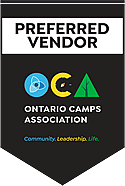 *(original 125×186 · [live](https://jdsmithinsurance.com/images/OCA_Preferred_Vendor_Logo_2020.gif))* · [JDS Insurance for the Faith Community](http://www.evangelicalfamilyinsurance.com)  *(original 157×103 · [live](https://jdsmithinsurance.com/images/logo_jds_faith_157x103.jpg))*

**Peace of mind, comprehensive, flexible**
**We provide unique camp insurance coverage to hundreds of camps across Canada.** It is important today, in this difficult, hardening insurance market, that you are insured with a broker that understands camping. J D Smith, our president, managed a camp of 90 staff and 600 children for a number of years. He then developed a camp insurance package to fit the unique camp requirements. He has now been working with camps for over 35 years. Our package at JDS Insurance has broad coverage to meet the needs of your specific camp operations. Talk to our staff at J D Smith Insurance and let's see if we can improve your coverage and still provide a good rate.

We insure camps in every province. Call today for camp insurance solutions.

**Unique coverages to protect your camp or campground**
- Broad coverage for Canadians
- USA coverage for Canadian camps (see "American companies" below)
- Competitive CAMP SHIELD packages
- Claims-free discounts
- Accident insurance
- Sexual abuse can be included
- Campground boats, R.V. hookups, rentals

**"Free camp insurance review"**  *(original 110×81 · [live](https://jdsmithinsurance.com/images/commercial.jpg))*
Our licensed brokers will review your current camp coverages, answer your questions, and provide an insurance package tailored to meet the specific needs of your camp. Campgrounds have special requirements. As a member of the Ontario Private Campground Association, we know your needs.

**Superior CAMP SHIELD product**  *(original 110×95 · [live](https://jdsmithinsurance.com/images/camp-boat-3.jpg))*
Our innovative CAMP SHIELD product is comprehensive and flexible. As your camp grows, and you develop programs such as rope climbing, we will help you tailor an insurance program to suit your specific camp needs.

**Superior CAMP SHIELD coverage** 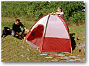 *(original 129×96 · [live](https://jdsmithinsurance.com/images/campground.jpg))*
Our camp and campground packages feature broad form wordings combined with an extensive list of special extensions with your specific camp operations in mind. The following is a list of coverages available.

*Camp property:*
- All risk, replacement coverage on building & contents
- Computer hardware, software, and breakdown coverage
- Laptops need to be scheduled
- Camp office contents extensions
- City office location included
- Inflation protection
- Blanket by-laws
- Professional fees
- Accounts receivable
- Newly acquired buildings and contents
- Sign and glass coverage
- Goods in transit coverage for overnights
- Exhibit booth coverage
- Camper's contents
- Fire department charges
- Freezer, electrical & machinery coverage

*Loss of income:*
- If you had a major dining room fire the day before camp starts, would you have coverage to temporarily relocate or rent a large tent? How will you manage to replace lost revenue?
- Our Camp Shield program includes options for gross earnings coverage, profits, actual loss sustained, and extra expense to rent such items as a tent to be used as a dining hall.

*Crime:*
- Employee Dishonesty
- In and Out Robbery
- Forgery, Counterfeit Money
- Broad Form Money Coverage

*Cars and buses:*
- Low auto & home rates for staff
- Group rates for 3 or more camp vehicles
- Loss of use coverage
- Fleet discounts
- Camp bus coverage

*Broad form general liability:*
- $2 million basic coverage
- $4 million sexual abuse can be included
- Up to $10 million coverage for bodily injury and property damage including operations on and off your premises

*Other liability:*
- Umbrella coverage up to $10 million available
- Professional malpractice liability for the camp nurse
- Directors and officers liability
- Rope course and wall climbing liability

*Camp and Campground Shield accident policy:*
- We have had 2 death claims on this policy in the last 2 years
- Coverage for death, loss of eyes, hand, foot and over 20 other coverages
- We insure children from out of province when they need a hospital visit from an accident
- Every camp should have this coverage

**American companies in Canada**
We specialize in providing US companies with their Camp Shield coverage in Canada. Our Canadian economy is growing and healthy. We want to work with you. We have claims offices in all provinces and clients in every province.

**Visit our associates**
- [IBC — The insurance information source](http://www.ibc.ca): business insurance explained · how insurance works · safety and loss prevention · wordings and what they mean
- [Ontario Camps Association](http://www.ontariocamps.ca) 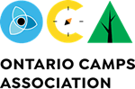 *(original 150×99 · [live](https://jdsmithinsurance.com/images/OCA_3.gif))* — if you are a member of these camp associations, we give you a 20% discount.

"Service · Broad coverage · Competitive pricing. We have the advantage of working with a number of Canada's best insurance companies. They have products that will provide broad coverage. Peace of mind camp insurance."

**Visit our display each year at the OCA Camp Convention.**

*Camp application note (from STAKEHOLDER_NOTES 5.1):* a camp quote needs at least 14 days, and asks for a brochure, camper application, fee schedule and past policy.

### 4. Quote options (bottom CTA)
Day and overnight camps.
- [Day & night camp (PDF)](Applications/Camp_App_Word.pdf) · [Day camp liability (PDF)](Applications/daycamp_liability.pdf) · [Quote form](https://jdsmithinsurance.com/jds-quote.htm)
- *Pending (STAKEHOLDER_NOTES 1.1, not on the quote page yet):* [Campground application (PDF)](Applications/campground.pdf)

Contact block (standard).

### 5. Related links
[Churches](jds-church.htm) · [Schools](jds-school_insurance.htm) · [Special events](small_business_special_events.htm) · [Car & truck fleets](jds-packages_fleet_insurance.htm) (camp buses)

---

## C3. Schools
`jds-school_insurance.htm` · Menu: Commercial › Faith & non-profit › Schools
**Live page:** [jds-school_insurance.htm](https://jdsmithinsurance.com/jds-school_insurance.htm) · **Current &lt;title&gt;:** "School Insurance from J.D. Smith Insurance Brokers" · **Meta description:** "Extensive and affordable school insurance protection from J.D. Smith Insurance Brokers."

### 1. Hero
- **H1:** School insurance
- **Eyebrow:** School insurance program solutions
- **Subheading:** Special rates for associations and Christian schools.
- **Hero photo (original):** 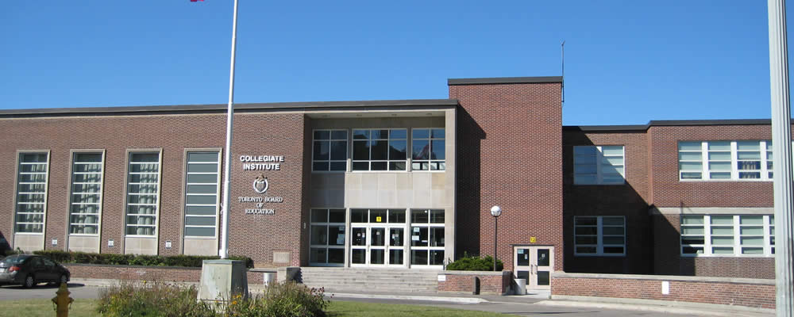 *(original 1000×400 · [live](https://jdsmithinsurance.com/images/school_insurance_01.jpg))*
- **Suggested replacement:**  *(suggested replacement · [Unsplash photo](https://unsplash.com/photos/students-in-classroom-with-teacher-presenting-zFSo6bnZJTw) · free Unsplash License)*
- Secondary photo:  *(original 308×140 · [live](https://jdsmithinsurance.com/images/school_insurance_02.jpg))*

### 2. Quote options (top CTA)
- **Primary:** [Call 1-800-917-7283](tel:18009177283) — free school insurance review

### 3. Information
**Highlights**
- **Sexual abuse:** broad coverage, counselling included
- **Property:** extended coverage including cyber insurance
- **Accident policy** for staff and students
- **Liability:** up to $15 million coverage, including E&O for teachers *(the live page says "EXO")*

**Unique school package coverage. As school specialists, we insure:**
- 2 Canadian universities
- 24 Christian schools
- Montessori schools across Canada *(live: "Montissori")*

Photo gallery (6 photos, 258×148):  *(original 108×88 · [live](https://jdsmithinsurance.com/images/school_insurance_03.jpg))*  *(original 258×148 · [live](https://jdsmithinsurance.com/images/school_insurance_04.jpg))*  *(original 258×148 · [live](https://jdsmithinsurance.com/images/school_insurance_05.jpg))*  *(original 258×148 · [live](https://jdsmithinsurance.com/images/school_insurance_06.jpg))*  *(original 258×148 · [live](https://jdsmithinsurance.com/images/school_insurance_07.jpg))*  *(original 258×148 · [live](https://jdsmithinsurance.com/images/school_insurance_08.jpg))*  *(original 258×148 · [live](https://jdsmithinsurance.com/images/school_insurance_09.jpg))*

**"Free school insurance review"**
Our licensed brokers will review your current school coverages, answer your questions, and provide an insurance package tailored to meet the specific needs of your school.

**Superior School Shield coverage**

*School property:*
- All risk, replacement coverage on building & contents
- Computer hardware, software, and breakdown coverage
- Laptops need to be scheduled
- Office contents extensions
- Inflation protection
- Blanket by-laws
- Professional fees
- Accounts receivable
- Newly acquired buildings and contents
- Sign and glass coverage
- Goods in transit coverage for overnights
- Exhibit booth coverage
- Fire department charges
- Freezer, electrical & machinery coverage

*Loss of income:* Our School Shield program includes options for gross earnings coverage, profits, actual loss sustained, and extra expenses.

*Crime:*
- Employee Dishonesty
- In and Out Robbery
- Forgery, Counterfeit Money
- Broad Form Money Coverage

*Cars and buses:*
- Low auto & home rates for staff
- Group rates for 3 or more school vehicles
- Loss of use coverage
- Fleet discounts

*Broad form general liability:*
- $2 million basic coverage
- $4 million sexual abuse can be included
- Up to $15 million coverage for bodily injury and property damage including operations on and off your premises

*Other liability:*
- Umbrella coverage up to $10 million available
- Professional malpractice liability for all school staff
- Directors and officers liability
- Rope course and wall climbing liability

*School Shield accident policy:*
- We have had 2 death claims on this policy in the last 2 years
- Coverage for death, loss of eyes, hand, foot and over 20 other coverages
- We insure children from out of province when they need a hospital visit from an accident
- Every school should have this coverage

### 4. Quote options (bottom CTA)
- **Primary:** [Call 1-800-917-7283](tel:18009177283) — free school insurance review

Contact block (standard).

### 5. Related links
[Churches](jds-church.htm) (daycare and Christian school extension) · [Camps](jds-camp-insurance.htm) · [Cyber liability](jds-cyber_liability_insurance.htm) · [Group insurance](jds-life_groups.htm)

---

## C4. Non-profits
`jds-packages_non_profit_companies.htm` · Menu: Commercial › Faith & non-profit › Non-profits
**Live page:** [jds-packages_non_profit_companies.htm](https://jdsmithinsurance.com/jds-packages_non_profit_companies.htm) · **Current &lt;title&gt;:** "Insurance for Non-Profit Organizations" · **Meta description:** "Specialists Insuring Non-Profit Organizations, our Clients experience Personal Service, great rates, monthly payment plans and quality insurance products throughout Ontario and Canada."

### 1. Hero
- **H1:** Insurance for non-profit organizations
- **Subheading:** Directors and officers protection · property and liability package · auto & crime coverage · up to 45% off house and car for member organizations.
- **Hero photo (original):**  *(original 1000×400 · [live](https://jdsmithinsurance.com/images/not_for_profit_insurance.jpg))*
- **Suggested replacement:**  *(suggested replacement · [Unsplash photo](https://unsplash.com/photos/three-men-wearing-yellow-volunteers-shirts-qKVSEuBT5EY) · free Unsplash License)*
- Icon photos:  *(original 108×85 · [live](https://jdsmithinsurance.com/images_new/non_profits_directors.jpg))* 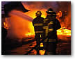 *(original 108×85 · [live](https://jdsmithinsurance.com/images_new/non_profits_property.jpg))*  *(original 108×85 · [live](https://jdsmithinsurance.com/images_new/non_profits_auto_crime.jpg))*  *(original 108×85 · [live](https://jdsmithinsurance.com/images_new/house_car_small.jpg))*

### 2. Quote options (top CTA)
- **Primary:** [Call 1-800-917-7283](tel:18009177283) — discounts for Charity Village and CCBF members
- Contacts on the live page: [Ext. 228 for Mark Smith](tel:+19057647868,228) · [Ext. 234 for J. D. Smith](tel:+19057647868,234)
- Small non-profit? [Quote non-profit liability online](https://jdsmithinsurance.securequotebot.com/nonprofit-liability) (see B4)

### 3. Information
**Member discounts**
- **40% discount on house & car & boat** — [Charity Village members](charity_village_group_insurance.htm) only. [Charity Village](https://charityvillage.com)  *(original 164×92 · [live](https://jdsmithinsurance.com/images_new/logo_charity_village.jpg))*
- **[CCBF](http://www.ccbf.org) members, call us today:** up to 45% discount on house and car; 30% discount on commercial business and auto policies.  *(original 206×88 · [live](https://jdsmithinsurance.com/images_new/logo_ccbf_non_profits.gif))*
- Insurer logos on the page:  *(original 500×84 · [live](https://jdsmithinsurance.com/images_new/logo_economical_insurance_1_2012.gif))* *(2012 logo: Economical is now Definity)*

**JDS directors & officers solution**
- 1 to 5 million coverage
- All boards and committees included
- Spousal coverage available

**Costs**
- For 12 board members, from $850 per year
- For 20 board members, from $1,250 per year

**JDS / Charity Village property solution**
*Property:*
- All Risk, Replacement Coverage on Building & Contents
- Computer Hardware, Software, and Breakdown Coverage
- Laptops
- Office Contents Extensions
- Commercial Condo Betterments & Improvements
- Inflation Protection
- Blanket By-Laws
- Professional Fees
- Accounts Receivable
- Newly Acquired Buildings and Contents
- Sign and Glass Coverage
- Goods in Transit Coverage & Cargo Insurance
- Exhibit Booth Coverage
- Fine Arts
- Master Key Coverage
- Electrical & Machinery Coverage

*Loss of income and business interruption:* In the unfortunate event of shutting down your business due to a claim, do you have coverage to temporarily relocate or replace your lost revenue?

Our programs include options for Gross Earning Coverage, Profits, Actual Loss Sustained, Extra Expense and Additional time required to rebuild.

*Crime:*
- Employee Dishonesty
- In and Out Robbery
- Forgery, Counterfeit Money
- Broad Form Money Coverage

*Broad form general liability:*
- Up to $10 Million Coverage for bodily injury and property damage including operation on and off your premises, and sales to the USA.
- USA coverage available
- Companies that test welds and steel need special wordings *(copied from the NDT page by mistake: remove)*

*Car and fleets:*
- Group Rates for 3 or more vehicles
- Loss of use coverage
- Fleet Discounts
- Special rates for Associations

### 4. Quote options (bottom CTA)
- **Primary:** [Call 1-800-917-7283](tel:18009177283) — discounts for Charity Village and CCBF members

Contact block (standard).

### 5. Related links
[Non-profit liability online (small business)](small_business_non_profit.htm) · [Churches](jds-church.htm) · [D&O application, non-profit (PDF)](Applications/directors_officers_non_profit.pdf) · [Group insurance](jds-life_groups.htm)

### C4.1 Sub-page: Charity Village group discounts — `charity_village_group_insurance.htm`
Linked from C4 ("Charity Village members"). Not in the menus. The live page uses a different (old) template.
**Live page:** [charity_village_group_insurance.htm](https://jdsmithinsurance.com/charity_village_group_insurance.htm) · **Current &lt;title&gt;:** "Charity Village Group Discounts" · **Meta description:** "Group discounts mean great savings for your home and auto insurance."

- **H1:** The J D Smith Group Insurance Package for Charity Village members
- **Subheading:** Big insurance premium savings · better coverage · best personal service · best claims service. "My job is to save you money, with personal service."
- **Photos (original):**  *(original [live](https://jdsmithinsurance.com/images_sub_webs/house_car_3.jpg))*  *(original 164×92 · [live](https://jdsmithinsurance.com/images_new/logo_charity_village.jpg))*  *(original [live](https://jdsmithinsurance.com/images_sub_webs/coverage_auto.jpg))*  *(original [live](https://jdsmithinsurance.com/images_sub_webs/coverage_home.jpg))*  *(original [live](https://jdsmithinsurance.com/images_sub_webs/coverage_reliable.jpg))*  *(original [live](https://jdsmithinsurance.com/images_sub_webs/girl_csr_large.jpg))*
- **Suggested replacement:**  *(suggested replacement · [Unsplash photo](https://unsplash.com/photos/green-grass-lawn-in-front-of-white-concrete-house-y_ibWWpOiL0) · free Unsplash License)*
- **CTA (top and bottom):** Call one of our group specialists: [1-800-917-SAVE](tel:18009177283) or [905-764-7868](tel:9057647868), [John Bell ext. 255](tel:+19057647868,255). *(The live "24/7 online quote" buttons go to compu-quote.com, which no longer responds. Use the auto rater and the phone instead: [Start online auto quote](https://webrater.appliedsystems.com/WR/Default.aspx?GC=JDSMITH&LOB=AUTO&LANG=EN) · home by phone.)*

Text:
- **Group savings to date:** total $192,500.
- Home & auto group insurance protection with J. D. Smith Insurance gives you flexible coverage tailored to meet your individual needs, at the best available group rates.
- **Auto coverage:** our excellent insurance program is available for your private passenger cars, utility vehicles, trucks, SUVs and vans. Recreational vehicle coverage is also available for trailers, motor homes, motorcycles and snowmobiles. Individuals with more than 2 tickets will not qualify for our lowest rates.
- **Home coverage:** choose from a broad selection of coverage packages to suit your needs, including homeowners, tenants, and condominium owners. Additional supplementary coverage is also available for boats and motors, sports equipment, jewellery and furs, musical instruments, seasonal/secondary residences, and more.
- **Save money with discounts:** save even more on your premiums by taking full advantage of our numerous discounts, such as multi-vehicle ownership, anti-theft device on vehicle, claims-free home & auto, new home, monitored home alarm, and age. Plus, more package discounts are available for insuring both your home & auto with the J. D. Smith Insurance Charity Village Insurance Program.
- **Flexible payment plans:** pre-authorized payments, with regular withdrawals from your financial institution · full payment with cash, cheque or credit card · instalment plan with cash, cheque or credit card. With J.D. Smith Insurance and the Charity Village Group Insurance Program there is no monthly service charge for our payment plan.
- **Reliable claims service:** we're here for you day and night, every day. From anywhere in North America you can speak directly with one of our claims professionals. 1-800-917-SAVE.
- **Typical savings on our group plan:**
  > "On my 2007 BMW I saved $497 with your Employee Group Plan." — Russell S.
  > "As an employee, on my 2 vehicles I saved $642 using your Group Plan." — Dr. Jennifer M.
  > "As a life insurance specialist, I saved $215 on my home policy and $342 on my car with your package, thanks so much." — Eldon T.
- "QUOTE ME — 5 minutes could save you $450."

---

## C5. Contractors
`jds-packages_contractors.htm` · Menu: Commercial › Trades & industry › Contractors · Footer: Commercial › Contractors
**Live page:** [jds-packages_contractors.htm](https://jdsmithinsurance.com/jds-packages_contractors.htm) · **Current &lt;title&gt;:** "Business Insurance For Members of the Toronto Construction Association" · **Meta description:** "JDs Commercial Package is designed for contractors and members of the Toronto Construction Association."

### 1. Hero
- **H1:** Construction insurance solutions
- **Subheading:** We are construction specialists with hundreds of clients.
- **Hero photo (original):**  *(original 1000×400 · [live](https://jdsmithinsurance.com/images/contractors_working_on_building.jpg))*
- **Suggested replacement:**  *(suggested replacement · [Unsplash photo](https://unsplash.com/photos/two-construction-workers-review-plans-on-a-tablet-gyrKtgqMChY) · free Unsplash License)*

### 2. Quote options (top CTA)
10–15% off for TCA and MCA members.
- [Contractors liability (PDF)](Applications/contractors_liability.pdf) · [Quote form](https://jdsmithinsurance.com/jds-quote.htm) · [Call 1-800-917-7283](tel:18009177283)
- Related contractor applications: [Builder's risk (PDF)](Applications/builders_risk.pdf) · [Architects & engineers (professional liability) (PDF)](Applications/prof_liability_architects_2.pdf) · [Homebuilders (professional liability) (PDF)](Applications/prof_liability_homebuilders.pdf) · [Roofing contractors (pollution liability) (PDF)](Applications/prof_liability_pollution.pdf)
- Contacts on the live page: [Ext. 215 for Rocco Scarano](tel:+19057647868,215) ([video message](https://jdsmithinsurance.com/VLP/JDS_RS.html), now on [Staff video messages](jds-staff_videos.htm)) · [Ext. 228 for Mark Smith](tel:+19057647868,228) · [Ext. 245 for Tom Larha](tel:+19057647868,245)

### 3. Information
 *(original 108×83 · [live](https://jdsmithinsurance.com/images/toronto_landscape.gif))* **Additional 20% discount** for members of the **TCA** (Toronto Construction Association) or **MCA** (Mississauga Construction Association). *(the fleet section on this page and the quote page say 10–15%: see STAKEHOLDER_NOTES)* [Toronto Construction Association](http://www.tcanetworks.com)  *(original 86×66 · [live](https://jdsmithinsurance.com/images/logo_tca.gif))*

Our program has developed, with our 2 insurance company partners, a **rate** and **package** with excellent personal service designed especially for 16 different industries.
- Additional 10% discount if we also insure your vehicles
- Buy-sell agreement coverage for partners
- Bonding where you order online
- All risk tool floaters
- Builder's risk competitive rates
- Transit solutions, USA included

Call our team today. We consistently better our new clients' coverage, and we probably have a unique JDS package designed especially for your business.

**Superior coverage**  *(original 208×141 · [live](https://jdsmithinsurance.com/images_new/j-d-staff-contractor_page_01.jpg))* *(Contracting broker team)*
Our construction package features broad form wordings combined with an extensive list of special extensions brought together with your specific business operations in mind. The following is a list of coverages available.

*Contractor's property:* the standard property list, with "Tools" in place of "Fine Arts".

*Crime and business interruption:*
- Employee Dishonesty
- In and Out Robbery
- Forgery, Counterfeit Money
- Broad Form Money Coverage

*Broad form general liability:*
- Up to $10 Million Coverage for bodily injury and property damage including operation on and off your premises, and sales to the USA.
- USA coverage available

*Car and fleets — we have the lowest rates in Ontario:*  *(original 108×65 · [live](https://jdsmithinsurance.com/images/contractor_van.gif))*
- Group rates for 3 or more vehicles
- Loss of use coverage
- Fleet discounts
- Additional 10%–15% discount for TCA or MCA members
- Ask about our package for electrical contractors

**[Boomerang](http://www.boomerangtracking.com)** — we insist on tracking devices on all loaders & earth movers.

### 4. Quote options (bottom CTA)
10–15% off for TCA and MCA members.
- [Contractors liability (PDF)](Applications/contractors_liability.pdf) · [Quote form](https://jdsmithinsurance.com/jds-quote.htm) · [Call 1-800-917-7283](tel:18009177283)
- Related contractor applications: [Builder's risk (PDF)](Applications/builders_risk.pdf) · [Architects & engineers (professional liability) (PDF)](Applications/prof_liability_architects_2.pdf) · [Homebuilders (professional liability) (PDF)](Applications/prof_liability_homebuilders.pdf) · [Roofing contractors (pollution liability) (PDF)](Applications/prof_liability_pollution.pdf)

Contact block (standard).

### 5. Related links
[Builder's risk (online)](small_business_builders_risk.htm) · [Landscapers & snow removal](jds-packages_landscape_snow_removal.htm) · [Windows & doors](jds-packages_doors_windows.htm) · [Car & truck fleets](jds-packages_fleet_insurance.htm)

---

## C6. Landscapers & snow removal
`jds-packages_landscape_snow_removal.htm` · Menu: Commercial › Trades & industry › Landscapers & snow removal
**Live page:** [jds-packages_landscape_snow_removal.htm](https://jdsmithinsurance.com/jds-packages_landscape_snow_removal.htm) · **Current &lt;title&gt;:** "Business Insurance For Landscape and Snow Removal Contractors" · **Meta description:** "JDs Commercial Insurance Package designed for landscape and snow removal contractors, garden centres and golf courses."

### 1. Hero
- **H1:** Garden, landscape & snow removal insurance
- **Subheading:** Canada's leading landscaper and garden insurance program also covers snow and ice removal. We guarantee to match or better your cost and coverage.
- **Hero photo (original):** 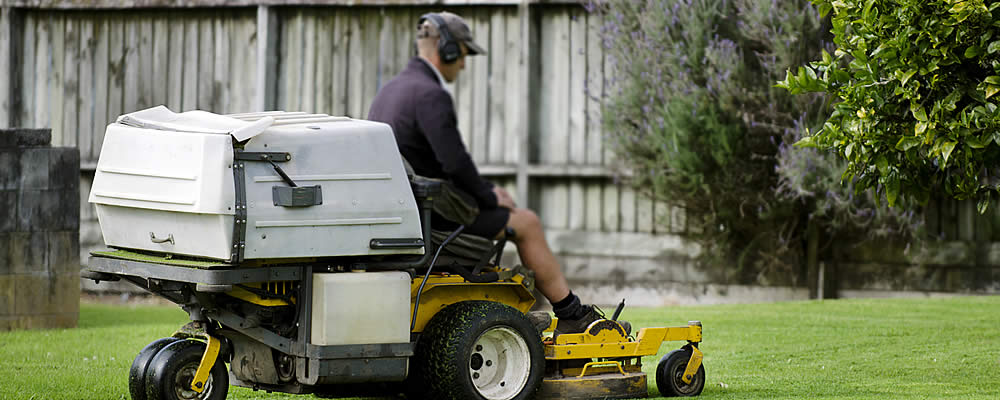 *(original 1000×400 · [live](https://jdsmithinsurance.com/images/landscape_contractor_on_lawn_mower.jpg))*
- **Suggested replacement:**  *(suggested replacement · [Unsplash photo](https://unsplash.com/photos/a-man-mowing-a-lawn-with-a-lawn-mower-bsld7GjQwjI) · free Unsplash License)* · second photo for the snow section:  *(suggested replacement · [Unsplash photo](https://unsplash.com/photos/skid-steer-loader-plowing-snow-on-a-city-street-2RhQAfvGeNo) · free Unsplash License)*

### 2. Quote options (top CTA)
- [PDF application (PDF)](Applications/landscaping_snow_removal_2017.pdf) · [Call Haig Papazian 905-907-9210](tel:+19059079210) · [Quote form](https://jdsmithinsurance.com/jds-quote.htm)
- "Contact specialist Haig Papazian, ext. 239 or 905-907-9210": [Ext. 239](tel:+19057647868,239) · Mark Smith [ext. 228](tel:+19057647868,228)

### 3. Information
 *(original 175×125 · [live](https://jdsmithinsurance.com/images_new/snow_removal_01.gif))*  *(original 175×125 · [live](https://jdsmithinsurance.com/images_new/landscape_01.gif))*
**Quality product.** Our landscape and garden package has been designed to provide broad coverage for lawn care, garden centres, sprinkler installers, tree care specialists, golf courses and contractors.

| Quality coverage | Optional coverage |
|---|---|
| Building & contents: all risk, replacement cost | Design & professional liability coverage |
| Contractor's and rental equipment coverage | Fleet and snow plow coverage |
| Flood, sewer back-up & earthquake coverage | Discounts on life insurance |
| $25,000 employee dishonesty coverage | Group discounts for home & auto insurance |
| $10,000 broad form crime coverage | |

**Superior coverage**  *(original 208×141 · [live](https://jdsmithinsurance.com/images_new/j-d-staff-contractor_page_01.jpg))*
J D Smith Insurance specializes in business insurance for landscapers in Ontario. We use our commercial industry knowledge to develop a special package just for your business. We will assist you with loss control ideas to prevent claims. With the expertise gained from 30 years of successful program management and the strength of Canada's largest, top-rated insurance companies, our clients will have stability through all market cycles.

**Snow and ice removal** 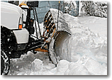 *(original 158×113 · [live](https://jdsmithinsurance.com/images_new/snow_removal_02.gif))*
We specialize in property and liability insurance for landscapers, tree care and snow removal companies. We understand that many of our landscaper and tree service clients make their living during the winter months performing snow and ice removal, a very difficult-to-place insurance risk. That's why we write coverage for snow and ice removal in Ontario. We insure both residential risks AND risks that clear snow at apartment complexes and low-traffic commercial buildings.

**Garden and landscape package: over $1,000,000 in additional coverage**
- $100,000 debris removal
- $100,000 by-law coverage
- $25,000 goods in transit coverage
- $100,000 professional fees
- $150,000 contractor's equipment
- Accounts receivable & valuable papers
- Business interruption & extra expense
- Consequential loss coverage of plants
- Computers & electronic data, media & equipment
- Exhibitions, exterior signs, inflation protection
- Replacement cost
- Valuable papers

**The JDS liability policy: limits to $10,000,000**
- Normal landscaper operations on and off premises
- Products & completed operations
- Bodily injury & property damage
- Non-owned auto, legal defence costs
- Contract brokers included
- Employees as additional insured

Photo strip:  *(original 158×103 · [live](https://jdsmithinsurance.com/images_new/landscape_02.gif))*  *(original 158×93 · [live](https://jdsmithinsurance.com/images_new/landscape_03.gif))*  *(original 158×80 · [live](https://jdsmithinsurance.com/images_new/landscape_04.gif))*  *(original 158×105 · [live](https://jdsmithinsurance.com/images_new/landscape_05.gif))*

*Crime and business interruption:*
- Employee Dishonesty
- In and Out Robbery
- Forgery, Counterfeit Money
- Broad Form Money Coverage

*Broad form general liability:*
- Up to $10 Million Coverage for bodily injury and property damage including operation on and off your premises, and sales to the USA.
- USA coverage available

*Car and fleets — we have the lowest rates in Ontario:*
- Group rates for 3 or more vehicles
- Loss of use coverage
- Fleet discounts
- Additional 10%–15% discount for TCA or MCA members
- Ask about our package for electrical contractors

**[Boomerang](http://www.boomerangtracking.com)** — we insist on tracking devices on all loaders & earth movers.

### 4. Quote options (bottom CTA)
- [PDF application (PDF)](Applications/landscaping_snow_removal_2017.pdf) · [Call Haig Papazian 905-907-9210](tel:+19059079210) · [Quote form](https://jdsmithinsurance.com/jds-quote.htm)

Contact block (standard).

### 5. Related links
[Contractors](jds-packages_contractors.htm) · [Golf & hole-in-one](jds-hole-in-one.htm) · [Car & truck fleets](jds-packages_fleet_insurance.htm)

---

## C7. Welding & steel (fabrication & welders package)
`jds-packages_metals_welding.htm` · Menu: Commercial › Trades & industry › Welding & steel
**Live page:** [jds-packages_metals_welding.htm](https://jdsmithinsurance.com/jds-packages_metals_welding.htm) · **Current &lt;title&gt;:** "Insurance Designed for the Metal and Welding Industry" · **Meta description:** "Thousands of Commercial Clients experience our Personal Service, great rates, monthly payment plans and quality insurance products throughout Ontario and Canada."
**Suggested meta:** The JDS program for the welding and metal industry: low special rates, broad coverage and claims servicing across Canada. Special rates for CWB members.

### 1. Hero
- **H1:** Fabrication & welders package
- **Subheading:** The JDS program for the welding and metal industry. Low special rates, broad coverage, claims servicing across Canada. Insureds in our program have saved over $2,167,000 in premiums.
- **Hero photo (original):**  *(original 1000×400 · [live](https://jdsmithinsurance.com/images/welding_contractor.jpg))*
- **Suggested replacement:**  *(suggested replacement · [Unsplash photo](https://unsplash.com/photos/welder-working-on-metal-with-sparks-9Q_pLLP_jmA) · free Unsplash License)*

### 2. Quote options (top CTA)
Send all three forms, Attn: Mark Smith. CWB members save a further 10–16%. Allow 2 weeks for your quote.
- [Product liability (PDF)](Applications/cwb_liability_questionnaire2.pdf) · [Welding (PDF)](Applications/cwb_welding_questionnaire2.pdf) · [Errors & omissions (PDF)](Applications/cwb_errors_and_ommissions.pdf) · [Call 905-764-7868 ext. 228](tel:+19057647868,228)
- "You can contact J. D. Smith ext. 234 or Mark Smith ext. 228, by phone at 1-800-917-SAVE (7283)": [J. D. Smith ext. 234](tel:+19057647868,234)

### 3. Information
**Program features**
- Special rates for CWB members for 18 years
- Insureds in our program have saved over $2,167,000 in premiums
- COVID-19 discount of 14%
- In December 2020 we returned 20% of your premium to most of our insureds on our program

**Some J. D. Smith Insurance advantages**  *(original 208×141 · [live](https://jdsmithinsurance.com/images_new/j-d-staff-contractor_page_01.jpg))*
- J D Smith reports that to date their commercial JDS/CWB insurance program has saved our members over **$1,980,000** in premiums each year. *(conflicts with $2,167,000 above: see STAKEHOLDER_NOTES)*
- NEW coverages available in 2012 *(dated)*
- No increase in premiums at renewal for JDS clients
- Extended liability coverage
- Insuring steel and welding businesses in EVERY PROVINCE
- 24-hour claims offices are across Canada and will be there to service you
- Transit coverage increased to $100,000
- Tools now $25,000
- Installation floater $1,000,000
- Accounts receivable $1,000,000

**Comments from our JDS clients on our package program**
> "Receiving this policy was just like getting a cheque for $9,500," said Mitch McLean. "We were delighted to be the first company AS A CWB MEMBER to receive a policy from JDS."
>
> "OUR savings on the JD Smith Welders Package was $6,300 on the property and $4,600 on the vehicles. Thanks Mark, we will certainly recommend you." — Bruce, Kitchener ON
>
> "Hi Mark. The package got us better coverage and you INCLUDED CYBER. Thanks so much. I wish you were able to insure our vehicles as there would probably be a savings as well, but we are in Alberta. I used the $6,400 to buy new equipment. And of course, this is a yearly savings if you keep the rates the same next year." — Dave, Red Deer, AB
>
> "Dear Dr. Smith, here is my cheque for the renewal. **Same price as last year. It pays to be part of your CWB program.** Thanks." — Alan, Vancouver BC
>
> "Hey Mark. I just received a cheque BACK of $6,100. What was this for?" ("Hi George. Due to the hardships with COVID-19, our insurance carrier is returning 20% of your premium. Stay well. Blessings." — JD)

Mark Smith headshot (use `images/staff/Mark_2023.jpg`).

**The first JDS / CWB policy** [ *(original 164×127 · [live](https://jdsmithinsurance.com/images/cwb_presentation.jpg))*](https://jdsmithinsurance.com/CWB%20Flyer5.pdf)
J D Smith congratulates Jess and Mitch McLean as he delivers the first insurance policy to a CWB client (2003). For 18 years our program for welders and fabricators has serviced the industry across Canada. [Read the flyer (PDF)](https://jdsmithinsurance.com/CWB%20Flyer5.pdf)

**Metals, fabricators and welding program**
We need at least 2 weeks' lead time to review the information and provide you with a quote. J D Smith has developed a unique package for the welding and fabrication industry, with special pricing for CWB members.

### 4. Quote options (bottom CTA)
Send all three forms, Attn: Mark Smith. CWB members save a further 10–16%. Allow 2 weeks for your quote.
- [Product liability (PDF)](Applications/cwb_liability_questionnaire2.pdf) · [Welding (PDF)](Applications/cwb_welding_questionnaire2.pdf) · [Errors & omissions (PDF)](Applications/cwb_errors_and_ommissions.pdf) · [Call 905-764-7868 ext. 228](tel:+19057647868,228)

Contact block (standard).

### 5. Related links
[Canadian Welding Bureau package](jds-packages_cwb_insurance.htm) · [NDT / NDE](jds-packages_non_destructive_testing.htm) · [Tool & die](jds-packages_tool_and_die.htm)

---

## C8. Canadian Welding Bureau (CWB) package
`jds-packages_cwb_insurance.htm` · Menu: Commercial › Trades & industry › Canadian Welding Bureau
**Live page:** [jds-packages_cwb_insurance.htm](https://jdsmithinsurance.com/jds-packages_cwb_insurance.htm) · **Current &lt;title&gt;:** "J.D. Smith Insurance Package for the Canadian Welding Bureau" · **Meta description:** "J.D. Smith Insurance Brokers Insurance Package for the Canadian Welding Bureau (CWB)"
*IA note: C7 and C8 cover the same program. Consider merging them into one page (C8 as an anchor or a redirect to C7). If kept separate, C8 is the CWB-member page and C7 the general welding page.*

### 1. Hero
- **H1:** Insurance package for the Canadian Welding Bureau
- **Subheading:** Peace of mind welding coverage. J. D. Smith Insurance has worked closely with the metal and welding industry to develop a unique package with broad coverage.
- **Hero photo (original):** none on the live page (only  *(original 108×70 · [live](https://jdsmithinsurance.com/images/cwb_blue_welder.gif))*)
- **Suggested replacement:**  *(suggested replacement · [Unsplash photo](https://unsplash.com/photos/man-using-welding-machine-Wiu3w-99tNg) · free Unsplash License)*

### 2. Quote options (top CTA)
Send all three forms, Attn: Mark Smith. CWB members save a further 10–16%. Allow 2 weeks for your quote.
- [Product liability (PDF)](Applications/cwb_liability_questionnaire2.pdf) · [Welding (PDF)](Applications/cwb_welding_questionnaire2.pdf) · [Errors & omissions (PDF)](Applications/cwb_errors_and_ommissions.pdf) · [Call 905-764-7868 ext. 228](tel:+19057647868,228)
- "CWB application for quote" → [the 3 CWB applications](jds-applications.htm#cwb)
- Contacts on the live page: [Ext. 228 for Mark Smith](tel:+19057647868,228) · Ext. 240 for Jo-Anne Griffiths *(not on the staff list: see STAKEHOLDER_NOTES)* · [Ext. 234 for J. D. Smith](tel:+19057647868,234)

### 3. Information
Our brokers understand the welding and metal industry, and we have developed coverages that will give you peace of mind at a competitive rate. If you are a member of the CWB, you receive an additional discount.

 *(original 135×177 · [live](https://jdsmithinsurance.com/images/JD_pic3-a.jpg))* [Video message from J.D. Smith](https://jdsmithinsurance.com/VLP/JDS_1.html) *("A Message from Dr. J.D. Smith", a Flash video: not yet on Staff video messages, see STAKEHOLDER_NOTES)*

 *(original 108×88 · [live](https://jdsmithinsurance.com/images/cwb_people.gif))* **JDS / CWB clients saved $1,980,000 annually in insurance premiums in 2010.**

 *(original 108×102 · [live](https://jdsmithinsurance.com/images/cwb_who_we_are.gif))* [Visit CWB](http://www.cwbgroup.org)  *(original 70×67 · [live](https://jdsmithinsurance.com/images/logo_cwb_group.gif))*
If you are a client of the CWB, you are eligible to apply to be included in our special insurance package plan designed for CWB clients.
- CWB discounts for members
- Higher limits at no extra cost
- 20 unique coverages
- Discount for claims-free businesses
- Broad products and liability coverages
- USA products included
- All risk building and contents coverage
- Directors and officers coverage
- Errors and omissions coverage
- Special lower rates
- Monthly payment option

**How to apply:** we require [3 applications](jds-applications.htm#cwb) to be completed and mailed to us at least 2 months prior to your insurance renewal date. If you are a manufacturer, please include copies of your catalogue.

**Superior coverage**
Our JDS business package for welders, metal manufacturers and the steel industry features broad form wordings combined with an extensive list of special extensions brought together with your specific business operations in mind. The following is a list of coverages available.

*Property:*
- All Risk, Replacement Coverage on Building & Contents
- Computer Hardware, Software, and Breakdown Coverage
- Laptops
- Office Contents Extensions
- Commercial Condo Betterments & Improvements
- Inflation Protection
- Blanket By-Laws
- Professional Fees
- Accounts Receivable
- Newly Acquired Buildings and Contents
- Sign and Glass Coverage
- Goods in Transit Coverage & Cargo Insurance
- Exhibit Booth Coverage
- Fine Arts
- Master Key Coverage
- Electrical & Machinery Coverage

*Loss of income: business interruption:* In the unfortunate event of shutting down your business due to a claim, do you have coverage to temporarily relocate or replace your lost revenue?

Our programs include options for Gross Earning Coverage, Profits, Actual Loss Sustained, Extra Expense and Additional time required to rebuild.

*Crime:*
- Employee Dishonesty
- In and Out Robbery
- Forgery, Counterfeit Money
- Broad Form Money Coverage

*Broad form general liability:*
- Up to $20 million CWB coverage for bodily injury and property damage including operations on and off your premises, and sales to the USA
- USA coverage available
- CWB extension for members

*Car and fleets — our fleet rates are the lowest in Ontario:*
- Group rates for 3 or more vehicles
- Loss of use coverage
- Fleet discounts
- Additional discount for CWB members
- Transit

*Other liability:*
- Umbrella coverage up to $20 million available
- Professional malpractice liability
- Directors and officers liability
- Liquor liability
- Special one-time large event liability

### 4. Quote options (bottom CTA)
Send all three forms, Attn: Mark Smith. CWB members save a further 10–16%. Allow 2 weeks for your quote.
- [Product liability (PDF)](Applications/cwb_liability_questionnaire2.pdf) · [Welding (PDF)](Applications/cwb_welding_questionnaire2.pdf) · [Errors & omissions (PDF)](Applications/cwb_errors_and_ommissions.pdf) · [Call 905-764-7868 ext. 228](tel:+19057647868,228)

Contact block (standard).

---

## C9. Tool & die
`jds-packages_tool_and_die.htm` · Menu: Commercial › Trades & industry › Tool & die
**Live page:** [jds-packages_tool_and_die.htm](https://jdsmithinsurance.com/jds-packages_tool_and_die.htm) · **Current &lt;title&gt;:** "Business Insurance For Tool and Die Machine Shops" · **Meta description:** "JDs Commercial Package is designed for the Tool and Die industry."

### 1. Hero
- **H1:** Tool & die machine shop insurance
- **Subheading:** The JDS Gold Shield insurance package for the tool and die machine shop provides broad coverage and group rates.
- **Hero photo (original):**  *(original 1000×400 · [live](https://jdsmithinsurance.com/images/tool_die_insurance_solutions.jpg))*
- **Suggested replacement:**  *(suggested replacement · [Unsplash photo](https://unsplash.com/photos/metal-rod-machining-on-lathe-eaanLTG7TCU) · free Unsplash License)*

### 2. Quote options (top CTA)
- [Call 1-800-917-7283](tel:18009177283) · [Quote form](https://jdsmithinsurance.com/jds-quote.htm)

### 3. Information
 *(original 108×115 · [live](https://jdsmithinsurance.com/images/tool_and_die.gif))*
Machine shops are unique and require special coverages, including coverage for loss of income, mould replacement, and often USA coverage. Call us for a quote.

*Property:*
- All Risk, Replacement Coverage on Building & Contents
- Computer Hardware, Software, and Breakdown Coverage
- Laptops
- Office Contents Extensions
- Commercial Condo Betterments & Improvements
- Inflation Protection
- Blanket By-Laws
- Professional Fees
- Accounts Receivable
- Newly Acquired Buildings and Contents
- Sign and Glass Coverage
- Goods in Transit Coverage & Cargo Insurance
- Exhibit Booth Coverage
- Fine Arts
- Master Key Coverage
- Electrical & Machinery Coverage

*Crime:*
- Employee Dishonesty
- In and Out Robbery
- Forgery, Counterfeit Money
- Broad Form Money Coverage

*Broad form general liability:*
- Up to $10 Million Coverage for bodily injury and property damage including operation on and off your premises, and sales to the USA.
- USA coverage available

*Car and fleets:*
- Group Rates for 3 or more vehicles
- Loss of use coverage
- Fleet Discounts
- Special rates for Associations

### 4. Quote options (bottom CTA)
- [Call 1-800-917-7283](tel:18009177283) · [Quote form](https://jdsmithinsurance.com/jds-quote.htm)

Contact block (standard).

### 5. Related links
[Welding & steel](jds-packages_metals_welding.htm) · [Boiler & machinery application (PDF)](Applications/boiler_machinery.pdf) · [Windows & doors](jds-packages_doors_windows.htm)

---

## C10. Windows & doors
`jds-packages_doors_windows.htm` · Menu: Commercial › Trades & industry › Windows & doors
**Live page:** [jds-packages_doors_windows.htm](https://jdsmithinsurance.com/jds-packages_doors_windows.htm) · **Current &lt;title&gt;:** "Business Insurance For Door and Window Manufacturers" · **Meta description:** "JDs Commercial Package is designed for manufacturers of doors, windows and related hardware."

### 1. Hero
- **H1:** Insurance for door and window manufacturers & installers
- **Subheading:** Our JDS commercial package is especially designed for manufacturers & installers of doors, windows and all their related hardware.
- **Hero photo (original):**  *(original 1000×400 · [live](https://jdsmithinsurance.com/images/doors_windows_packages.jpg))*
- **Suggested replacement:**  *(suggested replacement · [Unsplash photo](https://unsplash.com/photos/brown-brick-house-with-white-wooden-door--zNNFDR3dPM) · free Unsplash License)*

### 2. Quote options (top CTA)
- [Quote form](https://jdsmithinsurance.com/jds-quote.htm) · [Call 1-800-917-7283](tel:18009177283)
- Contacts on the live page: [Ext. 228 for Mark Smith](tel:+19057647868,228) · [Ext. 245 for Tom Larha](tel:+19057647868,245)

### 3. Information
 *(original 108×158 · [live](https://jdsmithinsurance.com/images/reddish_door.gif))*
Our JDS business package features broad form wordings combined with an extensive list of special extensions brought together with your specific business operations in mind. The following is a list of coverages available.

*Property:*
- All Risk, Replacement Coverage on Building & Contents
- Computer Hardware, Software, and Breakdown Coverage
- Laptops
- Office Contents Extensions
- Commercial Condo Betterments & Improvements
- Inflation Protection
- Blanket By-Laws
- Professional Fees
- Accounts Receivable
- Newly Acquired Buildings and Contents
- Sign and Glass Coverage
- Goods in Transit Coverage & Cargo Insurance
- Exhibit Booth Coverage
- Fine Arts
- Master Key Coverage
- Electrical & Machinery Coverage

*Crime:*
- Employee Dishonesty
- In and Out Robbery
- Forgery, Counterfeit Money
- Broad Form Money Coverage

*Broad form general liability:*
- Up to $10 Million Coverage for bodily injury and property damage including operation on and off your premises, and sales to the USA.
- USA coverage available

*Car and fleets — we have the lowest auto rates in Ontario:*
- Group Rates for 3 or more vehicles
- Loss of use coverage
- Fleet Discounts
- Special rates for Associations

### 4. Quote options (bottom CTA)
- [Quote form](https://jdsmithinsurance.com/jds-quote.htm) · [Call 1-800-917-7283](tel:18009177283)

Contact block (standard).

### 5. Related links
[Contractors](jds-packages_contractors.htm) · [Tool & die](jds-packages_tool_and_die.htm)

---

## C11. Non-destructive testing (NDT / NDE)
`jds-packages_non_destructive_testing.htm` · Menu: Commercial › Trades & industry › NDT / NDE
**Live page:** [jds-packages_non_destructive_testing.htm](https://jdsmithinsurance.com/jds-packages_non_destructive_testing.htm) · **Current &lt;title&gt;:** "Insurance for Companies Performing Non Destructive Testing" · **Meta description:** "Thousands of Commercial Clients experience our Personal Service, great rates, monthly payment plans and quality insurance products throughout Ontario and Canada."

### 1. Hero
- **H1:** Non-destructive testing insurance solutions
- **Subheading:** If you are a trained technician or supervisor with NDT or NDE, we think you are a better risk and should have better rates on your business insurance and your personal insurance.
- **Hero photo (original):**  *(original 1000×400 · [live](https://jdsmithinsurance.com/images/non_destructive_testing.jpg))*
- **Suggested replacement:**  *(suggested replacement · [Unsplash photo](https://unsplash.com/photos/industrial-metal-pipes-and-valves-41X6FwTwPh4) · free Unsplash License)*

### 2. Quote options (top CTA)
"For a quote, complete the applications:"
Send all three forms.
- [Questionnaire (PDF)](Applications/NDE_questionnaire1.pdf) · [Product liability (PDF)](Applications/NDE_Liability2.pdf) · [Professional liability (PDF)](Applications/NDE_Professional_Liab3.pdf)
- Contacts on the live page: [Ext. 228 for Mark Smith](tel:+19057647868,228) · [Ext. 234 for J. D. Smith](tel:+19057647868,234)

### 3. Information
 *(original 158×114 · [live](https://jdsmithinsurance.com/images/cinde_man_computer.jpg))*
We understand that professionals who do non-destructive testing need special coverage.

**E&O:** our professional liability policy will provide up to $10 million in errors & omissions coverage for your business.

**Superior coverage: JDS/NDE**  *(original 108×79 · [live](https://jdsmithinsurance.com/images/cinde_man_computer_2.jpg))*
Our business package features broad form wordings combined with an extensive list of special extensions brought together with your specific business operations in mind. The following is a list of coverages available.

*Property:*
- All Risk, Replacement Coverage on Building & Contents
- Computer Hardware, Software, and Breakdown Coverage
- Laptops
- Office Contents Extensions
- Commercial Condo Betterments & Improvements
- Inflation Protection
- Blanket By-Laws
- Professional Fees
- Accounts Receivable
- Newly Acquired Buildings and Contents
- Sign and Glass Coverage
- Goods in Transit Coverage & Cargo Insurance
- Exhibit Booth Coverage
- Fine Arts
- Master Key Coverage
- Electrical & Machinery Coverage

*Loss of income and business interruption:* In the unfortunate event of shutting down your business due to a claim, do you have coverage to temporarily relocate or replace your lost revenue?

Our programs include options for Gross Earning Coverage, Profits, Actual Loss Sustained, Extra Expense and Additional time required to rebuild.

*Crime:*
- Employee Dishonesty
- In and Out Robbery
- Forgery, Counterfeit Money
- Broad Form Money Coverage

*Broad form general liability:*
- Up to $10 Million Coverage for bodily injury and property damage including operation on and off your premises, and sales to the USA.
- USA coverage available
- Companies that test welds and steel need special wordings

*Car and fleets:*
- Group Rates for 3 or more vehicles
- Loss of use coverage
- Fleet Discounts
- Special rates for Associations

### 4. Quote options (bottom CTA)
"You can view, print and fill out the insurance forms below, then fax them to 905-764-9618."
Send all three forms.
- [Questionnaire (PDF)](Applications/NDE_questionnaire1.pdf) · [Product liability (PDF)](Applications/NDE_Liability2.pdf) · [Professional liability (PDF)](Applications/NDE_Professional_Liab3.pdf)

Contact block (standard).

### 5. Related links
[Welding & steel](jds-packages_metals_welding.htm) · [Canadian Welding Bureau](jds-packages_cwb_insurance.htm)

---

## C12. Car & truck fleets
`jds-packages_fleet_insurance.htm` · Menu: Commercial › Transport & trade › Car & truck fleets · Footer: Commercial › Fleets & cargo
**Live page:** [jds-packages_fleet_insurance.htm](https://jdsmithinsurance.com/jds-packages_fleet_insurance.htm) · **Current &lt;title&gt;:** "Great Rates for Car and Truck Fleet Insurance" · **Meta description:** "JDs Commercial Fleet Package is designed to give you peace of mind when insuring your fleet of cars or trucks."

### 1. Hero
- **H1:** Car & truck fleet insurance
- **Subheading:** J D Smith Insurance are specialists in fleets.
- **Hero photo (original):**  *(original 1000×400 · [live](https://jdsmithinsurance.com/images/commercial_fleet_front.jpg))*
- **Suggested replacement:**  *(suggested replacement · [Unsplash photo](https://unsplash.com/photos/aerial-photography-of-freight-truck-lot-GOD2mDNujuU) · free Unsplash License)*

### 2. Quote options (top CTA)
- [Quote form](https://jdsmithinsurance.com/jds-quote.htm) · [Motor truck cargo (PDF)](Applications/motor_truck.pdf) · [Call 1-800-917-7283](tel:18009177283)
- Contact on the live page: "Ext. 245 for Tom Larha and Mark Smith" → [Tom Larha ext. 245](tel:+19057647868,245) · [Mark Smith ext. 228](tel:+19057647868,228) *(Mark Smith is ext. 228: STAKEHOLDER_NOTES 2.2)*

### 3. Information
 *(original 110×94 · [live](https://jdsmithinsurance.com/images/Truck_cab-a.jpg))*  *(original 120×90 · [live](https://jdsmithinsurance.com/images/contractor_van.gif))*
- We represent all major markets for fleets
- JDS currently insures fleets from 6 to 190 vehicles
- JDS has very competitive rates
- We work with our clients on loss control
- Monthly payment plans at low rates

Photo strip:  *(original 143×108 · [live](https://jdsmithinsurance.com/images_new/fleet_truck_flatbed_1.jpg))*  *(original 191×108 · [live](https://jdsmithinsurance.com/images_new/fleet_truck_tanker_1.jpg))*  *(original 164×108 · [live](https://jdsmithinsurance.com/images_new/fleet_truck_waste_1.jpg))*

*Fleet coverage highlights (from the Commercial overview):* group rates for 3 or more vehicles · loss of use coverage · fleet discounts · special rates for associations.

*Crime and business interruption:*
- Employee Dishonesty
- In and Out Robbery
- Forgery, Counterfeit Money
- Broad Form Money Coverage

*Broad form general liability:*
- Up to $10 Million Coverage for bodily injury and property damage including operation on and off your premises, and sales to the USA.
- USA coverage available

### 4. Quote options (bottom CTA)
- [Quote form](https://jdsmithinsurance.com/jds-quote.htm) · [Motor truck cargo (PDF)](Applications/motor_truck.pdf) · [Call 1-800-917-7283](tel:18009177283)

Contact block (standard).

### 5. Related links
[Marine & overland cargo](jds-packages_marine_overland_insurance.htm) · [Contractors](jds-packages_contractors.htm) · [Customs bonds](jds-customs_bonding.htm)

---

## C13. Marine & overland cargo
`jds-packages_marine_overland_insurance.htm` · Menu: Commercial › Transport & trade › Marine & overland cargo
**Live page:** [jds-packages_marine_overland_insurance.htm](https://jdsmithinsurance.com/jds-packages_marine_overland_insurance.htm) · **Current &lt;title&gt;:** "Great Rates for Car and Truck Fleet Insurance" · **Meta description:** "JDs Commercial Fleet Package is designed to give you peace of mind when insuring your fleet of cars or trucks."
**Suggested &lt;title&gt;:** Marine & Overland Cargo Insurance | JD Smith Insurance *(the live title is copied from the fleet page)*

### 1. Hero
- **H1:** Marine & overland cargo insurance
- **Subheading:** CNA (Continental Casualty Company) ocean and overland cargo insurance. If this happens to your goods, our policy will be there to help.
- **Hero photo (original):**  *(original 1000×400 · [live](https://jdsmithinsurance.com/images/commercial_marine_overland.jpg))*
- **Suggested replacement:**  *(suggested replacement · [Unsplash photo](https://unsplash.com/photos/red-and-blue-cargo-ship-on-body-of-water-during-daytime-NndKt2kF1L4) · free Unsplash License)*

### 2. Quote options (top CTA)
"Click for a CNA application for OCEAN CARGO insurance that can be printed, completed and faxed to us."
- [PDF application (PDF)](Applications/2016%20-%20CNA%20Marine%20Cargo%20Application%20V.2.pdf) · [Quote form](https://jdsmithinsurance.com/jds-quote.htm)
- Contact on the live page: [Ext. 228 for Mark Smith](tel:+19057647868,228)

### 3. Information
"If this happens to your goods, then our policy will be there to help. Call for a quote today."
Photo gallery (cargo losses, 6 photos):  *(original 400×300 · [live](https://jdsmithinsurance.com/images/commercial_cna_02.jpg))* 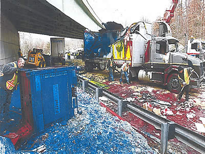 *(original 400×300 · [live](https://jdsmithinsurance.com/images/commercial_cna_03.jpg))* 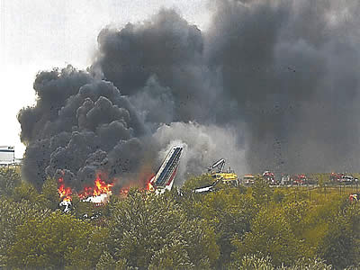 *(original 400×300 · [live](https://jdsmithinsurance.com/images/commercial_cna_04.jpg))* 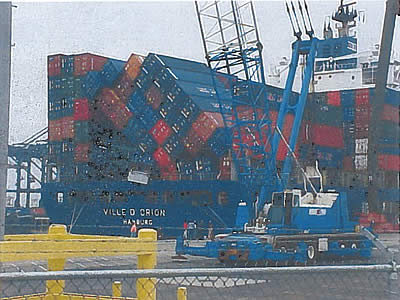 *(original 400×300 · [live](https://jdsmithinsurance.com/images/commercial_cna_05.jpg))*  *(original 400×190 · [live](https://jdsmithinsurance.com/images/commercial_cna_06.jpg))*  *(original 400×190 · [live](https://jdsmithinsurance.com/images/commercial_cna_07.jpg))*

*Crime and business interruption:*
- Employee Dishonesty
- In and Out Robbery
- Forgery, Counterfeit Money
- Broad Form Money Coverage

*Broad form general liability:*
- Up to $10 Million Coverage for bodily injury and property damage including operation on and off your premises, and sales to the USA.
- USA coverage available

### 4. Quote options (bottom CTA)
- [PDF application (PDF)](Applications/2016%20-%20CNA%20Marine%20Cargo%20Application%20V.2.pdf) · [Quote form](https://jdsmithinsurance.com/jds-quote.htm)

Contact block (standard).

### 5. Related links
[Car & truck fleets](jds-packages_fleet_insurance.htm) · [Customs bonds](jds-customs_bonding.htm) · [Motor truck cargo application (PDF)](Applications/motor_truck.pdf)

---

## C14. Customs bonds
`jds-customs_bonding.htm` · Menu: Commercial › Transport & trade › Customs bonds
**Live page:** [jds-customs_bonding.htm](https://jdsmithinsurance.com/jds-customs_bonding.htm) · **Current &lt;title&gt;:** "Bonding for Canada Customs" · **Meta description:** "Get a continuous bond to help get your shipments through Canada customs."

### 1. Hero
- **H1:** Bonding for Canada Customs
- **Subheading:** We can usually issue you a customs bond in a couple of days.
- **Hero photo (original):**  *(original 1000×400 · [live](https://jdsmithinsurance.com/images/contact_us_front.jpg))* *(the contact-us banner, reused)*
- **Suggested replacement:**  *(suggested replacement · [Unsplash photo](https://unsplash.com/photos/stacked-orange-shipping-containers-sNY6B9NsPP8) · free Unsplash License)*

### 2. Quote options (top CTA)
Talk to our bond expert, Haig Papazian. Bonds are usually issued in a couple of days.
- [Call 905-907-9210](tel:+19059079210)
- Also: [1-800-917-SAVE ext. 239](tel:+19057647868,239) · "Complete our 2-page application" *(the application is not online: ask the office for the PDF, see STAKEHOLDER_NOTES)*

### 3. Information
Canada's relationship with the USA is changing. Tariffs have brought increasing problems to exporters and importers. You may find that all of a sudden you have to pay extra fees to receive your goods across the Kingston, Niagara Falls or Windsor borders.

**We can help.** We can usually issue you a customs bond in a couple of days.

**How a customs bond works**
- The bond is a contract between three parties: the importer (your company), the customs department (CRA) and the insurance company.
- With our standard bond of $50,000, the customs department knows that it will get paid, either by you or by the insurance company. Usually, they will release your shipment quickly.
- We will issue you a yearly, continuous bond that will help you get all your shipments through Canada customs quickly and will assist your customs broker at the border.

If you are looking for bonding in this tough business environment, please give us a call and complete our 2-page application.

### 4. Quote options (bottom CTA)
"Call our bond expert Haig Papazian, direct line 905-907-9210 or 1-800-917-SAVE ext. 239."
Talk to our bond expert, Haig Papazian. Bonds are usually issued in a couple of days.
- [Call 905-907-9210](tel:+19059079210)

Contact block (standard).

### 5. Related links
[Marine & overland cargo](jds-packages_marine_overland_insurance.htm) · [Car & truck fleets](jds-packages_fleet_insurance.htm) · [Retail & wholesale](jds-packages_retail_wholesale.htm)

---

## C15. Retail & wholesale
`jds-packages_retail_wholesale.htm` · Menu: Commercial › Transport & trade › Retail & wholesale
**Live page:** [jds-packages_retail_wholesale.htm](https://jdsmithinsurance.com/jds-packages_retail_wholesale.htm) · **Current &lt;title&gt;:** "Business Insurance For Retail and Wholesale Businesses" · **Meta description:** "JDs Commercial Package is designed for retailers, wholesalers and franchise insurance."

### 1. Hero
- **H1:** Retail, wholesale & franchise insurance
- **Subheading:** We insure more than 380 franchise locations across Canada. Our franchise and retail store package division will give you an instant quote on the telephone.
- **Hero photo (original):**  *(original 1000×400 · [live](https://jdsmithinsurance.com/images/mall_food_court_franchises.jpg))*
- **Suggested replacement:**  *(suggested replacement · [Unsplash photo](https://unsplash.com/photos/clothes-store-interior-P3pI6xzovu0) · free Unsplash License)*

### 2. Quote options (top CTA)
Instant quote over the phone.
- [Call 1-800-917-7283](tel:18009177283) · [Quote form](https://jdsmithinsurance.com/jds-quote.htm)
- "For an instant quote call 905-764-7868 or 1-800-917-SAVE and speak to Tom Larha at extension 245": [Tom Larha ext. 245](tel:+19057647868,245) *(the live page has the wrong toll-free number, 1-800-817-SAVE: STAKEHOLDER_NOTES 2.3)* · Mark Smith [ext. 228](tel:+19057647868,228)

### 3. Information
 *(original 108×75 · [live](https://jdsmithinsurance.com/images/retail_wholesale.gif))*
**When combining business & auto, ask for the additional 15% discount.**

*Property:*
- All Risk, Replacement Coverage on Building & Contents
- Computer Hardware, Software, and Breakdown Coverage
- Laptops
- Office Contents Extensions
- Commercial Condo Betterments & Improvements
- Inflation Protection
- Blanket By-Laws
- Professional Fees
- Accounts Receivable
- Newly Acquired Buildings and Contents
- Sign and Glass Coverage
- Goods in Transit Coverage & Cargo Insurance
- Exhibit Booth Coverage
- Fine Arts
- Master Key Coverage
- Electrical & Machinery Coverage

*Loss of income and business interruption:* In the unfortunate event of shutting down your business due to a claim, do you have coverage to temporarily relocate or replace your lost revenue?

Our programs include options for Gross Earning Coverage, Profits, Actual Loss Sustained, Extra Expense and Additional time required to rebuild.

*Crime:*
- Employee Dishonesty
- In and Out Robbery
- Forgery, Counterfeit Money
- Broad Form Money Coverage

*Broad form general liability:*
- Up to $10 Million Coverage for bodily injury and property damage including operation on and off your premises, and sales to the USA.
- USA coverage available

*Car and fleets — our auto rates are the best in Ontario:*
- Group Rates for 3 or more vehicles
- Loss of use coverage
- Fleet Discounts
- Special rates for Associations

### 4. Quote options (bottom CTA)
Instant quote over the phone.
- [Call 1-800-917-7283](tel:18009177283) · [Quote form](https://jdsmithinsurance.com/jds-quote.htm)

Contact block (standard).

### 5. Related links
[Corporate clients: types of businesses we insure](jds-corporate_clients.htm) · [Customs bonds](jds-customs_bonding.htm) · [Cyber liability](jds-cyber_liability_insurance.htm)

---

## C16. Cyber liability
`jds-cyber_liability_insurance.htm` · Menu: Commercial › Specialty › Cyber liability · Footer: Commercial › Cyber liability
**Live page:** [jds-cyber_liability_insurance.htm](https://jdsmithinsurance.com/jds-cyber_liability_insurance.htm) · **Current &lt;title&gt;:** "Untitled Document"
**Suggested &lt;title&gt;:** Cyber & Privacy Liability Insurance for Business | JD Smith Insurance *(the live title is "Untitled Document")*

### 1. Hero
- **H1:** Cyber risk insurance
- **Subheading:** $1,000,000 cyber & privacy liability. Commercial property insurance protects your physical computers, but not the data stored on them.
- **Hero photo (original):**  *(original 1000×400 · [live](https://jdsmithinsurance.com/images/cyber_liability_insurance.jpg))*
- **Suggested replacement:**  *(suggested replacement · [Unsplash photo](https://unsplash.com/photos/red-padlock-on-black-computer-keyboard-mT7lXZPjk7U) · free Unsplash License)*

### 2. Quote options (top CTA)
Many packages include a small amount of cyber cover. Apply for quotes on higher limits.
- [PDF application (PDF)](Applications/cyber_risk_insurance.pdf) · [Email manager@jdsmithinsurance.com](mailto:manager@jdsmithinsurance.com?subject=Cyber%20liability%20quote)
- Technology E&O applications: [IT professionals, revenue under $200,000 (PDF)](Applications/IT_prof_gen_liability_E-O_under200K.pdf) · [Computer technology & internet, revenue over $200,000 (PDF)](Applications/computer_tech_internet.pdf) · [Computer technology (terminology) (PDF)](Applications/computer_tech_terminology.pdf) · [I.T. professional liability (PDF)](Applications/prof_liability_IT.pdf) · [Technology errors & omissions (PDF)](Applications/prof_liability_errors_omissions.pdf)

### 3. Information
Commercial property insurance protects your physical computers, but not the data stored on them. Commercial general liability insurance will not cover claims for privacy violations, intellectual property rights infringement or defamation.

Cyber/privacy liability offers coverage for your civil liability resulting from data breaches, your own costs to notify individuals in the event of a privacy breach and the cost of actions taken to mitigate a larger liability claim, protection for your financial obligations resulting from a computer virus transmission or hacking, and for system repair and restoration. This coverage extends to paper documents as well as equipment such as laptops and phones, should they become misplaced.

**Coverage includes:**
- **Insuring agreement A — 1st party:** data compromise coverage with incident response expert support
- **Insuring agreement B — 3rd party:** liability claims coverage, duty to defend
- **Insuring agreement C — public relations coverage:** applies to both 1st party data compromise and 3rd party liability claims; provides proactive consultations when necessary to inform the public of business impersonation

*No sublimits for:*
- Data breach response (incl. forensics, notification, call centre support, etc.)
- PCI compliance violations (including case management, fines/penalties, fraud recovery, and card reissuance costs)
- Restoration costs for data asset damage
- Cyber crime (incl. extortion, compromised credentials, telecommunications fraud, & limited electronic funds transfer fraud)

*Restoration periods for:*
- Network disruption (30 days)
- Reputational harm (90 days)

*Optional coverages:*
- Social engineering (additional premium)
- Contingent disruptions (additional premium)

*Full prior acts coverage for:*
- Regulatory investigations
- Multimedia liability
- Privacy liability
- Network security liability

**Sample monthly premiums (approximate)** *(the live table adds "plus 8% PST": check the tax wording with the office)*

| Amount of cyber insurance | $0–$150,000 revenue | $150,000–$500,000 | $500,000–$1,000,000 | $1,000,000+ |
|---|---|---|---|---|
| $50,000 | $29.25 | $41.25 | $54.25 | Call for quote |
| $100,000 | $39.25 | $51.25 | $64.25 | Call for quote |
| $250,000 | $49.25 | $61.25 | $74.25 | Call for quote |
| $500,000 | $59.25 | $71.25 | $84.25 | Call for quote |
| $1,000,000 | $69.25 | $81.25 | $94.25 | Call for quote |
| Over $1,000,000 | Call for quote | Call for quote | Call for quote | Call for quote |

**Cyber risks & liabilities: policies to manage cyber risk** *(long guidance text: build as an accordion)*

All companies should develop and maintain clear and robust policies for safeguarding critical business data and sensitive information, protecting their reputations and discouraging inappropriate behaviour by employees.

Many companies already have these types of policies in place, but they may need to be tailored to reflect the increasing impact of cyber risk on everyday transactions, both professional and personal. As with any other business document, cyber security policies should follow good design and governance practices—not so long that they become unusable, not so vague that they become meaningless, and reviewed regularly to ensure that they stay pertinent as your business' needs change.

*Establish security roles and responsibilities.* One of the most effective and least expensive means of preventing serious cyber security incidents is to establish a policy that clearly defines the separation of roles and responsibilities with regard to systems and the information they contain. Many systems are designed to provide for strong role-based access control (RBAC), but this tool is of little use without well-defined procedures and policies to govern the assignment of roles and their associated constraints. At a minimum, such policies need to clearly identify company data ownership and employee roles for security oversight and their inherent privileges, including:
- Necessary roles, and the privileges and constraints accorded to those roles
- The types of employees who should be allowed to assume the various roles
- How long an employee may hold a role before access rights must be reviewed
- If employees may hold multiple roles, the conditions defining when to adopt one role over another

Depending on the types of data regularly handled by your business, it may also make sense to create separate policies governing who is responsible for certain types of data. For example, a business that handles large volumes of personal information from its customers may benefit from identifying a chief steward for customers' privacy information. The steward could serve not only as a subject matter expert on all matters of privacy, but also as the champion for process and technical improvements to handling of personally identifiable information (PII).

*Develop a privacy policy.* Privacy is important for your business and your customers. Continued trust in your business practices, products and secure handling of your clients' unique information impacts your profitability. Your privacy policy is a pledge to your customers that you will use and protect their information in ways that they expect and that adhere to your legal obligations. Your policy should start with a simple, clear statement describing the information you collect about your customers (physical addresses, email addresses, browsing history, etc.) and what you do with it. It's important to create your privacy policy with care and post it clearly on your website. It's also important to share your privacy policies, rules and expectations with all employees and partners who may come into contact with that information. Your employees need to be familiar with your privacy policy and what it means for their daily work routines.

*Establish an employee Internet usage policy.* The limits on employee Internet usage in the workplace vary widely from business to business. Your guidelines should allow employees the maximum degree of freedom they require to be productive (for example, short breaks to surf the Web or perform personal tasks online have been shown to increase productivity). At the same time, rules for behaviour are necessary to ensure that all employees are aware of boundaries, both to keep themselves safe and to keep your company successful. Some guidelines to consider:
- Personal breaks to surf the Web should be limited to a reasonable amount of time and to certain types of activities.
- If you use a Web filtering system, employees should have clear knowledge of how and why their Web activities will be monitored, and what types of sites are deemed unacceptable by your policy.
- Workplace rules for behaviour should be clear, concise and easy to follow. Employees should feel comfortable performing both personal and professional tasks online without making judgment calls as to what may or may not be deemed appropriate. Businesses may want to include a splash warning upon network sign-on that advises employees about the company's Internet usage policy so that all employees are on notice.

*Establish a social media policy.* Social networking applications present a number of risks that are difficult to address using technical or procedural solutions. A strong social media policy is crucial for any business that seeks to use social networking to promote its activities and communicate with its customers. At a minimum, a social media policy should clearly include the following:
- Specific guidance on when to disclose company activities using social media and what kinds of details can be discussed in a public forum
- Additional rules of behaviour for employees using personal social networking accounts to make clear what kinds of discussion topics or posts could cause risk for the company
- Guidance on the acceptability of using a company email address to register for, or get notices from, social media sites
- Guidance on selecting long, strong passwords for social networking accounts, since very few social media sites enforce strong authentication policies for users

All users of social media need to be aware of the risks associated with social networking tools and the types of data that can be automatically disclosed online when using social media. Taking the time to educate your employees on the potential pitfalls of social media use, especially sites with geo-location services, may be the most beneficial social networking security practice of all.

*Identify potential reputation risks.* All organizations should take the time to identify potential risks to their reputations and develop strategies to mitigate those risks with policies or other measures as available. Specific types of reputation risks include:
- Being impersonated online by a criminal organization (e.g., an illegitimate website spoofing your business name and copying your site design, then attempting to defraud potential customers via phishing scams or other methods)
- Having sensitive company or customer information leaked to the public via the Web
- Having sensitive or inappropriate employee actions made public via the Web or social media sites

All businesses should set a policy for managing these types of risks, and plan to address such incidents if and when they occur. Such a policy should cover a regular process for identifying potential risks to the company's reputation in cyber space, practical measures to prevent those risks from materializing, and plans to respond and recover from incidents as soon as they occur.

JD Smith Insurance Brokers Inc. has numerous sample cyber security policies available to our clients upon request. These policies are a great starting point for your policy-creation efforts and can be modified to fit the unique needs of your business.

### 4. Quote options (bottom CTA)
"Please call our office at 1-800-917-7283 or 905-764-7868 for immediate information, or to confirm a quotation. Or send us a request by email. Please include your company name, your name, and telephone number."
Many packages include a small amount of cyber cover. Apply for quotes on higher limits.
- [PDF application (PDF)](Applications/cyber_risk_insurance.pdf) · [Email manager@jdsmithinsurance.com](mailto:manager@jdsmithinsurance.com?subject=Cyber%20liability%20quote)
- Technology E&O applications: [IT professionals, revenue under $200,000 (PDF)](Applications/IT_prof_gen_liability_E-O_under200K.pdf) · [Computer technology & internet, revenue over $200,000 (PDF)](Applications/computer_tech_internet.pdf) · [Computer technology (terminology) (PDF)](Applications/computer_tech_terminology.pdf) · [I.T. professional liability (PDF)](Applications/prof_liability_IT.pdf) · [Technology errors & omissions (PDF)](Applications/prof_liability_errors_omissions.pdf)

**Disclaimer (keep under the CTA):** WE CANNOT BIND OR HOLD ANY COVERAGE FROM EMAILS. DO NOT ASSUME YOU HAVE COVERAGE UNLESS YOU HAVE A BINDER OR LETTER BACK FROM OUR OFFICE CONFIRMING COVERAGE HAS BEEN ISSUED WITH THE INSURANCE COMPANY.

Contact block (standard).

### 5. Related links
[Professional liability (small business)](small_business_professional_liability.htm) · [Schools](jds-school_insurance.htm) (property includes cyber) · [Privacy statement](jds-privacy_statement.htm)

---

## C17. Renewable energy (solar & wind)
`jds-packages_renewable_energy.htm` · Menu: Commercial › Specialty › Renewable energy
**Live page:** [jds-packages_renewable_energy.htm](https://jdsmithinsurance.com/jds-packages_renewable_energy.htm) · **Current &lt;title&gt;:** "Business Insurance For Renewable Energy Sources" · **Meta description:** "JDs Commercial Package is designed for manufacturers of products for renewable energy."

### 1. Hero
- **H1:** Renewable energy insurance
- **Subheading:** When it comes to green power insurance, we are the experts. We have designed a special policy to cover the unique challenges of this industry.
- **Hero photo (original):** none on the live page (small gifs only)
- **Suggested replacement:**  *(suggested replacement · [Unsplash photo](https://unsplash.com/photos/solar-panels-on-green-field-513dBrMJ_5w) · free Unsplash License)* · second photo:  *(suggested replacement · [Unsplash photo](https://unsplash.com/photos/wind-turbines-generate-clean-energy-in-a-vast-green-field-Y9wuiqNawrA) · free Unsplash License)*

### 2. Quote options (top CTA)
A quote from our underwriters within 2 business days.
- [Quote form](https://jdsmithinsurance.com/jds-renewable_energy_quote.htm) · [Property PDF (PDF)](Applications/RES_Property_App_1.pdf) · [Liability PDF (PDF)](Applications/RES_Liability_App_2.pdf)
- "Review our web site for further information and call Mark Smith, V.P. Commercial Insurance, 1-800-917-SAVE or 905-764-7868 ext. 228": [Mark Smith ext. 228](tel:+19057647868,228) ([video message](https://jdsmithinsurance.com/VLP/JDS_MS.html): "A Message from Mark Smith & Dr. J.D. Smith", Flash, see STAKEHOLDER_NOTES) · Tom Larha [ext. 245](tel:+19057647868,245)

### 3. Information
| Wind energy package | Solar energy insurance |
|---|---|
|  *(original 130×79 · [live](https://jdsmithinsurance.com/images_new/windmill_1.gif))*  *(original 130×79 · [live](https://jdsmithinsurance.com/images_new/windmill_2.gif))* |  *(original 130×79 · [live](https://jdsmithinsurance.com/images_new/solar_panel_1.gif))*  *(original 130×79 · [live](https://jdsmithinsurance.com/images_new/solar_panel_2.gif))* |
| Broad coverage · All risk on equipment · Broad liability extensions | Panel coverage · All risk on equipment · Broad liability extensions · Special rates |

 *(original 73×79 · [live](https://jdsmithinsurance.com/images_new/girl_csr_2.jpg))* [ *(original 150×150 · [live](https://jdsmithinsurance.com/images_new/quote_sun_graphic.gif))*](https://jdsmithinsurance.com/jds-renewable_energy_quote.htm)

*Property:*
- All Risk, Replacement Coverage on Building & Contents
- Computer Hardware, Software, and Breakdown Coverage
- Laptops
- Office Contents Extensions
- Commercial Condo Betterments & Improvements
- Inflation Protection
- Blanket By-Laws
- Professional Fees
- Accounts Receivable
- Newly Acquired Buildings and Contents
- Sign and Glass Coverage
- Goods in Transit Coverage & Cargo Insurance
- Exhibit Booth Coverage
- Fine Arts
- Master Key Coverage
- Electrical & Machinery Coverage

*Crime:*
- Employee Dishonesty
- In and Out Robbery
- Forgery, Counterfeit Money
- Broad Form Money Coverage

*Broad form general liability:*
- Up to $10 Million Coverage for bodily injury and property damage including operation on and off your premises, and sales to the USA.
- USA coverage available

*Car and fleets — we have the lowest auto rates in Ontario:*
- Group Rates for 3 or more vehicles
- Loss of use coverage
- Fleet Discounts
- Special rates for Associations

### 4. Quote options (bottom CTA)
A quote from our underwriters within 2 business days.
- [Quote form](https://jdsmithinsurance.com/jds-renewable_energy_quote.htm) · [Property PDF (PDF)](Applications/RES_Property_App_1.pdf) · [Liability PDF (PDF)](Applications/RES_Liability_App_2.pdf)

Contact block (standard).

---

## C18. Golf courses & hole-in-one
`jds-hole-in-one.htm` · Menu: Commercial › Specialty › Golf & hole-in-one
**Live page:** [jds-hole-in-one.htm](https://jdsmithinsurance.com/jds-hole-in-one.htm) · **Current &lt;title&gt;:** "J.D. Smith Insurance Brokers Hole In One Insurance" · **Meta description:** "J.D. Smith Insurance Brokers protects your golf tournament with affordable hole in one insurance."

### 1. Hero
- **H1:** Golf course & hole-in-one insurance
- **Subheading:** Want to add excitement to your next charity golf fundraiser? We have the solution.
- **Hero photo (original):**  *(original 1000×400 · [live](https://jdsmithinsurance.com/images/hole_in_one_insurance.jpg))*
- **Suggested replacement:**  *(suggested replacement · [Unsplash photo](https://unsplash.com/photos/aerial-view-of-a-lush-green-golf-course-with-trees-3MdsHe3IIOk) · free Unsplash License)*

### 2. Quote options (top CTA)
- [Call 905-764-7868 ext. 215](tel:+19057647868,215) (Rocco Scarano, golf & hole-in-one specialist)
- Also on the live page: "Call Mark Smith at our office 905-907-1418" and "Rocco Scarano 905-907-1417" *(direct lines unconfirmed: STAKEHOLDER_NOTES 2.5)*

### 3. Information
**Golf course insurance**
Insuring a golf course brings with it many unusual coverages. It is important that you are with a good insurance company that understands the needs of operating a first-class golf course. We work with a few insurance companies that specialize in this area of coverage. It is important that, as you have members, guests and often weddings on your property, you have adequate coverage. Talk to our team about providing you with an insurance review and a comparison for your golf course.

**Hole-in-one insurance**  *(original 211×144 · [live](https://jdsmithinsurance.com/images/golf_green6.jpg))*
- Provide an attractive hole-in-one prize and get the attention of ace golfers.
- Reap the rewards of a higher number of entries, and higher proceeds.
- You may be eligible for the package we have in place for a group of 29 golf clubs.
- Let our carriers insure a few of your par 3 (150 yards+) holes! You pay by the hole, the prize value, and the number of golfers on the course. Give away trips to exotic resorts, a set of golf clubs, a free car lease for a year, or even cash! We'll even throw in a donation to a charity of your choice (20% of prize value). You decide the prize, we'll insure it! It's that simple!

**Sample rates, depending on golf course and distance to hole**

| Limit of insurance | Premium per hole | Each additional golfer |
|---|---|---|
| Up to $5,000 | $165 | $1.25 |
| $5,001 to $10,000 | $245 | $1.90 |
| $10,001 to $15,000 | $345 | $2.50 |
| $15,001 to $20,000 | $445 | $3.15 |
| $20,001 to $25,000 | $545 | $3.80 |
| $25,001 to $30,000 | $645 | $4.75 |
| $30,001 to $35,000 | $745 | $5.35 |
| $35,001 to $40,000 | $895 | $6.30 |
| $40,001 to $45,000 | $1,260 | $6.95 |
| $45,001 to $50,000 | $1,360 | $7.90 |
| $50,001 + | Call for quote | Call for quote |

**Buy one policy to insure all your hole-in-one events for the season — save 35%!**
Pricing is for the annual total summer prize limit, depending on the amount used per hole (i.e. $25k, $50k), per game or hole played, up to 144 golfers. Some of your tournaments will have more than one hole with a prize, and that will account for 2 games. Coverage is for up to 365 days from the date the policy is put in place. If you use up your line of credit, we will top it up or write a new policy.

| Annual line of credit | Premium (plus RST) | Each additional golfer |
|---|---|---|
| $100,000 | $1,825 | Call for quote |
| $150,000 | $2,756 | Call for quote |
| $200,000 | $3,684 | Call for quote |
| $250,000 | $4,575 | Call for quote |
| $300,000 | $5,444 | Call for quote |
| $350,000 | $6,391 | Call for quote |
| $400,000 | $7,216 | Call for quote |
| $450,000 | $8,019 | Call for quote |
| $500,000 | $8,800 | Call for quote |
| $1,000,000 | $16,500 | Call for quote |
| $1,000,000 + | Call for quote | Call for quote |

Subject to policy wordings and conditions. You choose the hole, and the amount of insurance!

### 4. Quote options (bottom CTA)
"To ensure the success of your next golf tournament, talk to our golf hole-in-one specialist."
- [Call 905-764-7868 ext. 215](tel:+19057647868,215) (Rocco Scarano, golf & hole-in-one specialist)

Contact block (standard).

### 5. Related links
[Special events](small_business_special_events.htm) · [Landscapers](jds-packages_landscape_snow_removal.htm) (golf course grounds)

---

## C19. Corporate clients — types of businesses we insure
`jds-corporate_clients.htm` · Menu: Commercial › Specialty › Corporate clients · Linked from C0
**Live page:** [jds-corporate_clients.htm](https://jdsmithinsurance.com/jds-corporate_clients.htm) · **Current &lt;title&gt;:** "Corporate and Business Insurance from J.D. Smith Insurance Brokers" · **Meta description:** "Quality insurance and complete coverages on corporate and business insurance from J.D. Smith Insurance Brokers"

### 1. Hero
- **H1:** Types of businesses we insure
- **Subheading:** Speak with a representative, and we will quote you while you are on the phone or, on larger accounts, within 48 hours.
- **Hero photo (original):** none on the live page
- **Suggested replacement:**  *(suggested replacement · [Unsplash photo](https://unsplash.com/photos/four-coworkers-smiling-around-laptop-at-table-Of_m3hMsoAA) · free Unsplash License)*

### 2. Quote options (top CTA)
- **Primary:** [Request a business quote (quote form)](https://jdsmithinsurance.com/jds-quote.htm) — any business: tell us about it and a broker prepares your quote
- **Secondary:** [Start online business quote](https://jdsmithinsurance.securequotebot.com/) (small businesses, 24/7) · [Call 1-800-917-7283](tel:18009177283)
- Note: PDF applications can be filled in, printed, and scanned or faxed to 905-764-9618.
"Please complete the online commercial quote form as accurately as possible and one of our representatives will be in touch with you with a quote. We will call you if we need additional information."

### 3. The list (build as A–Z columns, alphabetized)
**Contractors:** Building construction · Carpentry · Carpet & tile installation · Concrete & masonry · Construction · Driveway & parking lot paving · Drywall, stucco & plastering · Electrical wiring · Electricians · General contractor · Glass installations · Heating & air-conditioning · Home renovations · New building sales · Painting & wallpaper hanging · Paving · Plumbing · Pumps · Roofing – commercial (2 & 4 ply) · Roofing – residential · Septic tank installation & service · Sheet metal · Sidewalk construction · Siding, windows & doors installation · Street & road construction including grading · Swimming pool installation · Water softener installation

**A:** Academies · Accountants · Ad specialties offices · Advertising offices · Alarm sales & installations · Amusement parks · Apartment buildings · Appliance repair shops · Appliance sales · Appliance servicing · Architects · Automobile body shop · Automobile brake, muffler, transmission shop · Automobile parts & accessories (excluding scrap yards) · Automobile service shop
**B:** Bakeries · Baked goods wholesaler · Banquet halls · Barber shop · Beauty parlours, hairdressers · Bed & breakfast home · Bedding supply · Beverage manufacturer & wholesaler · Bindery · Boat sales & service · Boiler & machinery · Book binding · Boots & shoes retailer · Bottled water producers & sales · Bridal shop · Builders supplies · Building owners · Burglary alarm installations · Butcher shop
**C:** Camper unit sales (RVs) · Camps (summer, youth) · Candy products wholesaler · Cargo insurance · Carnival equipment · Carnivals · Carpet installation · Carpet sales · Catering · Cemeteries, mausoleums, crematoriums · Ceramic & porcelain sales · Children & infant clothing wholesalers · Chiropractors · Clothing manufacturing · Clothing wholesaler · Coffee shops & delis · Commercial condominiums · Computer parts wholesaler · Computer sales & installation · Consultants · Contractors
**D:** Dairy manufacturing · Dairy – retail & wholesale · Delicatessen · Department stores · Driving ranges · Drop-in centres · Drug manufacturer · Drug wholesaler · Dry cleaners – depots
**E:** E-commerce sales · Electrical equipment wholesalers · Electricians · Engineers
**F:** Fabric manufacturers · Fabric wholesalers · Fast food sales · Film developing · Film printing · Fire alarm installations, sprinkler installations · Fire extinguisher sales · Fish stores · Fleets · Florist · Franchises · Freight broker · Freight forwarders · Frozen food manufacturers · Frozen food sales · Fruit & vegetable canneries · Fruit juice manufacturing · Funeral homes · Furniture manufacturing · Furniture sales
**G:** Gasoline station · Gift shops · Glass product manufacturing · Graphic artists · Graphic design · Groceries, supermarkets · Group homes
**H:** Hardware stores · Hardware wholesaler · Hospitality centres · Housewares · Housewares appliances
**I:** Ice cream parlours · Ice cream shops · Importer · Information technology
**J:** Janitorial services (5+ employees) · Janitorial supplies
**K:** Kennels
**L:** Land surveyors · Large group events · Laundromats · Laundry plants · Lawyers' offices · Lighting fixture wholesaler · Lithographing · Locksmiths
**M:** Mailing services · Manufacturing · Marine insurance · Marketing offices · Medical clinics · Medical clinics (out-patient) · Medical offices, dental offices · Motor home (RV) sales
**N:** Networking
**O:** Office equipment sales · Offices · Opticians · Optical goods wholesaler · Optometrist · Organizer
**P:** Paint & wallpaper stores · Pet groomers · Pet supplies & sales · Pharmacies · Photographers · Photography studios · Piano tuners · Plumbing supplies · Portal development · Printers & web printers · Printing & photocopy shops · Private schools · Promotion office
**R:** Real estate agents · Realty · Repair garages & service stations · Restaurants · Retailers · Retirement homes, centres · Retreat centres
**S:** Satellite sales & installations · Schools · Shippers & receivers · Shoe manufacturers & wholesalers · Shoe sales · Shopping malls · Sign installations & sales · Small business owners · Software consulting · Software developers · Special events · Stationery supplies
**T:** Tailors · Tool & die shops · Towels & linens · Toy manufacturer · Trucking · Truckmen · Tutoring
**U:** Uniform supply shops
**V:** Vegetable food processing · Vending machine operators · Veterinarians
**W:** Watch & jewellery repair · Water depots · Water softening & treatment installations · Web sales · Website designers · Wholesalers

### 4. Quote options (bottom CTA)
"Coverage outlines & quotes on our package programs can be emailed to you within 48 hours. Call 1-800-917-SAVE."
- **Primary:** [Request a business quote (quote form)](https://jdsmithinsurance.com/jds-quote.htm) — any business: tell us about it and a broker prepares your quote
- **Secondary:** [Start online business quote](https://jdsmithinsurance.securequotebot.com/) (small businesses, 24/7) · [Call 1-800-917-7283](tel:18009177283)
- Note: PDF applications can be filled in, printed, and scanned or faxed to 905-764-9618.

Contact block (standard; the live page lists phone (905) 764-7868 or 1-800-917-7283, fax 905-764-9618).

---

## C20. Business quote request (commercial quote form)
`jds-quote.htm` · Menu: Commercial › Get started › Business quote request · Footer: Commercial › Business quote request · Target of every "Quote form" button
**Live page:** [jds-quote.htm](https://jdsmithinsurance.com/jds-quote.htm) · **Current &lt;title&gt;:** "Insurance Quote for Business or Not-For-Profit Organization" · **Meta description:** "J.D. Smith Insurance Brokers provides insurance for Commercial, Church and Not-For-Profit Organizations"

### 1. Hero
- **H1:** Request a business insurance quote
- **Subheading:** Use the form below to email your request for a no-obligation quotation. One of our licensed brokers will contact you shortly with added information on our products. **Please note we only insure operations within Canada.**
- **Photos (original):**  *(original 130×155 · [live](https://jdsmithinsurance.com/images/mark3.jpg))* (use `images/staff/Mark_2023.jpg`) ·  *(original 102×76 · [live](https://jdsmithinsurance.com/images/commercial-a.jpg))* ·  *(original 102×72 · [live](https://jdsmithinsurance.com/images/church-1b.jpg))*
- **Suggested replacement (hero):**  *(suggested replacement · [Unsplash photo](https://unsplash.com/photos/man-signing-a-document-with-a-pen-QI6NLgN5XnM) · free Unsplash License)*

### 2. Quote options (top)
- **Primary:** the form below.
- **Prefer to talk?** "For immediate service from a friendly J.D. Smith Insurance professional, call 1-800-917-SAVE (7283) throughout Ontario, or 905-764-7868 within the G.T.A." [Call 1-800-917-7283](tel:18009177283)
- If you prefer, you can fill in the details, print the form and fax it to us (905-764-9618).
- The following will give us some basic details so we can assign your request to the appropriate customer representative who specializes in your particular industry.

**For specific coverages, please complete these short applications** (the live list, with corrected links):
| # | Live label | Live link | Use instead |
|---|---|---|---|
| 1 | Directors and officers | `directors_officers_non_profit.pdf` | OK ([PDF](Applications/directors_officers_non_profit.pdf)); also add D&O for-profit ([PDF](Applications/directors_officers_profit.pdf)) |
| 2 | Church | `church_building_application.pdf` — **404** | [church_building_application_02.pdf](Applications/church_building_application_02.pdf) |
| 3 | Non profit | `church.pdf` (an old church form) | [Non-profits page](jds-packages_non_profit_companies.htm) or the D&O non-profit PDF |
| 4 | Business interruption | no link | (covered by the form) |
| 5 | Commercial property | no link | (covered by the form) |
| 6 | Employee dishonesty | no link | (covered by the form) |
| 7 | Liability | no link | (covered by the form) |
| 8 | Auto & truck fleet | `motor_truck.pdf` | OK ([PDF](Applications/motor_truck.pdf)) |
| 9 | Camp insurance | `campground.pdf` (actually the campground form) | Label "Campgrounds"; add [Day & night camp](Applications/Camp_App_Word.pdf) as "Camps" |
| 10 | Sports | no link | — |
| 11 | Retail store | no link | — |
| 12 | T.V. & magazine liability | no link | [Media professional liability PDF](Applications/prof_liability_media.pdf) |
| — | All other businesses | | the form below / [all application forms](jds-applications.htm) |

### 3. The form (fields in order)
**Contact:** Company · Name · Address · City · Postal code · Telephone · Fax · Email
**Quote my insurance needs for:** Commercial business · Retail business · Building owner · Home business · Church · Not-for-profit organization · Other than listed
**Required information:** Building limit · Contents limit · Computer limit · Liability limit up to ($1,000,000 / $2,000,000 / $5,000,000 / $10,000,000)
**Location info:** Description · Square footage occupied · Building type (Single / Strip plaza / Enclosed mall / High rise) · Adjacent buildings (left side, right side) · Number of storeys (1–25) · Construction type (Fire resistive / Non-combustible / Frame / Masonry / Masonry veneer / Masonry non-combustible) · Sprinklered? (Yes/No) · Alarm (None / Central station / Monitoring station / Local alarm / ULC certified) · Details of physical protection (type of doors, locks, window protection, security, etc.)
**History:** Years in business · Present insurance company · Renewal dates (property, auto) · Date quote required by
**Operation description:** Do you own or lease your building? · Approximately when was your building built? · Approximately when did you move into your present premises? · Do you have directors and officers insurance? (Yes/No) · Number of employees (office, plant) · List your last 3 claims and describe each (date, description × 3)
**Group program:** "We have a unique insurance program that gives up to 15% discount on employee personal insurance." Do you have a group personal auto and home program for your staff? (Yes / No / Please develop a proposal)
**Fleet:** Do you have a commercial auto fleet of vehicles? (Yes/No) · Brief description of the fleet
**Free text:** A brief description of your operations · Additional comments & questions
**[Submit]**

**Small print (under the button):** For operations within Canada only. Quotations are provided in accordance with the information submitted. Any incorrect information may alter the amount you are quoted. The submission results are for quotation purposes only, and do not guarantee you any coverage. E. & O. E.
*(The live form posts to an outside host, sws006.actionhosting.ca: see SITE_MAP notes.)*

---

## C21. Solar & wind power plant quote form
`jds-renewable_energy_quote.htm` · Not in the menus; linked from C17 and the Get a free quote page
**Live page:** [jds-renewable_energy_quote.htm](https://jdsmithinsurance.com/jds-renewable_energy_quote.htm) · **Current &lt;title&gt;:** "Insurance Quote for Solar or Wind Power Plant" · **Meta description:** "J.D. Smith Insurance Brokers provides insurance for Commercial, Church and Not-For-Profit Organizations"

### 1. Hero
- **H1:** Insurance quote for a solar or wind power plant
- **Subheading:** Complete the online quote application and receive a quote back from our underwriters within 2 business days of your submission.
- **Photos (original):**  *(original 122×70 · [live](https://jdsmithinsurance.com/images_new/solar_quote_01.jpg))* 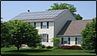 *(original 122×70 · [live](https://jdsmithinsurance.com/images_new/solar_quote_02.jpg))*  *(original 122×70 · [live](https://jdsmithinsurance.com/images_new/solar_quote_03.jpg))*  *(original 122×70 · [live](https://jdsmithinsurance.com/images_new/solar_quote_04.jpg))*  *(original 102×140 · [live](https://jdsmithinsurance.com/images_new/solar_quote_06.jpg))*
- **Suggested replacement:** use the C17 photos.

### 2. Intro
We work with insurance carriers that provide group insurance rates. We can provide coverage up to $100 million limits, with $10,000,000 commercial general liability if needed. Discounts if you own and operate more than one site. Rates are based on:
- Sites installed professionally
- Warranted equipment
- 24-hour monitoring system and alarm
- All FIT program requirements are followed and adhered to

For immediate service from a friendly J.D. Smith Insurance professional, call 1-800-917-SAVE (7283) throughout Ontario, or 905-764-7868 within the G.T.A. Alternative: [Property PDF](Applications/RES_Property_App_1.pdf) · [Liability PDF](Applications/RES_Liability_App_2.pdf)

### 3. The form (fields in order; * = required)
**Company information:** Company name* · Contact name* · Address* · City* · Postal code* · Company URL · Email* · Telephone* · Fax
**Installation information:** Renewable site location address (list all sites if applicable) · Project type (Commercial roof top / Residential roof top / Agricultural roof top / Agricultural ground mount / Wind mill / Other) · Project size (1–9 kW / 10–25 kW / 25–99 kW / 100–249 kW / 250–499 kW / 500–999 kW / 1,000–4,999 kW / 5,000–9,999 kW / 10,000 kW+) · Have you submitted a FIT application? (Yes / No / Site in operation) · Have you been approved? (Yes / No / Site in operation) · Estimated start date of installation · Estimated completion date of installation · Do you require coverage for the installation? (Yes/No) · Name of solar equipment supplier(s) · Name of company(s) installing the project · Do you own the building/land it is installed on? (Yes / No / N/A) · Do you have a lease in place for the building/land? (Yes / No / N/A) · What amount of space are you using/leasing? (square feet / acres) · Building construction (Fire resistive – concrete roof / Non-combustible – steel deck roof / Non-combustible – masonry, frame roof / Frame – brick veneer / Frame / Other) · Roof top type (Flat deck gravel / Flat deck shingled / Angled shingled / Flat deck steel / Angled steel / Concrete / Other) · Date building was constructed (1950–2011 on the live form: extend to the current year) · Date roof last updated (same)
**Insurance information:** Estimated project insured value ($25,000 to >$10,000,000) · Insured value of building (same range) · Machinery and electrical breakdown coverage (same range) · Liability insurance limit required ($1,000,000–$10,000,000) · Income protection limit required ($10,000 to >$1,000,000) · Other information pertinent to this quotation · Do you plan to add more locations later? (Yes/No)
**[Submit]**

**After the form:** "Our insurance underwriters will be in touch with you shortly once you have submitted the above information. Our insurance quote provides you with:"
- All risk property insurance coverage
- Business income protection & machinery & electrical insurance coverage
- Over 45 renewable energy insurance extensions
- Comprehensive general liability
- Warranty insurance & bonding is available

Small print: same as C20 (for operations within Canada only … E. & O. E.).

---

## C22. Application forms
`jds-applications.htm` · Menu: Commercial › Get started › Application forms · Footer: Commercial › Application forms
**Live page:** [jds-applications.htm](https://jdsmithinsurance.com/jds-applications.htm) · **Current &lt;title&gt;:** "Insurance Application Forms for Downloading" · **Meta description:** "J.D. Smith Insurance Brokers provides online insurance application forms for Commercial, Business, Church, Camp, RV and Not-For-Profit Insurance"
*Every PDF on this page is also on Get a free quote (since 2026-10-18). The full list is in SITE_MAP.md section 5.*

### 1. Hero
- **H1:** Insurance application forms
- **Subheading:** Find the insurance application form below that applies to your needs, and click the link to download it. It can then be completed, printed, and scanned or faxed to J.D. Smith Insurance Brokers at 905-764-9618.
- **Hero photo (original):**  *(original 1000×400 · [live](https://jdsmithinsurance.com/images/application_forms_for_insurance.jpg))*
- **Suggested replacement:**  *(suggested replacement · [Unsplash photo](https://unsplash.com/photos/two-people-reviewing-documents-at-a-table-MhqUBTxQ3Hw) · free Unsplash License)*

### 2. Quote options (top CTA)
- **Not sure which form?** [Request a business quote](https://jdsmithinsurance.com/jds-quote.htm) · [Call 1-800-917-7283](tel:18009177283)
- **Contacts** (the live table; the last two conflict with the staff list, so use only the first four: STAKEHOLDER_NOTES 2.4): Haig Papazian [ext. 239](tel:+19057647868,239) · Rocco Scarano [ext. 215](tel:+19057647868,215) · Tom Larha [ext. 245](tel:+19057647868,245) · Mark Smith [ext. 228](tel:+19057647868,228) · ~~Kathy Turner ext. 207~~ · ~~Caroline Tang ext. 206~~

### 3. The forms (grouped like the commercial categories on Get a free quote)

**Cyber insurance**  *(original 108×124 · [live](https://jdsmithinsurance.com/images/cyber_liability_small.jpg))*
Today it is VERY important to have cyber coverage. Many of our packages have new coverage added for a limited amount. Complete the application and we will get you quotes on higher limits from a number of companies.
- [Cyber risk insurance application](Applications/cyber_risk_insurance.pdf)

**Special event liability solutions**  *(original 108×75 · [live](https://jdsmithinsurance.com/images/sp_event_application.gif))*
If you are planning a wedding, church group, a birthday party or any other event, complete this application. We have special rates that apply on our package if alcohol is not at the event: display booths · dinners, seminars · weddings, recitals. We have a special rate for **universities**, **camps** and **mission organizations**. The cost is based on the size of the event, activity and venue.
- $1 million coverage, excluding alcohol, is approximately $375 to $475
- MissionFest exhibitors: basic coverage $250
Please complete the application and email or fax it to our office for a quick quote.
- [Special events (short term) – liability](Applications/special_events.pdf)
- [Exhibitor/kiosk liability insurance](Applications/exhibitorss.pdf)
- Prefer online? [Special events quote online](https://jdsmithinsurance.securequotebot.com/special-event)

**Welders and metal workers applications** (property, products and liability) 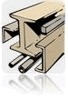 *(original 75×109 · [live](https://jdsmithinsurance.com/images/logo_cwb_group_1.gif))*
We insure hundreds of welders and metal workers across Canada. We have a special program and very good rates. CWB members get a further 10% to 16% discount depending on the number of employees. Please download the following 3 applications, which are needed to provide you with an insurance review. Complete in full and fax to 905-764-9618, Attn: Mark Smith, Commercial Department, or mail to 105 West Beaver Creek Rd., Richmond Hill, Ontario, L4B 1C6. Call Mark at [905-764-7868 ext. 228](tel:+19057647868,228) if you have any questions. If available, please include any photographs, catalogues outlining your product, or a brochure showing your business operations. We will then review the information provided with our top carriers and provide you with a full insurance review.
- [Product liability questionnaire](Applications/cwb_liability_questionnaire2.pdf)
- [Welding insurance questionnaire](Applications/cwb_welding_questionnaire2.pdf)
- [Errors & omissions insurance](Applications/cwb_errors_and_ommissions.pdf)

**Non-destructive testing coverage (NDE):** insurance, products and liability applications  *(original 108×79 · [live](https://jdsmithinsurance.com/images/cinde_man_computer_2.jpg))*
- [NDE product liability questionnaire](Applications/NDE_Liability2.pdf)
- [NDE insurance questionnaire](Applications/NDE_questionnaire1.pdf)
- [NDE professional liability (errors & omissions)](Applications/NDE_Professional_Liab3.pdf)

**Camp insurance program solutions**  *(original 110×95 · [live](https://jdsmithinsurance.com/images/camp-boat-3.jpg))*
- [Day and night camp application](Applications/Camp_App_Word.pdf)
- *Pending (STAKEHOLDER_NOTES 1.1):* [Campground application](Applications/campground.pdf)

**Church and non-profit applications**  *(original 109×96 · [live](https://jdsmithinsurance.com/images/Church_white_2.jpg))*
For new church submissions or church insurance renewals: please complete these Adobe applications online, print them or "Save" and email them to us for an insurance review.
- [Church building application](Applications/church_building_application_02.pdf)
- [Directors & officers of church application](Applications/church_directors_officers.pdf)
- [Sexual abuse application](Applications/church_sexual_abuse.pdf)
- [Church day care application](Applications/church_day_care_supplement.pdf)
- [Faith based organization program application](Applications/Faith_Based_Organization_Program.pdf)
- [Limited abuse coverage application](Applications/Limited_Abuse_Coverage.pdf)
- *(The main [Church application](Applications/Church%20Application.pdf) is linked from the church page and the quote page but not from this page on the live site: add it here.)*

**Errors and omissions applications**  *(original 110×81 · [live](https://jdsmithinsurance.com/images/commercial.jpg))*
- [Directors & officers for non-profit](Applications/directors_officers_non_profit.pdf)
- [Directors & officers for-profit](Applications/directors_officers_profit.pdf)
- [Professional liability for property managers (outline)](Applications/prof_liability_prop_mgr_outline.pdf)
- [Professional liability for property managers](Applications/prof_liability_prop_mgrs.pdf)
- [Rented dwellings](Applications/rented_dwelling.pdf)
- [Miscellaneous errors & omissions](Applications/errors_omissions_miscellaneous.pdf)

**Contractors applications**  *(original 110×98 · [live](https://jdsmithinsurance.com/images/Steel_Walk-a.jpg))*
- [Builders risk](Applications/builders_risk.pdf)
- [Contractors liability](Applications/contractors_liability.pdf)
- [Landscaping & snow removal](Applications/landscaping_snow_removal_2017.pdf)
- [Professional liability for architects & engineers](Applications/prof_liability_architects_2.pdf)
- [Professional liability for homebuilders](Applications/prof_liability_homebuilders.pdf)
- [Pollution liability / roofing contractors](Applications/prof_liability_pollution.pdf)

**Miscellaneous applications**  *(original 110×81 · [live](https://jdsmithinsurance.com/images/comm-1a.jpg))*
- [Boiler and machinery](Applications/boiler_machinery.pdf)
- [Concession](Applications/concession.pdf)
- [Day camp](Applications/daycamp_liability.pdf)
- [Graphic designers professional liability](Applications/prof_liability_graphic_designer.pdf)
- [Hot dog vendor](Applications/hot_dog.pdf)
- [Locksmith](Applications/security_locksmith.pdf)
- [Paintball](Applications/paintball.pdf)
- [Media professional liability](Applications/prof_liability_media.pdf)
- [Miscellaneous professional liability](Applications/prof_liability_miscellaneous.pdf)
- [Printers liability](Applications/prof_liability_printers.pdf)
- [Veterinary medical liability](Applications/prof_liability_vet_medical.pdf)
- [Security services – alarm monitoring & paging](Applications/security_monitor_paging.pdf)
- [Security services – fidelity](Applications/security_fidelity.pdf)
- [Security services – installer's supplement](Applications/security_installers.pdf)
- [Security services – manufacturers and distributors](Applications/security_mfgs_distis.pdf)
- [Security services – security guard](Applications/security_guard.pdf)
- [Special events (short term) – liability](Applications/special_events.pdf)

**Fleet and cargo applications**  *(original 110×94 · [live](https://jdsmithinsurance.com/images/Truck_cab-a.jpg))*
- [Motor truck cargo](Applications/motor_truck.pdf)
- [CNA marine cargo application](Applications/2016%20-%20CNA%20Marine%20Cargo%20Application%20V.2.pdf) *(on the marine page, not on this page on the live site: add it here)*

**Renewable energy applications** *(on the renewable energy page, not on this page on the live site: add them here)*
- [Renewable energy property application](Applications/RES_Property_App_1.pdf)
- [Renewable energy liability application](Applications/RES_Liability_App_2.pdf)

**Computer technology applications**  *(original 108×73 · [live](https://jdsmithinsurance.com/images/computer1.jpg))*
- [Professional liability errors & omissions](Applications/prof_liability_errors_omissions.pdf)
- [IT professional general liability & errors & omissions – revenue under $200,000](Applications/IT_prof_gen_liability_E-O_under200K.pdf)
- [Computer technology internet errors & omissions – revenue over $200,000](Applications/computer_tech_internet.pdf)
- [Computer technology terminology errors & omissions](Applications/computer_tech_terminology.pdf)
- [I.T. professional liability](Applications/prof_liability_IT.pdf)

If you are unable to view or download the applications, please download the free [Adobe Reader](https://get.adobe.com/reader/) *(the live link is an old adobe.com URL)*.

### 4. Quote options (bottom CTA)
- [Request a business quote](https://jdsmithinsurance.com/jds-quote.htm) · [Call 1-800-917-7283](tel:18009177283) · Fax completed forms to 905-764-9618

Contact block (standard).

---

# D. LIFE & HEALTH

Shared: every live life page ends with "Contact our office for great quotes: 905-764-7868 · 1-800-917-SAVE" and "Individual life and groups are our specialty". J D Smith's extension is shown as **223** on the life pages, but the staff list says **234** (STAKEHOLDER_NOTES 2.1). This file uses 223, as the quote page does, until the office confirms.

---

## D1. Life insurance & planning (also the Life & Health overview)
`jds-life_health.htm` · Menu: Life & Health › Life insurance & planning · Category head page in SITE_MAP
**Live page:** [jds-life_health.htm](https://jdsmithinsurance.com/jds-life_health.htm) · **Current &lt;title&gt;:** "J.D. Smith Life, Disability and Dental Insurance" · **Meta description:** "J.D. Smith Insurance Brokers has excellent rates and a variety of coverage's for most of your insurance and financial services needs."
**Suggested &lt;title&gt;:** Life Insurance & Financial Planning | JD Smith Insurance

### 1. Hero
- **H1:** Life & health insurance
- **Subheading:** Protect your child's future. Individual life and financial planning are our specialty.
- **Hero photo (original):**  *(original 1000×400 · [live](https://jdsmithinsurance.com/images/life_insurance_front.jpg))*
- **Suggested replacement:**  *(suggested replacement · [Unsplash photo](https://unsplash.com/photos/family-playing-together-in-a-grassy-field-f3wPIQrzba0) · free Unsplash License)*

### 2. Quote options (top CTA): all life & health products
"Free consultation by phone."

| Insurance | How to get your quote | Button |
|---|---|---|
| Life insurance | By phone. Life insurance and financial planning with J D Smith. | [Call 905-764-7868 ext. 223](tel:+19057647868,223) |
| Group benefits | By phone. Life, AD&D, long-term disability, health and dental plans for groups. | [Call 905-764-7868 ext. 223](tel:+19057647868,223) |
| Mortgage insurance | By phone. Keep your family in the home if something happens to you. Ask for Tom Larha. | [Call 905-764-7868 ext. 245](tel:+19057647868,245) |
| Critical illness | By phone. A lump sum of $10,000 to $100,000 if you are diagnosed with a covered illness. Ages 18 to 60. | [Call 905-764-7868 ext. 245](tel:+19057647868,245) |

### 3. Overview cards (in header order)
| Card | Summary | Learn more |
|---|---|---|
| Life insurance & planning | Life insurance to protect your assets, long-term investments, retirement planning. | (this page, sections below) |
| Group insurance | JDS small group benefit plans: life, AD&D, LTD, extended health, vision and dental. Sample rates from $96 a month. | [Group insurance](jds-life_groups.htm) |
| Mortgage insurance | Your own mortgage life insurance instead of the bank's. | [Mortgage insurance](jds-life_mortgage_insurance.htm) |
| Critical illness | Quick Issue plan: a tax-free lump sum of $10,000–$100,000, ages 18–60, 8 qualifying questions. | [Critical illness](jds-life_insurance_critical_illness.htm) |

### 4. Information

**Call us for quotes on life insurance.** If you have huge taxes to pay, call us, as we may have a good solution. View our associated web site [www.ardillgroup.com](http://www.ardillgroup.com) *(this link redirects: check it, see STAKEHOLDER_NOTES)*.

**Personal financial planning**
- Life insurance to protect your assets
- Special funds for long-term investments
- Retirement planning
- Over 1 million managed funds
- Call for a free consultation

**Mortgage life insurance**  *(original 158×108 · [live](https://jdsmithinsurance.com/images/mortgage_life_insurance_01.jpg))*  *(original 158×128 · [live](https://jdsmithinsurance.com/images/mortgage_life_insurance_02.jpg))*
Buying a home can be the single biggest decision and purchase you will ever make. For most buyers, that purchase involves a substantial mortgage and years of debt. Protect that purchase with Solution 20. This unique product offers simplicity, more benefits and greater flexibility than group mortgage life insurance offered by traditional mortgage lenders.
- No need to re-apply for coverage if you move or need to re-finance
- You choose the amount of coverage and your beneficiaries
- Competitive premiums are guaranteed and renewable to age 100, and coverage remains level
- You decide how and when the money is used: you own it

The advantages and competitive features of Solution 20 from Empire Life are clear.

| Mortgage amount $250,000 | Empire Solution 20 | Lender's creditor life insurance\*: as a rider | Lender's creditor life insurance\*: stand alone |
|---|---|---|---|
| Male, age 35, non-smoker | $248 | $308 | $390 |
| Male, age 40, non-smoker | $353 | $413 | $600 |
| Female, age 35, non-smoker | $188 | $248 | $390 |
| Female, age 40, non-smoker | $253 | $313 | $600 |

All amounts shown are based on a fixed annual premium rate and do not include provincial sales tax (Ontario 8%, Quebec 9%). \*The lender's group life mortgage insurance premium shown is based on the average rate quoted in a survey of Scotiabank, Bank of Montreal, TD Canada Trust, Royal Bank of Canada and CIBC conducted on December 30, 2008 by Empire Life. *(2008 data, and the Mortgage insurance page now features Wawanesa Life: ask the office which product to show, see STAKEHOLDER_NOTES)*

**Complete the package with critical illness coverage.** Add a **Vital Link Critical Illness Rider** to Solution 20 and protect yourself against the financial burden of a critical illness. Vital Link offers tax-free financial protection against 23 covered conditions, including heart attack, stroke, cancer and loss of independence. If you do not become ill, you could receive all of your Vital Link premiums back by choosing one of our two return of premium options.

**Why segregated funds?**
Segregated funds, known colloquially as "seg funds," are a type of pooled investment similar to mutual funds. However, seg funds differ from mutual funds by being issued by an insurance company and having an insurance element, which guarantees the return of principal on death or maturity. While on the surface seg funds appear almost identical to mutual funds, the taxation issues pertaining to them are noticeably different.

*What is a seg fund?* Seg funds are not in themselves legal entities; however, the Income Tax Act deems them to be trusts for tax purposes. Each seg fund trust holds units of a corresponding mutual fund trust. In essence, this means that the seg fund is a unit holder of the mutual fund. So, for example, the Trimark Select Growth Seg Fund invests exclusively in units of the corresponding mutual fund, the Trimark Select Growth Fund. The individual investor, however, is not a unitholder of the mutual fund; rather, the investor is referred to as a contractholder of a seg fund contract.

**Seg funds, most often backed by the insurance company, give you much more protection. Some of our funds will give you a 100 per cent guarantee that you will not lose your original investment.**

**Death and taxes**
Canada has no official death, estate or inheritance taxes. So, without proper planning, on death an estate may be faced with large and unexpected tax liabilities.

*The general rule:* though special rules apply to RRSPs and RRIFs, a taxpayer is generally deemed to have disposed of all of his or her capital property (including stocks, bonds, mutual fund units, real estate, farms etc.) immediately before death at fair market value. When the proceeds of disposition exceed the property's adjusted cost base (ACB), the result is a capital gain. One half (50 per cent) of the capital gain is taxable to the deceased and must be reported in the deceased's final tax return, the terminal return. On that return, a capital gains deduction may be claimed against any capital gains arising from qualifying property, such as shares of a small business corporation or farm property.

*Spouse as beneficiary:* the most common exception to the deemed disposition rules occurs when the capital property is transferred to a deceased taxpayer's spouse or testamentary spousal trust (spouse trust). A spouse trust is a trust that is created by a taxpayer's will. It must meet specific criteria, but generally entitles the spouse to receive all of the income of the trust during his or her lifetime. When property is transferred to a spouse or spouse trust, the transfer may be done without triggering any immediate capital gains and the associated tax liability.

*Example: Susan and Bruce.* Susan and Bruce are husband and wife. Bruce holds a non-registered investment in, say, Trimark Fund, with an original cost of $150,000. At Bruce's death on January 15, 1998, the fair market value of his holdings had grown to $250,000. That represents an accrued capital gain of $100,000. If Bruce left his investment in the fund to Susan (perhaps by naming her as the beneficiary of this property in his will), the investment can simply be transferred into Susan's name. Susan will be deemed to have acquired the property at the same ACB of $150,000, thereby deferring tax on the $100,000 accrued capital gain. If Susan wasn't the beneficiary of Bruce's mutual fund investment, Bruce will be deemed to have disposed of his units for proceeds equal to the fair market value of $250,000. That would result in a capital gain of $100,000, 50 per cent of it taxable. Depending on Bruce's marginal tax rate in the year of death, the estate may be liable for taxes of up to $30,000.

Our suggestion is that you name specific beneficiaries on all RRSPs, GICs and segregated funds to keep them out of your estate.

*Disclaimer (keep):* We are not tax experts at JD Smith Insurance Brokers. The above are only things to consider and to think about. It would be wise to contact your lawyer and accountant for information.

**Employee groups for life, health, dental and disability**
- We can insure from 3–20 lives in our small group package with good companies like Engle Insurance.
- We can insure from 20–100 lives in our large office group package with well-known companies like Crown, Aetna, and NN Financial.
- We work with more than 15 group insurance providers.
→ [See the JDS small group benefit plans](jds-life_groups.htm)

### 5. Quote options (bottom CTA)
- **Primary:** [Call 905-764-7868 ext. 223](tel:+19057647868,223) — life insurance and financial planning with J D Smith; free consultation by phone
*(The bottom of the live page shows "J D Smith EXT 234"; the top shows 223.)*

Contact block (standard).

---

## D2. Group insurance (JDS small group benefit plans)
`jds-life_groups.htm` · Menu: Life & Health › Group insurance
**Live page:** [jds-life_groups.htm](https://jdsmithinsurance.com/jds-life_groups.htm) · **Current &lt;title&gt;:** "J.D. Smith Insurance Plans for Groups" · **Meta description:** "J.D. Smith Insurance Brokers has Instant Issue Life Insurance, with no medical requirement."
**Suggested meta:** Low-cost small group benefit plans for Ontario businesses and non-profits: life, AD&D, long-term disability, extended health, vision and dental. *(the current meta describes Instant Issue life insurance)*

### 1. Hero
- **H1:** Group insurance benefit plans
- **Subheading:** JDS small group insurance benefit plans: an excellent plan for non-profits and small businesses.
- **Hero photo (original):**  *(original 1000×400 · [live](https://jdsmithinsurance.com/images/group_insurance_front.jpg))*
- **Suggested replacement:**  *(suggested replacement · [Unsplash photo](https://unsplash.com/photos/a-group-of-people-sitting-around-a-table-with-laptops-E3LsanLgkLM) · free Unsplash License)*
- Secondary photo:  *(original 235×162 · [live](https://jdsmithinsurance.com/images_new/insurance_groups_01.jpg))* · "Diversity" title graphic  *(original 350×206 · [live](https://jdsmithinsurance.com/images_new/title_diversity.gif))* *(image of text)*

### 2. Quote options (top CTA)
- **Primary:** [Call 905-764-7868 ext. 223](tel:+19057647868,223) — life, AD&D, long-term disability, health and dental plans for groups
"Call today for a quote and outline of the coverages."

### 3. Information

**Plan comparison: Basic vs Enhanced** *(build as a 2-column comparison table)*

| Benefit | Basic | Enhanced |
|---|---|---|
| **Life insurance**: benefit amount | $25,000 | $50,000 |
| Life: termination | Earlier of retirement or age 70 | Earlier of retirement or age 70 |
| **Accidental death insurance**: benefit amount | $25,000 | $50,000 |
| AD&D: termination | Earlier of retirement or age 70 | Earlier of retirement or age 70 |
| **Long-term disability**: benefit per month | $750 | Without evidence $1,500 (minimum salary $25,000/yr); with evidence $2,500 (minimum salary $45,000/yr) |
| LTD: qualifying period | 120 days | 120 days |
| LTD: maximum benefit period | 5 years | 5 years |
| LTD: definition of disability | 5 years own occupation | 5 years own occupation |
| LTD: pre-existing condition clause | 6/12 months | 6/12 months |
| LTD: benefit offsets | No offsets | Primary CPP/QPP, WCB, EI and any government plan of insurance including auto |
| LTD: critical illness feature | $1,000 single payment per lifetime | $1,500 single payment per lifetime |
| LTD: termination | Earlier of retirement or age 65 minus qualifying period | Earlier of retirement or age 65 minus qualifying period |
| **Extended health** (no deductible; maximums apply individually to each employee and dependant): reimbursement for drugs, paramedical services and medical services & supplies | 80% | 100% |
| Drugs | $5,000 calendar year maximum | $10,000 calendar year maximum |
| Paramedical services | $750 calendar year maximum, combined for all listed practitioners | $1,000 calendar year maximum, combined for all listed practitioners |
| Medical services & supplies | $1,500 calendar year maximum, combined | $2,000 calendar year maximum, combined |
| Reimbursement for ambulance, hospital and emergency out of country | 100% | 100% |
| Ambulance (ground) | $500 per calendar year | $500 per calendar year |
| Hospital, semi-private | $500 per calendar year | $1,000 per calendar year |
| Emergency out of country / travel assist | 30-day trip limit, $1,000,000 lifetime | 30-day trip limit, $1,000,000 lifetime |
| Extended health: termination | Earlier of retirement or employee age 70; dependent children at age 21 | Same |
| **Vision care** (no deductible): reimbursement | Not available | 100% |
| Frames, lenses & contacts | Not available | $150 per 24 consecutive months |
| Vision: termination | Not available | Earlier of retirement or employee age 70; dependent children at age 21 |
| **Dental care** (no deductible): basic reimbursement | 80% | 100% |
| Major reimbursement | Not available | 50% |
| Calendar year maximum | $1,000 | $1,500 combined basic & major |
| Recall exam | 6 months | 6 months |
| Scaling | 10 units per calendar year | 10 units per calendar year |
| Fee guide | Current general practitioner for province of residence | Same |
| Dental: termination | Earlier of retirement or employee age 70; dependent children at age 21 | Same |

**Special JDS rates for Ontario small groups: sample rates**

*Basic package* — with $25,000 life insurance included. This package, as outlined above, includes LTD, extended health, and dental care of 80%.
| Age / gender | Single | Family |
|---|---|---|
| Age 40 to 44, male | $96.00 per month | $188.00 per month |
| Age 50 to 54, female | $109.00 per month | $211.00 per month |
| Age 65, female | $148.00 per month | $245.00 per month |

*Enhanced package* — with $50,000 life insurance included. This package, as outlined above, also includes LTD, extended health, and dental care of 100% PLUS vision care.
| Age / gender | Single | Family |
|---|---|---|
| Age 45 to 49, male | $157.00 per month | $275.00 per month |
| Age 60 to 64, female | $211.00 per month | $338.00 per month |

These are estimates only. Please call our office at 905-764-7868 for us to quote our JDS low-cost small group benefit plan. This is an excellent plan for non-profits and small businesses. Some restrictions may apply.

**Key elements overview**

*Employee life insurance:*
- Coverage provided is a flat benefit amount
- Benefit amount **does not reduce** because of age
- Conversion privilege available to age 65
- Reduction in premium available if approved for an LTD claim
- Coverage terminates at the earlier of retirement or age 70

*Employee accidental death insurance:*
- Coverage provided is a flat benefit amount
- Benefit amount **does not reduce** because of age
- Coverage terminates at the earlier of retirement or age 70

*Employee long-term disability:*
- Coverage provided is a flat benefit amount, depending on the JDS small group insurance benefit plan chosen and minimum salary requirements
- Definition of disability is 5-year own occupation
- Critical illness feature included
- POSACTION Plus services included
- Reduction in premium available if approved for an LTD claim
- The benefit is non-taxable, provided employees pay a minimum of 30% of the monthly premium for any JDS small group insurance benefit plan
- Coverage terminates at the earlier of retirement or age 65 minus the qualifying period
- Pre-existing condition clause

*Extended health benefit:*
- Coverage available for employee and dependants
- **No deductible** applies to any JDS small group insurance benefit plan
- Reimbursement varies depending on the benefit plan chosen
- Drugs provided on a pay-direct drug card basis
- Paramedical coverage includes the following practitioners: chiropractors, osteopaths, chiropodists or podiatrists, naturopaths, physiotherapists, speech therapists, massage therapists, acupuncturists, dieticians, audiologists, ophthalmologists or optometrists for eye exams. There is **no individual maximum** per practitioner. Coverage is based on a combined annual dollar amount for all paramedical practitioners, allowing for **maximum flexibility** in meeting the needs of each individual insured under a JDS small group insurance benefit plan.
- Medical services and supplies include, but are not limited to: custom-made orthopaedic shoes and foot orthotics, hearing aids, diabetic supplies and equipment, surgical bras, surgical stockings. There is **no individual maximum** for any of the medical services or supplies under this portion of the benefit plan. Coverage is based on a combined annual dollar amount, allowing for **maximum flexibility** in meeting the needs of each individual insured.
- Ambulance services: ground transportation
- Semi-private hospital
- Emergency out of country coverage and travel assistance
- Coverage for the employee and spouse terminates at the earlier of employee retirement or age 70, or attained age of 21 for dependent children

*Vision care benefit:*
- Available with the JDS small group insurance benefit plan Enhanced
- Coverage available for employee and dependants
- **No deductible** applies
- Eye glasses and contact lenses
- Coverage for the employee and spouse terminates at the earlier of employee retirement or age 70, or attained age of 21 for dependent children

*Dental care benefit:*
- Coverage available for employee and dependants
- **No deductible** applies to any dental coverage
- Basic dental coverage included in all JDS small group insurance benefit plans
- All plans include, but are not limited to, coverage for: examinations and x-rays, cleaning and fluoride treatments, routine extractions and fillings, root canals, denture repair, periodontal treatment, surgical procedures performed by a dentist, including anaesthetics
- Coverage for the employee and spouse terminates at the earlier of employee retirement or age 70, or attained age of 21 for dependent children
- The Enhanced plan includes major dental coverage. These services include, but are not limited to: bridges and crowns, full/partial dentures, inlays and onlays, including veneers

### 4. Quote options (bottom CTA)
- **Primary:** [Call 905-764-7868 ext. 223](tel:+19057647868,223) — life, AD&D, long-term disability, health and dental plans for groups

Contact block (standard).

### 5. Related links
[Life insurance & planning](jds-life_health.htm) · [Non-profits](jds-packages_non_profit_companies.htm) · [Churches](jds-church.htm) (group health & dental for church staff)

---

## D3. Mortgage insurance
`jds-life_mortgage_insurance.htm` · Menu: Life & Health › Mortgage insurance
**Live page:** [jds-life_mortgage_insurance.htm](https://jdsmithinsurance.com/jds-life_mortgage_insurance.htm) · **Current &lt;title&gt;:** "J.D. Smith and Wawanesa Life Mortgage Insurance vs The Bank" · **Meta description:** "J.D. Smith Insurance Brokers has Instant Issue Life Insurance, with no medical requirement."

### 1. Hero
- **H1:** Mortgage insurance: J.D. Smith and Wawanesa Life vs the bank
- **Subheading:** Keep your family in the home if something happens to you.
- **Hero photo (original):**  *(original 1000×400 · [live](https://jdsmithinsurance.com/images/mortgage_insurance_front.jpg))*
- **Suggested replacement:**  *(suggested replacement · [Unsplash photo](https://unsplash.com/photos/holding-house-keys-in-front-of-the-entrance-bqUZEAeWuok) · free Unsplash License)*

### 2. Quote options (top CTA)
- **Primary:** [Call 905-764-7868 ext. 245](tel:+19057647868,245) — ask for Tom Larha
- Also on the live page: J D Smith [ext. 223](tel:+19057647868,223)

### 3. Information
**The whole page content is one image:**  *(original 600×613 · [live](https://jdsmithinsurance.com/images_new/mortgage_insurance_01.gif))*
**Action needed:** the text in this graphic cannot be read by search engines or screen readers. Type it out as HTML (a comparison of Wawanesa Life mortgage insurance with bank mortgage insurance) when the page is built. The graphic is downloaded to `images/original/images_new/mortgage_insurance_01.gif`.
Partner logo:  *(original 195×59 · [live](https://jdsmithinsurance.com/images_new/logo_wawanesa_life.gif))*

See also the Empire Life Solution 20 comparison on [Life insurance & planning](jds-life_health.htm).

### 4. Quote options (bottom CTA)
- **Primary:** [Call 905-764-7868 ext. 245](tel:+19057647868,245) — ask for Tom Larha

Contact block (standard). "Individual life and groups are our specialty."

---

## D4. Critical illness insurance
`jds-life_insurance_critical_illness.htm` · Menu: Life & Health › Critical illness
**Live page:** [jds-life_insurance_critical_illness.htm](https://jdsmithinsurance.com/jds-life_insurance_critical_illness.htm) · **Current &lt;title&gt;:** "J.D. Smith Life, Quick Issue Critical Illness Insurance" · **Meta description:** "J.D. Smith Insurance Brokers has Instant Issue Life Insurance, with no medical requirement."

### 1. Hero
- **H1:** Quick Issue critical illness insurance
- **Subheading:** Can you and your family survive the financial aftershock of a critical illness?
- **Hero photo (original):**  *(original 1000×400 · [live](https://jdsmithinsurance.com/images/critical_illness_insurance_front.jpg))* · header graphic  *(original 508×114 · [live](https://jdsmithinsurance.com/images_new/header_critical_illness.gif))* *(image of text)*
- **Suggested replacement:**  *(suggested replacement · [Unsplash photo](https://unsplash.com/photos/a-woman-in-a-white-shirt-holding-a-stethoscope-tE7_jvK-_YU) · free Unsplash License)*

### 2. Quote options (top CTA)
- **Primary:** [Call 905-764-7868 ext. 245](tel:+19057647868,245) — a lump sum of $10,000 to $100,000 if you are diagnosed with a covered illness; ages 18 to 60
- Also on the live page: J D Smith [ext. 223](tel:+19057647868,223)

### 3. Information
 *(original 195×59 · [live](https://jdsmithinsurance.com/images_new/logo_wawanesa_life.gif))*
**The Quick Issue Critical Illness plan** is designed to provide funds to help you financially care for yourself and your family and maintain the same quality of life after surviving a critical illness. The plan provides a tax-free lump sum living benefit to the owner of the plan on the occurrence of the first of the 14 covered illnesses, provided the insured survives the waiting period following the onset of the critical illness (30 days from diagnosis, except for loss of speech (180 days) and paralysis (90 days)). No living benefit is payable if cancer is diagnosed within 90 days of issue.

**Plan at a glance**
- **14 covered illnesses:** heart attack, stroke, cancer (life-threatening), coronary artery bypass surgery, failure of both kidneys, major organ transplant, major organ failure on waiting list, paralysis, occupational HIV infection, blindness, deafness, loss of speech, loss of limbs, and severe burns (industry benchmark definitions)
- **3 plan types:** 10 year term renewable to age 75 · level term to age 75 · level term to age 75 with flexible ROP (return of premium)
- **Issue ages:** 18–60 years for all plan types
- **Issue amounts:** $10,000–$100,000
- **8 qualifying questions:** coverage is issued upon answering no to the qualifying questions, provided there are no unfavourable reports from the Medical Information Bureau

You need to protect yourself and your family against the high cost of rebuilding your lifestyle following a critical illness.

**The 3 plan options**  *(original 158×232 · [live](https://jdsmithinsurance.com/images_new/critical_illness_insurance_01.jpg))*
- **10 year term renewable to age 75:** provides level insurance coverage with premiums that increase every 10 years as the plan is renewed. Coverage can be provided until age 75.
- **Level term to age 75:** provides level insurance coverage with premiums that remain level and never increase. Provides coverage to age 75.
- **Level term to age 75 with flexible ROP (return of premium):** provides level insurance with premiums that remain level and never increase. Provides coverage to age 75. Flexible return of premium (ROP) is an option that becomes available when you reach the later of age 65 or the 10th policy year, with no critical illness benefit having been paid and the policy still in force. The flexible ROP benefit gives you the option to surrender the policy and receive 50% of the annual premiums paid on the in-force volume, with the percentage of return proportionately increasing to a 100% return of premium at age 75.

Plan graphic: 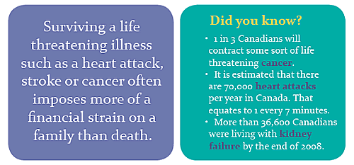 *(original 500×233 · [live](https://jdsmithinsurance.com/images_new/critical_illness_insurance_02.gif))* *(image of text: rebuild as HTML)*

**Quick Issue CI: qualifying questions** (answer yes/no)
1. Within the last two years, have you had an application for individual life insurance or critical illness insurance rated, declined, postponed or had exclusions added by Wawanesa Life or any other company?
2. Have you ever been treated for, diagnosed, consulted a doctor, received abnormal test results or experienced symptoms of the following:
   - Heart attack, congenital cardiac defects, angina, angioplasty, coronary artery bypass, congestive heart failure, stroke, transient ischemic attack (TIA), arteriosclerosis or any other cerebrovascular disease or disease of the heart or the blood vessels, or an abnormal electrocardiogram (EKG)?
   - Type 1 (insulin-dependent) diabetes or type 2 diabetes?
   - Cancer or other malignant disease, growth, tumour or colon polyp?
   - Multiple sclerosis or motor neuron disease?
   - Any breast disorders (mass, cyst, unusual discharge, physical change, abnormal mammogram or biopsy) or prostate disorders (nodule or abnormal PSA)?
   - Any eye or ear problems or diseases other than those corrected by glasses, contact lenses or hearing aids?
3. a) Have you consulted a physician for an illness or condition which has not yet been diagnosed or for which testing is still in progress? b) Have you noticed any symptoms or health problems for which you have not yet consulted a physician, such as: lump or mass of the breasts, shortness of breath, chest pain, dizziness, loss of balance, numbness, rectal bleeding, prostate or other problems?
4. Have you ever tested positive for HIV or been diagnosed, treated for or had any indication of AIDS, AIDS-related complex, liver or kidney failure, cirrhosis, chronic kidney disease, hepatitis B or C, or carrier of hepatitis B?
5. Within the last five years, have you received treatment or been advised to seek treatment or medical advice because of your alcohol usage?
6. Within the last five years, have you used heroin, cocaine, hallucinogens or any other hard drugs other than as prescribed by a doctor, or methadone whether prescribed by a doctor or not, or have you received treatment or been advised to seek treatment or medical advice because of your drug usage?
7. To the best of your knowledge, has one of your natural parents or siblings ever suffered from, or are they suffering from, heart disease, cancer, stroke or transient ischemic attack (TIA) prior to the age of 55?
8. Does your weight exceed the weight indicated in the maximum weight table below?

| Height (feet/inches) | Height (cm) | Maximum weight (lbs) | Maximum weight (kg) |
|---|---|---|---|
| 5'0" – 5'3" | 150 – 162 cm | 200 lbs | 91 kg |
| 5'4" – 5'6" | 163 – 169 cm | 230 lbs | 104 kg |
| 5'7" – 5'9" | 170 – 177 cm | 250 lbs | 113 kg |
| 5'10" – 6'0" | 178 – 183 cm | 275 lbs | 125 kg |
| Over 6'0" | Over 183 cm | 290 lbs | 132 kg |

**Note:** you must be a Canadian citizen or landed immigrant to be eligible for coverage.

### 4. Quote options (bottom CTA)
- **Primary:** [Call 905-764-7868 ext. 245](tel:+19057647868,245) — a lump sum of $10,000 to $100,000 if you are diagnosed with a covered illness; ages 18 to 60

Contact block (standard). "Individual life and groups are our specialty."

### 5. Related links
[Life insurance & planning](jds-life_health.htm) (Vital Link critical illness rider) · [Mortgage insurance](jds-life_mortgage_insurance.htm) · [Group insurance](jds-life_groups.htm)

---

# E. RESOURCES

Supporting pages: hero → (key actions) → full live text → soft CTA. Under "Full text (live)" the wording is copied from the live page as it is, with its photos. Edit it for tone and length when building.

---

## E1. Claims
`jds-claims.htm` · Menu: Resources › For clients › Claims · Footer: Resources › Claims · Homepage quick action "Report a claim"
**Live page:** [jds-claims.htm](https://jdsmithinsurance.com/jds-claims.htm) · **Current &lt;title&gt;:** "J.D. Smith Insurance Claims Information" · **Meta description:** "Information and advice from J.D. Smith Insurance Brokers on registering insurance claims."

### 1. Hero
- **H1:** Claims
- **Subheading:** Important: we suggest you first talk to your personal broker about your claim. They will give you advice and review what to expect from your company.
- **Hero photo (original):**  *(original 1000×400 · [live](https://jdsmithinsurance.com/images/info_claims_front.jpg))*
- **Suggested replacement:**  *(suggested replacement · [Unsplash photo](https://unsplash.com/photos/a-magnifying-glass-sitting-on-top-of-a-piece-of-paper-mCqi3MljC4E) · free Unsplash License)*

### 2. Key actions (top) — build in this order
1. **Talk to your broker first:** [Claims Help Line 905-764-7868 ext. 232](tel:+19057647868,232) · [Find your broker](jds-staff.htm)
2. **Report online with your insurer** (logo buttons): [Aviva](https://www.aviva.ca/en/claim/make-a-claim/) · [Aviva auto (Ovation)](https://myaviva.avivainsurance.ca/claims/auto/landing) · [Ecclesiastical](https://ecclesiastical.ca/contact/reportaclaim/) · [Economical](https://www.economical.com/en/claims) · [Travelers](https://www.travelers.com/claims/report-claim/index) · [Unica](https://www.unicainsurance.com/claims/) · [Wawanesa](https://www.wawanesa.com/canada/claims/claim-information.html) · [Jevco](https://www.jevco.ca/en/insurance-claims.html). If you report directly, PLEASE copy our office at [manager@jdsmithinsurance.com](mailto:manager@jdsmithinsurance.com).
3. **24/7 emergency insurer lines** (click-to-call; must match `jds-staff.htm`): Aviva 1-866-MY-AVIVA (1-866-692-8482) · Dominion / Chieftain / Travelers 1-800-661-5522 · Ecclesiastical 1-888-224-5677 · Economical 1-800-607-2424 · Intact 1-866-464-2424 · JEVCO 1-866-864-1112 · Perth 1-800-607-2424 · Unica 1-866-864-1113 · Wawanesa 1-844-929-2637 *(the staff page and SITE_MAP say 1-800-268-7300: see STAKEHOLDER_NOTES)*
4. **Commercial claims after hours:** if you cannot reach your insurer, our 24-hour hotline for fire or water damage on a large claim is 1-888-224-5677 (Crawford Adjusters). *(the same number as Ecclesiastical: see STAKEHOLDER_NOTES)*

Insurer logos (original):  *(original 250×58 · [live](https://jdsmithinsurance.com/images/logo_claims_aviva.jpg))*  *(original 250×83 · [live](https://jdsmithinsurance.com/images/logo_claims_ecclesiastical.jpg))*  *(original 210×75 · [live](https://jdsmithinsurance.com/images/logo_claims_economical.jpg))*  *(original 250×56 · [live](https://jdsmithinsurance.com/images/logo_claims_travelers.jpg))*  *(original 250×121 · [live](https://jdsmithinsurance.com/images/logo_claims_unica.jpg))*  *(original 250×61 · [live](https://jdsmithinsurance.com/images/logo_claims_wawanesa.jpg))*  *(original 241×219 · [live](https://jdsmithinsurance.com/images/logo_claims_jevco.jpg))*  *(original 250×176 · [live](https://jdsmithinsurance.com/images/logo_claims_aviva_ovation.jpg))*

### 3. Full text (live)
Includes: the backflow valve tip, our claims philosophy (fraud hurts us all), the "Ask the adjuster" link, auto accident steps, reporting a home claim, the older (pre-2026) auto benefit chart *(out of date: replace it with a link to [Ontario auto reform 2026](jds-auto_reform.htm))*, the claim stories (A bridge too small, A 14" hole, Lucky to be alive, Unusual claims, Frozen pipes, Giant Mine, Roofer liable: their full pages are in the Appendix) and the Stella Awards.

 *(original 158×76 · [live](https://jdsmithinsurance.com/images/claims_boat.jpg))* |  |  *(original 158×76 · [live](https://jdsmithinsurance.com/images/claims_tractor.jpg))*

 *(original 300×250 · [live](https://jdsmithinsurance.com/images/claims_backflow_valve.jpg))*
At J D SmithInsurance.com, we recommend everyone have a Backflow Prevention Valve Installed.

Claims like this are never good. Effluent everywhere.

Some policies will not even cover this damage, so check with your Personal Broker.

**IMPORTANT: WE SUGGEST YOU FIRST TALK TO YOUR PERSONAL BROKER ABOUT YOUR CLAIM.**

**They will give you advice and review what to expect from your company. Our companies are good when it comes to claims.**

**When it comes to claims, our companies are professional and prompt in settling legitimate claims.**

**We work with our Insurance Companies to prevent fraud. Fraud hurts us all. Please report suspected fraud.**

**Please follow these quick links to a number of our Top Insurance carriers in order to set up an insurance claim. You can also call the numbers shown further down this page in order to set up a claim with an adjuster over the phone.**

[ *(original 250×58 · [live](https://jdsmithinsurance.com/images/logo_claims_aviva.jpg))*](https://www.aviva.ca/en/claim/make-a-claim/) | [ *(original 250×83 · [live](https://jdsmithinsurance.com/images/logo_claims_ecclesiastical.jpg))*](https://ecclesiastical.ca/contact/reportaclaim/) | [ *(original 210×75 · [live](https://jdsmithinsurance.com/images/logo_claims_economical.jpg))*](https://www.economical.com/en/claims)

[https://www.aviva.ca/en/claim/make-a-claim/](https://www.aviva.ca/en/claim/make-a-claim/) | [https://ecclesiastical.ca/contact/reportaclaim/](https://ecclesiastical.ca/contact/reportaclaim/) | [https://www.economical.com/en/claims](https://www.economical.com/en/claims)

[ *(original 250×56 · [live](https://jdsmithinsurance.com/images/logo_claims_travelers.jpg))*](https://www.travelers.com/claims/report-claim/index) | [ *(original 250×121 · [live](https://jdsmithinsurance.com/images/logo_claims_unica.jpg))*](https://www.unicainsurance.com/claims/) | [ *(original 250×61 · [live](https://jdsmithinsurance.com/images/logo_claims_wawanesa.jpg))*](https://www.wawanesa.com/canada/claims/claim-information.html)

[https://www.travelers.com/claims/report-claim/index](https://www.travelers.com/claims/report-claim/index)

[https://www.unicainsurance.com/claims/](https://www.unicainsurance.com/claims/) | [https://www.wawanesa.com/canada/claims/claim-information.html](https://www.wawanesa.com/canada/claims/claim-information.html)

[ *(original 241×219 · [live](https://jdsmithinsurance.com/images/logo_claims_jevco.jpg))*](https://www.jevco.ca/en/insurance-claims.html) | [ *(original 250×176 · [live](https://jdsmithinsurance.com/images/logo_claims_aviva_ovation.jpg))*](https://myaviva.avivainsurance.ca/claims/auto/landing?ck=123456&lang=en&pid=pro-per-cla-car-fnol-sub-pos2-en&_ga=2.8843381.1376586757.1584361678-1754176598.1573228316)

[https://www.jevco.ca/en/insurance-claims.html](https://www.jevco.ca/en/insurance-claims.html)

[https://myaviva.avivainsurance.ca/claims/auto/ landing?ck=123456&lang=en&pid=pro-per-cla- car-fnol-sub-pos2-en&_ga=2.8843381. 1376586757.1584361678-1754176598.1573228316](https://myaviva.avivainsurance.ca/claims/auto/landing?ck=123456&lang=en&pid=pro-per-cla-car-fnol-sub-pos2-en&_ga=2.8843381.1376586757.1584361678-1754176598.1573228316)

**[ASK THE ADJUSTER WEB SITE](http://www.asktheadjuster.com)**

The following link may be helpful when you have a claim. The adjuster will assist you with the claim and settle it with the insurance company. Be sure to be honest and clear with them. They are there to help, but also to protect you and me from fraudulent claims that increase our premiums. We are here at J D Smith to give you advice at any time. We advise our clients **NOT to put in small claims** and lose the good claims discount you have with the company. Keep in mind that all claims are recorded and available to all companies for future policy rating. This helps keep the rates down for those of us with rare claims. [Go to site...](http://www.asktheadjuster.com)

**Emergency Company Contacts 24 / 7**

We have set up a direct line for you to call the Insurance Company for large emergency claims . Direct contact with your Insurance Company 24/7 is possible.

**Note** that the best way, ESPECIALLY IF THE Claim is Minor, is to talk to your personal Broker first, for advice and Deductible Information.

Each Insurance Company does have their own web site, and you are welcome to go direct to their site on the web and report the claim or problem, but PLEASE copy our office as well to, [manager@jdsmithinsurance.com](mailto:manager@jdsmithinsurance.com) .

Aviva Insurance | 1-866-MY AVIVA
(1-866-692-8482)

Dominion Insurance
Chieftain Insurance
Travelers Insurance | 1-800-661-5522

Ecclesiastical Insurance | 1-888-224-5677

Economical Insurance | 1-800-607-2424

Intact Insurance | 1-866-464-2424

JEVCO Insurance | 1-866-864-1112

Perth Insurance | 1-800-607-2424

Unica Insurance | 1-866-864-1113

Wawanesa | 1-844-929-2637

**When You Have an Auto Accident**

 *(original 108×117 · [live](https://jdsmithinsurance.com/images/girl_csr_large.jpg))* Call our office and speak to your Customer Care Representative.
1-800-917-SAVE
- Obtain the third party's driver's license number, year, make, model and serial number for the vehicle from the ownership, the vehicle's license plate number and insurance company and policy number from the pink liability slip for this vehicle.
- Then take your vehicle to the Collision Reporting Centre within the area.
- The police will complete a report and look at the damages to your vehicle.
- They will send a copy of the report to your Insurance Company.
- Call your Broker to report the incident and we will provide a full report to your Insurance Company to get your claim started.

All Insurance Companies have "Preferred Shops" that they will refer to you for the repairs to your vehicle. These "Preferred Shops" guarantee their work to the Insurance Company.

**Reporting Your Home Claim**

 *(original 158×108 · [live](https://jdsmithinsurance.com/images_new/customer_care_1.jpg))* Call our office and speak to your Customer Care Representative.
1-800-917-SAVE
- Remember, leakage claims are not covered.
- Damage must be caused at your location.
- Hydro outage or surges are not normally covered.
- Your deductible may be more than your claim.

In today's insurance climate, it is wise to pay small claims yourself.

**Emergency Claims 24 / 7**

**Commercial Claims** - For any company, if you cannot reach them directly using the numbers above, our 24 hour hotline is 1-888-224-5677 for fire or water damage when you have a large claim. This line is to **Crawford Adjusters** who will assist you & will contact your insurance if you have tried the numbers above without success.

**New Auto Policy Coverage and Benefits**

A few years ago the Ontario Government revamped the rules and coverage available for Auto Insurance. The following information should be helpful for you as you review your insurance coverages.

These changes provide consumers with more choice and flexibility to purchase coverage that best meets their protection needs and budgets.

You now have choices to customize your medical and rehabilitation benefits, certain deductibles and income replacement coverage. The following chart summarizes these changes.

**New Auto Policy coverage – effective as of your renewal date.**

**New options now available – If you want to increase your benefits, here are some of your new options.**

* | Medical & rehabilitation expenses to a limit of $50,000 for non-catastrophic injuries.
**This coverage is in your expiring policy but the limit has been reduced to $50,000 in your renewal policy.**

* | You have the option to increase the limit to $100,000 for non-catastrophic injuries.

* | Attendant care expenses to a limit of $36,000 for non-catastrophic injuries.
**This coverage is in your expiring policy but the limit has been reduced to $36,000 in your renewal policy.**

* | You have the option to increase the limit to $72,000 for non-catastrophic injuries.

* | Caregiver, Housekeeping & Home Maintenance expenses only available for catastrophic injuries.
**This coverage is in your expiring policy for both catastrophic and non-catastrophic injuries. It is not in your renewal policy for non-catastrophic injuries.**

* | You have the option to purchase this coverage for non-catastrophic injuries

* | Deductible of $30,000 when suing for pain and suffering.
**This continues to be the standard deductible provided for by law.**

* | You have the option to reduce the deductible to $20,000

**The goal of these changes is to achieve rate stabilization by keeping the costs incurred by insurers in check with emphasis placed on Accident Benefits coverage. Without these reforms, major rate increases would be required.**

**A Bridge Too Small**

[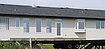 *(original 150×71 · [live](https://jdsmithinsurance.com/images_new/claims_house_bridge_1_small.jpg))*](jds-bridge_too_small.htm) [Click to see the full series](jds-bridge_too_small.htm)
- Sometimes we ask "stupid" questions or, maybe, the U/W asks "stupid" questions like, say, has the Insured surveyed route they are going to take?
- Have they obtained approvals for the route from the local authorities?
- Did they check the quality of the roads, clearance of overhead wires, bridges and tunnels.
- Did they determine the CAPACITY of that little BRIDGE they were going to use?
- Sometimes those "stupid" questions aren't so stupid after all.

**A 14" Hole in the Wrong Place**

[ *(original 104×80 · [live](https://jdsmithinsurance.com/images_new/claims_lake_peigneur.gif))*](https://jdsmithinsurance.com/media/LakePeigneur_SaltMine.wmv) [Click to see the full scene](https://jdsmithinsurance.com/media/LakePeigneur_SaltMine.wmv)
- **What happens when a 14" hole is drilled down through a lake into a salt mine?**

- **Click [here](https://jdsmithinsurance.com/media/LakePeigneur_SaltMine.wmv) to see the details and consequences**

**Lucky To Be Alive**

[ *(original 200×84 · [live](https://jdsmithinsurance.com/images_new/close_call_01_small.jpg))*](jds-lucky_to_be_alive.htm) [Click to see the full scene](jds-lucky_to_be_alive.htm)
- **Two photos of an accident that came very close to ending in disaster!**

- **Click [here](jds-lucky_to_be_alive.htm) to see what we mean**

**Unusual Claims**

[ *(original 150×74 · [live](https://jdsmithinsurance.com/images/unusual_claims_10_small.jpg))*](jds-unusual_claims.htm) [Click to see the full series](jds-unusual_claims.htm)
- **Amazing photos of unusual insurance claims.**

- **Click [here](jds-unusual_claims.htm) to see what we mean**

**Don't Let This Happen To You**

[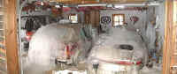 *(original 200×84 · [live](https://jdsmithinsurance.com/images/frozen_pipes_small.jpg))*](https://jdsmithinsurance.com/images/frozen_pipes.jpg) [Click to enlarge](https://jdsmithinsurance.com/images/frozen_pipes.jpg)
- **If it is water damage, rent a wet vac!**

- **Take photos**

- **Try to repair what you can.**

**Giant Mine Widows Denied $10.7-Million Award**

[ *(original 176×102 · [live](https://jdsmithinsurance.com/images_new/claims_news_01.jpg))*](jds-claims_giant_mine.htm) [Click for full story](jds-claims_giant_mine.htm)
**The Supreme Court of Canada has sided with the Northwest Territories Court of Appeal in overturning a lower court award of $10.7 million to the families of nine miners murdered in 1992.
( [more....](jds-claims_giant_mine.htm) )**

**Roofer Liable for $2.3 Million in Damages for Church Fire**

[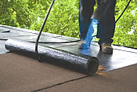 *(original 175×117 · [live](https://jdsmithinsurance.com/images_new/claims_news_02.jpg))*](jds-claims_roofer_liable.htm) [Click for full story](jds-claims_roofer_liable.htm)
**The Supreme Court of British Columbia recently found Sur-Del Roofing Limited responsible for a 2004 fire that destroyed a Mennonite Church in Abbotsford, B.C.
( [more....](jds-claims_roofer_liable.htm) )**

**Winners of the Annual Stella Awards**

The Stella's are named after 81-year-old Stella Liebeck who spilled coffee on herself and successfully sued McDonalds. That case inspired the Stella Awards for the most frivolous successful lawsuits in the United States.

**5th place (Tied)**
Kathleen Robertson of Austin, Texas was awarded $780,000 by a jury of her peers after breaking her ankle tripping over a toddler who was running inside a furniture store. The owners of the store were understandably surprised at the verdict, considering the misbehaving toddler was Ms. Robertson's Son.

**5th place (Tied)**
19-year-old Carl Truman of Los Angeles won $74,000 and medical expenses when his neighbour ran over his hand with a Honda Accord. Mr. Truman apparently did not notice there was someone at the wheel of the car when he was trying to steal the hubcaps.

**5th place (Tied)**
Terrence Dickson of Bristol, Pennsylvania was leaving a house he had just finished robbing by way of the garage door. He was not able to get the garage door to go up since the automatic door opener was malfunctioning. He could not reenter the house because the door connecting the house and garage locked when he pulled it shut. The family was on vacation and Mr. Dickson found himself locked in the garage for 8 days. He subsisted on a case of Pepsi he found and a large bag of dry dog food. He sued the homeowner's insurance claiming the situation caused him undue mental anguish. The Jury agreed to the tune of $500,000.

**4th Place**
Jerry Williams of Little Rock, Arkansas was was awarded $14,500 and medical expenses after being bitten on the buttocks by his next door neighbour's Beagle dog. The Beagle was on a chain in its owner's fenced yard. The award was less than sought because the jury felt the dog might have been a little provoked at the time as Mr. Williams, who had climbed over the fence into the yard, was shooting it repeatedly with a pellet gun.

**3rd place**
A Philadelphia restaurant was ordered to pay Amber Carson of Lancaster, Pennsylvania$113,500 after she slipped on a soft drink and broke her coccyx (tailbone). The beverage was on the floor because Ms. Carson had thrown it at her boyfriend 30 seconds earlier during an argument.

**2nd Place**
Kara Walton of Claymont, Delaware sued the owner of a nightclub in a neighbouring city when she fell from the bathroom window to the floor and knocked out two of her front teeth. This occurred whilst Ms. Walton was trying to crawl in through the window of the Ladies Room to avoid paying the $3.50 cover charge. She was awarded $12,000 and dental expenses.

**1st Place**
This year's runaway winner was Mr. Merv Grazinski of Oklahoma City, Oklahoma. Mr. Grazinski purchased a new Winnebago motorhome. On his trip home from an OU football game, having driven onto the freeway, he set the cruise control at 70 mph and calmly left the drivers seat to go into the back and make himself a cup of coffee. Not surprisingly, the RV left the freeway, crashed and overturned. Mr. Grazinski sued Winnebago for not advising him in the owner's manual that he could not actually do this. The jury awarded him $1,750,000 plus a new Winnebago Motor Home. The company actually changed their manuals on the basis of this suit just in case there were any other complete morons buying their recreation vehicles.

### 4. CTA (bottom)
[Call the Claims Help Line, ext. 232](tel:+19057647868,232) · [Contact your broker](jds-staff.htm) · Escalation: [manager@jdsmithinsurance.com](mailto:manager@jdsmithinsurance.com)

---

## E2. Online payments
`jds-online_payments.htm` · Menu: Resources › For clients › Online payments · Homepage quick action "Make a payment"
**Live page:** [jds-online_payments.htm](https://jdsmithinsurance.com/jds-online_payments.htm) · **Current &lt;title&gt;:** "Untitled Document"
**Suggested &lt;title&gt;:** Pay Your Insurance Online | JD Smith Insurance *(currently "Untitled Document")*

### 1. Hero
- **H1:** How to make an online payment
- **Subheading:** Thank you for insuring with J D Smith & Associates, or J D Smith Insurance & Financial. If you do online banking with the institutions below, it is easy to pay your insurance policy issued by our office.
- **Hero photo (original):**  *(original 1000×400 · [live](https://jdsmithinsurance.com/images/info_payments_front.jpg))*
- **Suggested replacement:**  *(suggested replacement · [Unsplash photo](https://unsplash.com/photos/person-using-laptop-computer-holding-card-Q59HmzK38eQ) · free Unsplash License)*

### 2. Steps (numbered)
1. Log in to your online banking.
2. Select "add a bill", "new bill" or "add payee".
3. When prompted to search for a payee, type in: **J D SMITH & ASSOCIATES INS. BROKERS** or **J.D. SMITH ASSOCIATES INS. BROKERS**
4. You will be prompted to enter a 6-digit account number (the customer number at the top right of your invoice). If you do not have this number, contact your broker directly.
5. Proceed to pay the bill.

Notes: depending on which bank you use, there may be either spaces or periods between J and D. Make sure to include "& ASSOCIATES".

**Automatic monthly payments:** please contact our accounting department at [ext. 224](tel:+19057647868,224).

**Banks** (logos):  *(original 125×125 · [live](https://jdsmithinsurance.com/images/logo_td.gif))*  *(original 125×125 · [live](https://jdsmithinsurance.com/images/logo_scotiabank.jpg))* 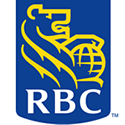 *(original 125×125 · [live](https://jdsmithinsurance.com/images/logo_rbc.gif))*  *(original 125×105 · [live](https://jdsmithinsurance.com/images/logo_bmo.gif))* 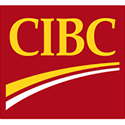 *(original 125×125 · [live](https://jdsmithinsurance.com/images/logo_cibc.gif))*  *(original 150×42 · [live](https://jdsmithinsurance.com/images/logo_national_bank.gif))* *(the CIBC logo's alt text says "TD Bank" on the live page)*

### 3. CTA (bottom): if you have a problem, please contact
Krista Furois, Registered Insurance Broker, JDS Accounting Department · J. D. Smith & Associates Insurance Brokers Inc. · 2 - 105 West Beaver Creek Road, Richmond Hill, ON L4B 1C6 · T: [(905) 907-9211](tel:+19059079211) · F: (905) 764-9618

---

## E3. Insurance companies we represent
`jds-insurance_companies.htm` · Menu: Resources › For clients › Insurance companies
**Live page:** [jds-insurance_companies.htm](https://jdsmithinsurance.com/jds-insurance_companies.htm) · **Current &lt;title&gt;:** "Insurance Companies Represented by J.D. Smith Insurance Brokers" · **Meta description:** "We have the advantage of working with Canada's best Insurance Companies with products providing broad coverage and give you Peace of Mind"

### 1. Hero
- **H1:** Insurance companies we represent
- **Subheading:** Service · broad coverage · competitive pricing.
- **Hero photo (original):**  *(original 1000×400 · [live](https://jdsmithinsurance.com/images/insurance_companies_front.jpg))*
- **Suggested replacement:**  *(suggested replacement · [Unsplash photo](https://unsplash.com/photos/two-people-shaking-hands-over-a-wooden-table-NzIV4vOBA7s) · free Unsplash License)*

### 2. Information
At JD Smith Insurance, we know the importance of creating many business-to-business relationships with insurance companies who also stand for integrity and transparency, and who provide broad coverage with excellent claims service. We work closely with these insurance companies and our client base to choose the best selection of products available on the market to meet all of your needs.

**Below are the companies we represent** (logo grid; each logo links to the insurer):
| Insurer | Link | Logo (original) |
|---|---|---|
| Chubb (formerly ACE INA) | https://www.chubb.com/ca-en/ |  *(original 100×77 · [live](https://jdsmithinsurance.com/images_new/logo_chubb_insurance.gif))*  *(original 122×43 · [live](https://jdsmithinsurance.com/images_new/logo_ace_ina.gif))* |
| AIG | http://www.aig.com |  *(original 86×41 · [live](https://jdsmithinsurance.com/images/logo_aig.gif))* |
| Aviva | https://www.avivacanada.com |  *(original 114×28 · [live](https://jdsmithinsurance.com/images_new/logo_aviva.gif))* |
| Definity | https://www.definityfinancial.com/English/overview/default.aspx |  *(original 210×57 · [live](https://jdsmithinsurance.com/images/Logo_definity_210.gif))* |
| Ecclesiastical | https://ecclesiastical.ca/ |  *(original 188×66 · [live](https://jdsmithinsurance.com/images/logo_ecclesiastical.gif))* |
| Economical | https://www.economical.com/en/home |  *(original 210×35 · [live](https://jdsmithinsurance.com/images_new/logo_economical_3_2012.gif))* |
| Hagerty | https://www.hagerty.com/ |  *(original 180×73 · [live](https://jdsmithinsurance.com/images/logo_hagerty_01.jpg))* |
| Intact | https://www.intact.ca/en/personal-insurance.html |  *(original 130×73 · [live](https://jdsmithinsurance.com/images/logo_intact_insurance_02.jpg))* |
| Jevco | https://www.jevco.ca/en/home.html |  *(original 53×50 · [live](https://jdsmithinsurance.com/images_new/logo_jevco_50_50.gif))* |
| Lloyd's | http://www.lloyds.com |  *(original 110×35 · [live](https://jdsmithinsurance.com/images_new/logo_lloyds.gif))* |
| The Dominion | http://www.thedominion.ca |  *(original 210×60 · [live](https://jdsmithinsurance.com/images_new/logo_dominion.gif))* |
| Travelers | https://www.travelerscanada.ca/ |  *(original 210×42 · [live](https://jdsmithinsurance.com/images/logo_travellers.jpg))* |
| Travel Underwriters | http://www.travelunderwriters.com |  *(original 200×48 · [live](https://jdsmithinsurance.com/images/Travel_Underwriters.gif))* |
| Unica | http://www.unicainsurance.com |  *(original 179×90 · [live](https://jdsmithinsurance.com/images_new/logo_unica_insurance.jpg))* |
| Wawanesa | http://www.wawanesa.com |  *(original 191×50 · [live](https://jdsmithinsurance.com/images/wawanesa.gif))* |
| Zurich | https://www.zurich.com/ | 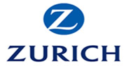 *(original 180×95 · [live](https://jdsmithinsurance.com/images/logo_zurich_02.jpg))* |

…and many others. Visit our company websites!

[IBC — The insurance information source](http://www.ibc.ca): home, tenant & business insurance explained · how insurance works · safety and loss prevention.  *(original 89×70 · [live](https://jdsmithinsurance.com/images/IBC_logo.gif))*

*Logos are small and some are out of date (ACE INA, Economical 2012). Get current logos from each insurer's media kit.*

### 3. CTA (bottom)
"Contact one of our professional brokers for a review of your coverages today!" → [Get a free quote](jds-get_a_quote.htm) · [Contact your broker](jds-staff.htm)

---

## E4. 12 ways to save
`jds-12waystosave.htm` · Menu: Resources › Advice › 12 ways to save · Footer: Resources
**Live page:** [jds-12waystosave.htm](https://jdsmithinsurance.com/jds-12waystosave.htm) · **Current &lt;title&gt;:** "12 Ways To Save On Home and Auto Insurance" · **Meta description:** "J.D. Smith Insurance Brokers shows you 12 ways to save money on your home and auto insurance."

### 1. Hero
- **H1:** 12 ways to save on home and auto insurance
- **Hero photo (original):**  *(original 1000×400 · [live](https://jdsmithinsurance.com/images/info_ways_to_save_front.jpg))*
- **Suggested replacement:**  *(suggested replacement · [Unsplash photo](https://unsplash.com/photos/piggy-bank-with-gold-coins-heYdDdq0cbE) · free Unsplash License)*

### 2. Full text (live)
 *(original 254×40 · [live](https://jdsmithinsurance.com/images/12ways.gif))*

**1.** | Check the policy carefully for correct information.
Postal codes, ages and location addresses can affect your rate.

**2.** | Are you getting the additional age discount for mature adults?

**3.** | Check deductibles. Higher deductibles results in savings.

**4.** | Are you paying for coverage you don't need?
If your car is over 5 years old, you may want to take off the collision.
Keep jewellery you don't wear in a safety deposit box.

**5.** | Are you a non smoker?

**6.** | Have you been consistent with one insurance company, or do you switch every few years?
The companies give loyalty discounts.

**7.** | Install an alarm system in your home and car.

**8.** | If you have a small claim, pay it yourself and save your insurance for the big one.

**9.** | Combine both your house and car policies for the extra discounts. Not all companies do this.

**10.** | Pay monthly, or look at a 3 pay policy.

**11.** | Some companies give a 5% discount if you pay your premium in full.

**12.** | Talk to one of our brokers who has your interest in mind.

 *(original 340×40 · [live](https://jdsmithinsurance.com/images/Discounts.gif))*

 *(original 60×30 · [live](https://jdsmithinsurance.com/images/House2-1.gif))*

**Home & Condo Discounts**

 *(original 55×30 · [live](https://jdsmithinsurance.com/images/Car2.gif))*

**Auto Discounts**

**1.** | Over 45, mature | **1.** | Multiple vehicles

**2.** | Combine house & car policies | **2.** | Combine house & car policies

**3.** | Claims free | **3.** | Retiree

**4.** | Alarm system | **4.** | Conviction free

**5.** | New home | **5.** | Short commute to work

**6.** | Non smoker | **6.** | Autonomous Emergency Braking (AES)

**7.** | Mortgage Free | **7.** | Out of town student for occassional drivers - 100Km or more from home

**8.** | Water prevention - backwater valve, monitored sump pumps | **8.** | New business loyalty - 5 years or more with prior insurance company
**9.** | Single pay - full payment of your premium

**Talk to our J.D. Smith Licensed Brokers today and get all the savings you deserve**

**IBC Is A Good Place To Learn About Insurance**

An Independent Insurance Broker Covers You Best

[ *(original 89×70 · [live](https://jdsmithinsurance.com/images/IBC_logo.gif))*](http://www.ibc.ca)

- How Insurance Works
- Home, Business & Auto
- Industry Issues
- Safety and Loss Prevention

The Top 10 Most Stolen Cars in Ontario

We recommend that **you install an after market tracker** on all of the following vehicles.

According to the Toronto Police, the [most commonly stolen vehicles](https://info.rates.ca/acton/ct/39960/s-0985-2211/Bct/q-0587/l-03cc:b864f/ct8_0/1/lu?sid=TV2%3AuVPjipu63) are those with a push-to-start ignition. The city of Ottawa has also seen a [rise in vehicle thefts this year](https://info.rates.ca/acton/ct/39960/s-0985-2211/Bct/q-0587/l-03cc:b864f/ct8_1/1/lu?sid=TV2%3AuVPjipu63) , with more than 1,500 vehicles reported stolen within the first nine months of 2022.

This year, SUV's dominate the list of most stolen vehicles, followed by pickup trucks and cars. [In Ontario](https://info.rates.ca/acton/ct/39960/s-0985-2211/Bct/q-0587/l-03cc:b864f/ct8_2/1/lu?sid=TV2%3AuVPjipu63) , criminals tend to seek these vehicles:

- Lexus RX Series
- Honda CR-V
- Ford F-150 Series
- Toyota Highlander
- Honda Civic
- Land Rover Range Rover Sport
- Honda Accord
- Chevrolet GMC Silverado/Sierra 1500 Series
- RAM 1500 Series
- Toyota Tacoma

CAR THEFT IN ONTARIO AND TORONTO. WHAT YOU CAN DO

 *(original 304×229 · [live](https://jdsmithinsurance.com/images/savings_stolen_cars.jpg))* Unfortunately, Ontario is seeing 130 cars stolen every day. Toronto is the worst area.

The police and OPP, are trying, but are not having a lot of success.

Your Carmakers GPS does no good and will not help with a professional theft.

The best way is to Install a professional tracker hidden in the vehicle.

We're now seeing, that technology is the predominant way that vehicles are being stolen. Criminals are utilizing tools that are purchased online that can make it very easy."

Here are some popular theft methods and ways to deter them.

- **Method:** Thieves have taken to accessing something called the onboard diagnostic port (ODP) that provides access to a car's electronic systems. Once they break into a vehicle, thieves can plug into the ODP and program a new key fob. That lets them start the car and drive it away.

"That is one of the biggest methods in Ontario for stealing vehicles," said Gast. "This is the sixth year in a row that has increased, so it continues to be a rising trend."

- **Defense:** Clients can put on an ODP lock, which covers the ODP port. "Some owners have gone so far as actually putting a dummy ODP port into what looks to be the legitimate one below the dash. The thief plugs into it, and nothing happens."

Other deterrents are mechanical steering-wheel or gas-pedal locks. There also are immobilizing devices that can be wired into a car's ignition system. Gast notes these require professional installation to avoid invalidating warranties.

- **Method:** Another trend is the 'relay attack' which usually involves two criminals using technology that captures door-lock signals on newer cars.

If a car owner parks, walks into the entry of their home and drops their key fob on a table, one criminal carrying an extender antenna walks near the house, while an accomplice pulls a car's door handle. That triggers a signal to see if the key fob is close by. The antenna picks up that signal and sends back the radio frequency.
"They're able to capture that and reprogram the key fob and off they go," said Gast.

- **Defense:** There are two primary methods. Faraday boxes or pouches that block key fob signals can be placed inside a car owner's home or carried in a pocket or purse.

Behavioural changes also help. "These attacks don't just happen in residential areas. It can happen in a parking lot. Somebody's parked their car and now they're walking towards the mall and can't remember if they locked their vehicle," Gast said. "Some of these key fobs have pretty good range and the owner clicks their lock button just to make sure. Somebody in proximity with that device can capture the signal."

Brokers should also tell clients to be on the lookout for tracking tags (AirTags or SmartTags that were designed to help people find misplaced phones or lap tops) that thieves attach to cars they've targeted for theft.

"A lot of thieves are walking through a mall parking lot looking for a particular vehicle but there's not an opportunity to steal it there," Gast said. "They put their little device somewhere on a vehicle and then, using an app, they track it back to whatever the residence is—and at two or three in the morning they go to work on their shopping list of what they want to take."

Other ways to deter theft, or recover stolen vehicles, include:

- Using GPS trackers installed either by dealers or aftermarket repair shops. They can transmit a stolen vehicle's location and owners can inform law enforcement.
- Parking in well lit areas, putting the vehicle in a garage if possible and always activating the car's security systems.
- Reporting suspicious activity. "If you happen to wake up at two o'clock in the morning and see people walking around [neighbours'] driveways, there's a good chance that they're scouting vehicles," Gast said. "Professional and organized crime groups are canvassing areas, looking for vehicles where people aren't taking these precautions. [Supply chain issues are driving the market](https://www.canadianunderwriter.ca/insurance/catalytic-converter-theft-a-growing-problem-for-auto-insurers-1004223964/) [for vehicles] not only nationally but internationally and that's going to continue to increase."
- **The main targeted vehicles are Any high end SUV's, Toyota Highlanders…..Lexus, Mercedes and Range Rovers**
- **The best way is to Install a professional tracker hidden in the vehicle.**

### 3. CTA (bottom)
"Make sure you have all the discounts you deserve." → [Get a free quote](jds-get_a_quote.htm) · [Call 1-800-917-7283](tel:18009177283)

---

## E5. 20 hot topics
`jds-hot_topics.htm` · Menu: Resources › Advice › 20 hot topics · Footer: Resources
**Live page:** [jds-hot_topics.htm](https://jdsmithinsurance.com/jds-hot_topics.htm) · **Current &lt;title&gt;:** "20 Hot Insurance Topics From J.D. Smith Insurance" · **Meta description:** "J. D. Smith presents 20 hot insurance topics of interest to think about."

### 1. Hero
- **H1:** 20 hot insurance topics
- **Hero photo (original):**  *(original 1000×400 · [live](https://jdsmithinsurance.com/images/hot_topics_front.jpg))*
- **Suggested replacement:**  *(suggested replacement · [Unsplash photo](https://unsplash.com/photos/3d-rendered-question-marks-in-orange-and-gray-IVGZ6NsmyBI) · free Unsplash License)*
- *(Build the 20 topics as an accordion or FAQ list with a table of contents.)*

### 2. Full text (live)
The following items are Hot Topics that we have saved online from the **"STAYING IN TOUCH"** Newsletter we send out to our clients bi-yearly. The information is compiled and copyrighted by The Insurance Brokers Association of Ontario. We hope you find the material useful.

[Impaired Driving](#impaired)

[Boating New Laws](#boating)

[Graduated Licensing](#graduated)

[8 Travel Tips](#travel)

[Road Rage](#rage)

[Insurance Fraud](#insurance fraud)

[Is Your License Valid?](#warning)

[Insure To Value](#insure value)

[e-Sense, Keeping Computer Info Safe & Secure](#e-sense)

[Insurance Broker, Trusted Partner](#partner)

[12 Tips to Save $$](#12 tips)

[Discounts That Save $$](#save $$)

[What About Car Rentals?](#rentals)

[Silent and Deadly](#silent)

[Credit Card Fraud](#credit card)

[Banks](#banks)

[Ice Storm Results](#storm)

[Who Pays Auto Accident Lost Income?](#who pays)

[Home Security](#home security)

**Impaired Driving - Not A Good Policy**

Drinking and driving is not only illegal, it is socially and morally irresponsible. Despite the horrific costs of impaired driving, measured not only in lives lost, injuries sustained and damage to property, the practice still continues.
Many Ontario drivers don't realize they lose important insurance protection if they are convicted of a drinking and driving offense. The financial consequences that they and their families will suffer in terms of loss of coverage's can be considerable.

Did you know, your insurance company will not pay for loss or damage to your vehicle if you are unable to maintain proper control of your vehicle because you are driving under the influence of intoxicating substances? Likewise, your insurance company will not pay for loss or damage if you are convicted of an offence such as impaired driving, driving with more than 80mg of alcohol in the blood or if you refuse to provide a breath sample.

Whether you drive a car, motorcycle, snowmobile or all-terrain vehicle, you could face life-long financial devastation by losing your income replacement benefits if you suffer a critical injury, or, at the very least, you could destroy your vehicle and get nothing for the value of it.

Please don't drink and drive.

If you are involved in an accident and are convicted of a drinking and driving offense, your Ontario Automobile Insurance policy will not pay:

- the Income Replacement Benefit;

- the Non-Earner Benefit; and

- Compensation for Other Expenses.

[Return to Top](#The)

**New Boating Rules**

In an effort to reduce accidents and save lives, the Canadian Coast Guard introduced new regulations for all power driven pleasure craft last year. A summary of the highlights follows:
**New Age and Horsepower Regulations** (as of April 1, 1999)

- No one under 12 years of age can operate a boat of **more than 10 horsepower** unless accompanied and directly supervised by a person 16 years of age or older.

- A person between the ages of 12 and 16 cannot operate a boat with **more than 40 horsepower** unless accompanied and directly supervised by a person 16 years old or older.

- A person under 16 years of age is prohibited from operating a personal watercraft (PWC).

**New Recreational Boat Operator Competency**

To keep our lakes and waterways safe, drivers of power driven pleasure craft will be required to show proof of competency to operate such a craft. Because of the large number of boaters on the waterways today, a graduated system has been put into place. You should be aware of the following regulations:

- Effective September 15, 1999, a person born after April 1, 1983 will require proof of competency on board to operate any boat fitted with a motor;

- Effective September 15, 2002, any person operating a boat fitted with a motor and less than 4 meters in length (including PWC), will require proof of competency on board;

- Effective September 15, 2009, all operators will require proof of competency on board.

These regulations also apply to non- residents operating their pleasure craft after 45 consecutive days in Canadian waters. An operator's card or its equivalent issued to a non- resident by their state, will be considered as proof of competency.

**What is Proof of Competency?**

Proof of competency can take three forms:

- Proof of having taken a boat safety course prior to April 1, 1999;

- A pleasure craft operator card from a Canadian Coast Guard accredited course provider following successful completion of an accredited test. Boaters must receive a mark of 75% or more to obtain this card, which is good for life;

- A completed rental boat safety checklist (for power driven rental boats)

It is important that you become aware of the new boating regulations.

[Return to Top](#The)

**Graduated Licensing in Ontario**

The Graduated Licensing system was put in place in Ontario a couple of years ago to cut the risks new drivers face. Statistics show new drivers are more likely to get into automobile accidents which are the leading cause of death for people between the ages of 16 and 24.

The program is divided into three distinct license levels: One, Two and a Full Drivers License.

**Level One** licensees must be at least 16 years of age, pass an eyesight test and pass a written test of their understanding of the rules of the road. There are five other Level One conditions:

- a fully licensed driver, licensed at least four years, must accompany drivers in the front seat at all times and that person must have a blood alcohol level less than .05%;

- the driver's own blood alcohol level must be zero;

- drivers must not drive between midnight and 5 a.m.;

- a seat belt must be available for each occupant; and

- drivers are not allowed to operate any vehicle on Ontario's 400-series highways or on Ontario's high speed expressways, such as the Queen Elizabeth Way or the Don Valley Parkway.

Level One lasts a minimum of 12 months and a maximum of five years, but can be reduced to eight months if the new licensee successfully completes an Approved Driver Education Course.

**Level Two** licensees must pass a road test after completion of Level One and can expect to stay in the second phase for a minimum of 12 months. There are two conditions for this level:

- drivers must have a blood alcohol level of zero; and
- a seat belt must be available for each occupant.

To qualify for a **Full License** , a licensee must pass a road test at the end of Level Two. For new drivers in Ontario, it takes at least 20 months to earn full driving privileges.

**If the police stop a Level One or Level Two driver for any reason, and the driver is charged with and convicted of breaking any of the above conditions, that driver's license will be suspended for 30 days.**

[Return to Top](#The)

**8 Travel Tips** to save you money and inconvenience

We've seen it all when it comes to unpleasant vacation problems, especially those that involve air travel. Not only can they be costly, they could spoil your vacation.

**Here's a checklist to help prevent common travel problems from happening to you.**

- Make a list of what you are packing and keep it with you in your carry- on bag. If checked bags are lost or stolen, this list can help identify your property and let you know if anything is missing.

- Always carry your valuables and important documents including money, traveler's cheques , credit cards and driver's license with you. Also keep jewellery, keys, medications and cameras with you since many airlines refuse to accept responsibility for these items if checked.

- Be sure to lock your bags. This helps avoid accidental openings and discourages theft. Since small luggage locks can be opened and closed without your knowledge, any loss may not be detected until it's too late. We suggest "zip ties" be used. This way if someone tampers with your luggage it will be obvious and you can present your claim immediately.

- Always remove all old baggage claim checks and destination tags to help avoid incorrect routing.

- Identification helps. According to airline carriers, correctly identified items are returned to their owners "most of the time". Bags should have your name, telephone number and address clearly marked both inside and outside.

- If your luggage is lost, call the airline daily for an update on your missing bags. After five days you should file a claim based on the assumption your bag or bags are lost. When filing a claim, itemize the contents of your bag( s) along with their estimated value, attach copies of any receipts you may have and include a copy of your plane ticket and baggage claim checks. As a word of caution, you may have to wait up to six months to be reimbursed and don't expect to receive the full amount you requested.

- Read your airline ticket carefully. Many have a clause which limits the amount paid on lost items based on the weight of the article. Usually airlines pay $9.07 per pound. Obviously this is not enough when it comes to jewellery. If your luggage containing 3 pounds of expensive jewellery was lost, your claim is limited to $27.21 U.S. Talk to us about other options.

- Finally, remember goods illegally acquired or not declared at customs may not be covered by your insurance company if lost or stolen.

Whenever you travel by air, train, bus or ship, always use common sense and follow these tips to prevent a loss. Your policy may have limitations or deductibles. If you have any doubts or questions, please check with us before you travel to make sure your possessions are adequately insured. Enjoy your trip.

[Return to Top](#The)

**Road Rage: The Growing Monster**

It's affecting drivers around the globe. It claims hundreds of lives every year - and Canada is currently feeling its monstrous grip.

It's called road rage, a condition that often involves anger or violence associated with on-road driving activities. Many government agencies have determined that road rage is not a myth or an invention of the media. Rather, it's a real and serious problem that manifests itself through bizarre and often violent behaviour. Since 1998, in Canada alone over 12,000 road rage incidents have been reported in the media!

What can be done? Most experts agree that the first step is to prepare yourself so you will not be the next victim. This means avoidance at any cost. You never know if the driver beside you is a ticking bomb or has concealed weapons in his or her vehicle. It's best to avoid any altercation with other motorists - period! Governments and other groups are currently trying to solve this problem through regulations, enforcement and increased penalties. Solutions take time. **Don't become a victim - take preventative measures now!**

Here are some Do's and Don'ts that you can use to prevent a road rage attack:

**DO.....**

- move over to allow tailgaters to pass
- allow plenty of time for any trip you take
- leave law enforcement to the authorities
- use the passing lane only to pass
- contact police with a description of the vehicle, licence number and driver if you are confronted with road rage
- ignore gestures from other drivers
- avoid eye contact with other motorists
- be considerate and courteous

**DO NOT.....**

- tailgate or flash your lights at other drivers
- insist on the right of way if challenged by another driver
- make eye contact, hand gestures or show irritation with aggressive drivers
- assume all foolish or aggressive acts by other motorists are intentional
- honk your horn unless absolutely necessary

[Return to Top](#The)

**Insurance Fraud**

Insurance fraud occurs when someone makes an insurance claim that is completely false or files a claim for more than the value of the goods actually lost, stolen or destroyed. Fraudulent claims affect the cost of everyone's insurance. The Canadian Coalition Against Insurance Fraud estimates that $1.3 billion worth of insurance claims that are paid in Canada every year are fraudulent. This works out to 10- 15% of every dollar you pay for insurance.

If someone you know is committing insurance fraud on a home, car or business policy, you can report it to Crime Stoppers. Crime Stoppers is an international non- profit civilian program that assists police in solving crimes through tips reported by ordinary citizens who have knowledge or suspicion that crime has taken place. If your tip helps the police or an insurance company catch an insurance fraud, you may be eligible for a cash reward. Your call will remain completely anonymous.

The Insurance Brokers Association of Ontario has supported Crime Stoppers for many years.

An innovative alliance between Crime Stoppers and the Canadian Coalition Against Insurance Fraud, which began in Ontario in 1995, to report insurance fraud tips has resulted in 51 arrests, 49 denied claims and has prevented the payment of more than $1.2 million worth of fraudulent home, car and business insurance claims across Canada in the past 5 years.

"The message of the Crime Stoppers program is **They Cheat /You Pay** ," said Maid Mary Lou O'Reilly, Executive Director of the Coalition. "With the level of support we've seen for our partnership with Crime Stoppers, we know that Canadians understand this message and they no longer turn the other way when a neighbour brags about 'ripping off the insurance company.' They know what it's costing all of us."

It is important for everyone to help prevent insurance fraud and in doing so, help reduce the premiums we pay.

[Return to Top](#The)

**Warning! Is Your Driver's License Still Valid?**

In Ontario all new drivers, regardless of age, must complete a two level "Graduated Licencing" program before they qualify for full licence privileges.

These drivers have a maximum of five (5) years from the start date of their Level One licence to earn full licence privileges. If they do not receive their Class G licence (full licence) within this 5 year period, they must reapply and start the licencing process over again. According to information provided by the Ministry of Transportation, an estimated 125,000 Ontario drivers will see their Level One and Level Two licences automatically expire this year.

If you received your Level One or Level Two licence in 1994/ 95 and have not "graduated" to a Class G licence, your licence may have already expired. This means you could unwittingly end up driving without a licence. Not only is this against the law, but driving without a valid licence invalidates your insurance coverage.

If this applies to you, call your nearest Ministry of Transportation Test Centre to book your appointment.

[Return to Top](#The)

**Why You Should Always "Insure to Value"**

**At 4 a. m. one morning, Dave and his family were awakened by their smoke alarms.** "I've had emergency training, but when I crawled on my hands and knees and opened the bedroom door, I was absolutely amazed at the clouds of smoke in my home. If it hadn't been for the smoke detectors, none of us would be here today." Dave and his family were fortunate, they were able to crawl to the door, get out of the house and call the fire department.

The fire in Dave's home was caused by a crack in the electrical cable coming into his home, which short- circuited and the arcing caused the subsequent fire, which began at the electrical box and moved through the false ceiling of his basement's recreation room. Dave and his family escaped in their pyjamas. At this point, it is important to note that Dave had done all the correct things with his insurance. He had filled out the appropriate forms and was insured to what he believed was to value - $150,000 on his home and $110,000 on his contents. Because the damage to the basement weakened the foundation, Dave's insurer paid $170,000 to replace the dwelling since he had the replacement value clause in his policy.

**Contents were an entirely different matter.** Dave said the most important thing you have to remember, is that whatever value you insure for includes sales tax. Therefore, he suggests that you remember whatever amount of insurance you have on contents, the limit is approximately 87 per cent of that value since sales tax is required to be paid. Most people would admit that $110,000 on contents and $150,000 on one's home is more than adequate - not according to Dave.

He remembers some of the immediate out- of- pocket expenses for which he was not prepared - two pairs of glasses, three sets of contact lenses, dental retainers and prescription drugs. He also found it surprising that he had to hire a locksmith to come and cut new keys for his cars, which had to be broken into and pushed out of the way for the fire department.

Other things, such as identification, licenses, credit cards, and passports had to be replaced. They had no keys, no place to live, no identification and no credit cards. His insurer responded within hours with a cheque for $3,000 to tide them over while they found temporary living quarters and shopped for clothes.

Dave is not wealthy, does not have extravagant tastes, but he does insist that insurance on contents be increased to adequately cover his possessions.

May we suggest that you closely review the value of all your contents including personal items, a partial list of which has been mentioned above, to ensure that in the event of accidental loss, your insurance will be in a position to replace all your goods. Dave's comments were that the least of his worries were things like jewellery - he was happy to get out alive.

As a note, when Dave's house was re- built, he did insure it and his contents fully to value and within a few months of moving back in, thieves in broad daylight entered his home and stole most of his new electronic equipment, stereo, VCR, TV including some items of jewellery that he had replaced for his wife. Dave's comment however, is if anyone wants to hear why they should insure to value, he'd be only too happy to tell them.

[Return to Top](#The)

**e-Sense Keep Your Online Information Safe & Secure**

As you've no doubt recently experienced or heard, Canadians are driving their mouses to online shopping sites in greater numbers. Consumers are looking, comparing and buying stuff for a number of reasons which include: saving time, perceived and real savings, convenience and thrill. If you have yet to conduct a purchase over the internet, chances are that you will in the near future, so the following is a little something for you to consider.

There are estimates that online transactions could top $40 billion by 2002. With this much e-commerce going on, there is a real fear that individuals may be giving up sensitive information they shouldn't.

Security and privacy issues can be confusing and difficult to understand. When was the last time you went to a site to review these policies of the company you were thinking about transacting business with? Was there a privacy policy at all? Did you read it?

Before you blindly enter a site, here are some questions you may want to ask yourself: Is knowing that the information you supply may be shared with other companies important to you? Can you change your mind at a later date about the information you supplied? Does the site use "cookies" or other ways to track your behaviour? Will the site work with cookies disabled? How does the company protect the information you have supplied them? Does the company provide a question and answer section on their site giving you this level of comfort?

Companies wanting your business should provide you the answers you require at well-constructed web sites in helpful and easy to understand language. But remember, it's up to you to do the research.

Be informed before you transact! For additional helpful information try the [Ontario Privacy Commissioner](http://www.ipc.on.ca) and go to the "If you wanted to know" section.

[Return to Top](#The)

**Your Insurance Broker, Your Trusted Partner**

When it comes to insurance matters for you, your family or your business, you can count on us for guidance and informed advice. With constant change touching all aspects of our lives, it's reassuring to have someone you can trust.

We continually upgrade our professional knowledge through seminars and courses. We put service and attention to detail first on our list - and yours. We answer your insurance questions. We provide the best possible coverage at the best possible price. And, we work for your best interests every day of the year.

From choosing a policy to assisting you with your claim, we're proud to be your insurance broker.

Thank you.

[Return to Top](#The)

**12 Tips to Save $$$**

1. | | Check the policy carefully for correct information.
Postal codes, ages and location addresses can affect your rate.

2. | | Are you getting the additional age discount for mature adults?

3. | | Check deductibles. Higher deductibles results in savings.

4. | | Are you paying for coverage you don't need?
If your car is over 5 years old, you may want to take off the collision.
Keep jewellery you don't wear in a safety deposit box.

5. | | Are you an abstainer? (non drinker)

6. | | Are you a non smoker?

7. | | Have you been consistent with one insurance company, or do you switch every few years?
The companies give loyalty discounts.

8. | | Install an alarm system in your home and car.
Take advantage of the special prices we have arranged for you.

9. | | If you have a small claim, pay it yourself and save your insurance for the big one.

10. | | Combine both your house and car policies for the extra discounts. Not all companies do this.

11. | | Pay up front rather than monthly, or look at a 3 pay policy.

12. | | Talk to one of our brokers who has your interest in mind.

[Return to Top](#The)

**Discounts That Save $$$**

**HOME AND CONDO DISCOUNTS**

**AUTO DISCOUNTS**

- Over 45, mature
- Combine house & car policies
- Claims free
- Alarm system
- New home
- Non smoker
- Mortgage Free

- Multiple vehicles
- Combine house & car policies
- Age 45 plus
- Good driving record (no accidents, less than 2 tickets)
- Abstainer (non drinker)
- Short commute to work
- First claim Free - Option

[Return to Top](#The)

**What You Should Know About Car Rentals**

There are some very serious contractual gaps in coverage for rental vehicles, particularly when you are renting in the United States. People who do not own their own vehicles need to be extremely careful.

Even if you purchase their Collision Damage or Physical/ Loss Damage Waivers, some rental car contracts exclude the following:

- theft of the vehicle
- glass, tire and undercarriage damage
- animal collision
- flood and hail damage
- damage above the windshield

Incredibly, some rental contracts even include a contractual shift of liability to the customer. Each car rental company, for their own reasons, provide certain coverages and exclude others. The above list is not complete and it is not intended to criticize any particular car rental company. It is mentioned here to warn renters of possible shortcomings in the rental contract process.

If you own your own vehicle, we suggest your best strategy is to contact us and purchase the OPCF 27 rider on your personal policy. If you are covered under a business policy (and the business owner agrees to cover you), we suggest the OPCF 27b rider. These riders will extend your coverage on the same basis provided by your standard automobile policy.

Our advice whenever you rent a car is to read the contract carefully. Don't assume you're fully covered by purchasing the rental company's Physical/ Loss Damage Waiver coverage. For your peace of mind, talk to us about including this coverage on your own auto policy.

It's the most convenient and inexpensive way to know you're adequately covered. Ask about the limits available.

[Return to Top](#The)

**Silent, Invisible, Deadly**

Carbon monoxide is called the silent killer - and for good reason. This colourless, odorless and tasteless gas overcomes and kills hundreds of people each year.

Carbon monoxide is a poisonous gas that is created by the incomplete combustion of any fossil fuel. Furnaces, wood stoves, fireplaces, gas appliances (stoves, ovens, clothes dryers) and water heaters are all common sources of carbon monoxide. Faulty ventilation and malfunctioning appliances can cause carbon monoxide to build up in your home. That's why the installation of a carbon monoxide detector in your home is crucial.

These detectors measure the level of carbon monoxide present in the atmosphere in parts per million. When the sensor detects a predetermined level of the gas in the air an alarm sounds.

When choosing a carbon monoxide detector always look for the Underwriters Laboratories (UL) approved logo on the unit before you buy. Once purchased, carefully read the instructions for proper installation and follow all maintenance suggestions. Although carbon monoxide detectors are important for home safety, they should not replace an annual inspection of heating and other gas producing appliances by a competent professional.

[Return to Top](#The)

**Fight Credit Card Fraud**

Here's what you can do to help keep your credit cards out of the hands of fraud artists and thieves:

- think of credit cards as cash
- never leave your cards unattended
- always know the location of your cards
- destroy expired cards
- sign the back of any new cards immediately
- report lost or stolen cards immediately
- protect your PIN - memorize it and do not write it down
- be careful how, when and to whom you give your card number and related information
- destroy personal financial information - don't just throw it away
- if you are not going to be using your cards for an extended period of time lock them away in a safe place
- always verify your account statement and report any discrepancies immediately
- make certain you get your card back after every transaction
- keep your card in plain view when making a transaction
- make certain that if you are being sent out a new card that it arrives within a few days of the date promised
- take extra care if you have cards with large credit limits

**(from the Financial Post)**

[Return to Top](#The)

**Banks And Your Insurance**

If proof were needed to illustrate the public's disapproval of Canada's big banks getting involved in the insurance industry, the results of a recent survey by Decima Research clearly make the point.

The survey, conducted last year when the government was considering the mergers of four of Canada's chartered banks, reveals some very interesting figures:

**Statement: [Very/Somewhat Likely]** If banks were allowed to sell insurance out of branch offices, do you think they:

- Would apply a service charge for insurance related transactions [81%]
- Might try to sell you other products when you buy insurance [79%]
- Might make getting a loan or mortgage harder to get if you don't buy your insurance from them [48%]
- Would use personal information obtained from applying for a mortgage or loan in an effort to sell other banking services [75%]

**Statement: [Agree/Strongly Agree]**

- If banks were allowed to sell insurance out of their branches, in a few years they would likely dominate the insurance market [67%]

[Return to Top](#The)

**The Ice Storm of 1998**

Ever wonder where your premium dollars go, especially when you don't make a claim?

Well, in the aftermath of the ice storm of 1998, by far the worst natural disaster in Canadian history, over 840,000 insurance claims were handled. At the peak of the storm more than five million people were without power and claims departments were receiving as many as ten calls per minute. Insurance companies worked throughout this ordeal in state-of-emergency conditions with adjusters and field staff often working out of independent broker offices, personally visiting customers' homes to inspect damage and get repairs started as quickly as possible.

Insured losses totaled $1.5 billion and it's testimony to the industry's prudent long term management of your premium dollars that not a single insurance company failed as a result of the huge claim payout.

As a matter of interest, a study by Standard & Poors released in September 1998, found claim activity pumped nearly $900 million into the economies of Ontario and Quebec. The study also determined that insurer payments led to the creation of some 16,000 jobs and generated over $330 million in tax revenue.

The people of eastern Ontario and Quebec have very positive feelings about their insurance brokers and the companies they represent as a result of their handling of the storm's devastation. They are now aware of the true value of adequate insurance coverage. Those of us lucky enough to escape the storm's wrath now know precisely where our premiums have gone.

[Return to Top](#The)

**Who Pays For My Lost Income If I Am In An Automobile Accident And Cannot Work?**

Every day on average, there are over 600 automobile accidents in Ontario. If you are injured in one and cannot work, your auto policy provides an income replacement benefit to **partially replace the income you have lost** . The policy will pay **80% of your net income** based on your pre-accident employment earnings. Net income is basically your take home pay (gross pay less employment insurance premiums, CPP payments and income tax deducted). **The maximum payment is $400 per week.** For most people, this amount is adequate. However, if your income is above average, you should consider purchasing increased benefit coverage from us. It is important to note that any payments made from other sources (such as your employer or any private disability plan) are deducted from the amount payable.

**Here's how it works.** If you are injured in an automobile accident, you may be eligible to get a payment every two weeks to partially replace the income you have lost. You can qualify if you suffer physical or psychological injuries within two years of an accident. The first seven days of your disability are not covered by this plan. Payments will begin within 14 days after the company has received your completed benefits application form and if your disability continues, a payment will follow at least every two weeks. You may require a certificate from a qualified medical person and the insurance company will pay for this certificate. Also, you are expected to participate in rehabilitation or treatments that are reasonable, and if you refuse, benefits can be reduced by 50%. There are lesser income benefits available to caregivers (such as full- time homemaker who looks after dependent children) and non- earners (such as a full- time student). If this describes your situation, we can explain the various benefits available.

We urge you to consider your own situation and minimum income needs in the event you became disabled in an automobile accident. Benefit coverage beyond the $400 weekly maximum is available at a reasonable cost. Contact us for more information.

[Return to Top](#The)

**Secure Your Home**

No one wants to go through the horror of a home break-in. Unfortunately, over 108,000 breaking and entering offences were committed in Ontario in 1997 (Statistics Canada). Here are some crime prevention strategies compiled by the Metropolitan Toronto Police and the Insurance Brokers Association of Ontario to help you reduce your risk and increase your peace of mind.

**OUTSIDE YOUR HOME:**

- keep shrubs and bushes trimmed back so your home is visible from the street and by neighbours
- keep basement windows clear so you can see in and out
- outside areas should always be well lit, especially near doors and windows
- take down old TV antennas as they can be used as ladders by burglars
- never leave items such as ladders, shovels and pieces of wood around your house
- keep your garage, storage and garden sheds locked
- make sure second floor windows and doors have functioning locks and are well secured
- make your home look occupied at all times (have neighbours pick up mail and always leave the lights on)
- get to know your neighbours (if they know your routine, they can report any unusual activity and may be witnesses if you do have a break- in)

**INSIDE YOUR HOME:**

- keep lights on timers (a television on a timer is a greater deterrent)
- never divulge information to telephone callers you don't know
- never attach your name, address, or licence number to your key chain
- install durable dead bolts that extend at least one inch into the door frame
- check all your window latches and locks frequently

[Return to Top](#The)

### 3. CTA (bottom)
"Have a question that isn't here? Ask your broker." → [Contact your broker](jds-staff.htm) · [Get a free quote](jds-get_a_quote.htm)

---

## E6. Ask a broker
`jds-ask_broker.htm` · Menu: Resources › Advice › Ask a broker · Footer: Resources *(this page is in the new header but was missing from SITE_MAP.md: now added)*
**Live page:** [jds-ask_broker.htm](https://jdsmithinsurance.com/jds-ask_broker.htm) · **Current &lt;title&gt;:** "J.D. Smith Insurance Broker Insurance Advice" · **Meta description:** "J.D. Smith Insurance Brokers provides great advice for home, auto, commercial, business, church and not-for-profit insurance."

### 1. Hero
- **H1:** Ask a broker: how to drive safe and save big bucks
- **Byline:** Dr. J.D. Smith, B.A., C.C.I.B., LLD (use `images/staff/JD_Aug_2023.jpg`)
- **Hero photo (original):**  *(original 1000×200 · [live](https://jdsmithinsurance.com/images/news_humour_front_2.jpg))*
- **Suggested replacement:**  *(suggested replacement · [Unsplash photo](https://unsplash.com/photos/a-man-and-woman-sitting-at-a-table-with-a-laptop-M5k978V3qBc) · free Unsplash License)*

### 2. Full text (live)
**How To Drive Safe And Save BIG Bucks
DR. J.D. SMITH, B.A., C.C.I.B, LLD**

Visiting the showroom to look at new or used cars is always fun to do, especially if you take along your grandson. Most of us do not take the time to consider how we will insure the new beauty or what the insurance could cost. The average cost for insurance coverage in Toronto is now about $1850.
Car insurance premiums are set based on your driving record, insurance record, the make and model of the car you own, as well as the purposes the car is used for and where and how far you drive. Insurance benefits attached to the policy differ widely from area to area depending on where you live. The rates in the GTA are higher as there is more theft, traffic to contend with and accidents.

**Choose Wisely**

You can help control the cost of your insurance through the vehicle choices you make. Before buying a car, you may want to ask yourself some important questions.
- How well will the car protect the occupants in a crash?
- How well will it assist the driver in avoiding a crash?
- How much will it cost to maintain?
- Will it hold its value in the resale market?
- Is it likely to be broken into or stolen?
- What type of alarm system is installed?

Each year all the car insurance companies gather information about car accidents, theft and other incidents that lead to insurance claims. Some European cars will cost more to repair, so the insurance cost is naturally higher. Over 600 cars a week are stolen in southern Ontario and many are shipped overseas, within days. I recommend the Boomerang alarm system, [www.boomerangtracking.com](http://www.boomerangtracking.com) for every car over $ 45,000, regardless what kind of system comes with the car. This way they can find the car anywhere immediately.

**Driving Habits**

Periodically check your own driving habits. Do you always use your mirrors to be aware of traffic around you? Do watch other vehicles to better anticipate their movements, and allow time to stop if the car ahead has to brake suddenly? Do you leave plenty of space?

I cannot believe the number of drivers who pull out into on coming traffic assuming people will stop. If you are hit it is your fault. Your insurance costs will go up for 6 years. If you are making a left turn, for any reason, it is also your fault, and you will be charged. Every 2 years most insurance companies check your abstract for tickets. Expect to be non-renewed with 4 or more tickets and your costs will double.

My pastor friend finally got coverage this week for, believe it or not, $15,967 for 2 cars 1999 and 2001. He and his wife were not careful and had 2 small fender benders, in 3 years, both of which he could have paid. His insurance company was a direct seller and just took the claims, without giving any advice, and when 5 months later they found out they also had 3 tickets, they cancelled this week, on renewal and a facility type of company was his only choice. The moral is…be careful and have a good reputable insurance company

Daytime Running Lights increase your visibility. Half of all collisions occur when drivers fail to see one another or misjudge the speed of an on-coming vehicle. If your car is older and does not have daytime lights, make it a habit to turn low beams on every time you start the car. ALSO always wear your seatbelt properly and ensure everyone in your car does the same.

**Reducing Costs**

Good drivers enjoy reduced premiums. Seniors get extra discounts with some companies. The guide in this Forever Young edition will be very helpful. Those who have collisions or convictions usually have to pay 30 to 100% more. A conviction for drinking and driving or even a "charge" will make life difficult. Don't do it. Facility rates for most vehicles are about $4,000. Save your insurance for the big claim over 2000.
Be careful who uses your car. If you lend your car to others and they cause an accident, your policy will be affected. You will carry the loss.

- Increase deductibles, and remove collision from older vehicles
- Are you getting the extra discount some companies give for combining house and car?
- Seniors get better rates, with many companies. BUT, if you are over 69 stay with the company you are with as you will have a good history with them, and when and if there is a claim, they will give you the service.
- When you have found a good competitive Broker, don't be switching ever year. Companies today look at this and want long term clients.
- If you are over 55, find a broker that targets this group and get the discounts now.
- Some brokers allow you to do your own quote on the net 24/7 and then call them if you like the package. This is a great way to shop and then see if you like the service and person who will explain the coverage's and options available.

The government is working with insurance companies to reduce the renewals by up to 10%. This fall is a good time to review your coverage's and costs.

**Car Theft**

Protect your car from thieves and vandals. Where possible, park in busy, well-lit areas. Do not to be too obvious about putting valuable items in the car or trunk and then leaving it unattended. Thieves are looking for clues on which car to break into - even in busy streets and in parking lots.

Double-check the doors when you leave. Believe it or not, doors are just left unlocked in more than 70 per cent of cases involving stolen cars. Many people now use code numbers or have identifying marks etched into the key areas of your car that will stop a thief even bothering to consider your vehicle. The company engraves a code number on the car windshield or side window, and on key parts. The parts are then more difficult for thieves to sell, and usually stop them from targeting your car.

**If you do buy that new car you have dreamed about, and you put into practice some of these suggestions, you can be sure driving with your grandchildren, I have 9, will be safer and your insurance costs will be less. Save driving**

**J D SMITH**

### 3. CTA (bottom)
[Start online auto quote](https://webrater.appliedsystems.com/WR/Default.aspx?GC=JDSMITH&LOB=AUTO&LANG=EN) · [Call 1-800-917-7283](tel:18009177283)

---

## E7. Winter storage tips
`jds-winter_storage.htm` · Menu: Resources › Advice › Winter storage tips · Footer: Resources
**Live page:** [jds-winter_storage.htm](https://jdsmithinsurance.com/jds-winter_storage.htm) · **Current &lt;title&gt;:** "J.D. Smith Insurance Provides Winter Storage Auto Tips"
**Suggested meta:** How to prepare your car, classic car or motorcycle for winter storage, and what to ask your broker about storage coverage.

### 1. Hero
- **H1:** Winter storage tips
- **Hero photo (original):**  *(original 1000×400 · [live](https://jdsmithinsurance.com/images/winter_storage_02.jpg))*
- **Suggested replacement:**  *(suggested replacement · [Unsplash photo](https://unsplash.com/photos/two-vintage-cars-beside-gray-concrete-wall-VOsy-vH3V2c) · free Unsplash License)*

### 2. Full text (live)
It's Time for Winter Storage Preparation

For many, the first snow of the winter has already fallen, and winterizing the beloved collector vehicle has suddenly become top on the priority list. If the car is simply parked in the garage for an extended period of time without preparation, you may return to a dead battery or — even worse — a damaged engine, flattened tires, or electrical or interior damage from rodents. The following steps will prevent any springtime heartbreak:

**Wash and Wax** It may seem fruitless to wash the car when it is about to be put away for months, but it is an easy step that shouldn't be overlooked. Water stains or bird droppings left on the car can permanently damage the paint. Make sure to clean the wheels and undersides of the fenders to get rid of mud, grease and tar. For added protection, give the car a coat of wax and treat any interior leather with a good conditioner.

**Car Covers** Even though your classic is stored in the garage in semi-stable temperatures and protected from the elements, a weatherproof car cover will keep any spills or dust off of the paint. It can also protect from scratches while moving objects around the parked car.

**Oil Change** If you will be storing the vehicle for longer than 30 days, consider getting the oil changed. Used engine oil has contaminants that could damage the engine or lead to sludge buildup.

**Fuel Tank** Before long-term storage of over 30-days, remember to fill the gas tank to prevent moisture from accumulating inside the fuel tank and to keep the seals from drying out. You should also purchase a fuel stabilizer to prevent ethanol buildup and protect the engine from gum, varnish and rust. The fuel stabilizer will prevent the gas from deteriorating for up to 12 months.

**Battery Care** An unattended battery will eventually lose its charge, resulting in having to purchase a new battery in the spring. The easiest, low-tech solution is to disconnect the battery cables — the negative (ground) first, then the positive. You'll likely lose any stereo presets, time and other settings. If you want to keep those settings and ensure that your battery starts the moment you return, purchase a battery tender, also known as a trickle charger. This device hooks up to your car battery on one end, then plugs into a wall outlet on the other and delivers just enough electrical power to prevent the battery from dying.

**Parking Brake Tips** For general use it is a good idea to use the parking brake, but don't do it when you leave a car in storage long term; if the brake pads make contact with the rotors for an extended period of time, they could fuse together. Instead of risking your emergency brake, purchase a tire stopper or two — also called a chock — to prevent the car from moving.

**Tire Care** If a vehicle is left stationary for too long, the tires could develop flat spots from weight of the vehicle pressing down on the tires' treads. This occurs at a faster rate in colder temperatures, especially with high-performance or low-profile tires and in severe cases, a flat spot becomes a permanent part of the tire causing a need for replacement. If your car will be in storage for more than 30 days, consider taking the wheels off and placing the car on jack stands at all four corners. This step requires more work than simply inflating the tires to the recommended pressure, but it can save you the disappointment that a set of destroyed tires would cause.

**Repel Rodents** A solid garage will keep your car dry and relatively warm, conditions that can also attract unwanted rodents during the cold winter months. There are plenty of places in your car for critters to hide and even more things for them to destroy. Prevent them from entering your car by covering any gaps where a mouse could enter, such as the exhaust pipe or an air intake; steel wool works well for this. Next, spread mothballs or cotton swabs dipped in peppermint oil along the perimeter of the vehicle as a rodent repellent. Instead of stinky mothballs, a product called Fresh Cab has been a part of my personal success in keeping the rodents away. For a more proactive approach in conjunction to the prior suggestions, lay down a few mousetraps, but make sure someone can check the garage regularly for casualties or you will have to deal with a smell much worse than mothballs.

**Maintain Insurance** You might be tempted to cancel your auto insurance when your vehicle is in storage in order to save money. If you remove coverage completely, it would be a major loss if a fire started, the weight of snow causes your roof to collapse, or if a theft occurred. Even if just collision coverage is temporarily removed, the car would not be covered when another moving object (for example: a tractor or motorcycle) rolled into it, or if the car were to fall of its jack stands. If you have classic car insurance, the J D Smith policy normally takes winter storage into account in your annual premium, so you don't have to worry about your car over the winter months.

[ *(original 304×138 · [live](https://jdsmithinsurance.com/images/winter_tips_01.jpg))*](https://www.hagerty.com/media/driving/6-winter-driving-reminders-even-if-you-dont-get-snow/?utm_source=SFMC&utm_medium=email&utm_content=MED_UN_NA_EML_UN_DailyDriver_Friday&hashed_email=41ff00e091e13318f9a4e623b0fef34b5be809c2a1703590f19b5425f3c152f8) | **[Click here for 6 winter driving reminders](https://www.hagerty.com/media/driving/6-winter-driving-reminders-even-if-you-dont-get-snow/?utm_source=SFMC&utm_medium=email&utm_content=MED_UN_NA_EML_UN_DailyDriver_Friday&hashed_email=41ff00e091e13318f9a4e623b0fef34b5be809c2a1703590f19b5425f3c152f8)**

### 3. CTA (bottom)
"Storing a vehicle for the winter? Ask your broker about reducing your coverage while it is parked." → [Contact your broker](jds-staff.htm)

---

## E8. News & humour
`jds-news.htm` · Menu: Resources › Reading › News & humour · Footer: Resources
**Live page:** [jds-news.htm](https://jdsmithinsurance.com/jds-news.htm) · **Current &lt;title&gt;:** "News and Humour from J.D. Smith Insurance Brokers" · **Meta description:** "News, humourous anecdotes, thoughts and meditations from J.D. Smith Insurance Brokers."

### 1. Hero
- **H1:** News & humour
- **Hero photo (original):**  *(original 1000×400 · [live](https://jdsmithinsurance.com/images/news_humour_front.jpg))*
- **Suggested replacement:**  *(suggested replacement · [Unsplash photo](https://unsplash.com/photos/man-reading-newspaper-with-coffee-at-cafe-Em40ER_I88Y) · free Unsplash License)*
- *(Build as a card grid of articles. The article pages are in the Appendix. Many links go to old .pps / .wmv / .wvx media files that modern browsers cannot play: see STAKEHOLDER_NOTES.)*

### 2. Full text (live)
[ *(original 58×70 · [live](https://jdsmithinsurance.com/images/news_meditations.jpg))*](jds-meditations.htm)

Take some time for yourself and view the [Meditations section](jds-meditations.htm) . Become inspired by the messages and amazed by the photographs.

[ *(original 86×70 · [live](https://jdsmithinsurance.com/images/news_dario.gif))*](jds-dario_thoughts.htm)

The Scriptures have great lessons for life. Here are a few [thoughts and comments](jds-dario_thoughts.htm) from everyday living from our friend Dario.

 *(original 69×61 · [live](https://jdsmithinsurance.com/images/news_news.gif))* | **What's New
From Dr. J.D. Smith**

 *(original 75×61 · [live](https://jdsmithinsurance.com/images/news_newsletter.gif))* | **Current Client
Newsletter**

 *(original 46×61 · [live](https://jdsmithinsurance.com/images/news_humour.gif))* | **Today's Smile**

[5 Tips to Prepare Your Vintage Rride for Storage](https://www.hagerty.com/articles-videos/articles/2019/10/29/5-tips-to-prepare-your-vintage-ride-for-storage?utm_source=SFMC&utm_medium=email&utm_content=19_November_2_Weekend_News)

[Latest Must See Car Video](https://www.youtube.com/embed/JHixeIr_6BM?rel=0&autoplay=1&iv_load_policy=3)

[After the Goderich Tornado](http://www.economicalinsurance.com/en/claimscentre/Rebuilding-in-Goderich.asp)

[When Its Not Your Time to Die](https://jdsmithinsurance.com/media/WhenItsNotYourTimeToDie.wmv)

[Some Humorous Photographs](jds-humorous_photograhs.htm)

[Kitchen Fire Prevention Video](jds-kitchen_fire_prevention.htm)

[It's A Beautiful Day](jds-its_a_beautiful_day.htm)

[Your Burglar Won't Tell You](jds-burglars_advice.htm)

[Beautiful Seatbelt Commercial](https://jdsmithinsurance.com/media/most_beautiful_seatbelt_commercial_.wmv)

[Swiss Army Knife of Cars](https://jdsmithinsurance.com/media/Swiss_technology.pps)

[Don't Forget To Check The Barn](jds-check_the_barn.htm)

[Bolivian "Road of Death"](https://jdsmithinsurance.com/media/bolivian_highway.pps)

[How NOT To Use Parasails](https://jdsmithinsurance.com/media/how_not_to_use_parasails.wmv)

[Impossible Clothing Changes](https://jdsmithinsurance.com/media/impossible_clothing_changes.wmv)

[The Bone Yard, Tucson, Arizona](jds-boneyard.htm)

[How to Avoid a Speeding Ticket](jds-avoid_a_speeding_ticket.htm)

[Outrageous Celebrity Homes](http://ca.tv.yahoo.com/blog/outrageous-celebrity-homes--234)

[Some Rather Strange Aircraft](https://jdsmithinsurance.com/media/strange_aircraft.pps)

[A 14" Hole in the Wrong Place](https://jdsmithinsurance.com/media/LakePeigneur_SaltMine.wmv)

[Preikestolen - "The Rock Pulpit"](https://jdsmithinsurance.com/media/preikestolen_en.pps)

[100 Years of Fords - good video](http://www.youtube.com/watch?v=S4KrIMZpwCY)

[Photo's of Unusual Claims](jds-unusual_claims.htm)

[Russia's Tunnel of Death](jds-tunnel_of_death.htm)

[Japan Marimba Ponies Band](jds-japan_marimba_ponies_band.htm)

[Lucky to be Alive - Close Call](jds-lucky_to_be_alive.htm)

[A Pretty Blue Planet](https://jdsmithinsurance.com/media/Pretty_Blue_Planet.pps)

[Do You Trust Engineers?](https://jdsmithinsurance.com/media/doyoutrustengineers.pps)

[$1,000,000 Car Wreck](jds-ferrari_wrecked.htm)

[Fraudulent Insurance Cards](jds-fraud_insurance_cards.htm)

[Forgotten Information on 9/11](jds-forgotten_information.htm)

[Racing Team](jds-racing_team.htm)

[Drive Clean](#drive)

[Impaired Driving](#impaired)

[New Laws](#newlaws)

[Graduated Licensing](#graduated)

[Carbon Monoxide](#carbon)

[Interesting Articles](#articles)

[Red Light Camera Locations in G.T.A.](jds-red_light_cameras.htm)

[Christmas and Other Internet Cards](jds-christmas.htm)

[Meditations](jds-meditations.htm)

[Protect Yourself - Be Aware](jds-be_aware.htm)

[Protect Your Credit - Be Prepared - Be Proactive](jds-ask_broker.htm)

[Ask Your Insurance Broker](jds-ask_broker.htm)

[Speeder's Remorse Pictures](jds-speeders_remorse.htm)

Latest Newsletters to JDS clients:

[Review New 2016 Auto AB Changes](jds-client_auto_insurance_changes_2016.htm)

[In Touch Newsletter #9](jds-client_newsletter_9.htm)

[In Touch Newsletter #8](https://jdsmithinsurance.com/media/Newsletter_fall09.pdf)

[In Touch Newsletter #7](https://jdsmithinsurance.com/media/Newsletter_Spr09.pdf)

[In Touch Newsletter #6](https://jdsmithinsurance.com/media/Newsletter_fall08.pdf)

[In Touch Newsletter #5](https://jdsmithinsurance.com/media/Newsletter_Spr08.pdf)

[In Touch Newsletter #4](https://jdsmithinsurance.com/media/Newsletter_Wntr07.pdf)

[In Touch Newsletter #3](https://jdsmithinsurance.com/media/Newsletter-3_Spr07.pdf)

[In Touch Newsletter #2](jds-client_newsletter_2.htm)

[In Touch Newsletter #1](jds-client_newsletter_1.htm)

[How a Man's Garage Should Look](https://jdsmithinsurance.com/images_mans_garage/index.htm)

[I'm Perfect For The Job](jds-my_diverse_resume.htm)

[Church Signs of the Times](https://jdsmithinsurance.com/images_church_signs/index.htm)

[In Honour of Bad Women Drivers](http://www.youtube.com/watch?v=ygtBxhFc24A)

[Unbelievably Smart Parrot](https://jdsmithinsurance.com/media/petstar_einstein.wvx)

[Dancing in a Train Station](http://www.youtube.com/watch?v=7EYAUazLI9k&annotation_id=annotation_72265&feature=iv)

[Do You Remember These?](http://oldfortyfives.com/DYRT.htm)

[The DAM Notice](jds-dam_notice.htm)

[Speeding Ticket turns to Jail Time](https://jdsmithinsurance.com/media/speeding_ticket_into_jail_time.wmv)

[Bill Gates' Advice For Students](jds-student_advice.htm)

[Kids and Their Look Alike Dogs](jds-kids_dogs_lookalikes.htm)

[How Smart is Your Right Foot?](jds-foot_rules.htm)

[Strange But True Claims](jds-bloopers.htm)

[Quit Complaining About Your Job](jds-job_complaint.htm)

["The Senior Shopper" (Good for a laugh)](https://jdsmithinsurance.com/Not_For_Upload/caltex.htm)

[What "Words" REALLY Mean](jds-words_meaning.htm)

**'DRIVE CLEAN'**

**ONTARIO'S NEW PROGRAM**

[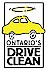 *(original 48×70 · [live](https://jdsmithinsurance.com/images/DriveClean_1.jpg))*](http://www.driveclean.com)

**How does Drive Clean affect you?**
[full details](http://www.driveclean.com)

Drive Clean is a testing and repair program starting in 1999 and is designed to cut smog-causing emissions from vehicles. Initially, the program will affect the Greater Toronto and Regional Municipality of Hamilton-Wentworth areas. Passing an emissions test every two years is a requirement for the renewal of vehicle license plates, depending on where the vehicle is registered and its model year.

Program testing will include cars and light-duty trucks that are more than three, and less than 20 model years old. All such vehicles with even-number model years and a license plate renewal date of April 1 or later will be required to pass the test in 1999. Vehicles with odd-number model years must be tested before their registration renewal in 2000.

The program is administered by the Ministry of the Environment and will be closely monitored to ensure that it is both fair and effective. With full implementation it will cut smog-causing pollutants from vehicles by up to 22% in the program areas.

Further information and a list of Drive Clean locations in Ontario is available at [www.driveclean.com](http://www.driveclean.com) or by calling 1-888-758-2999.

[Return to Top](#start)

**IMPAIRED DRIVING**

**NOT A GOOD POLICY**

Drinking and driving is not only illegal, it is socially and morally irresponsible. Despite the horrific costs of impaired driving, measured not only in lives lost, injuries sustained and damage to property, the practice still continues.

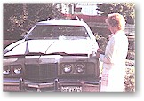 *(original 162×114 · [live](https://jdsmithinsurance.com/images/Car_crumpled.jpg))* Many Ontario drivers don't realize they lose important insurance protection if they are convicted of a drinking and driving offense. The financial consequences that they and their families will suffer in terms of loss of coverage's can be considerable.

Did you know, your insurance company will not pay for loss or damage to your vehicle if you are unable to maintain proper control of your vehicle because you are driving under the influence of intoxicating substances? Likewise, your insurance company will not pay for loss or damage if you are convicted of an offence such as impaired driving, driving with more than 80mg of alcohol in the blood or if you refuse to provide a breath sample.

Whether you drive a car, motorcycle, snowmobile or all-terrain vehicle, you could face life-long financial devastation by losing your income replacement benefits if you suffer a critical injury, or, at the very least, you could destroy your vehicle and get nothing for the value of it.

Please don't drink and drive.

[Return to Top](#start)

**NEW LAWS**

**RULE THE WAVES**

Prior to August 1998, if you had an accident involving a pleasurecraft for which you were responsible, the size of the vessel dictated the amount for which you could be held legally liable for any injury caused to another person or damage to their property. Previously your liability was limited to less than $200,000 depending on the size of your boat. This changed with an amendment to the Canada Shipping Act. The liability limits were increased to $1 million in the event of death or personal injury, plus $500,000 for damage caused to someone else's property, for a new total limit of $1,500,000. While carrying insurance is not compulsory for those owning or operating a pleasurecraft, the change in the law emphasizes the importance of carrying adequate liability insurance.

 *(original 112×67 · [live](https://jdsmithinsurance.com/images/SeaDo2.jpg))* Pleasurecraft owners also should be aware there is proposed legislation that will limit those who can operate such craft in Canada. This new legislation is based on the age and experience of the operator. By way of example, this new legislation proposes that no person under the age of 12 will be allowed to operate a boat that has an engine greater than 10 horsepower unless supervised by a competent person over the age of 16. For ages 12 to 15, the limit will be 40 horsepower and these individuals will have to be likewise supervised. Operators over the age of 16 will be expected to demonstrate a level of competence to the satisfaction of the Canadian Coast Guard before being granted an operator's license. Operators under the age of 16 will not be allowed to operate certain classes of vessels such as personal watercraft, and it will be necessary for such operators to have proof of age during operation.

[Return to Top](#start)

**GRADUATED**

**LICENSING IN ONTARIO**

The Graduated Licensing system was put in place in Ontario a couple of years ago to cut the risks new drivers face. Statistics show new drivers are more likely to get into automobile accidents which are the leading cause of death for people between the ages of 16 and 24.

The program is divided into three distinct license levels: One, Two and a Full Drivers License. Level One licensees must be at least 16 years of age, pass an eyesight test and pass a written test of their understanding of the rules of the road. There are five other Level One conditions:

- a fully licensed driver, licensed at least four years, must accompany drivers in the front seat at all times and that person must have a blood alcohol level less than .05%;
- the driver's own blood alcohol level must be zero;
- drivers must not drive between midnight and 5 a.m.;
- a seat belt must be available for each occupant; and
- drivers are not allowed to operate any vehicle on Ontario's 400-series highways or on Ontario's high speed expressways, such as the Queen Elizabeth Way or the Don Valley Parkway.

Level One lasts a minimum of 12 months and a maximum of five years, but can be reduced to eight months if the new licensee successfully completed an Approved Driver Education Course.

Level Two licensees must pass a road test after completion of Level One and can expect to stay in the second phase for a minimum of 12 months. There are two conditions for this level:

- drivers must have a blood alcohol level of zero; and
- a seat belt must be available for each occupant.

To qualify for a Full License, a licensee must pass a road test at the end of Level Two. For new drivers in Ontario, it takes at least 20 months to earn full driving privileges.

If the police stop a Level One or Level Two driver for any reason, and the driver is charged with and convicted of breaking any of the above conditions, that driver's license will be suspended for 30 days.

[Return to Top](#start)

**CARBON MONOXIDE**

**SILENT, INVISIBLE, DEADLY**

Carbon monoxide is called the silent killer - and for good reason. This colourless, odorless and tasteless gas overcomes and kills hundreds of people each year.

Carbon monoxide is a poisonous gas that is created by the incomplete combustion of any fossil fuel. Furnaces, wood stoves, fireplaces, gas appliances (stoves, ovens, clothes dryers) and water heaters are all common sources of carbon monoxide. Faulty ventilation and malfunctioning appliances can cause carbon monoxide to build up in your home. That's why the installation of a carbon monoxide detector in your home is crucial.

These detectors measure the level of carbon monoxide present in the atmosphere in parts per million. When the sensor detects a predetermined level of the gas in the air an alarm sounds.

When choosing a carbon monoxide detector always look for the Underwriters Laboratories (UL) approved logo on the unit before you buy. Once purchased, carefully read the instructions for proper installation and follow all maintenance suggestions. Although carbon monoxide detectors are important for home safety, they should not replace an annual inspection of heating and other gas producing appliances by a competent professional.

[Return to Top](#start)

**INTERESTING ARTICLES**

**LINKS TO ONLINE NEWS STORIES**

CBC News " [Grand Theft Auto](http://www.cbc.ca/consumers/market/files/cars/gta/learn.html) " about car thieves who don't break into the car, they just ask for the keys.

[Return to Top](#start)

### 3. CTA (bottom)
[Contact your broker](jds-staff.htm)

---

## E9. Reflection & encouragement
`jds-meditations.htm` · Menu: Resources › Reading › Reflection & encouragement · Footer: Resources
**Live page:** [jds-meditations.htm](https://jdsmithinsurance.com/jds-meditations.htm) · **Current &lt;title&gt;:** "Brighten Up Your Day" · **Meta description:** "Thought provoking meditations to help you through the day from J.D. Smith Insurance Brokers."

### 1. Hero
- **H1:** Reflection & encouragement
- **Subheading:** Thought-provoking meditations to help you through the day.
- **Hero photo (original):**  *(original 1000×400 · [live](https://jdsmithinsurance.com/images/meditations_front.jpg))*
- **Suggested replacement:**  *(suggested replacement · [Unsplash photo](https://unsplash.com/photos/boat-on-calm-water-at-low-sun-2d7n2sfYjHY) · free Unsplash License)*

### 2. Full text (live)
[ *(original 58×70 · [live](https://jdsmithinsurance.com/images/news_meditations.jpg))*](jds-meditations.htm) | Reflections, Devotions & Encouragement

We are a FAITH BASED Insurance Broker
Here are a few articles and items we found encouraging.
Perhaps they will also encourage you in these difficult Covid-19 times.

FRANKLIN GRAHAM SHARES

1 Minute Good News Gospel Message Of Hope with COVID-19

 *(original 86×70 · [live](https://jdsmithinsurance.com/images/Franklin_Graham_meditations.jpg))*
- [Your LIfe Matters to God](https://www.billygraham.ca/franklin-graham-your-life-matters-to-god/)
- [Are You Fed Up?](https://www.billygraham.ca/are-you-fed-up/)
- [When the World is Shaken](https://www.billygraham.ca/when-the-world-is-shaken/) (26 minute video by Franklin Graham with a message of Hope in this storm known as Covid-19)
- [A Call to Prayer](https://www.billygraham.ca/franklin-graham-a-call-to-prayer/)

Dario's Thought and Comments

[ *(original 86×70 · [live](https://jdsmithinsurance.com/images/news_dario.gif))*](jds-dario_thoughts.htm) | The Scriptures have great lessons for life. Here are a few [thoughts and comments](jds-dario_thoughts.htm) from everyday living from our friend Dario.

Short Versus, Videos and Presentations

**Has COVID-19 Caused You Stress and Worry? - " [Here are a few Bible Verses that we found helpful to us](jds-bible_verses.htm)** "

**Don't go through life alone - " [How to Recognize God's Voice - The Third Test](jds-recognize_gods_voice_3.htm)** "

**Adults can't explain this more beautifully - " [A Little Boy's Explanation of God](jds-little_boys_explanation_of_god.htm) "**

**Don't judge a book (or person) by its cover - " [To Meet Such A Man](jds-to_meet_such_a_man.htm) "**

**Perhaps things really do happen for a reason - " [The Table Cloth](jds-the_table_cloth.htm) "**

**A resource of encouraging words - " [Happy Autumn](jds-the_7_ups.htm) "**

**When doubt sets in, read - " [Why God Allows Pain](jds-why_god_allows_pain.htm) "**

**We will be remembered by our kind deeds - " [Red Marbles](jds-red_marbles.htm) "**

**What the news might have been in Jerusalem, 33 AD - " [Easter Obituary](jds-easter_obituary.htm) "**

**You will never look at a cup of coffee the same way again - " [Carrots, Eggs & Coffee](jds-carrot_egg_coffee.htm) "**

**An absolutely incredible short interview with - " [Rick Warren](jds-rick_warren.htm) "**

**Illuminating video about Jesus - " [That's My King!](http://www.youtube.com/watch?v=upGCMl_b0n4) "**

**Circumstances that can cause us mild-severe anxiety - " [The Thorn of Anxiety](jds-the_thorn_of_anxiety.htm) "**

**Trust in Him for Leading Each Moment of My Day - " [Unfolding The Rose](http://llerrahmusic.com/viewcard.php?code=21802) "**

**The Far Reaching Impact of One Teacher - " [For A Friend](jds-for_a_friend.htm) "**

**Relax And View - " [An Interview With God](http://www.theinterviewwithgod.com/windowmovie.html) "**

**The Children's View of Life - [Mud Puddles](jds-mudpuddles.htm)**

**When "Life" Is Getting You Down, Remember - [You Are So Blessed](jds-blessed_life.htm)**

**The Way To Resolving Conflicts - [The Carpenter](jds-the_carpenter.htm)**

**Count Your Blessings - [The Pickle Jar](jds-the_pickle_jar.htm)**

### E9.1 Sub-page: Dario's thoughts and comments — `jds-dario_thoughts.htm`
**Live page:** [jds-dario_thoughts.htm](https://jdsmithinsurance.com/jds-dario_thoughts.htm) · **Current &lt;title&gt;:** "Dario's Thoughts and Comments" · **Meta description:** "Thought provoking meditations to help you through the day from J.D. Smith Insurance Brokers."
Hero (original):  *(original 1000×400 · [live](https://jdsmithinsurance.com/images/darios_thoughts-front.jpg))*
The index below links to 58 short devotionals in `/dario/` on the live site (dated 2008–2011). Their text is not copied into this file. Keep them as links, or move them over in bulk later. *(one link is broken: `dario_08_09_23htm` is missing a dot)*

Dario is a Toronto Business man that has some interesting faith thoughts, to make us think, perhaps in a different way on various subjects.

The Scriptures have great lessons for life. Here are a few thoughts on specific verses that you might find interesting, with comments from everyday living from our friend Dario.

We update these often so check back. If you wish to have them, each day, emailed to you, just [let me know](mailto:jds@jdsmithinsurance.com?subject=Request For Darios Thoughts and Comments) and I will pass it on to Dario. Dario is a member of CBMC, a great organization for business leaders.

**[Do Not Be Overwhelmed](https://jdsmithinsurance.com/dario/dario_20-12-10.html)**

**[What Gives You The Right?](https://jdsmithinsurance.com/dario/dario_11_03_10.htm)**

**[A Date To Be Named Later](https://jdsmithinsurance.com/dario/dario_11_01_18.htm)**

**[Don't You Get It](https://jdsmithinsurance.com/dario/dario_10_09_17.htm)**

**[No Use Hiding](https://jdsmithinsurance.com/dario/dario_10_08_05.htm)**

**[Who's Doing All The Talking?](https://jdsmithinsurance.com/dario/dario_10_07_19.htm)**

**[Come On In, The Door's Always Open](https://jdsmithinsurance.com/dario/dario_10_07_07.htm)**

**[Godly Catch 22](https://jdsmithinsurance.com/dario/dario_10_06_29.htm)**

**[I'ts Not About Me](https://jdsmithinsurance.com/dario/dario_10_05_28.htm)**

**[Overflow Me Lord](https://jdsmithinsurance.com/dario/dario_10_05_20.htm)**

**[Give Thanks With A Great Full Heart](https://jdsmithinsurance.com/dario/dario_10_05_07.htm)**

**[Focusing On The Sound](https://jdsmithinsurance.com/dario/dario_10_04_30.htm)**

**[Locked, But The Door Was Open](https://jdsmithinsurance.com/dario/dario_10_04_23.htm)**

**[What If](https://jdsmithinsurance.com/dario/dario_10_03_19.htm)**

**[One Solitary Life](https://jdsmithinsurance.com/dario/dario_09_12_22.htm)**

**[Click, Double Click, Double Click...Sigh](https://jdsmithinsurance.com/dario/dario_09_09_16.htm)**

**[Three Keys to Stop](https://jdsmithinsurance.com/dario/dario_09_09_09.htm)**

**[An Interesting Question](https://jdsmithinsurance.com/dario/dario_09_09_04.htm)**

**[Eternal Life](https://jdsmithinsurance.com/dario/dario_09_07_07.htm)**

**[I Will Write My Word Upon Their Hearts](https://jdsmithinsurance.com/dario/dario_09_06_18.htm)**

**[I'm Not Saying Anything But](https://jdsmithinsurance.com/dario/dario_09_06_16.htm)**

**[Forever Is A Long Time](https://jdsmithinsurance.com/dario/dario_09_05_21.htm)**

**[I Don't Feel Like It](https://jdsmithinsurance.com/dario/dario_09_05_06.htm)**

**[Knock Three Times](https://jdsmithinsurance.com/dario/dario_09_04_20.htm)**

**[Shall We Only Accept Good And Not Adversity](https://jdsmithinsurance.com/dario/dario_09_04_17.htm)**

**[I'm A Good Person](https://jdsmithinsurance.com/dario/dario_09_03_04.htm)**

**[Dishwasher Safe](https://jdsmithinsurance.com/dario/dario_09_02_26.htm)**

**[Always Wear Clean Underwear](https://jdsmithinsurance.com/dario/dario_09_01_29.htm)**

**[Cuddle With The Lord](https://jdsmithinsurance.com/dario/dario_09_01_27.htm)**

**[Our Chemical Makeup](https://jdsmithinsurance.com/dario/dario_09_01_15.htm)**

**[I Had Forgotten](https://jdsmithinsurance.com/dario/dario_09_01_14.htm)**

**[Falling off a Cliff](https://jdsmithinsurance.com/dario/dario_09_01_09.htm)**

**[Working Backwards or Hindsight on God's Faithfulness is 20/20](https://jdsmithinsurance.com/dario/dario_09_01_08.htm)**

**[On Earth as it is in Heaven](https://jdsmithinsurance.com/dario/dario_08_12_08.htm)**

**[Are You a Doubting Thomas, or Fred, or Mike, or Jane?](https://jdsmithinsurance.com/dario/dario_08_11_18.htm)**

**[For God All Things Are Possible](https://jdsmithinsurance.com/dario/dario_08_11_14.htm)**

**[My Bodyguard](https://jdsmithinsurance.com/dario/dario_08_10_27.htm)**

**[Soar on Eagles Wings](https://jdsmithinsurance.com/dario/dario_08_10_23.htm)**

**[I Know What You Said But...](https://jdsmithinsurance.com/dario/dario_08_10_22.htm)**

**[Mission Impossible](https://jdsmithinsurance.com/dario/dario_08_10_17.htm)**

**[The First Call Initiative](https://jdsmithinsurance.com/dario/dario_08_10_15.htm)**

**[I Must Confess](https://jdsmithinsurance.com/dario/dario_08_10_07.htm)**

**[How Much Time Do You Want?](https://jdsmithinsurance.com/dario/dario_08_10_06.htm)**

**[NO](https://jdsmithinsurance.com/dario/dario_08_10_02.htm)**

**[The Silence is Deafening](https://jdsmithinsurance.com/dario/dario_08_10_01.htm)**

**[Life without Boundaries](https://jdsmithinsurance.com/dario/dario_08_09_25.htm)**

**[Don't Go There](https://jdsmithinsurance.com/dario/dario_08_09_23htm)**

**[In Whom Will You Trust?](https://jdsmithinsurance.com/dario/dario_08_09_22.htm)**

**[Be Like God](https://jdsmithinsurance.com/dario/dario_08_09_16.htm)**

**[Good Food, Fast!](https://jdsmithinsurance.com/dario/dario_08_09_10.htm)**

**[Speak For Yourself](https://jdsmithinsurance.com/dario/dario_08_09_08.htm)**

**[Why Do You Ask?](https://jdsmithinsurance.com/dario/dario_08_07_31.htm)**

**[Love One Another](https://jdsmithinsurance.com/dario/dario_08_07_17.htm)**

**[Your Flight is Ready for Boarding](https://jdsmithinsurance.com/dario/dario_08_06_26.htm)**

**[This Too Will Pass](https://jdsmithinsurance.com/dario/dario_08_06_25.htm)**

**[Anger](https://jdsmithinsurance.com/dario/dario_08_06_24.htm)**

**[I'm Not Saying Anything But](https://jdsmithinsurance.com/dario/dario_08_06_16.htm)**

**[There's a Little Zacchaeus in All of Us](https://jdsmithinsurance.com/dario/dario_08_06_03.htm)**

**[Worthless Worry](https://jdsmithinsurance.com/dario/dario_08_05_22.htm)**

---

# F. ABOUT

Staff & contacts (`jds-staff.htm`), Staff video messages (`jds-staff_videos.htm`) and Job opportunities (`jds-job_postings.htm`) are already built and are not repeated here. Real company photos already in the project: `images/staff/`, `images/office/`, `images/life/`.

---

## F1. Core values
`jds-values.htm` · Menu: About › Core values · Footer: About › Core values · Also the "RIBO broker facts" link (`#ribo`)
**Live page:** [jds-values.htm](https://jdsmithinsurance.com/jds-values.htm) · **Current &lt;title&gt;:** "Peace of Mind Insurance Values" · **Meta description:** "J.D. Smith Insurance provides Peace of Mind Insurance with traditional family values and service with excellence."

### 1. Hero
- **H1:** Peace of mind insurance values
- **Subheading:** Committed to excellence in personal & commercial insurance since 1979.
- **Hero photo (original):**  *(original 1000×400 · [live](https://jdsmithinsurance.com/images/core_values_front.jpg))*
- **Suggested replacement:**  *(suggested replacement · [Unsplash photo](https://unsplash.com/photos/two-men-facing-each-other-while-shake-hands-and-smiling-NbtIDoFKGO8) · free Unsplash License)* *(or use the real group photo `images/staff/staff_group_2023.jpg`, which is better for this page)*

### 2. Section order for the new page
1. What we offer (list) → 2. Group photo "Some of our great brokers" → 3. JDS Financial Group companies → 4. Mission, vision, corporate goal → 5. Core values (4 cards) → 6. Qualified professionals (text) → 7. Address & contact → 8. **RIBO broker fact sheet** (anchor `#ribo`) → 9. Racing support teaser → CTA.

### 3. Full text (live)
- Business, Home, Car, and Life Insurance
- Personal Service
- Helpful Advice from our Licensed RIBO Brokers
- Broad Coverage, Extra Savings and Discounts
- RRSP, Disability and Financial Services
- Group Auto, Property and Health Packages

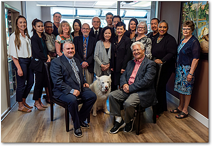 *(original 358×247 · [live](https://jdsmithinsurance.com/images/staff_group_2023.jpg))*
Some Of Our Great Brokers

**We are part of the JDS Financial Group of companies.
Insuring clients in every Province of Canada.** |  *(original 123×70 · [live](https://jdsmithinsurance.com/images/JDS-Financial-logo.gif))*

[Direct Buy Insurance](http://www.directdialinsurance.com) | | [Motorcycle Insurance Brokers Inc.](http://www.motorcycleinsurancebrokers.com)

Dynes Insurance | Farmers Insurance Brokers Inc.

J D Smith Financial Insurance | [Boat Insurance Canada.com](http://www.boatinsurancecanada.ca)

[Forever Young Insurance](http://www.foreveryounginsurance.ca)

**Committed to Excellence in Personal & Commercial Insurance**

Our JDS Mission Statement was developed in 1979. It was the driving force behind developing our company.

**Insurance Solutions that Make a Difference**

**Peace of Mind Insurance Solutions for our clients**

**OUR INSURANCE SOLUTION CORE VALUES**

**Qualified Professionals**

- All brokers are RIBO Licensed professionals.
- Our clients will be treated with courtesy, honesty and respect.
- We will adhere to the Industry Code of Consumer Rights and Responsibilities.

**Personal Service and Choice Since 1979**

- We will always provide personal Service With Excellence.
- We will always provide choice to our business and personal clients.
- We will give professional non biased advice to assist our clients to place the correct coverage with the appropriate Insurance Company.

**Independent Brokers**

- The client comes first.
- We work for our clients, not the Insurance Company.
- We will give professional non biased advice to assist our clients to place the correct coverage with the appropriate Insurance Company.

**Solutions at a Fair Price**

- As your broker, we will survey the market, outline the coverage available and provide you with competitive rates and a choice of Insurance Companies.

An Independent Insurance Broker Covers You Best

**Qualified Professionals**

Trying to review your coverages or problems with a large Insurance Company, or perhaps a Bank, is often intimidating, uncomfortable, and sometimes frustrating. In most cases you are just a number to them.

JD Smith is a friendly Insurance Broker, that can provide "Peace of Mind" for your business and your family. We want to get to know you. We will take the time to LISTEN and GIVE ADVICE.

We speak on your behalf to the many Insurance Companies to be sure that you get all the discounts you deserve with the appropriate coverage.

We will be there to help when you have a claim.

 *(original 111×141 · [live](https://jdsmithinsurance.com/images/GrandGirl_2.jpg))*

**Contact JD Smith Insurance, and have "Peace of Mind" when you think about your Insurance.**

 *(original 155×117 · [live](https://jdsmithinsurance.com/images/tractor_in_mud.jpg))*

105 West Beaver Creek Rd.

Richmond Hill, Ontario, L4B 1C6

Toll Free | 1-800-917-SAVE (7283)

Local | 905-764-7868

Fax | 905-764-9618

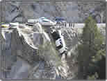 *(original 154×117 · [live](https://jdsmithinsurance.com/images/car_over_cliff.jpg))*

 *(original 108×117 · [live](https://jdsmithinsurance.com/images/girl_csr_large.jpg))*
Our job at JD Smith is to save you money and arrange insurance solutions.

**I LOVE MY JOB!**

For a list of employee extensions and emails [click here](jds-staff.htm)

**RIBO - FACT SHEET ABOUT YOUR REGISTERED INSURANCE BROKER**

**Registered insurance brokers offer independent advice and Property & Casualty (P&C) insurance products from a variety of companies. Brokers must be licensed by the Registered Insurance Brokers of Ontario (RIBO). All RIBO licensees must carry an errors & omissions policy, as well as a fidelity bond, which is designed to provide customers coverage in the unlikely event that a broker mishandles their premiums. RIBO licensees are required to follow the RIBO Code of Conduct, which establishes rules and standards of professional conduct.**

As a customer, you have the right to professional advice from a broker who is well informed about the products they are selling. You have the right to be treated with fairness and integrity.

- **How Insurance Works** – You have the right to be informed about how your insurance premiums are calculated. You have the right to access your policy and be clearly informed about the coverage and the claims settlement process.
- **Broker Compensation** – You have the right to ask how a broker is paid, the insurance companies they represent, and be informed about any potential conflicts of interest the broker may have. All RIBO licensed brokers must disclose commission information at the point of sale which outlines how they are paid.
- **Understand Your Insurance Needs** – You should consider your insurance needs and prepare relevant questions before you talk to a broker. Ask yourself if there have been changes in your personal or business life that could impact your insurance needs. Make sure you provide a detailed and accurate explanation of your circumstances to your broker so they can provide informed recommendations that meet your needs.
- **Insurance Quotes** – When obtaining a quote, your broker should always present the best value products available based on your current needs, and document why certain coverage and product options, including lower cost options, which may or may not be appropriate for you. Brokers are also expected to comply with the Take-All-Comers rule. For more information on buying auto insurance and the Take-All-Comers rule, visit [here](https://www.fsrao.ca/consumers/auto-insurance/understanding-auto-insurance-rates/take-all-comers-information-consumers) .
- **Personal Information** – You have the right to understand how your personal information is used and protected. Ask for a copy of the privacy statement from your broker and the insurer.
- **Customer Obligations** – You need to ensure that you know and understand your obligations under your insurance policy. For example, your policy will require you to provide updates to your broker and insurer regarding any material changes in your circumstances.
- **Insurance Claims** – If you need to file a claim, you have the right to be informed about the procedures and typical timelines for settling your claim, and you may inquire about the status of your claim throughout the process. If your claim is denied, you have the right to an explanation as to why it was denied. Your broker is your advocate as you work through your claim with the insurance company and will liaise as required.
- **Making a Complaint** – You can submit a complaint to RIBO if you believe your insurance broker failed to comply with the Registered Insurance Brokers Act, its regulations, or RIBO by-laws. File a complaint [here](https://www.ribo.com/complaints/) .
- **OmbudServices** – In the event you have an insurance claim, your broker will provide you with information about the insurer’s claims process. For any unresolved disputes with an insurer, you may contact the insurer’s Ombudsman, who will attempt to resolve the conflict. If the conflict is not resolved, you will be referred to the General Insurance OmbudServices for P&C insurance.

**View** the [Ontario Code of Consumer Rights & Responsibilities](jds-code_consumer_rights.htm)

**RIBO - Registered Insurance Brokers of Ontario**

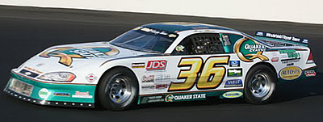 *(original 400×151 · [live](https://jdsmithinsurance.com/images_new/gary_elliott_9.jpg))*

J. D. Smith Insurance sponsors the [Gary Elliott](http://www.garyelliottmotorsports.com) racing team because Gary sticks to racing cars on the track, not the streets.

Street racing is foolhardy and dangerous, for everyone. To view pictures of what we mean, [click here](jds-speeders_remorse.htm) .

**More pictures [here](jds-racing_team.htm)**

 *(original 200×113 · [live](https://jdsmithinsurance.com/images_new/gary_elliott_13.jpg))*

 *(original 150×113 · [live](https://jdsmithinsurance.com/images_new/gary_elliott_11.jpg))*

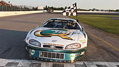 *(original 200×113 · [live](https://jdsmithinsurance.com/images_new/gary_elliott_12.jpg))*

### 4. CTA (bottom)
"Contact JD Smith Insurance, and have peace of mind when you think about your insurance." → [Contact your broker](jds-staff.htm) · [Get a free quote](jds-get_a_quote.htm)

---

## F2. The broker advantage
`jds-advantage.htm` · Menu: About › The broker advantage · Footer: About · Homepage feature link "Straight talk from Dr. J.D. Smith"
**Live page:** [jds-advantage.htm](https://jdsmithinsurance.com/jds-advantage.htm) · **Current &lt;title&gt;:** "The J.D. Smith Insurance Broker Advantage" · **Meta description:** "J.D. Smith Insurance Brokers is your advanatage for Home, Auto,  Commercial, Church and Not-For-Profit Insurance."

### 1. Hero
- **H1:** The broker advantage
- **Subheading:** Insurance solutions that make a difference. Because we are an insurance broker, we work for YOU.
- **Hero photo (original):**  *(original 1000×400 · [live](https://jdsmithinsurance.com/images/advantage_front.jpg))*
- **Suggested replacement:**  *(suggested replacement · [Unsplash photo](https://unsplash.com/photos/three-professionals-discussing-documents-at-a-table-Qzw2nMdXMMQ) · free Unsplash License)*
- Mark Smith headshot on the page: use `images/staff/Mark_2023.jpg`.

### 2. Full text (live)
**The Broker Advantage**

INSURANCE SOLUTIONS THAT MAKE A DIFFERENCE

Because we are an Insurance Broker, we work for **YOU** . That means we provide continuous assistance to satisfy your insurance needs. When you talk with J.D. Smith Insurance Brokers, you deal with insurance professionals who know how to match your requirements with

- the right policy
- the right Company
- at the right price
- the right solution

We will be completely up front with you, our client, and that's the most valuable Broker Advantage you can get. |  *(original 130×155 · [live](https://jdsmithinsurance.com/images/mark3.jpg))*
Mark Smith

**It Makes Sense To Talk To J. D. Smith Insurance**

OUR BROKER SOLUTION:
- Quick access to the best policies from the major companies.
- Impartial advice on the coverage that's right for your needs.
- The most advantageous terms available in the marketplace.
- Assistance with the fast and satisfactory settlement of your claim.

An Independent Insurance Broker
Covers You Best

**How We Do Business**

When you buy through an Insurance Broker, you are using the services of qualified professionals. JD Smith Insurance has over 30 licensed brokers, who understand your needs and will develop a solution for you. We operate independently of any insurance company... and solely on behalf of you, our customer.

We are not tied to any one Insurance Company. We have access to an extensive range of policies offered by many of the major property and casualty insurance companies, including:

- The Dominion of Canada
- Aviva
- Intact
- Lloyds
- Travellers
- Sovereign
- Economical
- Unica
- Wawanesa

When JD Smith Insurance acts on your behalf, a comprehensive range of coverage is fully accessible to you. You can be assured that we will do everything in our power to find the best protection to suit your specific solution requirements.

**JD Smith Insurance Works For You...
and only you!**

Shopping around for insurance can be a bewildering task for even the most sophisticated buyer.
JD Smith Insurance Brokers will make insurance buying so much easier for you. By using our expertise we will assess the many and various policy alternatives currently available, and provide you with a quote.

 *(original 130×155 · [live](https://jdsmithinsurance.com/images/mark3.jpg))*
Mark Smith

**JD Smith is Committed to YOU Our Client**

**When you engage the services of JD Smith Insurance Brokers, you can be confident that we will work hard and diligently for you.**

**Your satisfaction is our objective.**

**Our success, and our reputation depends on just that... your satisfaction.**

**INSURANCE SOLUTIONS THAT MAKE A DIFFERENCE
At JD Smith Insurance, The Client is #1**
*(The insurer list on this page (Dominion, Aviva, Intact, Lloyd's, Travelers, Sovereign, Economical, Unica, Wawanesa) differs from [Insurance companies](jds-insurance_companies.htm). Use one list: see STAKEHOLDER_NOTES.)*

### 3. CTA (bottom)
"It makes sense to talk to J. D. Smith Insurance." → [Get a free quote](jds-get_a_quote.htm) · [Contact your broker](jds-staff.htm)

---

## F3. Community
`jds-community.htm` · Menu: About › Community · Footer: About › Community
**Live page:** [jds-community.htm](https://jdsmithinsurance.com/jds-community.htm) · **Current &lt;title&gt;:** "J.D. Smith  Community Involvement" · **Meta description:** "J.D Smith & Associates Involved With The Community"

### 1. Hero
- **H1:** Community involvement
- **Subheading:** We support many community sports teams and church groups.
- **Hero photo (original):**  *(original 1000×399 · [live](https://jdsmithinsurance.com/images/community_page_front.jpg))*
- **Suggested replacement:** keep real JD Smith photos here. More community photos are already in the project: `images/life/` (food bank, Operation Christmas Child shoeboxes, baseball team 2023, hockey sponsor banner, staff lunches). If a stock hero is needed:  *(suggested replacement · [Unsplash photo](https://unsplash.com/photos/ice-hockey-players-on-ice-hockey-field-Rat7IoXPHYc) · free Unsplash License)*

### 2. Full text (live)
 *(original 106×83 · [live](https://jdsmithinsurance.com/images_new/j-d-staff-page_01.jpg))* We support many community sports teams and church groups.

J. D. Smith Sponsors a number of Sports teams and long distance runs, in the Richmond Hill, Aurora. Markham, Unionville and Newmarket area.

 *(original 308×175 · [live](https://jdsmithinsurance.com/images_new/community_1.jpg))*

J. D. Smith is pleased to be a sponsor for the Durham Crusaders hockey team.

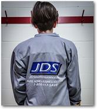 *(original 165×184 · [live](https://jdsmithinsurance.com/images/sponsorship_durham_cursaders_02.jpg))*

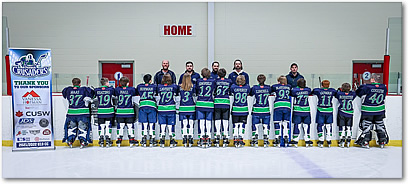 *(original 408×184 · [live](https://jdsmithinsurance.com/images/sponsorship_durham_cursaders_01.jpg))*
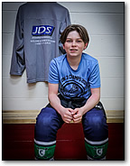 *(original 144×184 · [live](https://jdsmithinsurance.com/images/sponsorship_durham_cursaders_03.jpg))*

JDS Sponsors Fishing Derby Each Year
For Children’s Aid Society & Friends Outreach Canada

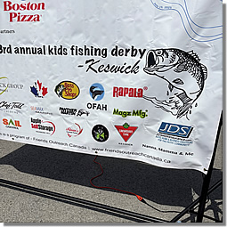 *(original 255×255 · [live](https://jdsmithinsurance.com/images/sponsorship_fishing_derby_01.jpg))*

 *(original 255×255 · [live](https://jdsmithinsurance.com/images/sponsorship_fishing_derby_02.jpg))*
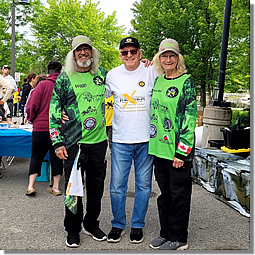 *(original 255×255 · [live](https://jdsmithinsurance.com/images/sponsorship_fishing_derby_03.jpg))*

On behalf of our school St. Mary Immaculate CES, the staff, parent council, and most important, our students, we would like to express our gratitude and thank you and all our local supporters for helping make our End-of-Year BBQ a big success.

We are extremely proud to be part of a such caring community.
THANK YOU!

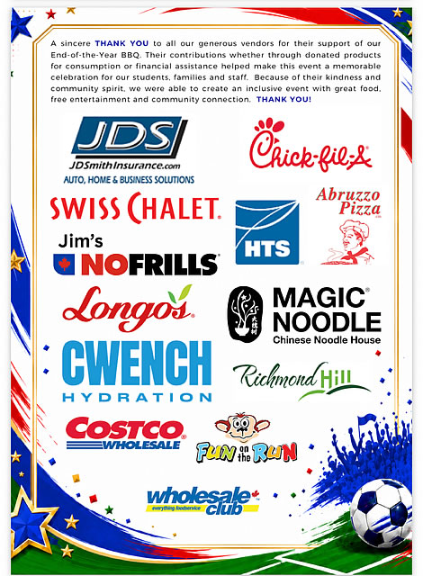 *(original 470×640 · [live](https://jdsmithinsurance.com/images/st_mary_school_poster.jpg))*

Our staff is involved on various committees serving Richmond Hill.

 *(original 208×106 · [live](https://jdsmithinsurance.com/images_new/staff_2011_01.jpg))*

 *(original 130×155 · [live](https://jdsmithinsurance.com/images/mark3.jpg))*
Mark Smith

**Mark Smith,** J D Smith Insurance Vice President, has served for 21 years, and Chaired for 20 years the Mayor's Richmond Hill Prayer Breakfast Council.

 *(original 105×155 · [live](https://jdsmithinsurance.com/images/mayor_david_west_01.jpg))*
Mayor David West

We are active members of the **Richmond Hill Chamber of Commerce** .

For updates on the Chamber of Commerce activities…click [here](http://www.rhcoc.com)

[ *(original 158×104 · [live](https://jdsmithinsurance.com/images_new/logo_rhcc_01.jpg))*](http://www.rhcoc.com)

### 3. CTA (bottom)
"Want JD Smith to support your team or event? Talk to us." → [Contact us](jds-staff.htm)

---

## F4. Car racing team
`jds-racing_team.htm` · Menu: About › Car racing team · Footer: About › Car racing team
**Live page:** [jds-racing_team.htm](https://jdsmithinsurance.com/jds-racing_team.htm) · **Current &lt;title&gt;:** "J.D. Smith Sponsors Gary Elliott Racing Team"
**Suggested meta:** J. D. Smith Insurance Brokers is a proud sponsor of the Gary Elliott racing team, because racing belongs on the track, not the streets.

### 1. Hero
- **H1:** Proud sponsor of the Gary Elliott racing team
- **Hero photo (original):**  *(original 1000×400 · [live](https://jdsmithinsurance.com/images/racing_team_front.jpg))*
- **Suggested replacement:** keep the real team photos. If a stock hero is needed:  *(suggested replacement · [Unsplash photo](https://unsplash.com/photos/a-race-car-speeds-around-a-track-at-dusk-TdH6kr6gNuw) · free Unsplash License)*
- Key message (from Core values): J. D. Smith Insurance sponsors the Gary Elliott racing team because Gary sticks to racing cars on the track, not the streets. Street racing is foolhardy and dangerous, for everyone. [Speeder's remorse pictures](jds-speeders_remorse.htm)

### 2. Full text (live)
**J. D. Smith Insurance Brokers is a proud sponsor of the Gary Elliott Racing Team**

**[Race](jds-racing_team_report_2017_17.htm)** [Report #1, May 4, 2019](jds-racing_team_report_2019_1.htm)

**For more pictures and exciting racing information, visit [Gary's web site](http://www.garyelliottmotorsports.com) .**

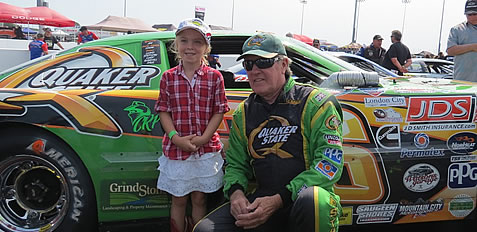 *(original 477×232 · [live](https://jdsmithinsurance.com/images_racing/gary_elliott_first_02.jpg))*

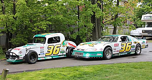 *(original 300×158 · [live](https://jdsmithinsurance.com/images_new/gary_elliott_10.jpg))*  *(original 210×158 · [live](https://jdsmithinsurance.com/images_new/gary_elliott_11a.jpg))*

 *(original 426×188 · [live](https://jdsmithinsurance.com/images_racing/2017_race17_01.jpg))*

 *(original 300×162 · [live](https://jdsmithinsurance.com/images_new/gary_elliott_16.jpg))* | 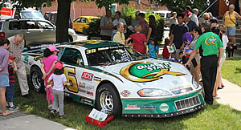 *(original 300×162 · [live](https://jdsmithinsurance.com/images_new/gary_elliott_17.jpg))* | 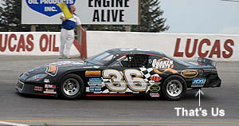 *(original 300×158 · [live](https://jdsmithinsurance.com/images_new/gary_elliott_3.jpg))*

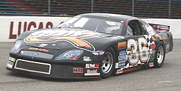 *(original 300×151 · [live](https://jdsmithinsurance.com/images_new/gary_elliott_8.jpg))* | 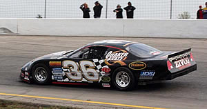 *(original 300×158 · [live](https://jdsmithinsurance.com/images_new/gary_elliott_2.jpg))* | 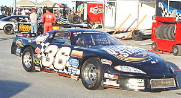 *(original 300×162 · [live](https://jdsmithinsurance.com/images_new/gary_elliott_4.jpg))*

[Visit Gary Elliott Racing Team](http://www.garyelliottmotorsports.com)

Race reports (full text in the Appendix): [Race report 2017 #17](jds-racing_team_report_2017_17.htm) · [Race report #1, May 4, 2019](jds-racing_team_report_2019_1.htm)

### 3. CTA (bottom)
[Visit Gary Elliott Motorsports](http://www.garyelliottmotorsports.com) · [Get an auto quote](https://webrater.appliedsystems.com/WR/Default.aspx?GC=JDSMITH&LOB=AUTO&LANG=EN)

---

# G. LEGAL PAGES (footer bottom row)

All four live pages use the disclaimer banner as their hero  *(original 1000×400 · [live](https://jdsmithinsurance.com/images/disclaimer_front.jpg))*, and three of them have the wrong &lt;title&gt; ("JD Smith Insurance Brokers Code of Consumer Rights"). For the new pages, use a simple text header (no photo) or the suggested photos below. Keep the wording exactly as it is: these are legal texts.

---

## G1. Code of consumer rights
`jds-code_consumer_rights.htm` · Footer: Code of consumer rights · Linked from Core values (RIBO section)
**Live page:** [jds-code_consumer_rights.htm](https://jdsmithinsurance.com/jds-code_consumer_rights.htm) · **Current &lt;title&gt;:** "JD Smith Insurance Brokers Code of Consumer Rights"
- **H1:** Code of consumer rights and responsibilities
- **Suggested photo:**  *(suggested replacement · [Unsplash photo](https://unsplash.com/photos/man-writing-on-paper-OQMZwNd3ThU) · free Unsplash License)*

**Ontario Code of Consumer Rights and Responsibilities**

BROKER COMPENSATION DISCLOSURE

**Registered Insurance Brokers of Ontario**

We are not owned by a Bank or Insurance Company
We are an Independent Broker

 *(original 358×247 · [live](https://jdsmithinsurance.com/images/staff_group_2023.jpg))*

**JDS Code of Consumer Rights**

We adhere to the Code Of Consumers Rights For Insurance

We are a Registered Broker Insurance Broker, with our head office in Richmond Hill Ontario.

We have commercial clients across Canada. if you should have an insurance claim, relax as we have claims offices in every major city

We have been in business providing Insurance Solutions, since 1979. Many of our current clients have been with us for 45 years and we are thankful. Contact is 1-800-917-SAVE (7283)

Our brokerage is NOT associated with, or owned by any Financial Institution, or Insurance Company. We will supply you with a quote along with this overview, and once coverage is issued, a copy of the Insurance policy, along with its wordings. It is your responsibility to review it, decide on coverage and limits and write or call us with any questions.

As your broker, we will work with you to place your business with a competitive company that you agree is best for you. We have NO allegiance to one particular company.

If we are your broker you can count on us to provide you with excellent service, price and a broad range of coverage choices.

We want to work with our clients to provide Risk Management and Claims Prevention suggestions. Our goal is to write good business with clients that are responsible drivers. We want to insure clients that understand Insurance should be in place for Emergencies and to Provide Peace of Mind. Some Insurance Companies occasionally, give us an additional commission of about 1 % based on our three year profitability, sales performance, losses and potential losses. Servicing claims quickly, when they happen, is important to us. This is why our client retention is over 98%.

Unfortunately, this year we have seen some major increases in premiums that were due to a high volume of water and fire losses in BC and across Canada.

Our Brokerage Group continues to grow. We are working hard to keep up with the new commercial business that is referred to us due to our consistent personal service.

PROPERTY

The following MGA/Wholesale Companies pay us as they do other brokers, 8 -15% Commission on Policies, new and renewed.
AIG, Arag, Appollo, Beazley Canada, Creechurch, Excess Underwriting, Encon, Equine Insurance, GFH Underwriters, Lloyds of London, PAL Insurance, Premier Marine, Premier Marine, Special Risk Insurance Managers, SWG Specialty, and South Western Group, Totten Group, Victor, Definity Zurich and Chubb Insurance.

The following companies pay us as they do other brokers, 8 to 20% Commission on Property and Liability Policies new and renewed.
Aviva, Chubb, Chieftain, Ecclesiastical, Economical, Definity, Economical Select, Intact, Markel, Traders, Travelers, Unica, and Wawanesa

AUTO AND FLEET

The following Companies pay us, as they do other brokers, Between 5% and 12.5% Commission on Auto Policies
Aviva, Chieftain, Economical, Intact, Jevco, Traders, Travelers, Unica, Wawanesa

The above commission Percentages are paid Annually for both new and renewal policies. All brokers are paid on the same basis. The comission already part of your insurance premium that we charge. Some companies charge a policy fee and we will show that separately on your billing.

OUALITY CANADIAN INSURANCE COMPANIES

In order for us to maintain a strong relationship with quality Insureds and clients, we work with each Insurance Company to assist them in underwriting the quality of the client and the actual risk we are considering insured. Each Insurance company has its own public policy outlined on its web site.

Many Insurance companies are represented in our office. Some have better service and rates than others. Most will niche market specific types of business.

Our broker licenced staff are here to provide Excellent Service and Assist you with Insurance Solutions for you your company, your friends and your family.

Dr. J D Smith, BA, CCIB,

President

J D Smith & Associates Insurance Brokers Inc.

Insurance Solutions Since 1979

JD Smith & Associates Insurance Brokers Inc.

WHEN WE QUOTE

 *(original 108×117 · [live](https://jdsmithinsurance.com/images/girl_csr_large.jpg))* Thanks for your interest in obtaining an insurance quote from our office. Our brokerage is licensed through the Registered Insurance Brokers of Ontario (RIBO), and our staff are individually licensed brokers. We are required to disclose our professional duties and obligations to you as a potential client, or as a long time client where we are providing you a quote with a competing Insurance Company.

Learn how we are compensated by the insurers and Managing General Agents we represent by reading the above outline and reviewing our privacy policy below .

To ensure we provide you with an accurate quote, we may need to obtain information and/or records pertaining to those that may be listed on your policy. If you agree to this, please reply and let us know if you would prefer us to contact you by phone or e-mail We will try to assist you with a quote based on the information you gave us..

Once you have made arrangements for payment and you have chosen the coverages you wish, and have completed the application, we will forward the information to the Insurance Company to issue the policy.
For Auto - The company will check with MTO on your claims.
For Property - The company will check their database for claims and issue the policy as quoted. Be sure you discuss water damage coverage with your broker as many Insurance Companies exclude this coverage or have a high deductible.

We look forward to providing you quotes and insuring you and your business.

CISRO Principles

J D Smith Insurance Brokers and our Personal Brokers follow and have implemented these [CISRO Guidelines](https://jdsmithinsurance.com/CISRO Principles of Conduct for Intermediaries.pdf) .

JD Smith & Associates Insurance Brokers Inc.

View The [PRIVACY STATEMENT](jds-privacy_statement.htm)

View The [TERMS OF USE](jds-terms_of_use.htm)

**View** the [RIBO Broker Facts](jds-values.htm#ribo)

CTA (bottom): Questions about your rights? [Contact your broker](jds-staff.htm) · [RIBO broker facts](jds-values.htm#ribo)

---

## G2. Privacy statement
`jds-privacy_statement.htm` · Footer: Privacy statement
**Live page:** [jds-privacy_statement.htm](https://jdsmithinsurance.com/jds-privacy_statement.htm) · **Current &lt;title&gt;:** "JD Smith Insurance Brokers Code of Consumer Rights"
**Suggested &lt;title&gt;:** Privacy Statement | JD Smith Insurance
- **H1:** Privacy statement
- **Suggested photo:**  *(suggested replacement · [Unsplash photo](https://unsplash.com/photos/a-golden-padlock-sitting-on-top-of-a-keyboard-FnA5pAzqhMM) · free Unsplash License)*

PRIVACY STATEMENT

Updated 2026

JD Smith Insurance Brokers Inc. and its associated brokerages including J D Smith Insurance & Financial Services Inc (also referred to as, “we” or “us”), is committed to protecting your personal information. “Personal information” generally means information about an identifiable individual. We do share this information with our Insurance companies if we are providing you a quote, or comparison of coverages.

At JD Smith Insurance Brokers Inc. , we make it a priority to ensure your personal information is kept confidential and secure, and we have strict safeguards in place to protect it.

We protect your privacy by complying with applicable privacy laws in Canada. We treat your personal information in a manner consistent with this Privacy Statement, unless we have your consent to treat it differently. This Privacy Statement applies to any information we collect or receive about you, from any source.

By using JD Smith Insurance Brokers Inc. 's website (the "site"), or by choosing to submit personal information to JD Smith Insurance Brokers Inc. , you are providing your consent to all of the terms of this Privacy Statement. If you do not agree with any terms of this Privacy Statement, please do not use this site or submit any personal information to JD Smith Insurance Brokers Inc..

JD Smith Insurance Brokers Inc. reserves the right to modify this Privacy Statement at any time. We will reflect any such modifications to this Privacy Statement on our site and will indicate at the top of this Privacy Statement the date this Privacy Statement was last amended. We may also use other ways to communicate amendments to this Privacy Statement, such as publishing a notice on our site. Your continued access to and/or use of the site after any such changes constitutes your acceptance of, and agreement to, this Privacy Statement, as revised. Please periodically review this Privacy Statement so that you know what personal information we collect, how we use it, and with whom we may share it.

We may collect your personal information from:

- you,

- third parties such as your insurance broker, data service providers, insurance industry databases, consumer credit reporting agencies, governmental authorities, investigation organizations, insurers, affiliates of JD Smith Insurance Brokers Inc. , regulatory organizations, and groups, businesses or associations you tell us you belong to,

- from such other parties for whom you have provided your consent, and

- such other sources as may be permitted or required by law.

What personal information we may collect:

- your name and contact information, such as your address, telephone number, postal code, or e-mail address,

- information regarding your claim history, property, or insurance profile,

- information regarding the property you wish to insure or to seek a quote in respect of, including without limitation information regarding your use of such property,

- with your consent, or when permitted by law or when necessary to provide a particular product or service, health or medical information,

- if you choose to make a purchase, your payment information, and

- any other personal information that you voluntarily choose to submit to us.

We may collect, use and disclose your personal information for the following purposes (the "Purposes"):

- to help us better understand your insurance and service needs,

- to make decisions about your eligibility for our insurance policies,

- to allow us, in conjunction with other factors, to establish the risk and premium associated with your insurance policy,

- to provide you with a quote for insurance or other products or services,

- to enable us to process your applications for insurance,

- to verify the information you provide when you buy your insurance, or at the time of a claim,

- to enable us to process, investigate, and administer claims, and assess and settle losses in the event of a claim,

- to allow us to protect the security of our site and operate our site in accordance with its terms and conditions,

- to respond to your questions or inquiries,

- to ensure proper billing, and to service your policies and accounts,

- to analyze your activities and to assist in strategic or operational business decisions to help us serve you as a customer,

- to protect our interests, including to detect, prevent and prosecute fraud,

- for marketing and marketing-related activities,

- to measure and improve the effectiveness of our site or our marketing endeavors,

- to analyze business results, for general business intelligence purposes, to assist us with strategic and operational business decisions, to develop and maintain actuarial models, and to help us improve our business, marketing initiatives and/or our site,

- to train employees and monitor for quality assurance,

- to confirm your eligibility for a discount or enrolment in a program,

- to enable a group, business or organization with which we have a commercial relationship to administer its own programs and services,

- to third parties if we have reason to believe that using or disclosing such information is necessary to: (i) conduct investigations of possible breaches of law; (ii) identify, contact, or bring legal action against someone who may be violating an agreement they have with us; (iii) investigate security breaches or cooperate with government authorities pursuant to a legal matter; or (iv) protect our rights, safety or property,

- such other purposes for which you have provided your consent, and

- as otherwise permitted or required by law.

We may provide your personal information to:

- operators of insurance industry databases,

- credit and consumer reporting agencies,

- independent insurance adjusters,

- governmental authorities,

- claims investigation service providers,

- medical organizations,

- other insurance carriers,

- reinsurers,

- regulatory organizations,

- a group, business or organization with which we have a commercial relationship,

- third party service providers,

- any third party that we merge with or that acquires all or a portion of our business, including for due diligence should any such transaction be proposed,

- affiliates of JD Smith Insurance Brokers Inc. ,

- insurance brokers and other insurance intermediaries with which you have a commercial relationship, and

- others as otherwise permitted or required by law.

Automated decision making

JD Smith Insurance Brokers Inc. uses personal information to render decisions based exclusively on automated processing of such information. Personal information may be used by JD Smith Insurance Brokers Inc. to make a decision in connection with one or more of the Purposes, including without limitation to decide if we can offer you a policy and, if so, on what terms, whether to cancel your policy, and how to administer your claim. If you reside in Québec, you have a right to submit observations to us about any such automated decision and your observations will be provided to someone who is in a position to review the decision. To do so, contact JD Smith Insurance Brokers Inc. 's Privacy Office using the contact information included at the end of this Privacy Statement.

Cookies, automatic data collection and related technologies

When you visit our site, JD Smith Insurance Brokers Inc. and our third-party service providers may collect information that is automatically sent to us by your web browser or your internet service provider. This information may include your numerical IP address. We may also collect other general information (such as the type of browser you use, which pages you view, and the files you request). We use this information to better understand how visitors use our site, to improve our site to better meet your needs, and to improve user experience.

We may use a feature on your Internet browser called a "cookie" and/or other similar methods including web beacons and conversion pixels. Cookies are small files that your web browser places on your computer's hard drive. They are used for a variety of reasons, such as tracking click streams, remembering information you have previously provided so you do not have to reenter it, and load balancing. Information tracked through these mechanisms may include, but is not limited to: (i) your IP address; (ii) the type of web browser and operating system you use; and (iii) the pages of our site you visit. By using cookies, we can deliver faster service, consistent and updated results, and a better experience on our site.

We may use common tracking technologies like browser cookies, analytical tools, or other technologies to customize our site, mobile and social media interactions as they relate to our brand as well as behavioral targeting. Through their use, we are able to enhance your experience on third-party websites and mobile apps with tailored advertising and content that may be most relevant to you.

You can change your cookie settings at any time within your browser's privacy settings. Your browser should give you the option to reject cookies. However, setting your browser to reject cookies generally hinders the browser's performance and will adversely affect your experience while using our site. You can also manage your preferences through the cookies management tool on our site to opt out of non-essential tracking by us and our third-party service providers.

Microsoft is one of our third party service providers that your personal information may be collected by or disclosed to, and Microsoft's privacy statement is available here: [https://privacy.microsoft.com/en-ca/privacystatement](https://privacy.microsoft.com/en-ca/privacystatement)

Our policies do not apply to the privacy practices of third party sites. Please read the privacy policy of other websites you use carefully as we are not able to affect third party sites.

Our policies and practices regarding personal information

The security of your personal information is important to us. We protect your personal information by maintaining physical, organizational and technological safeguards intended to help protect against loss, theft, and unauthorized access, disclosure, copying, use and modification.

JD Smith Insurance Brokers Inc. has established a robust privacy program designed to protect the personal information in our possession. Key components include:

- An internal enterprise-wide privacy policy and this Privacy Statement. Together, these govern our privacy practices, establish a common framework to govern the collection, use, and disclosure of personal information, and address requirements of privacy legislation.

- A protocol that outlines the process that must be followed by all staff if a possible or actual privacy incident has occurred. It obliges staff to report privacy incidents to our Privacy Office and ensures appropriate steps are taken, such as notifying customers, regulators, law enforcement, and other third parties as appropriate.

- Mandatory training to promote privacy awareness for all staff. It covers the protection, retention, and disposal of personal information and how to follow the privacy incident protocol.

- Mandatory training and routine phishing exercises to promote and test cyber security awareness.

- Policies and standards, aligned with the National Institute of Standards and Technology Cybersecurity Framework and related guidance, that are intended to ensure we are aligned with cybersecurity best practices as they evolve over time to meet emerging threats. The policies and standards encompass administrative, technical, data loss, and physical safeguards to protect our information assets and systems. Our policies and standards are built on the concept of least privilege where staff only receive the access required to perform their role in the enterprise.

- An information management policy that sets out requirements for the identification, classification, retention, and safe and secure destruction of information, including personal information.

- Contractual obligations for third parties that receive personal information from us (e.g. service providers that perform functions on our behalf) to comply with strict requirements to protect that personal information.

Your personal information will be made available to the authorized employees, representatives, contractors or agents of JD Smith Insurance Brokers Inc. or of our service providers who need to access the information in connection with the Purposes. Although we have taken measures to help protect personal information that we have collected from loss, theft, and unauthorized access, disclosure, copying, use and modification, no security measures can provide absolute protection. We cannot ensure the security of any information you provide to us.

Your personal information may be transferred and stored outside of your province to anywhere else in Canada as well as to outside of Canada for the Purposes. While such information is out of the province or country, it is subject to the laws of the jurisdiction in which it is held, and may be subject to access by the governments, courts or law enforcement or regulatory agencies of such other jurisdiction, pursuant to the laws of such jurisdiction.

Accessing and correcting your personal information

You have a right to request access to your personal information and to request a correction to it if you believe it is inaccurate. If you have submitted personal information to JD Smith Insurance Brokers Inc. and would like to have access to it, or if you would like to have it removed or corrected, please contact us using the contact information provided below. We may require you to confirm your identity before permitting you to access your personal information. We will use reasonable efforts to comply with your request; however, in some cases we may not be able to allow you to access certain personal information in certain circumstances, for example if it contains personal information of other persons, or for legal reasons.

Withdrawing your consent

By applying for insurance, continuing your commercial relationship with JD Smith Insurance Brokers Inc. , or providing JD Smith Insurance Brokers Inc. with personal information, you provide your consent for the ongoing collection, use and disclosure of your personal information as described in this Privacy Statement. In most cases, you may withdraw your consent with reasonable notice to JD Smith Insurance Brokers Inc. ; however, by doing so, JD Smith Insurance Brokers Inc. may no longer be able to meet your insurance needs. Your withdrawal of consent is also subject to your legal and contractual obligations.

Inquiries and complaints

The Privacy Officer or designate receives all inquiries and complaints concerning privacy, coordinates responses, ensures that responses meet privacy-related requirements, and ensures that responses are timely. All privacy complaints received are investigated. If the Privacy Officer finds that a complaint is justified, JD Smith Insurance Brokers Inc. will try to resolve it. If necessary, practices may be modified to ensure that other persons do not experience the same concerns. If a complaint cannot be resolved immediately, JD Smith Insurance Brokers Inc. will advise that the complaint is being reviewed and when to expect an answer.\

Contact information

You have certain rights to access and rectify the information we hold about you. In order to exercise these rights, or if you have any questions, comments or concerns about the collection, use and/or disclosure of your personal information, please contact our Privacy Officer at:

JD Smith Insurance Brokers Inc.
Privacy Officer, [manager@jdsmithinsurance.com](mailto:manager@jdsmithinsurance.com)

**View** the [RIBO Broker Facts](jds-values.htm#ribo)

CTA (bottom): Privacy questions: [manager@jdsmithinsurance.com](mailto:manager@jdsmithinsurance.com) · [905-764-7868](tel:9057647868)

---

## G3. Terms of use
`jds-terms_of_use.htm` · Footer: Terms of use
**Live page:** [jds-terms_of_use.htm](https://jdsmithinsurance.com/jds-terms_of_use.htm) · **Current &lt;title&gt;:** "JD Smith Insurance Brokers Code of Consumer Rights"
**Suggested &lt;title&gt;:** Terms of Use | JD Smith Insurance
- **H1:** Terms of use

TERMS OF USE

Your access to and continued use of this website (the "site") constitutes your acceptance of and your agreement to comply with and be bound by the following terms and conditions (the "Agreement"). If you have not already done so, please take some time to familiarize yourself with these terms and conditions. This agreement, together with our Privacy Statement, which is incorporated herein by reference, constitutes the entire agreement between you and JD Smith Insurance Brokers Inc. (as set out below) with respect to the use of this site. If you do not agree to these terms and conditions, you should immediately discontinue any use of the site. Also, note that these terms and conditions may change from time to time and it is your responsibility to check for such updates.

- Joint website

This site of JD Smith Insurance Brokers Inc. is not intended to provide specific insurance, business, or other general advice for any individual or business entity and should not be relied on for such advice or otherwise. Persons seeking advice with regard to insurance, business, or other matters should contact a licensed professional.

- Privacy statement

JD Smith Insurance Brokers Inc. is committed to protecting your privacy by complying with the laws and regulations under applicable privacy laws in Canada. We identify the purposes for which we will be collecting, using, and disclosing your personal information, and obtain your consent prior to doing so. You may contact our privacy office at [manager@jdsfinancial.ca](mailto:manager@jdsfinancial.ca) or by calling 1-800-917-7283.
Read more about our [privacy policy](jds-privacy_statement.htm) .

- Ownership of site, Reserved rights and grant of limited licence

- The site consists of various graphics, texts, icons, buttons, videos, audio and other files, images, designs, texts, trade-marks, source code, multimedia clips, brand names, software, and the selection and arrangement of the contents of the site, and other materials (collectively, the "Content") that have been provided by JD Smith Insurance Brokers Inc. and/or other individuals or entities. JD Smith Insurance Brokers Inc. 's individual entities either own or have acquired the necessary licenses to the intellectual property rights, including copyright, trademarks, service marks, or trade names in the information set out in this site, including without limitation the Content. As such, this site is protected by copyright, trademark, service mark, and other proprietary rights and laws. You hereby acknowledge that the site and each component of the site (including, without limitation, the Content) are protected to the fullest extent permitted by applicable law — including, but not limited to, copyright, trademark, patent, and all other applicable intellectual property and other laws. Your use of the site and/or any Content does not grant or transfer to you any ownership or other rights in the site or any component of the site (including, without limitation, the Content), and except as expressly provided, nothing herein or within the site or any component of the site (including, without limitation, the Content) shall be construed as conferring on you or any other person or entity any license under any of JD Smith Insurance Brokers Inc. 's or any third party's intellectual property or other rights. Any rights not expressly granted to you in this Agreement are expressly reserved by JD Smith Insurance Brokers Inc. .

- Certain names, graphics, logos, icons, designs, words, titles, or phrases contained within the site and/or Content may constitute trade names, registered or unregistered trademarks or service marks (collectively, "Trademarks") of JD Smith Insurance Brokers Inc. or other third party individuals or entities.

Trademarks may be unregistered or registered in Canada and in other countries, as applicable. All Trademarks not owned by JD Smith Insurance Brokers Inc. are the property of their respective owners, and, where used by JD Smith Insurance Brokers Inc. are used under license or with permission. All Trademarks are and shall remain the sole and exclusive property of their respective owner(s). Any use of such Trademarks, except as expressly provided for herein, without the express written consent of the applicable owner is strictly prohibited. Nothing contained herein or on the site or any component of the site (including, without limitation, the Content) may be construed as granting, by implication, estoppel, or otherwise, any license to use any Trademark(s). You agree that you will not take any actions inconsistent with JD Smith Insurance Brokers Inc. 's ownership of, or any third party's ownership of, the Trademarks.

- As a user of the site, you are granted a limited, revocable, non sub-licensable license under the intellectual property rights licensable by JD Smith Insurance Brokers Inc. to download, view, and print the Information solely for your personal, non-commercial use in connection with your use of the site provided that you shall be fully responsible for any consequences resulting from such use. Any other use of the Information is prohibited. None of the Information may be otherwise copied, reproduced, republished, altered, adapted, modified, published, translated, defaced, transmitted, distributed, displayed sold, or disseminated in any manner or form without the prior written consent of JD Smith Insurance Brokers Inc. .

- You will not: (i) cover or obscure any banner advertisements on the site via HTML/CSS, scripting, or any other means; (ii) interfere with, disrupt, or create an undue burden on the site, the networks connected to the site, or take any action that imposes an unreasonable or disproportionately large load on the infrastructure used to run and maintain the site; (iii) bypass any measures used to prevent or restrict access to the site; (iv) introduce software or automated agents to the site, or access the site so as to generate automated messages (except as may be expressly contemplated by any functionality that JD Smith Insurance Brokers Inc. chooses to make available on the site), or to strip or mine data from the site; (v) interfere with, disrupt, or modify the functionality of the site; (vi) reverse engineer, disassemble, decompile, or translate the site or any component of the site (including, without limitation, the Content); (vii) attempt to derive the source code of the site or any component of the site (including, without limitation, the Content, except as may be expressly contemplated by any functionality that JD Smith Insurance Brokers Inc. chooses to make available on the site); (viii) create any derivative work from the site or any component of the site (including, without limitation, the Content); or (ix) remove any proprietary notice of JD Smith Insurance Brokers Inc. , or any third party, from any copy of the site or any component of the site (including, without limitation, the Content; or (x) authorize or assist any third party to do any of the foregoing.

- JD Smith Insurance Brokers Inc. will take appropriate legal action to enforce its rights as JD Smith Insurance Brokers Inc. determines to be necessary or advisable in its sole and absolute discretion.

- Products and services

- No part of the site should be taken to constitute an offer or solicitation to buy or sell products or services. Some products or services mentioned on the site may only be available in certain areas or jurisdictions.

- Any products or services mentioned on the site are made available in accordance with local law and only where they may be lawfully offered for sale.

- The information and descriptions contained on this site are accurate at the time of posting but may be superseded by subsequent disclosures and are not intended to be complete descriptions of all terms, conditions and exclusions of the product and services. In all cases, the product and services shall be governed by the terms and conditions of the policy applicable thereto.

- Hyperlinks

- The site may contain links to other sites. These links are provided as references to help you identify and locate other Internet resources that may be of interest. These other sites were independently developed by parties other than JD Smith Insurance Brokers Inc. , and JD Smith Insurance Brokers Inc. is not responsible for, and does not assume responsibility for the accuracy or appropriateness of the content of such sites or any information contained at such sites. In providing links to other sites, JD Smith Insurance Brokers Inc. is in no way acting as a publisher or disseminator of the material contained on those other sites and does not seek to control the content of, or maintain any type of editorial control over, such sites. A link to another site should not be construed to mean that JD Smith Insurance Brokers Inc. is affiliated or associated with, or is legally authorized to use any trademark, trade name, logo, or copyrighted symbol that may be reflected in the link or the description of the link to such other sites.

- The mention of another party or its product(s) or service(s) on the site is not and should not be construed as an endorsement, adoption or sponsorship of that party or its product(s) or service(s). You should make an independent investigation and evaluation before acquiring, using or relying upon any such products or services. Any transactions that take place between you and any third party offering products or services on the site are directly with such third party and JD Smith Insurance Brokers Inc. will not be held responsible for any loss or damage you may incur as a consequence thereof.

- JD Smith Insurance Brokers Inc. is not responsible for the privacy practices and policies and the legal liabilities of other sites to which this site may provide a link. You use all such links at your own risk.

- Disclaimer

JD Smith Insurance Brokers Inc. does not guarantee the quality, accuracy, completeness or timeliness of the information or other Content provided. JD Smith Insurance Brokers Inc. assumes no obligation to update the information or other Content or advise on further developments concerning topics mentioned. Information or other Content contained on the site may contain typographical errors. Information provided may be changed without notice. Access to this site is provided on an "as is" basis and "as available" basis. You should not assume that the site will be error-free or that the site will operate without interruption.

To the maximum extent permitted by the applicable law, JD Smith Insurance Brokers Inc. disclaims all warranties, representations, and conditions regarding use of the site or the information or other Content provided and all implied warranties or conditions of merchantability, fitness for a particular purpose, non-infringement, or accuracy, whether express or implied, or arising from a course of dealing, usage or trade practice.

The use of the site and the Content is at your own risk. To the maximum extent permitted by the applicable law, JD Smith Insurance Brokers Inc. is not responsible for any content or information contained on the site, including but not limited to content or information that you may find undesirable or objectionable.

Without limiting the generality of the foregoing, JD Smith Insurance Brokers Inc. makes no representation or warranty that: (i) the site or any component of the site (including, without limitation, the Content) will be compatible with your computer, mobile, or other device and/or software; (ii) the site or any component of the site (including, without limitation, the Content) will be available or will function without interruption or error; (iii) the use of the site or any component of the website (including, without limitation, the Content), including, without limitation, the browsing and downloading of any information or material, will be free of any viruses, Trojan horses, worms or other destructive, intrusive or disruptive components; (iv) the transmission of information to and from the site will be secure; (v) the use of the site or any component of the site (including, without limitation, the Content) will not infringe the rights (including, without limitation, intellectual property rights) of any person or entity; or (vi) the use of the site or any component of the site (including, without limitation, the Content) will not cause any damage to your computer, mobile or other device, software, or electronic files.

- No liability

To the extent permitted by the applicable law, JD Smith Insurance Brokers Inc. is not responsible for any direct, indirect, special, incidental, or consequential damage or any other damage whatsoever and howsoever caused, arising out of or in connection with the use of the site in reliance on the information available on the site, including any loss of use, lost data, lost business profits, lost opportunities, expenses, business interruption, personal injury or any other pecuniary loss, whether action is in contract, tort (including negligence) or other tortuous action, even if JD Smith Insurance Brokers Inc. is advised of the possibility of such damages, losses, or expenses. JD Smith Insurance Brokers Inc. disclaims any liability for unauthorized use or reproduction of any portion of the site.

Without in any way limiting the generality of the foregoing, in no event shall JD Smith Insurance Brokers Inc. be liable to you or any person: (a) on account of your or that person's use or misuse of or reliance on the site Content, the information or other materials accessible on or via the site; or (b) for any loss or damage suffered as a result or in connection with the failure, malfunction, interruption, removal, change or modification of the site or the Content.

JD Smith Insurance Brokers Inc. will not be responsible for any damages you or any third party may suffer as a result of the transmission, storage or receipt of confidential, personal or proprietary information that you make or that you expressly or implicitly authorize JD Smith Insurance Brokers Inc. to make, or for any errors or any changes made to any transmitted, stored or received information.

The limitations specified above shall apply regardless of the causes or circumstances giving rise to the claim, even if such claim is based on breach of contract, negligence or other tort, and shall survive a fundamental breach or failure of essential purpose of any limited remedy, the failure of any exclusive remedy, or termination of this agreement.

- Indemnity

You will indemnify and save harmless JD Smith Insurance Brokers Inc. and its affiliates, and the officers, directors, employees, agents and representatives of each of them, ("JD Smith Insurance Brokers Inc. Entities"), from and against any and all losses, claims, damages, actions, causes of action, costs and expenses that any of the JD Smith Insurance Brokers Inc. Entities may sustain, incur, suffer, or be put to at any time or times as a result of a third party claim or demand that in any way arise out of: i) the use of the site, and/or the Content; ii) your violation of any of the terms and conditions of this Agreement; iii) the infringement by you of any intellectual property or other right of any person or entity; and/or iv) out of anything done or omitted to be done by yourself, your servants, employees, agents, trustees, officers, subcontractors, or members relating directly or indirectly to this site or the Content.

- Confidentiality warning

The Internet is not a secure medium and privacy cannot be ensured. Communications over the Internet are vulnerable to interception and forging. JD Smith Insurance Brokers Inc. will not be responsible for any damages you or any third party may suffer as a result of the transmission of confidential information that you make to JD Smith Insurance Brokers Inc. through the Internet, or that you expressly or implicitly authorize JD Smith Insurance Brokers Inc. to make, or for any errors or any changes made to any transmitted information. JD Smith Insurance Brokers Inc. will not be responsible for any damages you or any third party may suffer as a result of the transmission of confidential information that you make to JD Smith Insurance Brokers Inc. or any other third party of whom you may have become aware as a result of accessing the site or by following a link to another site which is found on this site through the Internet.

- Computer viruses

While JD Smith Insurance Brokers Inc. makes efforts to help ensure that all information provided at the site does not contain computer viruses, you should take reasonable and appropriate precautions to scan for computer viruses and should ensure that you have a complete and current backup of the applicable items of information contained on your computer system. You should pay specific attention to viruses that have been written to automatically execute when an infected word processing document is loaded into certain word processing programs.

- Linking to this site

Except as expressly agreed to in writing by JD Smith Insurance Brokers Inc. , any linking to the site from another website is strictly prohibited. Except with relation to the operation of legitimate, publicly available search engines, you agree that you will not use, or permit anyone else to use, any robot, scraper, spider, or other automated devices or means to access or use the site for any purpose without the prior express written consent of JD Smith Insurance Brokers Inc. .

- Conformance with law

- This site is intended for visitors from Canada only, who have reached the age of majority in their jurisdiction of residence. You agree that your use of the site shall not violate any applicable local, national, provincial/territorial, or international law, including but not limited to any regulations having the force of law. Some jurisdictions may have restrictions on the use of the Internet by their residents.

- You agree not to impersonate another person in your use of the site or the sending of any email to an address listed on the site.

- Choice of law

For persons who are not an individual resident in Quebec, the laws of the Province of Ontario and the laws of Canada applicable therein shall govern as to the interpretation, validity and effect of this agreement notwithstanding any conflict of laws provisions or your domicile, residence or physical location. You consent and submit to the exclusive jurisdiction of the courts of the Province of Ontario in any action or proceeding instituted under or related to this agreement.

For individual residents of Quebec, the laws of the Province of Quebec and the laws of Canada applicable therein shall govern as to the interpretation, validity and effect of this agreement notwithstanding any conflict of laws provisions or your domicile, residence or physical location. You consent and submit to the exclusive jurisdiction of the courts of the Province of Quebec in any action or proceeding instituted under or related to this agreement.

- Submissions

- All information submitted to JD Smith Insurance Brokers Inc. via the site shall be deemed and remain the property of JD Smith Insurance Brokers Inc. and JD Smith Insurance Brokers Inc. shall be free to use, any ideas, concepts, know-how or other techniques contained in information provided to JD Smith Insurance Brokers Inc. through the site or sent through email for the purposes of operating JD Smith Insurance Brokers Inc. and as set out in the license below.

- By using the site and providing User Content, you hereby: (i) grant to JD Smith Insurance Brokers Inc. a world-wide, perpetual, irrevocable, transferable, sub-licensable, royalty-free, non-exclusive and unrestricted license to copy, reproduce, adapt, transmit, edit, modify, or otherwise use, publicly display, distribute, translate and create compilations and derivative works from, any and all User Content (in any format or media); and (ii) waive all moral rights in and to all User Content that you post on, upload or otherwise submit to or through, the site in favour of JD Smith Insurance Brokers Inc. and anyone authorized by JD Smith Insurance Brokers Inc. to reproduce or otherwise use such materials. For greater certainty and the avoidance of any doubt, this means that, among other things, JD Smith Insurance Brokers Inc. has the right to use any and all User Content and ideas you submit in any manner without any notice or obligation to you whatsoever. For greater certainty and the avoidance of any doubt, none of the User Content you post on, upload or otherwise submit to or through, the site will be deemed confidential.

- Certain features and/or portions of this site may now or in the future permit you to share your User Content. You understand that any User Content you choose to share via the site may be copied, used, modified, or distributed by other users. Further, you understand that once your User Content is shared, it cannot always be withdrawn. You assume all risks associated with your User Content – including, but not limited to, any third party's reliance on its quality, accuracy, or reliability, or any disclosure of information in your User Content that makes you or others personally identifiable. You hereby agree that JD Smith Insurance Brokers Inc. has no responsibility or liability whatsoever for any such activities. You also agree and understand that your User Content is not sponsored or endorsed by JD Smith Insurance Brokers Inc. , and you will not imply that your User Content is in any way sponsored or endorsed by JD Smith Insurance Brokers Inc. . Please consider carefully what User Content you choose to share.

- You represent and warrant that any User Content or other information submitted via the site is accurate and complete and does not violate the privacy rights, publicity rights or copyright rights of, or infringe on the intellectual property or other rights of any third parties, including but not limited to confidentiality obligations owed to such parties, and you grant JD Smith Insurance Brokers Inc. a right to provide access to the User Content or other information from the site. You warrant that any User Content (including without limitation any software) submitted to JD Smith Insurance Brokers Inc. shall be free of computer viruses, malware, adware, Trojan horses, worms or any related or similar software or executable program, or any other harmful components. JD Smith Insurance Brokers Inc. shall strive to be free of computer viruses and any assorted malware, adware, Trojan horse or worm or any related or similar software or executable program.

- Intellectual Property Concerns

JD Smith Insurance Brokers Inc. respects the intellectual property rights of others and expects you to do the same. If you are a copyright or trade-mark owner, authorized to act on behalf of one, or authorized to act under any exclusive right under copyright or trade-mark, you agree to promptly report any alleged copyright or trade-mark infringements taking place on or through the site by providing a written notice with the following information:

- Identification of the copyrighted work or trade-mark that you claim has been infringed;

- Identification of the allegedly infringing content, and information reasonably sufficient to permit JD Smith Insurance Brokers Inc. to locate it;

- A statement by you that you have a good faith belief that the use of the content identified in your notice in the manner complained of is not authorized by the copyright/trade-mark owner, its agent, or the applicable law;

- A statement by you that you attest that the information in your notice is accurate and that you are the copyright/trade-mark owner or otherwise authorized to act on the owner's behalf; and

- Your physical or electronic signature, together with your contact information (address, telephone number and, if available, email address).

Deliver the notice to us at the following address:
JD Smith Insurance Brokers Inc. Insurance Privacy Office
2-105 West Beaver Creek Road, Richmond Hill, On, L4B 1C6

- Amendments

JD Smith Insurance Brokers Inc. reserves the right, in its sole discretion, to change, modify, or otherwise alter this Agreement, or any portion of this Agreement, from time to time, for any reason. When such changes occur, JD Smith Insurance Brokers Inc. will post the updated version of the Agreement on the site together with the date on which it was revised. Such changes become effective immediately upon posting. If you do not agree to be bound by (or cannot comply with) the Agreement as amended, your only remedy is to cease using the site. You will be deemed to have accepted the Agreement as amended thirty (30) days after the updated version of the Agreement is posted if you continue to use the site. All other terms of this Agreement will continue in effect.

- General

- If any provision of this agreement is found to be invalid by any court having competent jurisdiction, the invalidity of such provision shall not affect the validity of the remaining provisions of this agreement, which shall remain in full force and effect.

- No waiver of any term of this agreement shall be deemed a further or continuing waiver of such term or any other term.

- Should you violate these terms and conditions or any other rights of JD Smith Insurance Brokers Inc. , JD Smith Insurance Brokers Inc. reserves the right to pursue any and all legal and equitable remedies against you, including, without limitation, restricting, suspending or terminating your access to all or any part of the site.

- This clause applies only to persons resident outside Quebec, Ontario, or Saskatchewan. Subject to applicable law, you agree to waive any right you may have to a trial by jury, or commence or participate in any class action against JD Smith Insurance Brokers Inc. related to your use of the site or this Agreement.

- This Agreement was written in English. Except in Quebec, to the extent any translated version of this Agreement conflicts with the English version, the English version governs. The parties expressly wish that this Agreement and any related documents be drafted in the English language. C'est la volonté expresse des parties que cette entente et tous les documents qui s'y rattachent soient rédigés en anglais.

- No provision of this Agreement will be interpreted against any party merely because that party or its legal representative drafted the provision.

- JD Smith Insurance Brokers Inc. 's failure to exercise or enforce any right or provision of this Agreement shall not operate as a waiver of such right or provision.

This agreement was last updated Sept 2025.

**View** the [RIBO Broker Facts](jds-values.htm#ribo)

---

## G4. E. & O. E. disclaimer
`jds-disclaimer.htm` · Footer: E. & O. E. disclaimer
**Live page:** [jds-disclaimer.htm](https://jdsmithinsurance.com/jds-disclaimer.htm) · **Current &lt;title&gt;:** "J.D. Smith Insurance Brokers Disclaimer"
- **H1:** J.D. Smith & Associates Insurance Brokers Inc. disclaimer

**J.D. Smith & Associates

Insurance Brokers Inc. Disclaimer**

Thank you for visiting our website. Please read the following conditions and information carefully.
Insurance coverage outlined on this site will be available only in jurisdictions where permitted by law.

Our Insurance services, products and information outlined on this website may not be available in all regions of Canada or to persons who are residents outside of Canada.

**Privacy and Security**
Complete privacy, confidentiality and security are not yet possible over the Internet. As a result, our Brokerage will not be responsible or liable for any harm or loss resulting from use, communication or transmission of any information to or from this website. Material is not to be copied from our website.

**Use at Your own Risk and Information Accuracy**
The contents and information of this website are given strictly for your convenience and we believe that it was accurate when it was placed on the Site. This information is subject to change and updated at any time without prior notice.

The information in this Site is not to be relied upon for any financial, legal or insurance purposes and is intended for information purposes only. We will not be held responsible for any detrimental reliance you place on this Site or its content. It is agreed that if you use of this website it shall be on an "as is" basis and entirely at your own risk.

**No Liability Implied or Stated**
J.D. Smith & Associates Insurance Brokers Inc., J.D. Smith Insurance Brokers, it's affiliated partners and associated companies, its officers, directors, agents, or employees, or any other person associated with this Site, shall not be liable or responsible for any harm, loss or damage (whether arising in contract, tort negligence, or otherwise) that may arise in any connection with use of this Site, including any indirect, direct, special, third party, or consequential damages.

Every Insurance Policy package has limits and exclusions. It is the responsibility of each individual and company to be knowledgeable and aware of the wordings and coverage's for their Insurance Policy.

**Hypertext Links Are Not Endorsements**
Other websites that may be accessed from this website by hypertext links, are entirely independent of this website and SHALL NOT BE in any manner construed as any reflection on, or any affiliation with, or endorsement of such site, or entity, or its respective products or services.

We value your visit to our website. Should you have any questions about this site, these conditions, or products and services, please contact our office.

**Use of Trademark and Logo Not Permitted**
The display and use of trademarks in this website does not imply that a license of any kind has been granted.

J.D. Smith and Associates Insurance Brokers Inc. has trademarks, copyrighted logos and service marks, which are registered and unregistered, in Canada, and/or in other countries. All other service and product names are trademarks or registered trademarks of their respective owners.

**Site For Personal Use Only**
The contents of this Site are for your own personal use. No one has permission to copy, distribute disseminate, commercially exploit, republish, or otherwise communicate any part of such contents in any manner whatsoever without the prior written consent of our office.

All rights are reserved and © by J.D. Smith & Associates Insurance Brokers Inc. This website is protected under the copyright laws of the Province of Ontario and of Canada, and other countries. Also note that certain information on this website may be copyrighted by others.

---

# H. LIVE PAGES THAT ARE NOT IN THE NEW MENUS

These pages exist on the live site but have no place in the new header or footer. Their content is already covered elsewhere. Recommendation: do not rebuild them. Redirect each old URL to the page shown so that links and bookmarks keep working.

| Live page | What it is | Redirect / where its content now lives |
|---|---|---|
| `jds-products.htm` "J.D. Smith Shield Insurance Products and Packages" (homepage feature link "Products & packages") | An old index of commercial, church, broker advantage, 12 ways to save, IBC, quotes and "What's new" | → `index.html` (or `jds-corporate.htm`). Its links to `jds-12waysto1.htm` are broken (404). |
| `charity_village_group_insurance.htm` | Charity Village member home & auto discounts | Kept as sub-page C4.1. Its online quote buttons go to compu-quote.com, which no longer responds. |
| `charity_village_group_insurance1.htm` | Linked from the non-profit page (house & car image) | **404**: fix the link to `charity_village_group_insurance.htm` |
| `uberx_insurance_rates.htm` | Linked from the UberX hero ("Sample rates") | **404**: the sample rates are on `uberx.htm` itself (A4) |
| `VLP/JDS_1.html`, `VLP/JDS_MS.html`, `VLP/JDS_RS.html` | Flash video players: "A Message from Dr. J.D. Smith", "A Message from Mark Smith & Dr. J.D. Smith", "A message from Rocco Scarano & Dr. J.D. Smith" | → `jds-staff_videos.htm`. Only JDS_RS is on that page so far (see STAKEHOLDER_NOTES 7). |
| `media/*.pps`, `media/*.wmv`, `media/*.wvx` | Old PowerPoint shows and Windows Media videos linked from News & humour, Claims and Churches | No modern browser plays these. Convert or remove them. `media/Sharing_Thoughts1.pps` is a 404. |
| `media/Newsletter_*.pdf` (In Touch newsletters #3–#8) | Client newsletters 2007–2009 (PDF) | Linked from News & humour. Keep as PDF downloads or archive them. |

### H1. Products & packages — `jds-products.htm` (content, for reference)
**Live page:** [jds-products.htm](https://jdsmithinsurance.com/jds-products.htm) · **Current &lt;title&gt;:** "J.D. Smith Shield Insurance Products and Packages" · **Meta description:** "Comprehensive and affordable insurance products and packages for home, auto, business, churches, not-for-profit and camps from J.D. Smith Insurance Brokers."
Hero (original):  *(original 1000×400 · [live](https://jdsmithinsurance.com/images/life_health_front.jpg))*

[ *(original 110×81 · [live](https://jdsmithinsurance.com/Images/comm-1a.jpg))*](jds-corporate.htm)

[Commercial Insurance](jds-corporate.htm)

- Superior Insurance Packages
- Insurance Markets and Links
- Products and Special Packages
- Group, Auto and Fleet
- USA Insurance

[ *(original 139×101 · [live](https://jdsmithinsurance.com/Images/church-1a.jpg))*](jds-church.htm)

[Church & Non-Profit Insurance](jds-church.htm)

- Quality Products
- Quality Service and Pricing
- Unique Coverage's including Counseling & Sexual Abuse Liability
- Daycare's, Private Schools
- Camps
- Answers to Common Liability Questions

An Independent Insurance Broker Covers You Best

[Straight Talk From Dr. J.D. Smith, BA,CCIB, LLD](jds-advantage.htm)

- Broker Advantage
- We shop the market

[12 Ways To Save $$ On Insurance](jds-12waysto1.htm)

- 12 Cost Saving Ideas on Car & Home Insurance
- How to get all the Discounts you Deserve

[ *(original 89×70 · [live](https://jdsmithinsurance.com/images/IBC_logo.gif))*](http://www.ibc.ca)

[IBC - The Insurance Information Source](http://www.ibc.ca)

- How Insurance Works
- Home, Tenant, Business & Auto Policies
- Industry Issues
- Safety and Loss Prevention

[Insurance Quotes](jds-quote_me.htm)

- [Home, Condo and Renter's Insurance](jds-quote_me.htm)

**Auto Insurance**

- [Auto](jds-quote_me.htm)

**Commercial Insurance**

- [Commercial Auto and Property](https://jdsmithinsurance.com/jds-quote.htm)
- [Non-Profit Organizations](https://jdsmithinsurance.com/jds-quote.htm)

[ *(original 48×70 · [live](https://jdsmithinsurance.com/images/DriveClean_1.jpg))*](jds-news.htm)
**WHAT'S [NEW](jds-news.htm)**

[? Insurance Info](jds-news.htm)
[ *(original 112×67 · [live](https://jdsmithinsurance.com/images/SeaDo2.jpg))*](jds-news.htm)

- **Ontario's Drive Clean Program**
- Impaired Driving
- New Boat and Personal Watercraft Laws
- Graduated Licensing in Ontario
- Carbon Monoxide...silent, invisible, deadly

---

# APPENDIX. ARTICLE PAGES

Full text of every article page linked from the supporting pages, in the order of the hub page that links to it. These pages share one layout: a small hero (the hub hero, or the article photo), H1, article text, then a "Back to …" link and the standard contact block. Most heroes on the live site are the hub banner ( *(original 1000×200 · [live](https://jdsmithinsurance.com/images/news_humour_front_2.jpg))*); use the hub's suggested photo instead.

## Claim stories (linked from Claims and News & humour)

### Photo's of Unusual Claims
`jds-unusual_claims.htm`

Click on the picture to enlarge.

[ *(original 150×93 · [live](https://jdsmithinsurance.com/images/unusual_claims_01_small.jpg))*](https://jdsmithinsurance.com/images/unusual_claims_01.jpg) | [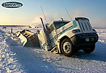 *(original 150×103 · [live](https://jdsmithinsurance.com/images/unusual_claims_02_small.jpg))*](https://jdsmithinsurance.com/images/unusual_claims_02.jpg) | [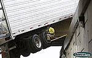 *(original 150×95 · [live](https://jdsmithinsurance.com/images/unusual_claims_03_small.jpg))*](https://jdsmithinsurance.com/images/unusual_claims_03.jpg) | [ *(original 150×106 · [live](https://jdsmithinsurance.com/images/unusual_claims_04_small.jpg))*](https://jdsmithinsurance.com/images/unusual_claims_04.jpg) | [ *(original 150×120 · [live](https://jdsmithinsurance.com/images/unusual_claims_05_small.jpg))*](https://jdsmithinsurance.com/images/unusual_claims_05.jpg)

[ *(original 150×109 · [live](https://jdsmithinsurance.com/images/unusual_claims_06_small.jpg))*](https://jdsmithinsurance.com/images/unusual_claims_06.jpg) | [ *(original 150×105 · [live](https://jdsmithinsurance.com/images/unusual_claims_07_small.jpg))*](https://jdsmithinsurance.com/images/unusual_claims_07.jpg) | [ *(original 150×112 · [live](https://jdsmithinsurance.com/images/unusual_claims_08_small.jpg))*](https://jdsmithinsurance.com/images/unusual_claims_08.jpg) | [ *(original 150×108 · [live](https://jdsmithinsurance.com/images/unusual_claims_09_small.jpg))*](https://jdsmithinsurance.com/images/unusual_claims_09.jpg) | [ *(original 150×74 · [live](https://jdsmithinsurance.com/images/unusual_claims_10_small.jpg))*](https://jdsmithinsurance.com/images/unusual_claims_10.jpg)

[ *(original 150×98 · [live](https://jdsmithinsurance.com/images/unusual_claims_11_small.jpg))*](https://jdsmithinsurance.com/images/unusual_claims_11.jpg) | [ *(original 150×102 · [live](https://jdsmithinsurance.com/images/unusual_claims_12_small.jpg))*](https://jdsmithinsurance.com/images/unusual_claims_12.jpg) | [ *(original 150×113 · [live](https://jdsmithinsurance.com/images/unusual_claims_13_small.jpg))*](https://jdsmithinsurance.com/images/unusual_claims_13.jpg) | [ *(original 150×107 · [live](https://jdsmithinsurance.com/images/unusual_claims_14_small.jpg))*](https://jdsmithinsurance.com/images/unusual_claims_14.jpg) | [ *(original 150×114 · [live](https://jdsmithinsurance.com/images/unusual_claims_15_small.jpg))*](https://jdsmithinsurance.com/images/unusual_claims_15.jpg)

[ *(original 150×111 · [live](https://jdsmithinsurance.com/images/unusual_claims_16_small.jpg))*](https://jdsmithinsurance.com/images/unusual_claims_16.jpg) | [ *(original 150×111 · [live](https://jdsmithinsurance.com/images/unusual_claims_17_small.jpg))*](https://jdsmithinsurance.com/images/unusual_claims_17.jpg) | [ *(original 150×113 · [live](https://jdsmithinsurance.com/images/unusual_claims_18_small.jpg))*](https://jdsmithinsurance.com/images/unusual_claims_18.jpg) | [ *(original 150×101 · [live](https://jdsmithinsurance.com/images/unusual_claims_19_small.jpg))*](https://jdsmithinsurance.com/images/unusual_claims_19.jpg) | [ *(original 150×95 · [live](https://jdsmithinsurance.com/images/unusual_claims_20_small.jpg))*](https://jdsmithinsurance.com/images/unusual_claims_20.jpg)

[ *(original 150×115 · [live](https://jdsmithinsurance.com/images/unusual_claims_21_small.jpg))*](https://jdsmithinsurance.com/images/unusual_claims_21.jpg) | [ *(original 150×113 · [live](https://jdsmithinsurance.com/images/unusual_claims_22_small.jpg))*](https://jdsmithinsurance.com/images/unusual_claims_22.jpg)

JD Smith, B.A.,
President

2-105 West Beaver Creek Road, Richmond Hill, ON, L4B 1C6
Ph: 905-764-7868 Fax: 905-764-9618

### Strange But True Claims
`jds-bloopers.htm`

 *(original 86×105 · [live](https://jdsmithinsurance.com/images/produc3.gif))*

[Back to Hot News Page](jds-news.htm)

 *(original 206×51 · [live](https://jdsmithinsurance.com/images/Crazy_claims.gif))*

**The following are actual statements found on insurance forms where car drivers
attempted to summarize the details of an accident in the fewest words possible.**

- "Coming home I drove into the wrong house colliding with a tree I don't have."

- "The other car collided with mine without giving warning of his intentions."

- "I thought my window was down, but I found out it was up when I put my head through it."

- "I collided with a stationary truck coming the other way."

- "A truck backed through my windshield into my wife's face."

- "The guy was all over the road. I had to swerve a number of times before I hit him."

- "I pulled away from the side of the road, glanced at my mother-in-law, and headed over the embankment."

- "I had been shopping all day for plants and was on my way home. As I reached an intersection, a hedge sprang up, obscuring my vision and I didn't see the other car."

- "I had been driving for 40 years when I fell asleep at the wheel and had an accident."

- "I was on my way to the doctor with rear end trouble when my universal joint gave way causing me to have an accident."

- "As I approached the intersection, a sign suddenly appeared in a place where no sign had ever appeared before. I was unable to stop in time to avoid the accident."

- "To avoid hitting the bumper of the car in front, I struck the pedestrian."

- "My car was legally parked as it backed into the other vehicle."

- "An invisible car came out of nowhere, struck my car and vanished."

- "I told the police I was not injured but on removing my hat, found that I had a fractured skull."

- "I was sure the old fellow would never make it to the other side of the road when I struck him."

- "The pedestrian had no idea which direction to run, so I ran over him."

- "I saw a slow moving sad faced old gentleman, as he bounced off the hood of my car."

- "The indirect cause of the accident was a little guy in a small car with a big mouth."

- "I was thrown from my car as it left the road. I was later found in a ditch by some stray cow."

- "The telephone pole was approaching. I was attempting to swerve out of its way, when it struck my front end."

[Back to Hot News Page](jds-news.htm)

### J D Smith Insurance Claims News Items
`jds-claims_giant_mine.htm`

**Giant Mine Widows Denied $10.7-Million Award**

The Supreme Court of Canada has sided with the Northwest Territories Court of Appeal in overturning a lower court award of $10.7 million to the families of nine miners murdered in 1992. In May of 1992, a strike began at the Giant Mine near Yellowknife, N.W.T. The gold mine's owner, Royal Oak Mines, decided to continue operating and hired replacement workers.

The strike rapidly degenerated into violence, so Royal Oak hired Pinkerton?s for security services. In mid-June, strikers rioted, damaging property and injuring security guards as well as replacement workers. Royal Oak fired about 40 strikers and the police laid criminal charges.

Later in June, three strikers entered the mine, stole explosives and painted graffiti threatening replacement workers. In late July, strikers set an explosion that blew a hole in a satellite dish on mine property. In early September, strikers set a second explosion that damaged the mine's ventilation shaft plant.

On September 18, fired miner Roger Warren evaded security, entered the mine and planted an explosive device underground. When a man-car triggered the trip wire, the nine miners in the car were all killed in the explosion. In 1995, Warren was convicted on nine counts of second-degree murder and is serving a life sentence.

The miners' survivors sued Royal Oak Mines, Pinkerton's of Canada Limited and the territorial government for negligently failing to prevent the murders. They also claimed against members of the Canadian Association of Smelter and Allied Workers (CASAW) Local 4, the national union and some union officials for failing to control Warren and for inciting him. In 2004, Justice Arthur Lutz of the Supreme Court of the Northwest Territories ruled that the negligence of the defendants inflamed the situation and failed to prevent the disaster. He awarded $10.7 million, plus interest and GST, to the families.

In 2008, the Court of Appeal for the Northwest Territories reversed Lutz?s judgment, saying that he had erred in three key areas:

- Finding that Pinkerton?s and the government owed a duty of care in negligence to the appellants
- Applying the wrong legal test for determining whether the wrongful acts caused the miners' deaths
- Finding a national union vicariously liable for the acts of members of a local and finding that it had incited Mr. Warren's murderous acts.
- The miners' families appealed to the Supreme Court of Canada, but their appeal was dismissed in February of 2010.

"Although I would find that the security firm and the government owed a duty of care, my view is that the trial judge erred when he found that they had breached that duty," said the Honourable Mr. Justice Thomas Albert Cromwell, writing for the top court. "With respect to the claims against the union, union officers and members, I agree with the Court of Appeal that the trial judge's findings of liability cannot be sustained."

The ruling brings to an end the long, bitter legal legacy of the strike, which remains the bloodiest chapter in Canadian labour history.

To read the complete decision, go to [http://scc.lexum.umontreal.ca/en/2010/2010scc5/2010scc5.html](http://scc.lexum.umontreal.ca/en/2010/2010scc5/2010scc5.html) .

### J D Smith Insurance Claims News Items
`jds-claims_roofer_liable.htm`

**Roofer Liable for $2.3 Million in Damages for Church Fire**

The Supreme Court of British Columbia recently found Sur-Del Roofing Limited responsible for a 2004 fire that destroyed a Mennonite Church in Abbotsford, B.C. On December 11, 2004, Sur-Del's subcontracted crew, led by Chris Hutchings, was replacing a flat roof section of the church.

The work called for the old roof to be removed, then three layers of new material to be applied. The agreed-upon "20-year Torchflex System" specifies a fiberglass fireproof underlay, followed by a base layer and then a cap. Torching is used to adhere the products.

When torching is used, the B.C. Fire Code requires a 60-minute fire watch following the completion of work and a final inspection of the area four hours after work finishes. Code also requires that floodlights be used when torching is performed after dark.

The roofers claimed to have finished torching by 4:00 p.m., a few minutes before sunset. Hutchings said he then conducted a two-hour fire watch while he cleaned up and prepared for the next day's work. He said he checked for hot spots with his bare hands twice. He left at about 6:00 p.m. and was home in Langley, about an hour's drive away, by 7:00 p.m.

Two nearby neighbours testified that torch work continued, without floodlights, until 6:00 p.m., when the crew left for the day.

At about 10:00 p.m., the church's fire alarm sounded, but by the time the fire crews arrived, the fire was too far advanced to save the building.

Justice Loryl Russell believed the evidence of the neighbours and fire experts, finding the roofing company responsible for the fire due to its negligence in failing to apply the fireproof base layer, failing to conduct even a one-hour fire watch, and failing to illuminate the area sufficiently when work continued after sunset.

She awarded $2.3 million in damages, plus costs and interest.

To read the complete decision, go to [http://www.canlii.org/en/bc/bcsc/doc/2010/2010bcsc223/2010bcsc223.html](http://www.canlii.org/en/bc/bcsc/doc/2010/2010bcsc223/2010bcsc223.html) .

### The House Is Too Heavy For The Bridge
`jds-bridge_too_small.htm`

**Question #1: How much does a house weigh?**

 *(original 500×294 · [live](https://jdsmithinsurance.com/images_new/claims_house_bridge_1.jpg))*

**Question #2: How much weight can a rural two-lane bridge Hold???**

 *(original 500×263 · [live](https://jdsmithinsurance.com/images_new/claims_house_bridge_2.jpg))*

**Question #3: SO......WOULD THIS BE COVERED BY
HOUSE INSURANCE,
CAR INSURANCE,
OR,
DOES IT COME UNDER ROADSIDE ASSISTANCE ???**

 *(original 500×298 · [live](https://jdsmithinsurance.com/images_new/claims_house_bridge_3.jpg))*

### Lucky to be Alive - Close Call
`jds-lucky_to_be_alive.htm`

 *(original 454×362 · [live](https://jdsmithinsurance.com/images_new/close_call_01.jpg))*

Look at the picture above, and you can see where this driver broke through the guardrail, on the right side of the culvert, where people are standing on the road, pointing.

The pick-up was traveling about 75 mph, from right to left, when it crashed through the guardrail.

It flipped end-over-end, bounced off and across the culvert outlet, and landed right-side-up on the left side of the culvert, facing the opposite direction from which the driver was traveling.

The 22-year-old driver and his 18-year-old passenger were unhurt, except for minor cuts and bruises.

Just outside Flagstaff , AZ on U.S. Hwy 100.

**Now, look at the second picture below . . .**

 *(original 454×1027 · [live](https://jdsmithinsurance.com/images_new/close_call_02.jpg))*

**If this guy didn't believe in God before,
do you suppose he believes now?**

## News & humour articles

### In Touch Newsletter #1
`jds-client_newsletter_1.htm`

**Direct link to articles:**
- [Could This Happen To You?](#happen)
- [Tips for Identifying Car Insurance Scams](#tips)
- [When All You Have Left is Your Insurance!](#when)
- [Guests, Alcohol, and Your Liability](#guests)
- [All-Season Tires or Snows – Should You Change?](#all)
- [You’ve had a Loss. Now What?](#loss)
- [“Slip and Fall” Accidents Can Be Prevented](#slip)
- [Concerned About an Insurance Issue?](#concerned)
- [Is Your Home a High Insurance Risk?](#risk)

**Could This Happen To You?**

The following is a true story provided by a member of our Association. It illustrates how important it is to be prepared for emergencies.
Our hydro went out last March, when the ice storm hit. High winds and severe cold weather hampered the efforts of the workmen who were braving the elements to repair service to the affected areas.

We were reasonably prepared for the blackout, with a woodstove for warmth and candles to light our way. However, our nightmare began after I took our dog out for a walk. Coming back into the house, I found that the candle in my living room had fallen over and our couch was ablaze. Unbelievably calm, I remembered the fire extinguisher. As I pulled the extinguisher out of the cupboard where it’s buried, I yelled for my children to hurry downstairs and put on their coats. I thought: “This cannot be too difficult, can it?”

As I hurried back to the living room, (a matter of 90 seconds had passed) I observed the curtains were on fire, the carpet was burning, and the couch was fully engulfed in flames. The room was quickly filling with acid smoke from the burning upholstery and flames were licking at the walls and across the ceiling. Shaking as I held the fire extinguisher, I pulled the pin and managed to squeeze the trigger. Unfortunately, the small extinguisher lasted long enough to put out only half the flames on the couch. My eyes were watering profusely and I realized that this was beyond my capabilities. I dropped the extinguisher and ran out the door, directing the children ahead of me. It didn’t take long before I felt the bitter cold of the night, as I was wearing my bedroom slippers and no coat.

Horrified and cold, my children and I watched as the high winds fed the fire and one window after another exploded in the night air. Although the volunteer fire department arrived after only 11 minutes, all that was left of our house, within an hour, was a blackened hulk. The second floor had fallen in on the first floor and everything was gone.

Fortunately, no one was hurt. But now with no home, no clothes and a family huddled in the cold, we needed help. I called our insurance broker who calmly offered advice, suggested a place to stay and assured me we were adequately covered. He helped make our horrible experience a little more bearable.

**Prepare for an Emergency**
What started out as a simple power outage for the above family, ended in catastrophe. When disaster strikes you may not have much time to act. Learn how to protect yourself and your family in an emergency. First discuss emergency planning with your family and develop a plan that suits your needs. Public Safety and Emergency Preparedness Canada, a Federal agency offers a series of self-help advice brochures for families and individuals to help you prepare for emergencies. Visit [www.ocipep.gc.ca](http://www.ocipep.gc.ca) to learn more.

[Return to top](#start)

**Tips for Identifying Car Insurance Scams**

 *(original 102×171 · [live](https://jdsmithinsurance.com/images/newsletter_1.gif))* Insurance fraud is estimated to cost insurers over $2 billion annually. You can help eliminate automobile insurance scams – and help lower car insurance premiums – by being an informed consumer.
The Financial Services Commission of Ontario (FSCO) has released a brochure entitled: **“Tips for Identifying Car Insurance Scams.”** It describes how some scams work, offers tips on dealing with tow truck drivers, paralegals, and healthcare providers, and lets you know what to do if you suspect fraudulent activity. This brochure is available by visiting FSCO’s website at [www.fsco.gov.on.ca](http://www.fsco.gov.on.ca) , or by calling FSCO’s 24-hour information line toll-free at 1-800-668-0128 (in Toronto call 416-250-7250).

Only you can prevent fraud. Know your rights and take action to make sure only legitimate payments are paid under your policy. It’s up to you.

**Referral fees are illegal!**
It is illegal for tow truck drivers to be paid a fee to refer accident victims to a particular paralegal or a repair shop. It is also illegal for paralegals to refer accident victims to a particular healthcare provider for a fee. If you suspect this is happening, report it to us, and contact the police.

[Return to top](#start)

**When All You Have Left is Your Insurance!**

Insurance is a complicated and sometimes frustrating purchase that you make each year to protect your vehicle, property, personal possessions, or business. These important purchases cannot be taken lightly!
**Why deal with an independent insurance broker?**

- Independent insurance brokers offer added value for your premium dollars by giving you choices, quality products, sound advice, and local personal service – something you can’t readily get from a call centre, or direct writer!
- Independent insurance brokers are trained professionals who understand your personal insurance needs and the specific needs of your business.
- Independent insurance brokers act as your insurance buyer. We “shop” the insurance marketplace to make sure you get the broadest possible coverage at a competitive premium. This is a tremendous advantage to you, and is not available from agents who only sell for one insurance company.
- Finally, as part of your community, independent brokers contribute everyday by dealing locally, volunteering, sponsoring, supporting, and getting involved in activities that benefit everyone.

**You deserve peace of mind**

We sincerely hope you never experience a loss, either minor or catastrophic, but if you should, your coverage is critical. When all you have left is your insurance, it’s reassuring to know your insurance coverage will be there to put you back in the position you were in prior to the loss!

It’s also comforting to know that someone will be there to guide you along the way. That someone is us. That’s why we proudly say: **Your best insurance is an Insurance Broker!**

[Return to top](#start)

**Guests, Alcohol, and Your Liability**

**It doesn’t matter if it’s in your home, office, or elsewhere,** if you host a party where alcohol is being served, you are legally responsible for the actions of an intoxicated guest.
 *(original 158×106 · [live](https://jdsmithinsurance.com/images/newsletter_2.gif))* The law defines a host or “occupier” as the person who has control over the property and the power to admit or exclude visitors. This could be a homeowner, an officer of a service club, or a parent renting a banquet hall for their son, or daughter’s wedding.

When it comes to occupier’s liability, as the host you must take reasonable steps to protect your guests from any foreseeable risk of injury. Before a function, be sure to repair loose carpets, broken steps, uneven walkways, and any other potential hazard.

Under most liquor laws, it is an offence to serve or provide alcohol to a person who is legally intoxicated. Once a guest has reached the intoxicated limit, the host has sole responsibility for their actions until they are no longer intoxicated. This could be 24 hours, or longer, depending on the person’s size and the amount of alcohol they have consumed. In addition, by providing alcohol, you can be held liable for injuries your intoxicated guest may cause to another person.

If you are a host, we recommend you remain sober, provide food for your guests, make non-alcoholic drinks available, prohibit drinking games, and stop serving alcohol at least two hours before the function is scheduled to end.

A good way to protect yourself is to purchase a **Party Alcohol Liability** policy to cover a licenced function. Even though many homeowner’s and some commercial policies will defend you against liquor liability lawsuits, we think the cost of this type of policy is worth the peace of mind. If in doubt, call us.

[Return to top](#start)

**All-Season Tires or Snows – Should You Change?**

Many new cars sold in Ontario come with “all-season” tires. These tires are designed to provide safe, all-weather protection, but are not suitable for snow-covered roads or extreme cold. Once the temperature drops below –10º C, all-season tires lose their grip as the tires harden. This is definitely not desirable and may account for the rising number of unexpected “loss of control” accidents in cold weather.
 *(original 58×56 · [live](https://jdsmithinsurance.com/images/newsletter_3.gif))* Years ago, snow tires were knobby and noisy. They were great for driving in the snow, but performed poorly when exposed to dry and wet road conditions. This is no longer true. Today’s new snow tires are made with rubber compounds that not only handle ice, snow, and cold temperatures, but also dry, wet, or slushy driving conditions. New snow tires are marked with the pictograph of a peaked mountain with a snowflake to show they meet specific snow traction performance requirements that help you control your vehicle safely in snowy conditions.

If your winter driving is limited to regions with little snow and moderate winter temperatures, all-season tires may be suitable for you. For the rest of us, the traction and security offered by snow tires makes them the best choice. A good way to rationalize the expense of winter tires – at least $500 a set – is to remember that the cost is equal to the deductible on many auto insurance policies, which means you’ll pay that much anyway if you end up in a crash. As a bonus, by switching to winter tires, you’ll extend the life of your regular “all-season” tires.

[Return to top](#start)

**You’ve had a Loss. Now What?**

 *(original 81×134 · [live](https://jdsmithinsurance.com/images/newsletter_4.gif))* A fire, a burglary, or a flood. Nobody expects it to happen to them. Unfortunately these things do occur. To help reduce the stress and inconvenience of such an event, here’s what you can do before and after a claim.
**BEFORE A CLAIM**

- Create an inventory of your home’s contents using a list, photographs, or videotape. Be sure to keep a copy outside your home.
- Make sure your high value items are covered. Sometimes, furs, jewellery, fine arts, and antiques are only covered to a certain limit. Review or appraise their value and confirm if additional (and separate) insurance is required.
- Keep receipts on high value and high target items off site.
- Update your possessions values. It’s easy to overlook the costs of new furniture, appliances, computers, and entertainment electronics. Don’t risk being under-insured.
- Talk to your insurance broker. If you are not sure you have adequate coverage or need more information, call us, we’re here to help.

**AFTER A CLAIM**

- Whatever the cause, you are obligated to prevent further loss or damage by securing your home or having emergency repairs done without delay. Call us, or your insurance company’s 24 hour emergency number, for referrals to emergency crews and contractors to assist you.
- You must be able to prove your loss. Prepare a list of lost items with the estimated cost to replace them. You may be required to provide estimates from merchants and suppliers. An inventory list with receipts would make this process fast and easy.
- An insurance adjuster will be appointed by your insurer to work with you to ensure a fair and fast settlement. Co-operate with him/her.
- Many expenses such as emergency repairs and additional living costs are covered by your insurance policy. Keep a record and include receipts of these expenses in your claim.
- Talk to your insurance broker. A loss can be a stressful experience. If you have any concerns with your claim or settlement, we’re always here to help you.

[Return to top](#start)

**“Slip and Fall” Accidents Can Be Prevented**

 *(original 75×105 · [live](https://jdsmithinsurance.com/images/newsletter_5.gif))* Members of the public are now more likely to sue when they have been injured on your premises due to a “slip and fall” accident. Studies show the number of claims and the amounts being paid out have increased substantially over the past few years.
All businesses and homeowners have a legal obligation to maintain their premises and ensure that anyone who comes on the property is reasonably safe.

**How am I at risk?**
If you are a business owner, you may be at risk of being sued if someone slips, trips, or falls if:

- There is an unsafe condition on your premises;
- You could have foreseen the accident due to a hazardous condition;
- The accident could have been avoided had you taken precautions;
- You fail to post warning signs advising of any known hazards;
- You fail to have written inspection and maintenance procedures in place.

**How can I protect myself against claims?**
Most “slip and fall” accidents are caused by slippery walkways, sidewalks, parking lots, uneven pavement, missing guardrails, improperly maintained staircases, wet floors, or other hazards. Your best protection is to inspect, repair, and document the state of your premises on a regular basis.
We can review your situation and provide you with tools and help to protect yourself against claims. Please call us to get started.

[Return to top](#start)

**Concerned About an Insurance Issue?**

Where do you go if you have a serious complaint or concern about your insurance?
Your first step is to call us. If we can’t help you resolve the issue to your satisfaction, we will recommend you make a formal complaint to your insurance company.

Every company has a procedure to deal with complaints. This starts with your insurance company’s Consumer Complaint Officer (Ombudsman). A list of all Consumer Complaint Officers (Ombudsman) and their phone numbers is available on the Financial Services Commission of Ontario (FSCO) website at [www.fsco.gov.on.ca](http://www.fsco.gov.on.ca) .

If your issue is still not resolved, request a letter from the company stating its final position on your complaint. From here you will need to write to FSCO’s Insurance Ombudsman, describe your complaint and explain why you disagree with the company’s position. Make sure that you include a copy of the insurance company’s letter. The Insurance Ombudsman will review your written complaint and will attempt to resolve it once and for all.

As your broker, we want to satisfy your needs and concerns as quickly as possible. If you have a serious concern about your insurance, call us first.

[Return to top](#start)

**Is Your Home a High Insurance Risk?**

 *(original 208×101 · [live](https://jdsmithinsurance.com/images/newsletter_6.gif))* Take a look around your home. Are there accidents waiting to happen? Are you vulnerable to disaster, insurance claims, or perhaps a lawsuit?
Maybe it’s time to practice a little risk management. This means taking action to prevent and protect yourself from some of the perils that can cause havoc in your life. Many insurance companies are implementing their own risk management practices, such as, regulating the age of oil tanks in order to prevent oil spills and requiring proper woodstove installations to prevent fires.

**Here are some things you can do:**

- **Practice good housekeeping**
Keep your yard, stairways, and entrance-ways clear. Keep ice and snow away from your walkways and driveways.

- **Consider a monitored security system**
Security systems can provide peace of mind and solid risk management. It is important to include both fire and burglary systems to protect against two of the most common types of insurance claims made on homeowner policies.

- **Have your chimney professionally cleaned and your furnace serviced annually**
It is good practice to hire a professional chimney sweep to clean your chimney. Even if you have the tools to do it yourself, it is advisable to hire a professional periodically. Be sure to have your home furnace serviced annually for improved efficiency and to reduce the risk of carbon monoxide emissions and furnace blow-backs.

- **Be sure pools are fenced**
To prevent a tragic incident, it is very important to ensure that your pool area is totally inaccessible when no one is there to supervise. Make sure the fencing is complete and any gate or entranceway is securely locked.

- **Update electrical systems**
If you live in an older home, it is advisable to have a licensed electrician inspect your system. Although there are costs involved, upgrading to a 100 or 200 amp system can make your home a safer place. You can do visual inspections around the home to check for loose wires, cracks in the plastic coating, burn marks from arcing, and improper use of electrical cords. Electrical cords should not be run under carpets and are not for permanent use. It is also important to be sure that your electrical outlets are not overloaded.

- **Keep up with repairs**
As things age around the home, be sure they are maintained, repaired, and if needed, replaced. Important areas to consider are your roof, foundation, sump pumps, bricks, mortar, siding, and oil tank.

By practicing good risk management around the home, you will reduce the risk of insurance claims, as well as the cost, and inconvenience that goes along with them.

[Return to top](#start)

### In Touch Newsletter #2
`jds-client_newsletter_2.htm`

Direct link to articles:
- [Insurance Fraud Hurts Everyone](#fraud)
- [New School Bus Safety Legislation](#bus)
- [Attention Young Drivers](#young)
- [Wow! Over 4 Inches of Rain in One Hour](#wow)
- [When Do I Insure My New Home ?](#home)
- [Do You Tow a Trailer ?](#tow)
- [New Rules When Approaching a Stopped Emergency Vehicle](#rules)
- [Making Ontario Roads Safer For Children](#children)
- [Things Change! So Can Your Liability](#change)
- [Be Aware of Tow Truck Scams!](#scams)

**Insurance Fraud Hurts Everyone**

There is no such thing as a little fraud There are big lies and little lies, but insurance fraud can be anything from claiming two or three extra CD’s being stolen from your car, to claiming large sums of tools stolen from your garage, to falsifying an injury in order to collect weekly indemnity benefits.

Each year, insurance fraud costs Canadians $3 billion. That means 10 to 15 cents of every dollar you pay as premium is used to cover fraudulent insurance claims. Insurance fraud really does cost everyone.

Insurance fraud costs all of us in the form of higher premiums. If someone you know is committing insurance fraud on a home, car or business policy, you can report it to CrimeStoppers at 1-800-222-TIPS. If your tip helps the police or your insurance company catch an insurance fraud, you may be eligible for a cash reward – your call will remain completely anonymous.

**Common types of fraud or attempted fraud include:**

- Lying about the way a loss occurred.
- Adding items or inflating the value items in a claim.
- Filing fraudulent automobile accident or damage claims (i.e. including previously existing damage when submitting a claim).
- Withholding information about past accidents, traffic convictions, claims, policy cancellations or non-renewals.
- Receiving payments for treatments not received.

**If you are caught committing or attempting to commit insurance fraud:**

- Your claim will be denied.
- Your insurance policy may be cancelled outright.
- You may pay higher premiums in the future.
- You may be denied insurance in the future.
- More importantly, the offense is punishable on conviction, by a maximum of 10 years imprisonment for cases involving an amount over $5,000 or otherwise a maximum of 2 years imprisonment.

[Return to top](#start)

**New School Bus Safety Legislation**

 *(original 97×204 · [live](https://jdsmithinsurance.com/images/newsletter_2_1.gif))* Over 800,000 young people are transported safely in school buses every day. Unfortunately, accidents still happen. Most occur as students are boarding or leaving the bus when they are crossing the street.

Ontario recently passed legislation that allows police charge the OWNER of any vehicle that illegally passes a stopped school bus. This means it is the owner’s responsibility to make sure everyone using their vehicle is aware of this legislation.

Motorists are required by law to stop for a school bus with its upper reds lights flashing. This applies to city streets, highways or county roads regardless of speed limit or number of lanes. Motorists traveling in both directions must stop. The only exception is on highways separated by a median. In this situation, traffic coming from the opposite direction is not required to stop.

Motorists must not start moving until the red lights have stopped flashing and the bus begins to move. Penalties for not stopping for a school bus can be as high as $2,000 and six demerit points for the first offense. With your help, we can all help keep our roads and our children safe.

[Return to top](#start)

**Attention Young Drivers:**

**New rules limit the number of passengers you can carry** Ontario’s Graduated Licensing System has been a huge success in reducing death and injury among novice drivers. Research shows that teenage drivers are almost three times more likely to be involved in a fatal or serious collision when they are carrying teenage passengers. In fact, the more teenage passengers, the higher the risk.

**G2 License Rule changes**
To keep Ontario’s roads safer, new restrictions were introduced on September 1, 2005 that limit the number of young passengers a teen-aged G2 driver can carry from midnight to 5 a.m.

- For the first 6 months, G2 drivers 19 or under can carry only one passenger aged 19 or under.
- After 6 months, a G2 driver can carry up to three passengers aged 19 or under.

These restrictions do not apply if:

- The G2 driver is accompanied by a full “G” licensed driver (with at least 4 years driving experience) in the front seat.
- The passengers are immediate family members.
- The driver turns 20 years old.
- The driver earns a full G license.

In addition, G2 drivers must maintain a zero blood alcohol level while driving and never carry more passengers than the number of working seat belts in the vehicle.

 *(original 580×125 · [live](https://jdsmithinsurance.com/images/newsletter_2_2.gif))*

[Return to top](#start)

**Wow! Over 4 inches of rain in one hour**

 *(original 100×217 · [live](https://jdsmithinsurance.com/images/newsletter_2_3.gif))*

On August 19, 2005, 103mm (4 inches) of rain fell in a one-hour period in Toronto and parts of Southern Ontario. The $100 million storm caused massive flooding and damage to 5,200 homes and 700 automobiles. A section of Finch Avenue, a four-lane road in North York was completely washed out (see photos, left) and will cost an estimated $5 million to repair. While storms of this magnitude are rare, you can be sure they will occur again at some point in the future.

If you live in an area prone to flooding, be prepared.

- Clear leaves and other debris from eaves troughs, downspouts and catch basins to allow proper drainage.
- In extreme downpours, even clear eaves troughs can overflow. Make sure the grading around your home drains away from all exterior walls, window wells and other openings.
- Keep drinking water, canned food, flashlights, spare batteries, a first aid kit, and a transistor radio in your home.

If you are caught in a storm while driving, watch out for flooded roadways, especially low spots like underpasses. If you encounter a flooded underpass, do not attempt to drive through it – take an alternative route instead.

Severe weather can strike at anytime. A little preparation now will serve you well in an emergency.

[Return to top](#start)

**When Do I Insure My New Home?**

 *(original 122×172 · [live](https://jdsmithinsurance.com/images/newsletter_2_4.gif))* Are you planning to build your dream home soon or thinking about adding an addition to your present home?

For your protection, you must advise us about your plans before you start construction.

You will be required to insure for the full replacement value of the project. This may take the form of an endorsement or “course of construction” extension to your current policy, or may require an entirely new policy.

If you are going to act as your own general contractor, you may be charged a higher premium for the increased exposure. You will also be asked to obtain proof of insurance from any subcontractors performing work for you. Some insurers may request a higher deductible during the construction phase.

These can be exciting and hectic times. If you have any questions, please call us. We’re here to help.

[Return to top](#start)

**Do you tow a trailer?**

In Ontario, there are 12 different license classes. Each one qualifies you to drive a different type of vehicle. The class of license you have must match the type of vehicle you are driving.

A “G” class license is the most common in Ontario and allows you to drive any car, van or small truck or combination of vehicle and towed vehicle up to 11,000kg, provided the vehicle being towed is not over 4,600kg.

**For people who tow large camper trailers, travel trailers or 5th Wheel trailers, it is possible to exceed the weight restrictions of a G license.** If your trailer exceeds 4,600 kg or if the total weight of your tow vehicle and trailer exceeds 11,000 kg, you will be in violation of the G class rules and in effect, will be driving without a license.

**Without a valid license, your insurance may be null and void in the event of an accident or claim.**

If your tow vehicle and trailer combination exceeds the weight limit, you should obtain a A class license.

[Return to top](#start)

**New rules when approaching a stopped emergency vehicle**

If you see an emergency vehicle (police car, ambulance, or fire vehicle) stopped with its red lights flashing on your side of the road or highway, you must slow down and pass with caution.

**If the road has two or more lanes, you now must move over into another lane, if it can be done safely.** Failing to do so can result in fines up to $2,000 plus 3 demerit points for the first offence. Subsequent offences within 5 years, can result in fines up to $4,000, up to 6 months jail time, and a possible 2 year suspension of your driver’s license.

As always, if you see or hear an emergency vehicle approaching from either direction, with lights flashing or siren on, you must clear the way by pulling to the right, and if possible, stop to let it pass.

[Return to top](#start)

**Making Ontario’s Roads Safer for Children**

**New Child Booster Seat Legislation**
You would never think of dropping a child from a third story window, but in a 50 km/hr car crash, an unrestrained child would suffer similar injuries.

 *(original 150×124 · [live](https://jdsmithinsurance.com/images/newsletter_2_5.gif))* According to the Canadian Hospitals Injury Reporting and Prevention Program, motor vehicle collisions are the leading cause of death and injury among children and youth.

Recently, the Ontario government passed legislation making our roads and highways even safer for children. Studies have shown that children using seat belts instead of booster seats are 3.5 times more likely to suffer significant injury, and 4 times more likely to suffer head injury.

**Now it’s the Law!**
All children under the age of eight and weighing between 18 and 36 kg (40-80lbs) must use booster seats. A child can start using a seatbelt alone, once any one of the following criteria is met:

- The child turns 8 years old;
- The child weighs 36 kg (80 lbs); or,
- The child is 145 cm (4 feet 9 inches) tall.

This law applies to all drivers, not just parents and legal guardians. Babysitters, grandparents, aunts, uncles or anyone travelling with young children are required to follow the law on the use of car seats. The penalty for failing to comply is a $90 fine plus a $20 victim surcharge and 2 demerit points.

[Return to top](#start)

**Things Change! So Can Your Liability.**

 *(original 150×165 · [live](https://jdsmithinsurance.com/images/newsletter_2_6.gif))* As the nice weather approaches our thoughts turn to getting back outdoors. Maybe this is the year you invest in a family swimming pool.

If you are considering such an investment or have already added one, please let us know. A new swimming pool often increases the value of your home, but it also changes your insurance risk with respect to the liability portion of your homeowner’s policy.

A swimming pool can be fun for the entire family as well as friends and guests, but they can be dangerous. Some insurance companies charge a nominal fee to protect you against any lawsuits that may arise from the use – or misuse – of your pool.

Whether you add a swimming pool, a trampoline or anything else that could increase the risk of injury, make sure we adjust your liability coverage accordingly. Don’t be left exposed.

If you are not sure, call us today.

[Return to top](#start)

**Be Aware of Tow Truck Scams!**

 *(original 200×157 · [live](https://jdsmithinsurance.com/images/newsletter_2_7.gif))* Most tow truck operators provide a fair and valuable service to those in need. However, some operators have made side deals with repair shops or storage facilities that pay them a commission for bringing in your vehicle. Not only is this practice unethical, it can result in poor quality repairs or hefty storage, administrative and environmental charges if you decide to change shops.

If your vehicle is not drivable after being involved in an accident, have the tow truck operator take it to a Collision Reporting Centre (CRC), if one is available in your area. The centre will pay the towing bill on your behalf and provide 24 hours FREE storage. Your insurance company will then authorize a damage appraisal and arrange to have your vehicle towed to a repair facility of your choice.

If a tow truck operator promises you a free courtesy car, additional bodywork at no cost, or offers to pay your deductible, you are likely being scammed. To avoid being a victim, **Do Not Sign a Waiver** allowing your vehicle to be towed from the Collision Reporting Centre. A reputable towing company will never ask you to sign a waiver.

If you are involved in an accident, call us as soon as possible. We’ll answer all your questions.

**Do Not Sign a Waiver allowing
your vehicle to be towed from a
Collision Reporting Centre (CRC)**

[Return to top](#start)

### In Touch Newsletter #9
`jds-client_newsletter_9.htm`

Direct link to articles:
- [Auto Insurance Has Changed - Now you have more choice](#1)
- [Choosing The Right Contractor](#2)
- [Why Would You Insure Your Home For More Than You Paid For It?](#3)
- [You've Had An Auto Accident - Now What?](#4)
- [Choosing The Right Insurance...It's Easier Than You Think](#5)
- [Business Interrupted? Now What?](#6)
- [Tips For Driving In The USA](#7)

**Auto Insurance Has Changed - You now have more choice**

A few years ago the Ontario Government revamped the rules and coverage available for Auto Insurance. The following information should be helpful for you as you review your insurance coverages.

These changes provide consumers with more choice and flexibility to purchase coverage that best meets their protection needs and budgets.

You now have choices to customize your medical and rehabilitation benefits, certain deductibles and income replacement coverage. The following chart summarizes these changes.

**New Auto Policy coverage – effective as of your renewal date.**

**New options now available – If you want to increase your benefits, here are some of your new options.**

* | Medical & rehabilitation expenses to a limit of $50,000 for non-catastrophic injuries.
**This coverage is in your expiring policy but the limit has been reduced to $50,000 in your renewal policy.**

* | You have the option to increase the limit to $100,000 for non-catastrophic injuries.

* | Attendant care expenses to a limit of $36,000 for non-catastrophic injuries.
**This coverage is in your expiring policy but the limit has been reduced to $36,000 in your renewal policy.**

* | You have the option to increase the limit to $72,000 for non-catastrophic injuries.

* | Caregiver, Housekeeping & Home Maintenance expenses only available for catastrophic injuries.
**This coverage is in your expiring policy for both catastrophic and non-catastrophic injuries. It is not in your renewal policy for non-catastrophic injuries.**

* | You have the option to purchase this coverage for non-catastrophic injuries

* | Deductible of $30,000 when suing for pain and suffering.
**This continues to be the standard deductible provided for by law.**

* | You have the option to reduce the deductible to $20,000

**The goal of these changes is to achieve rate stabilization by keeping the costs incurred by insurers in check with emphasis placed on Accident Benefits coverage. Without these reforms, major rate increases would be required.**

**What should you do?**

All policies issued after September 1 2010, were issued using the new Standard Auto Insurance Policy and have the option to increase your benefits as described above.

If your vehicle is already insured, you don’t have to do anything until your next policy renewal date.

When your policy comes due for renewal, the new Standard Auto Insurance Policy will apply.

In the meantime, your insurance company will automatically include the following limits/coverages:

- $100,000 limit for non-catastrophic injuries and $1,000,000 limit for catastrophic injuries for Medical and Rehabilitation expenses
- $72,000 limit for non-catastrophic injuries and $1,000,000 limit for catastrophic injuries for Attendant Care expenses
- Housekeeping and Home Maintenance Expenses up to $100 per week for all injuries
- Caregiver Expenses up to $250 per week for your first dependant plus $50 per week for each additional dependant for all injuries

If you prefer to move to the new Standard Auto Insurance Policy before your next renewal date, contact us. We’ll explain your options and help you make an informed choice.

[Return to top](#start)

**Choosing The Right Contractor and Protecting Your Investment**

Whether you’re adding a new room or two, replacing an out-dated kitchen or re-shingling the roof, home improvements can be challenging.

While some homeowners may have the time and skills to do the work themselves, most people will save time and money by hiring a professional. Finding the right contractor is very important. Choose wrongly, and your project can quickly turn into a nightmare of unmet schedules, cost over-runs, shabby workmanship and endless arguments.

**Where do you start?**

** *(original 154×138 · [live](https://jdsmithinsurance.com/images_new/contractor_house.gif))*** Ask for recommendations from family, friends, co-workers and neighbours. Building supply companies, hardware stores and local builder/renovator associations are also excellent options.

Once you’ve got a list, contact your local office of the Better Business Bureau (BBB) to see if any complaints have been lodged against the firms you name. Then, call and check the references. Contractors with nothing to hide will not be offended with these inquiries.

**Always deal with a professional**

Protect your home — and yourself — by dealing with a reputable firm that operates in the open market, legally and responsibly. Professional contractors and sub-contractors follow stringent guidelines to protect themselves and those they do business with. Professionals have all the necessary insurance. Their policies are up-to-date and they can provide you with a certificate of insurance. Your peace of mind is worth it.

**Protect yourself**

Although you may save money in the short term,uninsured contractors expose you to significant financial risk in the event of an injury or damage to your property. You could be liable if an employee of the contractor is hurt while working on your property or if they damage your home or your neighbour’s property.

Before starting any renovation on your home, be sure to call us, your insurance professionals. You want to make sure your investment in your home is adequately insured under your policy from the get go, as renovations increase the value of your home, and materials values can quickly add up. Calling us first will ensure you have adequate coverage under your policy to protect the investment you’re making in your home.

So, check your coverage with us. Then, once you’ve checked references, confirmed insurance and legal credentials, agreed on a price, schedules and materials, pick the contractor that you like and feel you can communicate with. It’s a long process and you’ll be glad you did.

**Beware of contractors who:**

- Quote prices before seeing the job;
- Knock on the door and claim they can give you a “special price” because they are doing work in your area;
- Offer discounts if they can, “use your home to advertise with”;
- Demand unusually large deposits“to buy materials”. Most reputable contractors maintain charge accounts with their suppliers;
- Will not supply you with a detailed written contract specifying what they say and what they will do;
- Have an address that is a post office box, a telephone number, or answering service address.

[Return to top](#start)

**Why Would You Insure Your Home For More Than You Paid For It?**

Insist on Guaranteed Replacement Cost coverage and always ‘Insure to Value’

 *(original 154×137 · [live](https://jdsmithinsurance.com/images_new/value_home.gif))* Many people mistakenly believe the amount they paid for their home is the same as its replacement cost. Unfortunately this is not always true.

Depending on where you live, the cost to rebuild a total loss home can be significantly more than its market value.

Some of the factors that drive up rebuilding/reconstruction costs include:

**Urgency -** Property losses are not planned like a new construction project. When they do occur, there is a need to rebuild as soon as possible. This means the cost of labour, materials and other services required are often significantly higher.

**Demolition and Debris Removal -** Major losses, require the removal of partially damaged property and debris. Costs increase if there are environmental issues such as soil contamination.

**Current Building Codes -** New and more demanding building codes may need to be met when rebuilding or restoring a damaged home.

**Worksite Access and Collateral Damage -** At reconstruction sites there is typically less room because of debris, landscaping, fences and other buildings in the vicinity. This causes more work and material storage to be done further away from the site, thus extending the project time and cost. In some cases, physical access requirements result in collateral damage to existing property on and beside the insured’s property.

It’s easy to see how the cost to rebuild your home could be much more than you paid for it.

Don’t get caught in a situation where your loss exceeds your coverage limits. We can provide you with advice to help you determine the correct amount of insurance you need on your property. And, we’ll recommend coverages like Guaranteed Replacement Cost coverage.

It’s wise to re-evaluate your home’s replacement cost every 5 years to reflect changes in the cost of construction, including building materials and labour. And, if you’ve made any recent renovations, upgrades or alterations to your home, we can help you established a new replacement cost value.

If you have any doubts, please contact us.

We’ll help you insure your home to its proper value.

[Return to top](#start)

**You’ve Had An Auto Accident - Now What?**

 *(original 254×116 · [live](https://jdsmithinsurance.com/images_new/accident_newsletter.gif))* You hear a horn, feel a bump and next thing you know, you hear the sound of crumpling metal. With all this going on around you, you’re thoughts race. You make sure everyone is okay, and then all is quiet. You think to yourself…”What do I do next? Who do I contact? Where do I go to get my car fixed? Is my car driveable?” All of these questions fog up you mind and confuse you. That’s why it’s important to be prepared and know what steps to take after an auto accident.

**What you should do after an accident?**

- Don’t leave the accident scene – leaving the scene could lead to serious or even criminal charges.

- Determine if there are any injuries and if so, call 911 immediately.

- Try to determine if there is more than $1,000 in damage for the whole accident (your car and any other vehicles involved). If the damage appears to be more than $1,000, call the police and they will come and assess the scene. If the damage is less than $1,000, you still need to call the police, but they will instruct you on what to do next to assess the damages.

- If it is safe to do so, move the vehicles off to the side of the road and make the situation safe for all, including passing traffic.

- Collect names, addresses, telephone numbers, insurance information, license plates numbers, driver’s license numbers of all drivers involved in the accident.

- Remember witnesses and passengers; gather their information as well – names, addresses, telephone numbers.

- Take notes of what the immediate scene looked like - placement of trees, shrubs, stop signs, signal lights, pedestrian crossings etc. This will help when you report the claim to us.

- Call us! As soon as you have completed the first 7 steps, call us immediately. We’ll answer your questions and guide you through the claims process.

**Keep in mind…**

- Stay calm
- Don’t argue with other drivers, witnesses, passengers or on-lookers
- Tell your story only to the police
- Never admit liability
- If a tow truck driver suddenly appears without you calling them, don’t allow them to take your car. You have the right to choose a tow truck company or if you like, we can help guide you
- Most importantly, STAY SAFE

[Return to top](#start)

**Choosing The Right Insurance… it’s easier than you think!**

Choice is important to all consumers. We know you have many options when it comes to buying insurance. However, if you want independent, unbiased, uninfluenced, personalized advice, there is only one choice. And that choice is an independent insurance broker.

Independent insurance brokers work for you - not for a call centre, an insurance company or a bank. As your independent insurance broker, we are your consultant and advocate - and we’re with you every step of the way. As your life and insurance needs change, whether it’s marriage, a new home, young drivers or the toys that come with retirement, we can tailor an insurance product that fits you perfectly.

Don’t settle for one-size fits all solutions. By properly assessing your insurance needs, we can help you purchase customized insurance products that match your needs. Because we represent many insurers, we search the marketplace for the best insurance coverage for you. Unlike direct agents who can only sell the product of the Insurer or bank they work for, we offer more choices, unbiased advice and insurance that fits. This is our advantage for you.

And remember, when you deal with an independent insurance broker, you get a licensed and highly trained insurance professional working for you. From the application process to the never anticipated claim, we’re here to guide you, offer advice and advocate on your behalf. You’re never alone and never just a number. We’re insurance experts and we’re on your side.

It’s no wonder we say...
**Your Best Insurance, is an Insurance Broker.**

[Return to top](#start)

**Business Interrupted? Now What?**

Let’s say you own a restaurant and suffer a fire loss. You are forced to close for two months to make repairs and then you find it takes another two months before your business returns to its normal level. How can you protect your property and your business?

In this situation, your Property policy pays to repair the building and replace your contents. Your business losses are covered depending on the type of Business Interruption insurance you’ve chosen.

If you have Gross Profits Insurance, your loss of income is paid while closed for repairs and while you rebuild your business to its original level up to the limit of coverage. Gross Earnings Insurance only covers the income lost during the time required to repair the premises.

If you own rental income property, you also have two choices for Business Interruption Insurance. Gross Rentals Insurance acts on the same basis as Gross Profit Insurance. If your apartment building suffered a fire,your Gross Rentals Insurance will pay for the loss of income during the repair period and for lost income during the time it takes to rent all of the damaged apartments up to the limit of coverage.

Whether your business is retail, restaurant, manufacturing or rental properties, we can offer the appropriate Business Interruption Insurance to protect you from loss of income. Call us to get started.

[Return to top](#start)

**Tips For Driving In The USA**

 *(original 150×119 · [live](https://jdsmithinsurance.com/images_new/passport_canada.gif))* If you plan on driving in the United States, whether in a rental car or your own, there are certain steps you can take to make sure you’re trip is safe and enjoyable.

First, make sure you have a valid Passport or WHTI-compliant identification like an enhanced driver’s license (EDL) or NEXUS card. Since June 2009, Canadians traveling to the U.S. by land or sea are required to present an approved document that shows identity and citizenship.

Be aware that you must declare any meats, fruits, vegetables, plants, seeds, and animals you have in your vehicle or are carrying, including checked baggage and carry-on luggage.

Also make sure to carry your valid Driver’s Licence and proof of insurance. An up-to-date pink insurance liability slip includes important telephone numbers and proves you have insurance.

If you are considering renting a vehicle, it is a good idea to extend coverage from your own Ontario automobile policy to the rental vehicle. By adding an OPCF 27 to your auto policy, you won’t have to worry about buying extra insurance when you rent a car anywhere in the United States or Canada.

Like Ontario’s hands-free law, many states ban the use of cell phones while driving. The states of Illinois, Massachusetts, Michigan, New Mexico, Ohio and Pennsylvania even allow cities or regions to implement their own bans. Be safe and smart and avoid electronic distractions while behind the wheel.

It’s impossible to know when, where or if you’ll get into an accident, but if you do, call us for advice and we’ll help guide you through the claims process.

[Return to top](#start)

**J D Smith Insurance**

905-764-7868

1-800-917-SAVE(7283)

**Committed to Peace of Mind Insurance**

[Return to top](#start)

### Your Burglar Won't Tell You
`jds-burglars_advice.htm`

- Of course I look familiar. I was here just last week cleaning your carpets, painting your shutters, or delivering your new refrigerator.

- Hey, thanks for letting me use the bathroom when I was working in your yard last week. While I was in there, I unlatched the back window to make my return a little easier.

- Love those flowers. That tells me you have taste... and taste means there are nice things inside. Those yard toys your kids leave out always make me wonder what type of gaming system they have.

- Yes, I really do look for newspapers piled up on the driveway. And I might leave a pizza flyer in your front door to see how long it takes you to remove it.

- If it snows while you're out of town, get a neighbor to create car and foot tracks into the house. Virgin drifts in the driveway are a dead giveaway.

- If decorative glass is part of your front entrance, don't let your alarm company install the control pad where I can see if it's set. That makes it too easy.

- A good security company alarms the window over the sink. And the windows on the second floor, which often access the master bedroom - and your jewelry. It's not a bad idea to put motion detectors up there too.

- It's raining, you're fumbling with your umbrella, and you forget to lock your door - understandable. But understand this: I don't take a day off because of bad weather.

- I always knock first. If you answer, I'll ask for directions somewhere or offer to clean your gutters. (Don't take me up on it.)

- Do you really think I won't look in your sock drawer? I always check dresser drawers, the bedside table, and the medicine cabinet.

- Here's a helpful hint: I almost never go into kids' rooms.

- You're right: I won't have enough time to break into that safe where you keep your valuables. But if it's not bolted down, I'll take it with me.

- A loud TV or radio can be a better deterrent than the best alarm system . If you're reluctant to leave your TV on while you're out of town, you can buy a $35 device that works on a timer and simulates the flickering glow of a real television. (Find it at [http://www.faketv.com](http://www.faketv.com) ).

- Sometimes, I carry a clipboard. Sometimes, I dress like a lawn guy and carry a rake. I do my best to never, ever look like a crook.

- The two things I hate most: loud dogs and nosy neighbors.

- I'll break a window to get in, even if it makes a little noise. If your neighbor hears one loud sound, he'll stop what he's doing and wait to hear it again.. If he doesn't hear it again, he'll just go back to what he was doing. It's human nature.

- I'm not complaining, but why would you pay all that money for a fancy alarm system and leave your house without setting it?

- I love looking in your windows. I'm looking for signs that you're home, and for flat screen TVs or gaming systems I'd like. I'll drive or walk through your neighborhood at night, before you close the blinds, just to pick my targets.

- Avoid announcing your vacation on your Facebook page. It's easier than you think to look up your address.

- To you, leaving that window open just a crack during the day is a way to let in a little fresh air. To me, it's an invitation.

- If you don't answer when I knock, I try the door. Occasionally, I hit the jackpot and walk right in.

**Sources:** Convicted burglars in North Carolina, Oregon, California, and Kentucky; security consultant Chris McGoey, who runs [www.crimedoctor.com](http://www.crimedoctor.com) and Richard T. Wright, a criminology professor at the University of Missouri-St. Louis, who interviewed 105 burglars for his book Burglars on the Job.

**If you don't have a gun, here's a more humane way to wreck someone's evil plans for you. (I guess I can get rid of the baseball bat.)**

**WASP SPRAY:**

A friend who is a receptionist in a church in a high risk area was concerned about someone coming into the office on Monday to rob them when they were counting the collection. She asked the local police department about using pepper spray and they recommended to her that she get a can of wasp spray instead.

The wasp spray, they told her, can shoot up to twenty feet away and is a lot more accurate, while with the pepper spray, they have to get too close to you and could overpower you. The wasp spray temporarily blinds an attacker until they get to the hospital for an antidote. She keeps a can on her desk in the office and it doesn't attract attention from people like a can of pepper spray would. She also keeps one nearby at home for home protection. Thought this was interesting and might be of use.

**FROM ANOTHER SOURCE**

On the heels of a break in and beating that left an elderly woman in Toledo dead, self defense experts have a tip that could save your life.

Val Glinka teaches self-defense to students at Sylvania Southview High School. For decades, he's suggested putting a can of wasp and hornet spray near your door or bed.

Glinka says, "This is better than anything I can teach them."

Glinka considers it inexpensive, easy to find, and more effective than mace or pepper spray. The cans typically shoot 20 to 30 feet; so if someone tries to break into your home, Glinka says, "spray the culprit in the eyes". It's a tip he's given to students for decades. It's also one he wants everyone to hear. If you're looking for protection, Glinka says look to the spray.

"That's going to give you a chance to call the police; maybe get out."

Maybe even save a life.

**Put your car keys beside your bed at night**

Tell your spouse, your children, your neighbors, your parents, your Dr's office, the check-out girl at the market, everyone you run across. Put your car keys beside your bed at night.

If you hear a noise outside your home or someone trying to get in your house, just press the panic button for your car. The alarm will be set off, and the horn will continue to sound until either you turn it off or the car battery dies. This tip came from a neighborhood watch coordinator. Next time you come home for the night and you start to put your keys away, think of this: It's a security alarm system that you probably already have and requires no installation. Test it. It will go off from most everywhere inside your house and will keep honking until your battery runs down or until you reset it with the button on the key fob chain. It works if you park in your driveway or garage. If your car alarm goes off when someone is trying to break into your house, odds are the burglar/rapist won't stick around. After a few seconds all the neighbors will be looking out their windows to see who is out there and sure enough the criminal won't want that. And remember to carry your keys while walking to your car in a parking lot. The alarm can work the same way there. This is something that should really be shared with everyone. Maybe it could save a life or avoid a sexual abuse crime.

**P.S.** I am sending this to everyone I know because I think it is fantastic. Would also be useful for any emergency, such as a heart attack, where you can't reach a phone.

Please pass this on even IF you've read it before. It's a reminder.

### Fraudulent Insurance Cards
`jds-fraud_insurance_cards.htm`

 *(original 113×52 · [live](https://jdsmithinsurance.com/images/news_brokers_logo.gif))*

 *(original 450×128 · [live](https://jdsmithinsurance.com/images/news_fraud_insurance_masthead.gif))*

**Fraudulent Insurance Cards**

**Peel Regional Police - [www.peelpolice.on.ca](http://www.peelpolice.on.ca)**

Peel - Just because there is an insurance card in your wallet does not mean that you have automobile insurance. Police and the auto insurance industry are concerned with the increased number of vehicles in the community with fraudulent insurance cards.

Insurance cards are the pink documents required by law that contain insurance particulars for vehicles, including policy numbers and policy expiry dates.

Fraudulent insurance cards appear valid, but have false policy numbers and or expiry dates. Drivers using fraudulent cards are driving with no insurance and can face fines up to $5,000.00 and/or criminal charges. In addition, if involved in motor vehicle collisions, these drivers may find themselves civilly liable for costs related to the collision and any injuries.

In concert with the Insurance Bureau of Canada, the Registered Insurance Brokers of Ontario and the Insurance Brokers Association of Ontario, a recent week long series of spot-checks was conducted by the Peel Regional Police, focusing on this issue. Over 500 vehicles were investigated at various locations throughout the cities of Brampton and Mississauga. The checks resulted in 71 charges against drivers, of which 32 were insurance related offences and three fraudulent insurance cards were discovered.

Police note that drivers may not be aware that they have a fraudulent insurance card. Individuals with poor driving records and or drivers with no Canadian driving history may find themselves facing high costs for car insurance. They may be approached by culprits trafficking in fraudulent insurance cards and offered car insurance at significantly reduced rates. The victims purchase what they believe is valid insurance, but which is in fact fraudulent.

Police are urging drivers to ensure the insurance they have for their vehicle is valid and up-to-date. If they have any concerns they should contact their respective insurance companies to verify they are documented as clients.

Members of the public with information on individuals creating fraudulent insurance documents are urged to contact Police either directly or through Crime Stoppers at 1-800-222-TIPS. They may also contact the Insurance Crime Tip Line at 1-877-IBC-TIPS.

In partnership with the Insurance Bureau of Canada and the Registered Insurance Brokers of Ontario, police are actively addressing complaints of this nature.

**Originator:**
Detective Sergeant John Betts
Fraud Bureau
(905) 453-2121 ext. 3330

**Contact:**
Constable Craig Platt
Media Relations
(905) 453-2121 ext. 4027
September 13, 2006

### Protect Yourself - Be Aware
`jds-be_aware.htm`

**Car Jackings**

**Imagine:** You walk across the parking lot, unlock your car and get inside. Then you lock all your doors, start the engine and shift into REVERSE, and you look into the rear-view mirror to back out of your parking space and you notice a piece of paper stuck to the middle of the rear window. So, you shift into PARK, unlock your doors and jump out off your car to remove that paper (or whatever it is) that is obstructing your view. When you reach the back of your car, that is when the car-jackers appear out of nowhere, jump into your car and take off !! Your engine was running, you would have your purse in the car and they practically mow you down as they speed off in your car.

**BE AWARE OF THIS NEW SCHEME THAT IS NOW BEING USED.** Just drive away and remove the paper that is stuck to your window LATER, and be thankful that you read this. I hope you will alert friends and family especially to women! A purse contains all identification, and you certainly do NOT want someone getting your home address. They already HAVE your keys!!!!!

**Plug In Air Fresheners**

My brother and his wife learned a hard lesson this last week. Their house burned down...nothing left but ashes.
They have good insurance, so the home will be replaced and most of the contents. That is the good news. However, they were sick when they found out the cause of the fire.

The insurance investigator sifted through the ashes for several hours. He had the cause of the fire traced to the master bathroom. He asked my sister-in-law what she had plugged in in the bathroom. She listed the normal things....curling iron, blow dryer. He kept saying to her, "No, this would be something that would disintegrate at high temperatures."

Then, my sister-in-law remembered she had a Glade Plug-in in the bathroom. The investigator had one of those "Aha" moments. He said that was the cause of the fire.

He said he has seen more home fires started with the plug in type room fresheners than anything else. He said the plastic they are made from is a THIN plastic. He said in every case there was nothing left to prove that it even existed. When the investigator looked in the wall plug, the two prongs left from the plug-in were still in there.

My sister-in-law had one of the plug-ins that had a small night light built in it. She said she had noticed that the light would dim....and then finally go out. She would walk in a few hours later, and the light would be back on again. The investigator said that the unit was getting too hot, and would dim and go out rather than just blow the light bulb. Once it cooled down, it would come back on. That is a warning sign.

The investigator said he personally wouldn't have any type of plug in fragrance device anywhere in his house. He has seen too many burned down homes. Something to be aware of.

### Red Light Camera Locations in G.T.A.
`jds-red_light_cameras.htm`

**Do you drive in the Greater Toronto Area?
Then you might be interested in knowing where the cameras are located.**

**Below are the intersections that have them installed.**
Take a look for any intersections that may be on your path to or from work and take it easy. If it takes a picture of you in violation, you could get a $190.00 fine in the mail.

- Finch Ave. & Kipling Ave.
- Dixon Rd. & Islington Ave.
- Dixon Rd. & Martin Grove Rd.
- Eglinton Ave. & Martin Grove Rd.
- The Queensway & Royal York Rd.
- Finch Ave. & Weston Rd.
- Finch Ave. & Jane St.
- Dufferin St. & Steeles Ave.
- Allen Rd. & Sheppard Ave.
- Bathurst St. & Finch Ave.
- Weston Rd. & Lawrence Ave.
- Dundas St. & Keele St.
- Dufferin St. & Eglinton Ave.
- Dufferin St. & St Clair Ave.
- Yonge St. & Eglinton Ave.
- Yonge St. & York Mills Rd.
- Dufferin St. & Bloor St.
- Bloor St. & Bathurst St.
- University Ave. & Gerrard St.
- Yonge St.& Steeles Ave.
- Yonge St. & Finch Ave.
- Finch Ave. & Don Mills Rd.
- Eglinton Ave. & Don Mills Rd.
- Yonge St. & Wellesley St.
- Lakeshore Blvd. E/B & Yonge St.
- Yonge St. & Richmond St.
- Danforth Ave. & Broadview Ave.
- St. Clair & Victoria Park Ave.
- Lawrence Ave. & Victoria Park Ave.
- Eglinton Ave. & Pharmacy Ave.
- Eglinton Ave. & Markham Rd.
- Lawrence Ave. & Warden Ave.
- Ellesmere Rd. & Brimley Rd.
- Ellesmere Rd. & Markham Rd.
- Lawrence Ave. & Markham Rd.
- Steeles Ave. & Warden Ave.
- Brimley Rd. & Huntingwood Dr.
- Kingston Rd. & Morningside Ave.

### How to Avoid a Speeding Ticket
`jds-avoid_a_speeding_ticket.htm`

 *(original 308×208 · [live](https://jdsmithinsurance.com/images_new/avoid_speeding_ticket_02.jpg))* A quick check of the rearview mirror and all you see are flashing lights. Oh Oh...here it goes.....Your heart races and sweat forms on your brow as the realization sinks in. You were speeding and this time it could be expensive. Just as your foot reaches for the brake pedal, the police officer pulls out and accelerates past. His target is someone else today, but next time it could be you. AND this will increase you Insurance rates after 2 tickets. Think Ahead...be careful...there is no rush. But here are a few ideas.

We all have faced this situation at least once in our lifetime. Convinced we are not at fault, the relief of not being pulled over is as equally heart stopping as the realization we were guilty. Here are several tips to help you stay on the good side of the law.

- How fast is too fast? Generally speaking, police officer's will allow between 9 and 15 km's over the posted speed limit. Anything above this and you are at the mercy of the local or provincial police department. Insurance rates also soar for any speeding violation 20 km's over the limit.

- Drive appropriate for each situation. If you are in a 20 km/h school zone, limit your speed to what is posted. When it comes to areas where children may be playing or crossing on a regular basis, the police have no reason to be tolerant of speeders. If your child was crossing the street and someone decided to speed through the area, how lenient would you be?  *(original 308×208 · [live](https://jdsmithinsurance.com/images_new/avoid_speeding_ticket_03.gif))*

- Traffic flow is important, so try not to stand out from the crowd. Use cruise control when driving on the highway. By maintaining a level speed, even if it slightly exceeds the posted limit, police are less likely to notice your vehicle. Keep pace with other vehicles around you. If someone is riding your tail and wants to pass, let them go. Never be the quickest person on the road. Let that dubious privilege fall to someone else. In addition to maintaining a steady speed, fuel savings provided by cruise control can be substantial.

- Watch your surroundings and oncoming traffic for signs of police activity. Back in the day, it was common for drivers to signal approaching traffic of potential roadblocks and speed traps by flashing their headlights. Today, most drivers are content to let others take the fall instead. Something about morbid curiosity I guess. That said, a small number of driver's will flash their headlights to warn you, so take note and maintain the appropriate speed when this happens.
- Learn where police choose to lie in wait on well travelled routes. Be alert as patterns will develop based on traffic flow, speed limit changes, etc. Favorite places include overpasses, "emergency vehicle only" crossroads and on-ramps to the highway. Pay attention as you drive back and forth to work on a daily basis and watch your speed closely.

- In almost all of Canada, radar detectors are illegal. Transport truck drivers employ CB communication to learn where speed traps are. Following behind a truck at a safe distance is a less costly way to achieve similar results to a radar detector.

- When a police officer pulls you over, they generally have three options available; offer a warning, write a ticket or arrest you. Option number three is something you definitely want to avoid.

 *(original 308×208 · [live](https://jdsmithinsurance.com/images_new/avoid_speeding_ticket_04.gif))* If you are stopped by the police, pulling off to the side safely and as soon as possible are sure ways to let the officer know you respect their authority. Pretending you didn't notice them in your rearview mirror and extending the "chase" is never a good idea. Provide enough space for the police officer to approach your vehicle without the need for concern of oncoming traffic. Turn on your four-way flashers as a further means of creating a safe environment.

Relax and allow time for the officer to approach your vehicle. They may be checking your license plate, so don't make any sudden or strange moves by trying to locate your insurance and registration. Roll down your window and remove any sunglasses you may be wearing. Rest your hands on the steering wheel where they are easily seen. You may be surprised at the reaction you receive.

When addressing the officer, be polite and have your information close at hand. At night, turn on your interior lights as proof you have nothing to hide. Be honest. If the officer asks do you know why you are being pulled over, tell them yes, you were speeding. Whether it means the difference between getting a ticket or not is entirely up to them.

If you spend enough time driving a vehicle, a speeding ticket is probably in your future. Drive smart and be respectful of local authorities as they are simply trying to provide a safe environment in which to drive. Not speeding is the still the best way to avoid a costly ticket and above all, drive safe!

### Speeder's Remorse Pictures
`jds-speeders_remorse.htm`

**We offer the pictures below with the hope of encouraging people to consider the drastic consequences of speeding. It's just not worth it.**

**Please drive carefully, and responsibly.**

**Click on the pictures to see the enlarged versions.**

[ *(original 150×81 · [live](https://jdsmithinsurance.com/images/speeder-01_small.jpg))*](https://jdsmithinsurance.com/images/speeder-01.jpg) [ *(original 150×98 · [live](https://jdsmithinsurance.com/images/speeder-06_small.jpg))*](https://jdsmithinsurance.com/images/speeder-06.jpg) [ *(original 150×82 · [live](https://jdsmithinsurance.com/images/speeder-03_small.jpg))*](https://jdsmithinsurance.com/images/speeder-03.jpg)

[ *(original 150×112 · [live](https://jdsmithinsurance.com/images/speeder-04_small.jpg))*](https://jdsmithinsurance.com/images/speeder-04.jpg) [ *(original 150×112 · [live](https://jdsmithinsurance.com/images/speeder-05_small.jpg))*](https://jdsmithinsurance.com/images/speeder-05.jpg) [ *(original 150×112 · [live](https://jdsmithinsurance.com/images/speeder-02_small.jpg))*](https://jdsmithinsurance.com/images/speeder-02.jpg)

[ *(original 150×106 · [live](https://jdsmithinsurance.com/images/speeder-07_small.jpg))*](https://jdsmithinsurance.com/images/speeder-07.jpg) [ *(original 150×108 · [live](https://jdsmithinsurance.com/images/speeder-08_small.jpg))*](https://jdsmithinsurance.com/images/speeder-08.jpg) [ *(original 150×112 · [live](https://jdsmithinsurance.com/images/speeder-09_small.jpg))*](https://jdsmithinsurance.com/images/speeder-09.jpg)

[ *(original 150×112 · [live](https://jdsmithinsurance.com/images/speeder-10_small.jpg))*](https://jdsmithinsurance.com/images/speeder-10.jpg) [ *(original 150×112 · [live](https://jdsmithinsurance.com/images/speeder-11_small.jpg))*](https://jdsmithinsurance.com/images/speeder-11.jpg) [ *(original 150×113 · [live](https://jdsmithinsurance.com/images/speeder-12_small.jpg))*](https://jdsmithinsurance.com/images/speeder-12.jpg)

[ *(original 150×129 · [live](https://jdsmithinsurance.com/images/speeder-13_small.jpg))*](https://jdsmithinsurance.com/images/speeder-13.jpg) [ *(original 150×112 · [live](https://jdsmithinsurance.com/images/speeder-14_small.jpg))*](https://jdsmithinsurance.com/images/speeder-14.jpg)

JD Smith, B.A.,
President

2-105 West Beaver Creek Road, Richmond Hill, ON, L4B 1C6
Ph: 905-764-7868 Fax: 905-764-9618

### How Smart is Your Right Foot?
`jds-foot_rules.htm`

Just try this. It is from an orthopedic surgeon.

This will boggle your mind and you will keep trying over and over again to see if you can outsmart your foot, but you can't. It's preprogrammed in your brain!

 *(original 12×12 · [live](https://jdsmithinsurance.com/images/BD14581_4.GIF))* | While sitting where you are at your desk in front of your computer, lift your right foot off the floor and make clockwise circles.

 *(original 12×12 · [live](https://jdsmithinsurance.com/images/BD14581_4.GIF))* | Now, while doing this, draw the number "6" in the air with your right Hand. Your foot will change direction.

 *(original 12×12 · [live](https://jdsmithinsurance.com/images/BD14581_4.GIF))* | I told you so!!! And there's not thing you can do about it!

### Kitchen Fire Prevention Video
`jds-kitchen_fire_prevention.htm`

This is an excellent **MUST SEE** video. Very very short; but impacting! Read the short article first.

Be safe and consider sharing with your friends and loved ones.

This is a dramatic video (30-second, very short) about how to deal with a common kitchen fire .... **oil in a frying pan** . Read the following introduction, then watch the show ...It's a real eye-opener!!

At the Fire Fighting Training school they would demonstrate this with a deep fat fryer set on the fire field. An instructor would don a fire suit and using an 8 oz cup at the end of a 10-foot pole to toss water onto the grease fire.

The results got the attention of the students. The water, being heavier than oil, sinks to the bottom where it instantly becomes superheated.

The explosive force of the steam blows the burning oil up and out. On the open field, it became a thirty foot high fireball that resembled a nuclear blast.

Inside the confines of a kitchen, the fire ball hits the ceiling and fills the entire room. Also, do not throw sugar or flour on a grease fire. One cup of either creates the explosive force of two sticks of dynamite.

This is a powerful message----watch the video and don't forget what you see.

Tell your whole family about this video. Or better yet, send this to them.

**Watch the video [here](https://jdsmithinsurance.com/media/AKitchenOilFire1.wmv) .**

### $1,000,000 Car Wreck
`jds-ferrari_wrecked.htm`

**We offer the pictures below with the hope of encouraging people to consider the drastic consequences of speeding. It's just not worth it.**

**Please drive carefully, and responsibly.**

**Click on the pictures to see the enlarged versions.**

**New Ferrari for Dad $1,000,000.00**

[ *(original 150×100 · [live](https://jdsmithinsurance.com/images/ferrari_wrecked_01_small.jpg))*](https://jdsmithinsurance.com/images/ferrari_wrecked_01.jpg) [ *(original 150×100 · [live](https://jdsmithinsurance.com/images/ferrari_wrecked_02_small.jpg))*](https://jdsmithinsurance.com/images/ferrari_wrecked_02.jpg)

**Daughter borrows Dad's new car to try it out......
and hits Power Pole at 200 MPH.**

[ *(original 150×91 · [live](https://jdsmithinsurance.com/images/ferrari_wrecked_03_small.jpg))*](https://jdsmithinsurance.com/images/ferrari_wrecked_03.jpg) [ *(original 150×64 · [live](https://jdsmithinsurance.com/images/ferrari_wrecked_04_small.jpg))*](https://jdsmithinsurance.com/images/ferrari_wrecked_04.jpg) [ *(original 150×95 · [live](https://jdsmithinsurance.com/images/ferrari_wrecked_05_small.jpg))*](https://jdsmithinsurance.com/images/ferrari_wrecked_05.jpg)

[ *(original 150×112 · [live](https://jdsmithinsurance.com/images/ferrari_wrecked_06_small.jpg))*](https://jdsmithinsurance.com/images/ferrari_wrecked_06.jpg) [ *(original 150×100 · [live](https://jdsmithinsurance.com/images/ferrari_wrecked_07_small.jpg))*](https://jdsmithinsurance.com/images/ferrari_wrecked_07.jpg) [ *(original 150×72 · [live](https://jdsmithinsurance.com/images/ferrari_wrecked_08_small.jpg))*](https://jdsmithinsurance.com/images/ferrari_wrecked_08.jpg)

[ *(original 150×113 · [live](https://jdsmithinsurance.com/images/ferrari_wrecked_09_small.jpg))*](https://jdsmithinsurance.com/images/ferrari_wrecked_09.jpg) [ *(original 150×112 · [live](https://jdsmithinsurance.com/images/ferrari_wrecked_10_small.jpg))*](https://jdsmithinsurance.com/images/ferrari_wrecked_10.jpg) [ *(original 150×112 · [live](https://jdsmithinsurance.com/images/ferrari_wrecked_11_small.jpg))*](https://jdsmithinsurance.com/images/ferrari_wrecked_11.jpg)

[ *(original 150×112 · [live](https://jdsmithinsurance.com/images/ferrari_wrecked_12_small.jpg))*](https://jdsmithinsurance.com/images/ferrari_wrecked_12.jpg)

**Car loss? $1 Million bucks!**

**Waiting list for a new one?...... 2 years.**

**When can daughter drive Dad's car again..... Next lifetime.**

**When will kid not be grounded and see the light of day?..... Same day the polar ice caps melt.**

**But she is still alive....Priceless!!!**

**Car only had 9 miles on it!..... One mile of it was during the wreck.**

JD Smith, B.A.,
President

2-105 West Beaver Creek Road, Richmond Hill, ON, L4B 1C6
Ph: 905-764-7868 Fax: 905-764-9618

### Don't Forget To Check The Barn
`jds-check_the_barn.htm`

A New York man retired. He wanted to use his retirement money wisely, so it would last, and decided to buy a home and a few acres in Portugal .

The modest farmhouse had been vacant for 15 years.; the owner and wife both had died, and there were no heirs. The house was sold to pay taxes.

There had been several lookers, but the large barn had steel doors, and they had been welded shut.

Nobody wanted to go to the extra expense to see what was in the barn, and it wasn't complimentary to the property anyway......so, nobody made an offer on the place.

The New York guy bought it at just over half of the property's worth, moved in, and set about to tear into the barn.......curiosity was killing him.

So, he and his wife bought a generator, and a couple of grinders.......and cut thru the welds.

What was in the barn...............?

 *(original 400×300 · [live](https://jdsmithinsurance.com/images_new/check_barn_01.jpg))*

**The Barn.**

 *(original 400×300 · [live](https://jdsmithinsurance.com/images_new/check_barn_02.jpg))*

**The doors were welded shut, but an angle grinder took care of that.**

 *(original 400×300 · [live](https://jdsmithinsurance.com/images_new/check_barn_03.jpg))*

**Fiat Cabriolet (1200 or 1500), Ford Cortina MKII, Mercedes Benz 180/190.**

 *(original 400×300 · [live](https://jdsmithinsurance.com/images_new/check_barn_04.jpg))*

**Aston Martin.**

 *(original 400×300 · [live](https://jdsmithinsurance.com/images_new/check_barn_05.jpg))*

**Opel GT, Lotus Elan FHC, Lotus Super Seven Series IV, Lotus Elan DHC.**

 *(original 400×300 · [live](https://jdsmithinsurance.com/images_new/check_barn_06.jpg))*

**Porsche 356, Austin Healey Sprite MkII, Volvo PV 544, Ford Y.**

 *(original 400×300 · [live](https://jdsmithinsurance.com/images_new/check_barn_07.jpg))*

**Giulietta Sprint, Giulia Sprint Speciale (SS), Nash Metropolitan.**

 *(original 400×300 · [live](https://jdsmithinsurance.com/images_new/check_barn_08.jpg))*

**Alfa Giulietta, Lotus Europa, another Lotus Elan FHC, Matra Djet.**

 *(original 400×300 · [live](https://jdsmithinsurance.com/images_new/check_barn_09.jpg))*

**Lancia Flaminia Coup.**

 *(original 400×300 · [live](https://jdsmithinsurance.com/images_new/check_barn_10.jpg))*

**Abarth 1300 Scorpione.**

 *(original 400×300 · [live](https://jdsmithinsurance.com/images_new/check_barn_11.jpg))*

**American (inspired) design.**

 *(original 400×300 · [live](https://jdsmithinsurance.com/images_new/check_barn_12.jpg))*

**Interior of Alfa Romeo.**

 *(original 400×300 · [live](https://jdsmithinsurance.com/images_new/check_barn_13.jpg))*

**Lancia Flaminia Coup, Peugeot 504 cabriolet & 404 cabriole.**

 *(original 400×300 · [live](https://jdsmithinsurance.com/images_new/check_barn_14.jpg))*

**Mini, Alfa 1900 Super Sprint, Balilla.**

 *(original 400×300 · [live](https://jdsmithinsurance.com/images_new/check_barn_15.jpg))*

**Fiat Topolino II, Triumph TR4, Peugeot 202.**

 *(original 400×300 · [live](https://jdsmithinsurance.com/images_new/check_barn_16.jpg))*

**BMW V8, Formula racers, Chryslers, Mercedes, Austin A30.**

**ALL ADDED UP, VALUED AT $35 MILLION DOLLARS. THIS IS A TRUE STORY. THE MAN AND HIS WIFE HAD FULL CLAIM TO THE LOT . THEY HAD A GREAT RETIREMENT!**

### The DAM Notice
`jds-dam_notice.htm`

**This is an actual letter sent to a man named Ryan DeVries regarding a pond on his property. It was sent by the Pennsylvania Department of Environmental Quality, State of Pennsylvania . This guy's response is hilarious, but read the State's letter before you get to the response letter.**

 *(original 208×153 · [live](https://jdsmithinsurance.com/images_new/dam_notice_01.gif))* **SUBJECT: DEQ File No.97-59-0023; T11N; R10W, Sec. 20; Lycoming County**

Dear Mr. DeVries:

It has come to the attention of the Department of Environmental Quality that there has been recent unauthorized activity on the above referenced parcel of property. You have been certified as the legal landowner and/or contractor who did the following unauthorized activity: Construction and maintenance of two wood debris dams across the outlet stream of Spring Pond.

A permit must be issued prior to the start of this type of activity. A review of the Department's files shows that no permits have been issued. Therefore, the Department has determined that this activity is in violation of Part 301, Inland Lakes and Streams, of the Natural Resource and Environmental Protection Act, Act 451 of the Public Acts of 1994, being sections 324.30101 to 324.30113 of the Pennsylvania Compiled Laws, annotated.

The Department has been informed that one or both of the dams partially failed during a recent rain event, causing debris and flooding at downstream locations.

 *(original 208×158 · [live](https://jdsmithinsurance.com/images_new/dam_notice_02.gif))* We find that dams of this nature are inherently hazardous and cannot be permitted.

The Department therefore orders you to cease and desist all activities at this location, and to restore the stream to a free-flow condition by removing all wood and brush forming the dams from the stream channel. All restoration work shall be completed no later than January 31, 2008.

Please notify this office when the restoration has been completed so that a follow-up site inspection may be scheduled by our staff. Failure to comply with this request or any further unauthorized activity on the site may result in this case being referred for elevated enforcement action.. We anticipate and would appreciate your full cooperation in this matter. Please feel free to contact me at this office if you have any questions.

Sincerely,
David L. Price
District Representative and Water Management Division.

**Here is the actual response sent back by Mr. DeVries:**

**Re: DEQ File No. 97-59-0023; T11N; R10W, Sec. 20; Lycoming County**

Dear Mr. Price,

Your certified letter dated 11/25/07 has been handed to me to respond to. I am the legal landowner but not the Contractor at 2088 Dagget Lane , Trout Run, Pennsylvania .

A couple of beavers are in the (State unauthorized) process of constructing and maintaining two wood 'debris' dams across the outlet stream of my Spring Pond. While I did not pay for, authorize, nor supervise their dam project, I think they would be highly offended that you call their skillful use of natures building materials 'debris.'

I would like to challenge your department to attempt to emulate their dam project any time and/or any place you choose. I believe I can safely state there is no way you could ever match their dam skills, their dam resourcefulness, their dam ingenuity, their dam persistence, their dam determination and/or their dam work ethic.

 *(original 208×184 · [live](https://jdsmithinsurance.com/images_new/dam_notice_03.gif))*  *(original 208×184 · [live](https://jdsmithinsurance.com/images_new/dam_notice_04.gif))* These are the beavers/contractors you are seeking. As to your request, I do not think the beavers are aware that they must first fill out a dam permit prior to the start of this type of dam activity.

My first dam question to you is:

(1) Are you trying to discriminate against my Spring Pond Beavers, or

(2) do you require all beavers throughout this State to conform to said dam request?

If you are not discriminating against these particular beavers, through the Freedom of Information Act, I request completed copies of all those other applicable beaver dam permits that have been issued.

(Perhaps we will see if there really is a dam violation of Part 301, Inland Lakes and Streams, of the Natural Resource and Environmental Protection Act, Act 451 of the Public Acts of 1994, being sections 324.30101 to 324.30113 of the Pennsylvania Compiled Laws, annotated.)

I have several concerns. My first concern is, aren't the beavers entitled to legal representation? The Spring Pond Beavers are financially destitute and are unable to pay for said representation -- so the State will have to provide them with a dam lawyer. The Department's dam concern that either one or both of the dams failed during a recent rain event, causing flooding, is proof that this is a natural occurrence, which the Department is required to protect. In other words, we should leave the Spring Pond Beavers alone rather than harassing them and calling them dam names.

If you want the stream 'restored' to a dam free-flow condition please contact the beavers -- but if you are going to arrest them, they obviously did not pay any attention to your dam letter, they being unable to read English.

In my humble opinion, the Spring Pond Beavers have a right to build their unauthorized dams as long as the sky is blue, the grass is green and water flows downstream. They have more dam rights than I do to live and enjoy Spring Pond. If the Department of Natural Resources and Environmental Protection lives up to its name, it should protect the natural resources (Beavers) and the environment (Beavers' Dams).

So, as far as the beavers and I are concerned, this dam case can be referred for more elevated enforcement action right now. Why wait until 1/31/2008? The Spring Pond Beavers may be under the dam ice then and there will be no way for you or your dam staff to contact/harass them.

In conclusion, I would like to bring to your attention to a real environmental quality, health, problem in the area. It is the bears! Bears are actually defecating in our woods. I definitely believe you should be persecuting the defecating bears and leave the beavers alone. If you are going to investigate the beaver dam, watch your step! The bears are not careful where they dump!

Being unable to comply with your dam request, and being unable to contact you on your dam answering machine, I am sending this response to your dam office.

THANK YOU,

RYAN DEVRIES
& THE DAM BEAVERS

(PS- Isn't it sad what the "politically correct" movement has done to the Common Sense that we American's once enjoyed without governmental malarkey.)

### Forgotten Information on 9/11
`jds-forgotten_information.htm`

**Some pictures and information about the tragedy when terrorists flew 2 airplanes into the World Trade Center towers in New York City, September 11, 2001**

 *(original 158×121 · [live](https://jdsmithinsurance.com/images_new/trade_center_1.jpg))*
It was 1987! At a lecture the other day they were playing an old news video of Lt. Col. Oliver North testifying at the Iran-Contra hearings during the Reagan Administration.

There was Ollie in front of God and country getting the third degree, but what he said was stunning!

He was being drilled by a senator; "Did you not recently spend close to $60,000 for a home security system?"

Ollie replied, "Yes, I did, Sir."

The senator continued, trying to get a laugh out of the audience, "Isn't that just a little excessive?"

"No, sir," continued Ollie.

"No? And why not?" the senator asked.

 *(original 158×98 · [live](https://jdsmithinsurance.com/images_new/trade_center_2.jpg))* "Because the lives of my family and I were threatened, sir."

"Threatened? By whom?" the senator questioned.

"By a terrorist, sir" Ollie answered.

"Terrorist? What terrorist could possibly scare you that much?"

"His name is Osama bin Laden, sir" Ollie replied.

At this point the senator tried to repeat the name, but couldn't pronounce it, which most people back then probably couldn't. A couple of people laughed at the attempt. Then the senator continued. Why are you so afraid of this man?" the senator asked.

"Because, sir, he is the most evil person alive that I know of", Ollie answered.

"And what do you recommend we do about him?" asked the senator.

 *(original 158×98 · [live](https://jdsmithinsurance.com/images_new/trade_center_3.jpg))* "Well, sir, if it was up to me, I would recommend that an assassin team be formed to eliminate him and his men from the face of the earth."

The senator disagreed with this approach, and that was all that was shown of the clip.

By the way, that senator was Al Gore!

 *(original 158×98 · [live](https://jdsmithinsurance.com/images_new/trade_center_4.jpg))*
**Also:**

Terrorist pilot Mohammad Atta blew up a bus in Israel in 1986. The Israelis captured, tried and imprisoned him. As part of the Oslo agreement with the Palestinians in 1993, Israel had to agree to release so-called "political prisoners."

However, the Israelis would not release any with blood on their hands, The American President at the time, Bill Clinton, and his Secretary of State, Warren Christopher, "insisted" that all prisoners be released.

Thus Mohammad Atta was freed and eventually thanked the US by flying an airplane into Tower One of the World Trade Center. This was reported by many of the American TV networks at the time that the terrorists were first identified.

It was censored in the U.S. from all later reports.

### Bill Gates' Advice For Students
`jds-student_advice.htm`

 *(original 104×104 · [live](https://jdsmithinsurance.com/images_new/bill_gates.gif))* Love him or hate him, he sure hits the nail on the head with this!

Supposedly, Bill Gates gave a speech at a High School about 11 things they did not, and will not, learn in school. He talks about how feel-good, politically correct teachings created a generation of kids with no concept of reality and how this concept set them up for failure in the real world .

Regardless of the source, this should be posted in all schools and work places.

Rule #1: | Life is not fair - get used to it!

Rule #2: | The world won't care about your self-esteem. The world will expect you to accomplish something BEFORE you feel good about yourself.

Rule #3: | You will NOT make $60,000 a year right out of high school. You won't be a vice-president with a car phone until you earn both.

Rule #4: | If you think your teacher is tough, wait till you get a boss.

Rule #5: | Flipping burgers is not beneath your dignity. Your Grandparents had a different word for burger flipping: they called it opportunity .

Rule #6: | If you mess up, it's not your parents' fault , so don't whine about your mistakes, learn from them.

Rule #7: | Before you were born, your parents weren't as boring as they are now. They got that way from paying your bills, cleaning your clothes and listening to you talk about how cool you thought you were. So before you save the rain forest from the parasites of your parent's generation, try delousing the closet in your own room.

Rule #8: | Your school may have done away with winners and losers, but life HAS NOT. In some schools, they have abolished failing grades and they'll give you as MANY TIMES as you want to get the right answer. This doesn't bear the slightest resemblance to ANYTHING in real life.

Rule #9: | Life is not divided into semesters. You don't get summers off and very few employers are interested in helping you FIND YOURSELF. Do that on your own time.

Rule #10: | Television is NOT real life. In real life people actually have to leave the coffee shop and go to jobs.

Rule #11: | Be nice to nerds. Chances are you'll end up working for one.

**If you agree, pass it on.
If you can read this - Thank a teacher! If you can read this in English - Thank a soldier!!**

### I'm Perfect For The Job
`jds-my_diverse_resume.htm`

**1.** | My first job was working in an Orange Juice factory, but I got canned. Couldn't concentrate. |  *(original 75×86 · [live](https://jdsmithinsurance.com/images_new/my_resume_01.gif))*

**2.** | Then I worked in the woods as a Lumberjack, but just couldn't hack it, so they gave me the axe.

**3.** | After that, I tried being a Tailor, but wasn't suited for it --mainly because it was a sew-sew job .

**4.** | Next, I tried working in a Muffler Factory, but that was too exhausting. |  *(original 150×66 · [live](https://jdsmithinsurance.com/images_new/my_resume_02.gif))*

**5.** | Then, tried being a Chef--figured it would add a little spice to my life, but just didn't have the thyme. |  *(original 100×50 · [live](https://jdsmithinsurance.com/images_new/my_resume_03.gif))*

**6.** | Next, I attempted being a Deli Worker, but any way I sliced it... couldn't cut the mustard .

**7.** | My best job was a Musician, but eventually found I wasn't noteworthy. |  *(original 200×26 · [live](https://jdsmithinsurance.com/images_new/my_resume_04.gif))*

**8.** | I studied a long time to become a Doctor, but didn't have any patience. |  *(original 50×84 · [live](https://jdsmithinsurance.com/images_new/my_resume_05.gif))*

**9.** | Next, was a job in a Shoe Factory. Tried hard but just didn't fit in. |  *(original 75×50 · [live](https://jdsmithinsurance.com/images_new/my_resume_06.gif))*

**10.** | I became a Professional Fisherman, but discovered I couldn't live on my net income. |  *(original 75×50 · [live](https://jdsmithinsurance.com/images_new/my_resume_07.gif))*

**11.** | Managed to get a good job working for a Pool Maintenance Company, but the work was just too draining. |  *(original 75×50 · [live](https://jdsmithinsurance.com/images_new/my_resume_08.gif))*

**12.** | So then I got a job in a Workout Center, but they said I wasn't fit for the job. |  *(original 100×58 · [live](https://jdsmithinsurance.com/images_new/my_resume_09.gif))*

**13.** | After many years of trying to find steady work, I finally got a job as a Historian - until I realized there was no future in it.

**14.** | My last job was working in Starbucks, but had to quit because it was the same old grind. |  *(original 75×75 · [live](https://jdsmithinsurance.com/images_new/my_resume_10.gif))*

**15.** | **SO, I TRIED Retirement AND FOUND I'M PERFECT FOR THEJOB!** |  *(original 300×139 · [live](https://jdsmithinsurance.com/images_new/my_resume_11.gif))*

### Quit Complaining About Your Job
`jds-job_complaint.htm`

For those who are fortunate enough to have jobs, there seems to be this desire by some to constantly complain about the job that they have.
Well, next time you get that urge to complain, stop and think for a moment about whether you would rather have the jobs performed by the people in the pictures below.

**(click on the pictures to enlarge)**

[ *(original 100×67 · [live](https://jdsmithinsurance.com/images/Job_1_small.jpg))*](https://jdsmithinsurance.com/images/Job_1.jpg) [ *(original 100×66 · [live](https://jdsmithinsurance.com/images/Job_2_small.jpg))*](https://jdsmithinsurance.com/images/Job_2.jpg) [ *(original 100×65 · [live](https://jdsmithinsurance.com/images/Job_3_small.jpg))*](https://jdsmithinsurance.com/images/Job_3.jpg) [ *(original 100×69 · [live](https://jdsmithinsurance.com/images/Job_5_small.jpg))*](https://jdsmithinsurance.com/images/Job_5.jpg)

[ *(original 100×137 · [live](https://jdsmithinsurance.com/images/Job_4_small.jpg))*](https://jdsmithinsurance.com/images/Job_4.jpg)

### What "Words" REALLY Mean
`jds-words_meaning.htm`

 *(original 12×12 · [live](https://jdsmithinsurance.com/images/BD14581_4.GIF))* | **ADULT:** A person who has stopped growing at both ends and is now growing in the middle.

 *(original 12×12 · [live](https://jdsmithinsurance.com/images/BD14581_4.GIF))* | **BEAUTY PARLOR:** A place where women curl up and dye.

 *(original 12×12 · [live](https://jdsmithinsurance.com/images/BD14581_4.GIF))* | **CANNIBAL:** Someone who is fed up with people.

 *(original 12×12 · [live](https://jdsmithinsurance.com/images/BD14581_4.GIF))* | **CHICKENS:** The only animals you eat before they are born and after they are dead.

 *(original 12×12 · [live](https://jdsmithinsurance.com/images/BD14581_4.GIF))* | **COMMITTEE:** A body that keeps minutes and wastes hours.

 *(original 12×12 · [live](https://jdsmithinsurance.com/images/BD14581_4.GIF))* | **DUST:** Mud with the juice squeezed out.

 *(original 12×12 · [live](https://jdsmithinsurance.com/images/BD14581_4.GIF))* | **EGOTIST:** Someone who is usually me-deep in conversation.

 *(original 12×12 · [live](https://jdsmithinsurance.com/images/BD14581_4.GIF))* | **HANDKERCHIEF:** Cold Storage.

 *(original 12×12 · [live](https://jdsmithinsurance.com/images/BD14581_4.GIF))* | **INFLATION:** Cutting money in half without damaging the paper.

 *(original 12×12 · [live](https://jdsmithinsurance.com/images/BD14581_4.GIF))* | **MOSQUITO:** An insect that makes you like flies better.

 *(original 12×12 · [live](https://jdsmithinsurance.com/images/BD14581_4.GIF))* | **RAISIN:** Grape with sunburn.

 *(original 12×12 · [live](https://jdsmithinsurance.com/images/BD14581_4.GIF))* | **SECRET:** Something you tell to one person at a time.

 *(original 12×12 · [live](https://jdsmithinsurance.com/images/BD14581_4.GIF))* | **TOOTHACHE:** The pain that drives you to extraction.

 *(original 12×12 · [live](https://jdsmithinsurance.com/images/BD14581_4.GIF))* | **TOMORROW:** One of the greatest labor saving devices of today.

 *(original 12×12 · [live](https://jdsmithinsurance.com/images/BD14581_4.GIF))* | **YAWN:** An honest opinion openly expressed.

 *(original 12×12 · [live](https://jdsmithinsurance.com/images/BD14581_4.GIF))* | **WRINKLES:** Something other people have. You have character lines.

### It's A Beautiful Day
`jds-its_a_beautiful_day.htm`

**A blind boy sat on the steps of a building with a hat by his feet. He held up a sign which said: "I am blind, please help." There were only a few coins in the hat.**

 *(original 400×272 · [live](https://jdsmithinsurance.com/images_new/beautiful_day_01.gif))*

**A man was walking by. He took a few coins from his pocket and dropped them into the hat. He then took the sign, turned it around, and wrote some words. He put the sign back so that everyone who walked by would see the new words.**

**Soon the hat began to fill up. A lot more people were giving money to the blind boy.**

 *(original 368×254 · [live](https://jdsmithinsurance.com/images_new/beautiful_day_02.gif))*

**That afternoon the man who had changed the sign came to see how things were.
The boy recognized his footsteps and asked, "Were you the one who changed my sign this morning? What did you write?"**

**The man said, "I only wrote the truth. I said what you said but in a different way."
I wrote: "Today is a beautiful day but I cannot see it."**

**Both signs told people that the boy was blind. But the first sign simply said the boy was blind.**

**The second sign told people that they were so lucky that they were not blind.
Should we be surprised that the second sign was more effective?**

 *(original 400×290 · [live](https://jdsmithinsurance.com/images_new/beautiful_day_03.gif))*

**Moral of the Story: Be thankful for what you have. Be creative. Be innovative. Think differently and positively. When life gives you a 100 reasons to cry, show life that you have 1000 reasons to smile.**

**Face your past without regret. Handle your present with confidence. Prepare for the future without fear. Keep the faith and drop the fear.**

**The most beautiful thing is to see a person smiling…
And even more beautiful, is knowing that you are the reason behind it!!!**

**You may touch someone's heart today and forever.**

**J D Smith**

### Japan Marimba Ponies Band
`jds-japan_marimba_ponies_band.htm`

**The members of this band are cousins. They are all under 12, except for the boy playing the piano forte, who is 15.**

**The little girl playing the cymbals is only three!**

**[Click here to view the video](https://jdsmithinsurance.com/media/ponies.wmv) .**

### Kids and Their Look Alike Dogs
`jds-kids_dogs_lookalikes.htm`

 *(original 308×220 · [live](https://jdsmithinsurance.com/images/kids_dogs_01.jpg))*
A friend is someone we turn to

When our spirits need a lift

 *(original 308×204 · [live](https://jdsmithinsurance.com/images/kids_dogs_02.jpg))*
A friend is someone we treasure

For our friendship is a gift

 *(original 308×236 · [live](https://jdsmithinsurance.com/images/kids_dogs_03.jpg))*
A friend is someone who fills our lives

With beauty, joy, and grace

 *(original 308×266 · [live](https://jdsmithinsurance.com/images/kids_dogs_04.jpg))*
And makes the world we live in

A better and happier place

 *(original 308×213 · [live](https://jdsmithinsurance.com/images/kids_dogs_05.jpg))*
There is a miracle called friendship, that dwells in the heart.

You do not know how it happens or when it gets it's start.

 *(original 308×283 · [live](https://jdsmithinsurance.com/images/kids_dogs_06.jpg))*
But you know the special lift it always brings.

You realize that friendship is God's most precious gift!

 *(original 308×268 · [live](https://jdsmithinsurance.com/images/kids_dogs_07.jpg))* | Let old friends know you haven't forgotten them, and tell new friends you never will. Remember, everyone needs a friend; someday you might feel like you have NO FRIENDS at all, just remember this page and take comfort in knowing somebody out there cares about you and always will...
**Keep Smiling**

### Some Humorous Photographs
`jds-humorous_photograhs.htm`

**Me First!**

 *(original 400×540 · [live](https://jdsmithinsurance.com/images_new/smile_me_first.jpg))*

**Meeting God:**

 *(original 400×263 · [live](https://jdsmithinsurance.com/images_new/smile_meeting_god.jpg))*

**Diversionary Tactic**

 *(original 500×368 · [live](https://jdsmithinsurance.com/images_new/smile_diversionary_tactic.jpg))*

**Words of Wisdom**

 *(original 269×397 · [live](https://jdsmithinsurance.com/images_new/smile_words_of_wisdom.jpg))*

**A Fortune to Remember!**

 *(original 376×388 · [live](https://jdsmithinsurance.com/images_new/smile_not_chicken.jpg))*

**Not My Job**

 *(original 336×428 · [live](https://jdsmithinsurance.com/images_new/smile_not_my_job.jpg))*

**Fridge Magnet**

 *(original 400×267 · [live](https://jdsmithinsurance.com/images_new/smile_fridge_magnet.jpg))*

**Queen of the Blondes**

 *(original 400×488 · [live](https://jdsmithinsurance.com/images_new/smile_queen_of_blondes.jpg))*

**What Will I Be When I Grow Up?**

 *(original 250×235 · [live](https://jdsmithinsurance.com/images_new/smile_grow_up_1.jpg))*  *(original 250×235 · [live](https://jdsmithinsurance.com/images_new/smile_grow_up_2.jpg))*

 *(original 250×235 · [live](https://jdsmithinsurance.com/images_new/smile_grow_up_3.jpg))*  *(original 250×235 · [live](https://jdsmithinsurance.com/images_new/smile_grow_up_4.jpg))*

### The Bone Yard, Tucson, Arizona
`jds-boneyard.htm`

**The Bone Yard near Davis Monthan Air Force Base in Tucson , Arizona .**

**Remember - Each one of these babies had a multimillion dollar price tag!**

 *(original 450×413 · [live](https://jdsmithinsurance.com/images_new/boneyard_01.jpg))*

**For those of you that have never seen this, it is something to see. The precision in the way they are parked is impressive.**

 *(original 454×441 · [live](https://jdsmithinsurance.com/images_new/boneyard_02.jpg))*

**It's difficult to comprehend the size of the 'Bone yard' and the number of aircraft stored there. Of course the important thing to remember is that they are all capable of being returned to service if the need ever arises.**

 *(original 454×395 · [live](https://jdsmithinsurance.com/images_new/boneyard_03.jpg))*

**If you are ever in the Tucson area, the weekly tours of the bone yard are still given through the Tucson Air Museum, located just south of Davis Monthan AFB.**

 *(original 454×451 · [live](https://jdsmithinsurance.com/images_new/boneyard_04.jpg))*

**Both the museum and the bone yard are very popular attractions in the Arizona desert. It is difficult to comprehend the number of military aircraft in dead storage until you see these photographs!**

 *(original 454×378 · [live](https://jdsmithinsurance.com/images_new/boneyard_05.jpg))*

**Even if you have seen this before, look again.**

**The 3rd largest Air Force in the world is sitting on the ground here.**

### Russia's Tunnel of Death
`jds-tunnel_of_death.htm`

**The 3,150 m long Lefortovo tunnel in Russia , (near Poland) Is the longest in-city tunnel in all of Europe . It is nicknamed 'The Tunnel of Death'. See for yourself why.**

**There is a river running over the tunnel and water leaks through in some areas. When the temperature reaches nearly 0 degrees C, like it does during the winter in Russia, the road freezes and becomes extremely slippery. The result is the attached video which was taken during a single day with the tunnel surveillance camera.**

**Congratulations to the dual-carriage bus driver - imagine the passengers in the back! What a ride! The next time you Complain about traffic, remember this video... !**

**[Click here to view the video](https://jdsmithinsurance.com/media/russian_tunnel_0f_death.wmv) .**

### Christmas and Other Internet Cards
`jds-christmas.htm`

**We at JD Smith hope you have a great Christmas and enjoy the time of rest, turkey, presents and peace and good will brought by Gods gift to the world, in the person of Christ.** |  *(original 71×90 · [live](https://jdsmithinsurance.com/images/wreath_anim.cil.gif))*

**[Winter is here](http://www.jacquielawson.com/viewcard.asp?code=0263168021)**

**[The children of our employees had fun lighting this tree](https://jdsmithinsurance.com/images/Christmas Card.exe)**

**[Have a great New Year. Here is the history behind Jan. 1](http://wilstar.com/holidays/newyear.htm)**

JD Smith, B.A.,
President

2-105 West Beaver Creek Road, Richmond Hill, ON, L4B 1C6
Ph: 905-764-7868 Fax: 905-764-9618

### Church Signs of the Times
`images_church_signs/index.htm`

##### Church Signs Of The Times

[ *(original [live](https://jdsmithinsurance.com/images_church_signs/images/church_signs_01_jpg.jpg))*](https://jdsmithinsurance.com/images_church_signs/pages/church_signs_01_jpg.htm)
[Church Signs #1](https://jdsmithinsurance.com/images_church_signs/pages/church_signs_01_jpg.htm) | [ *(original [live](https://jdsmithinsurance.com/images_church_signs/images/church_signs_02_jpg.jpg))*](https://jdsmithinsurance.com/images_church_signs/pages/church_signs_02_jpg.htm)
[Church Signs #2](https://jdsmithinsurance.com/images_church_signs/pages/church_signs_02_jpg.htm) | [ *(original [live](https://jdsmithinsurance.com/images_church_signs/images/church_signs_03_jpg.jpg))*](https://jdsmithinsurance.com/images_church_signs/pages/church_signs_03_jpg.htm)
[Church Signs #3](https://jdsmithinsurance.com/images_church_signs/pages/church_signs_03_jpg.htm) | [ *(original [live](https://jdsmithinsurance.com/images_church_signs/images/church_signs_04_jpg.jpg))*](https://jdsmithinsurance.com/images_church_signs/pages/church_signs_04_jpg.htm)
[Church Signs #4](https://jdsmithinsurance.com/images_church_signs/pages/church_signs_04_jpg.htm)

[ *(original [live](https://jdsmithinsurance.com/images_church_signs/images/church_signs_05_jpg.jpg))*](https://jdsmithinsurance.com/images_church_signs/pages/church_signs_05_jpg.htm)
[Church Signs #5](https://jdsmithinsurance.com/images_church_signs/pages/church_signs_05_jpg.htm) | [ *(original [live](https://jdsmithinsurance.com/images_church_signs/images/church_signs_06_jpg.jpg))*](https://jdsmithinsurance.com/images_church_signs/pages/church_signs_06_jpg.htm)
[Church Signs #6](https://jdsmithinsurance.com/images_church_signs/pages/church_signs_06_jpg.htm) | [ *(original [live](https://jdsmithinsurance.com/images_church_signs/images/church_signs_07_jpg.jpg))*](https://jdsmithinsurance.com/images_church_signs/pages/church_signs_07_jpg.htm)
[Church Signs #7](https://jdsmithinsurance.com/images_church_signs/pages/church_signs_07_jpg.htm) | [ *(original [live](https://jdsmithinsurance.com/images_church_signs/images/church_signs_08_jpg.jpg))*](https://jdsmithinsurance.com/images_church_signs/pages/church_signs_08_jpg.htm)
[Church Signs #8](https://jdsmithinsurance.com/images_church_signs/pages/church_signs_08_jpg.htm)

[ *(original [live](https://jdsmithinsurance.com/images_church_signs/images/church_signs_09_jpg.jpg))*](https://jdsmithinsurance.com/images_church_signs/pages/church_signs_09_jpg.htm)
[Church Signs #9](https://jdsmithinsurance.com/images_church_signs/pages/church_signs_09_jpg.htm) | [ *(original [live](https://jdsmithinsurance.com/images_church_signs/images/church_signs_10_jpg.jpg))*](https://jdsmithinsurance.com/images_church_signs/pages/church_signs_10_jpg.htm)
[Church Signs #10](https://jdsmithinsurance.com/images_church_signs/pages/church_signs_10_jpg.htm) | [ *(original [live](https://jdsmithinsurance.com/images_church_signs/images/church_signs_11_jpg.jpg))*](https://jdsmithinsurance.com/images_church_signs/pages/church_signs_11_jpg.htm)
[Church Signs #11](https://jdsmithinsurance.com/images_church_signs/pages/church_signs_11_jpg.htm) | [ *(original [live](https://jdsmithinsurance.com/images_church_signs/images/church_signs_12_jpg.jpg))*](https://jdsmithinsurance.com/images_church_signs/pages/church_signs_12_jpg.htm)
[Church Signs #12](https://jdsmithinsurance.com/images_church_signs/pages/church_signs_12_jpg.htm)

[ *(original [live](https://jdsmithinsurance.com/images_church_signs/images/church_signs_13_jpg.jpg))*](https://jdsmithinsurance.com/images_church_signs/pages/church_signs_13_jpg.htm)
[Church Signs #13](https://jdsmithinsurance.com/images_church_signs/pages/church_signs_13_jpg.htm) | [ *(original [live](https://jdsmithinsurance.com/images_church_signs/images/church_signs_14_jpg.jpg))*](https://jdsmithinsurance.com/images_church_signs/pages/church_signs_14_jpg.htm)
[Church Signs #14](https://jdsmithinsurance.com/images_church_signs/pages/church_signs_14_jpg.htm)

### How a Man's Garage Should Look
`images_mans_garage/index.htm`

###### What A Guys Garage Should Look Like

[ *(original 154×127 · [live](https://jdsmithinsurance.com/images_mans_garage/images/mans_garage_01.jpg))*](https://jdsmithinsurance.com/images_mans_garage/pages/mans_garage_01.htm)  | [ *(original 154×230 · [live](https://jdsmithinsurance.com/images_mans_garage/images/mans_garage_02.jpg))*](https://jdsmithinsurance.com/images_mans_garage/pages/mans_garage_02.htm)  | [ *(original 154×137 · [live](https://jdsmithinsurance.com/images_mans_garage/thumbnails/mans_garage_03_small.gif))*](https://jdsmithinsurance.com/images_mans_garage/pages/mans_garage_03.htm)  | [ *(original [live](https://jdsmithinsurance.com/images_mans_garage/images/mans_garage_04.jpg))*](https://jdsmithinsurance.com/images_mans_garage/pages/mans_garage_04.htm)  | [ *(original 154×109 · [live](https://jdsmithinsurance.com/images_mans_garage/images/mans_garage_05.jpg))*](https://jdsmithinsurance.com/images_mans_garage/pages/mans_garage_05.htm)

[Garage #1](https://jdsmithinsurance.com/images_mans_garage/pages/mans_garage_01.htm) | [Garage #2](https://jdsmithinsurance.com/images_mans_garage/pages/mans_garage_02.htm) | [Garage #3](https://jdsmithinsurance.com/images_mans_garage/pages/mans_garage_03.htm) | [Garage #4](https://jdsmithinsurance.com/images_mans_garage/pages/mans_garage_04.htm) | [Garage #5](https://jdsmithinsurance.com/images_mans_garage/pages/mans_garage_05.htm)

[ *(original 156×115 · [live](https://jdsmithinsurance.com/images_mans_garage/images/mans_garage_06.jpg))*](https://jdsmithinsurance.com/images_mans_garage/pages/mans_garage_06.htm)  | [ *(original 154×140 · [live](https://jdsmithinsurance.com/images_mans_garage/images/mans_garage_07.jpg))*](https://jdsmithinsurance.com/images_mans_garage/pages/mans_garage_07.htm)  | [ *(original 154×116 · [live](https://jdsmithinsurance.com/images_mans_garage/images/mans_garage_08.jpg))*](https://jdsmithinsurance.com/images_mans_garage/pages/mans_garage_08.htm) | [ *(original 154×127 · [live](https://jdsmithinsurance.com/images_mans_garage/images/mans_garage_09.jpg))*](https://jdsmithinsurance.com/images_mans_garage/pages/mans_garage_09.htm)  | [ *(original 154×127 · [live](https://jdsmithinsurance.com/images_mans_garage/images/mans_garage_10.jpg))*](https://jdsmithinsurance.com/images_mans_garage/pages/mans_garage_10.htm) 

[Garage #6](https://jdsmithinsurance.com/images_mans_garage/pages/mans_garage_06.htm) | [Garage #7](https://jdsmithinsurance.com/images_mans_garage/pages/mans_garage_07.htm) | [Garage #8](https://jdsmithinsurance.com/images_mans_garage/pages/mans_garage_08.htm) | [Garage #9](https://jdsmithinsurance.com/images_mans_garage/pages/mans_garage_09.htm) | [Garage #10](https://jdsmithinsurance.com/images_mans_garage/pages/mans_garage_10.htm)

[ *(original 154×127 · [live](https://jdsmithinsurance.com/images_mans_garage/images/mans_garage_11.jpg))*](https://jdsmithinsurance.com/images_mans_garage/pages/mans_garage_11.htm) | [ *(original 154×129 · [live](https://jdsmithinsurance.com/images_mans_garage/images/mans_garage_12.jpg))*](https://jdsmithinsurance.com/images_mans_garage/pages/mans_garage_12.htm) | [ *(original 154×131 · [live](https://jdsmithinsurance.com/images_mans_garage/images/mans_garage_13.jpg))*](https://jdsmithinsurance.com/images_mans_garage/pages/mans_garage_13.htm) | [ *(original 154×126 · [live](https://jdsmithinsurance.com/images_mans_garage/images/mans_garage_14.jpg))*](https://jdsmithinsurance.com/images_mans_garage/pages/mans_garage_14.htm) | [ *(original 154×107 · [live](https://jdsmithinsurance.com/images_mans_garage/images/mans_garage_15.jpg))*](https://jdsmithinsurance.com/images_mans_garage/pages/mans_garage_15.htm)

[Garage #11](https://jdsmithinsurance.com/images_mans_garage/pages/mans_garage_11.htm) | [Garage #12](https://jdsmithinsurance.com/images_mans_garage/pages/mans_garage_12.htm) | [Garage #13](https://jdsmithinsurance.com/images_mans_garage/pages/mans_garage_13.htm) | [Garage #14](https://jdsmithinsurance.com/images_mans_garage/pages/mans_garage_14.htm) | [Garage #15](https://jdsmithinsurance.com/images_mans_garage/pages/mans_garage_15.htm)

[ *(original 154×108 · [live](https://jdsmithinsurance.com/images_mans_garage/images/mans_garage_16.jpg))*](https://jdsmithinsurance.com/images_mans_garage/pages/mans_garage_16.htm) | [ *(original 154×126 · [live](https://jdsmithinsurance.com/images_mans_garage/images/mans_garage_17.jpg))*](https://jdsmithinsurance.com/images_mans_garage/pages/mans_garage_17.htm) | [ *(original 154×117 · [live](https://jdsmithinsurance.com/images_mans_garage/images/mans_garage_18.jpg))*](https://jdsmithinsurance.com/images_mans_garage/pages/mans_garage_18.htm) | [ *(original 154×117 · [live](https://jdsmithinsurance.com/images_mans_garage/images/mans_garage_19.jpg))*](https://jdsmithinsurance.com/images_mans_garage/pages/mans_garage_19.htm) | [ *(original 154×120 · [live](https://jdsmithinsurance.com/images_mans_garage/images/mans_garage_20.jpg))*](https://jdsmithinsurance.com/images_mans_garage/pages/mans_garage_20.htm)

[Garage #16](https://jdsmithinsurance.com/images_mans_garage/pages/mans_garage_16.htm) | [Garage #17](https://jdsmithinsurance.com/images_mans_garage/pages/mans_garage_17.htm) | [Garage #18](https://jdsmithinsurance.com/images_mans_garage/pages/mans_garage_18.htm) | [Garage #19](https://jdsmithinsurance.com/images_mans_garage/pages/mans_garage_19.htm) | [Garage #20](https://jdsmithinsurance.com/images_mans_garage/pages/mans_garage_20.htm)

[ *(original 154×128 · [live](https://jdsmithinsurance.com/images_mans_garage/images/mans_garage_21.jpg))*](https://jdsmithinsurance.com/images_mans_garage/pages/mans_garage_21.htm)
Then there is this one, which is more along the lines of what most garages look like

[ *(original 154×140 · [live](https://jdsmithinsurance.com/images_mans_garage/images/mans_garage_22.jpg))*](https://jdsmithinsurance.com/images_mans_garage/pages/mans_garage_22.htm)

[Garage #21](https://jdsmithinsurance.com/images_mans_garage/pages/mans_garage_21.htm) | [Garage #22](https://jdsmithinsurance.com/images_mans_garage/pages/mans_garage_22.htm)

## Reflection & encouragement (meditations)

### A Little Boy's Explanation of God
`jds-little_boys_explanation_of_god.htm`

 *(original 308×156 · [live](https://jdsmithinsurance.com/images_new/explanation_of_god_01.jpg))*

**THIS IS FABULOUS!!!**

I **t was written by an 8-year-old named Danny Dutton, who lives in Chula Vista , CA . He wrote it for his third grade homework assignment, to 'explain God.' I wonder if any of us could have done as well?**
(and he had such an assignment, in California , and someone published it, I guess miracles do happen!).

**EXPLANATION OF GOD:**

'One of God's main jobs is making people. He makes them to replace the ones that die, so there will be enough people to take care of things on earth. He doesn't make grownups, just babies. I think because they are smaller and easier to make. That way he doesn't have to take up his valuable time teaching them to talk and walk. He can just leave that to mothers and fathers.'

'God's second most important job is listening to prayers. An awful lot of this goes on, since some people, like preachers and things, pray at times beside bedtime. God doesn't have time to listen to the radio or TV because of this. Because he hears everything, there must be a terrible lot of noise in his ears, unless he has thought of a way to turn it off.'

'God sees everything and hears everything and is everywhere which keeps Him pretty busy. So you shouldn't go wasting his time by going over your mom and dad's head asking for something they said you couldn't have.'

'Atheists are people who don't believe in God. I don't think there are any in Chula Vista . At least there aren't any who come to our church.'

'Jesus is God's Son. He used to do all the hard work, like walking on water and performing miracles and trying to teach the people who didn't want to learn about God. They finally got tired of him preaching to them and they crucified him. But he was good and kind, like his father, and he told his father that they didn't know what they were doing and to forgive them and God said O.K.'

'His dad (God) appreciated everything that he had done and all his hard work on earth so he told him he didn't have to go out on the road anymore. He could stay in heaven. So he did. And now he helps his dad out by listening to prayers and seeing things which are important for God to take care of and which ones he can take care of himself without having to bother God. Like a secretary, only more important.'

'You can pray anytime you want and they are sure to help you because they got it worked out so one of them is on duty all the time.'

'You should always go to church on Sunday because it makes God happy, and if there's anybody you want to make happy, it's God!'

'Don't skip church to do something you think will be more fun like going to the beach. This is wrong. And besides the sun doesn't come out at the beach until noon anyway.'

'If you don't believe in God, besides being an atheist, you will be very lonely, because your parents can't go everywhere with you, like to camp, but God can. It is good to know He's around you when you're scared, in the dark or when you can't swim and you get thrown into real deep water by big kids.'

'But...you shouldn't just always think of what God can do for you. I figure God put me here and he can take me back anytime he pleases.'

'And...that's why I believe in God.'

### Carrots, Eggs & Coffee
`jds-carrot_egg_coffee.htm`

**A carrot, an egg, and a cup of coffee...You will never look at a cup of coffee the same way again.**

A young woman went to her mother and told her about her life and how things were so hard for her. She did not know how she was going to make it and wanted to give up, She was tired of fighting and struggling. It seemed as one problem was solved, a new one arose.

Her mother took her to the kitchen. She filled three pots with water and placed each on a high fire. Soon the pots came to boil. In the first she placed carrots, in the second she placed eggs, and in the last she placed ground coffee beans. She let them sit and boil; without saying a word.

In about twenty minutes she turned off the burners. She fished the carrots out and placed them in a bowl. She pulled the eggs out and placed them in a bowl. Then she ladled the coffee out and placed it in a bowl. Turning to her daughter, she asked, ' Tell me what you see.'

'Carrots, eggs, and coffee,' she replied..

Her mother brought her closer and asked her to feel the carrots. She did and noted that they were soft. The mother then asked the daughter to take an egg and break it. After pulling off the shell, she observed the hard boiled egg.

Finally, the mother asked the daughter to sip the coffee. The daughter smiled as she tasted its rich aroma. The daughter then asked, 'What does it mean, mother?'

Her mother explained that each of these objects had faced the same adversity: boiling water. Each reacted differently. The carrot went in strong, hard, and unrelenting. However, after being subjected to the boiling water, it softened and became weak.. The egg had been fragile. Its thin outer shell had protected its liquid interior, but after sitting through the boiling water, its inside became hardened. The ground coffee beans were unique, however. After they were in the boiling water, they had changed the water.

'Which are you?' she asked her daughter. 'When adversity knocks on your door, how do you respond? Are you a carrot, an egg or a coffee bean?

Think of this: Which am I? Am I the carrot that seems strong, but with pain and adversity do I wilt and become soft and lose my strength?

Am I the egg that starts with a malleable heart, but changes with the heat? Did I have a fluid spirit, but after a death, a breakup, a financial hardship or some other trial, have I become hardened and stiff? Does my shell look the same, but on the inside am I bitter and tough with a stiff spirit and hardened heart?

Or am I like the coffee bean? The bean actually changes the hot water, the very circumstance that brings the pain. When the water gets hot, it releases the fragrance and flavor. If you are like the bean, when things are at their worst, you get better and change the situation around you. When the hour is the darkest and trials are their greatest do you elevate yourself to another level? How do you handle adversity?

**Are you a carrot, an egg or a coffee bean?**

May you have enough happiness to make you sweet, enough trials to make you strong, enough sorrow to keep you human and enough hope to make you happy.

The happiest of people don't necessarily have the best of everything; they just make the most of everything that comes along their way. The brightest future will always be based on a forgotten past; you can't go forward in life until you let go of your past failures and heartaches.

When you were born, you were crying and everyone around you was smiling.

Live your life so at the end, you're the one who is smiling and everyone around you is crying.

May we all be COFFEE!!!!!!

Have a great day!!!!!

### Easter Obituary
`jds-easter_obituary.htm`

 *(original 450×1176 · [live](https://jdsmithinsurance.com/images_new/easter_obituaries_01.jpg))*

###### that all will know Jesus!

**Thanks be unto God for His wonderful gift:
Jesus Christ, the only begotten Son of God is the object of our faith; the only faith that saves is faith in Him**

**This is the day that the Lord has made let us rejoice and be glad in it.**

**Have a blessed day**

 *(original 200×266 · [live](https://jdsmithinsurance.com/images_new/easter_obituaries_02.gif))*

### For A Friend
`jds-for_a_friend.htm`

One day a teacher asked her students to list the names of the other students in the room on two sheets of paper, leaving a space between each name.

Then she told them to think of the nicest thing they could say about each of their classmates and write it down.

It took the remainder of the class period to finish their assignment, and as the students left the room, each one handed in the papers.

That Saturday, the teacher wrote down the name of each student on a separate sheet of paper, and listed what everyone else had said about that individual.

On Monday she gave each student his or her list. Before long, the entire class was smiling. "Really?" she heard whispered. "I never knew that I meant anything to anyone!" and, "I didn't know others liked me so much," were most of the comments.

No one ever mentioned those papers in class again. She never knew if they discussed them after class or with their parents, but it didn't matter The exercise had accomplished its purpose. The students were happy with themselves and one another. That group of students moved on.

Several years later, one of the students was killed in Viet Nam and his teacher attended the funeral of that special student. She had never seen a serviceman in a military coffin before. He looked so handsome, so mature.

The church was packed with his friends. One by one those who loved him took a last walk by the coffin. The teacher was the last one to bless the coffin.

As she stood there, one of the soldiers who acted as pallbearer came up to her. "Were you Mark's math teacher?" he asked. She nodded: "yes." Then he said: "Mark talked about you a lot."

After the funeral, most of Mark's former classmates went together to a luncheon. Mark's mother and father were there, obviously waiting to speak with his teacher.

"We want to show you something," his father said, taking a wallet out of his pocket. "They found this on Mark when he was killed. We thought you might recognize it."

Opening the billfold, he carefully removed two worn pieces of notebook paper that had obviously been taped, folded and refolded many times. The teacher knew without looking that the papers were the ones on which she had listed all the good things each of Mark's classmates had said about him.

"Thank you so much for doing that," Mark's mother said. "As you can see, Mark treasured it."

All of Mark's former classmates started to gather around. Charlie smiled rather sheepishly and said, "I still have my list. It's in the top drawer of my desk at home."

Chuck's wife said, "Chuck asked me to put his in our wedding album."

"I have mine too," Marilyn said. "It's in my diary."

Then Vicki, another classmate, reached into her pocketbook, took out her wallet and showed her worn and frazzled list to the group. "I carry this with me at all times," Vicki said and without batting an eyelash, she continued: "I think we all saved our lists."

That's when the teacher finally sat down and cried. She cried for Mark and for all his friends who would never see him again.

The density of people in society is so thick that we forget that life will end one day. And we don't know when that one day will be.

So please, tell the people you love and care for, that they are special and important. Tell them, before it is too late.

Remember, you reap what you sow. What you put into the lives of others comes back into your own.

May Your Day Be Blessed As Special As You Are

### Happy Autumn
`jds-the_7_ups.htm`

 *(original 297×20 · [live](https://jdsmithinsurance.com/images_new/7_ups_title_01.gif))*

**The 7 Ups!**

** *(original 494×47 · [live](https://jdsmithinsurance.com/images_new/7_ups_pumpkins_01.gif))***

 *(original 207×210 · [live](https://jdsmithinsurance.com/images_new/7_ups_bear_01.gif))*

**1. Wake Up !!** 

**Decide to have a good day.
'This is the day the Lord hath made;
let us rejoice and be glad in it.'**

**Psalms 118:24**

** *(original 494×47 · [live](https://jdsmithinsurance.com/images_new/7_ups_pumpkins_01.gif))***

 *(original 134×167 · [live](https://jdsmithinsurance.com/images_new/7_ups_bear_02.gif))*

 *(original 98×151 · [live](https://jdsmithinsurance.com/images_new/7_ups_bear_03.gif))*

**2. Dress Up !!** 

**The best way to dress up is to put on a smile.
A smile is an inexpensive way to improve your looks.
'The Lord does not look at the things man looks at.
Man looks at outward appearance,
but the Lord looks at the heart.'**

**I Samuel 16:7**

** *(original 494×47 · [live](https://jdsmithinsurance.com/images_new/7_ups_pumpkins_01.gif))***

 *(original 151×120 · [live](https://jdsmithinsurance.com/images_new/7_ups_bear_04.gif))*

**3. Shut Up !!** 

**Say nice things and learn to listen.
God gave us two ears and one mouth,
so He must have meant for us to do twice as much listening as talking.
'He who guards his lips guards his soul.'**

**Proverbs 13:3**

** *(original 494×47 · [live](https://jdsmithinsurance.com/images_new/7_ups_pumpkins_01.gif))***

 *(original 200×193 · [live](https://jdsmithinsurance.com/images_new/7_ups_bear_05.gif))*

**4. Stand Up !!** 

**. . . for what you believe in.
Stand for something or you will fall for anything.
'Let us not be weary in doing good; for at the proper time,
we will reap a harvest if we do not give up.
Therefore, as we have opportunity, let us do good...'**

**Galatians 6:9-10**

** *(original 494×47 · [live](https://jdsmithinsurance.com/images_new/7_ups_pumpkins_01.gif))***

 *(original 204×225 · [live](https://jdsmithinsurance.com/images_new/7_ups_bear_06.gif))*

**5. Look Up !!** 

**. . to the Lord.
'I can do everything through Christ who strengthens me'.**

**Philippians 4:13**

** *(original 494×47 · [live](https://jdsmithinsurance.com/images_new/7_ups_pumpkins_01.gif))***

 *(original 100×99 · [live](https://jdsmithinsurance.com/images_new/7_ups_bear_07.gif))* |  *(original 100×118 · [live](https://jdsmithinsurance.com/images_new/7_ups_bear_08.gif))*

**6. Reach Up !!** 

**. . for something higher.
'Trust in the Lord with all your heart,
and lean not unto your own understanding.
In all your ways, acknowledge Him, and He will direct your path.'**

**Proverbs 3:5-6**

** *(original 494×47 · [live](https://jdsmithinsurance.com/images_new/7_ups_pumpkins_01.gif))***

 *(original 154×182 · [live](https://jdsmithinsurance.com/images_new/7_ups_bear_09.gif))*

**7. Lift Up !!** 

**. . your Prayers.
'Do not worry about anything; instead
PRAY ABOUT EVERYTHING.'**

**Philippians 4:6**

 *(original 238×148 · [live](https://jdsmithinsurance.com/images_new/7_ups_bear_10.gif))*  *(original 120×123 · [live](https://jdsmithinsurance.com/images_new/7_ups_bear_11.gif))*

** *(original 494×47 · [live](https://jdsmithinsurance.com/images_new/7_ups_pumpkins_01.gif))***

 *(original 141×145 · [live](https://jdsmithinsurance.com/images_new/7_ups_bear_12.gif))*

**A POSITIVE THOUGHT** 

**If God had a refrigerator, your picture would be on it.
If He had a wallet, your photo would be in it.
He sends you flowers every spring, and a sunrise every morning.**

**Whenever you want to talk, He'll listen.
He could live anywhere in the universe, and He chose your heart.
What about the Christmas gift He sent you in Bethlehem ;
not to mention that Friday at Calvary .
Face it, He's crazy about you.**

 *(original 173×178 · [live](https://jdsmithinsurance.com/images_new/7_ups_bear_13.gif))*

 *(original 83×126 · [live](https://jdsmithinsurance.com/images_new/7_ups_bear_14.gif))*  *(original 98×115 · [live](https://jdsmithinsurance.com/images_new/7_ups_bear_15.gif))*  *(original 119×144 · [live](https://jdsmithinsurance.com/images_new/7_ups_bear_16.gif))*

**I thought this was mighty special, just like YOU.
Pass this on and brighten someone's day, and remember ......**

 *(original 494×47 · [live](https://jdsmithinsurance.com/images_new/7_ups_pumpkins_01.gif))*

**God answers Knee-Mail!**

 *(original 494×47 · [live](https://jdsmithinsurance.com/images_new/7_ups_pumpkins_01.gif))*

 *(original 219×199 · [live](https://jdsmithinsurance.com/images_new/7_ups_bear_17.gif))*

** *(original 494×47 · [live](https://jdsmithinsurance.com/images_new/7_ups_pumpkins_01.gif))***

**Wishing you a Blessed day!!!**

### Helpful Bible Verses
`jds-bible_verses.htm`

Helpful Bible Verses

HAS COVID-19 CAUSED YOU STRESS AND WORRY?

Here are a few Bible Verses that we found helpful to us and hopefully will encourage you.

If we can help you in any way by connecting you to friends and clients that can encourage and help you in these tough times, please just drop us a note.

I TRUST IN GOD

"I praise God for what He promised; yes, I praise the Lord for what He has promised. I trust in God, so why should I be afraid? What can mere mortals do to me."
Psalm 56:10-11.

"Then at last everyone will say, 'There truly is a reward for those who live for God; surely there is a God who judges justly here on earth."
Psalm 58:11.

"Be exalted, O God, above the highest heavens. May Your Glory shine over all the earth."
Psalm 57:11.

"You are my strength; I will wait for You to rescue me, for You, O God, are my fortress. In His unfailing love, my God will stand with me. He will let me look down in triumph on all my enemies."
Psalm 59:9-10.

"But God is my helper. The Lord keeps me alive."
Psalm 54:4.

"But I will call on God, and the Lord will rescue me. Morning, noon and night I cry out in distress, and the Lord hears my voice."
Psalm 55:16-17.

"You keep track of all my sorrows. You have collected all my tears in Your bottle. You have recorded each one in Your Book."
Psalm 56:8.

"My heart is confident in You, O God; my heart is confident. No wonder I can sing Your praises!"
Psalm 57:7.

Write your own conversation between you and God. He hears your voice, He bears all your burdens and He feels all your tears. He understands your fears, He grieves with you and rescues you.

### How to Recognize God's Voice - The Third Test
`jds-recognize_gods_voice_3.htm`

 *(original 400×142 · [live](https://jdsmithinsurance.com/images_new/how_to_recognize_02.gif))* |  *(original 119×142 · [live](https://jdsmithinsurance.com/images_new/pastor_rick_warren.gif))*

**How to Recognize God's Voice - The Third Test**
by Tom Holladay

**"God's intent is that through the church, the manifold wisdom of God should be made known." Ephesians 3:10 (NIV).**

 *(original 158×99 · [live](https://jdsmithinsurance.com/images_new/how_to_recognize_01.gif))* God has not meant for anyone to go through life alone. He made us to live in relationship with other people. So when it comes to hearing God's voice, you need to listen to the people around you. You need a church family and a small group to confirm whether what you sense God directing you to do is true or not. This is the third test question: Are there other people who can confirm what I believe God is saying to me?

If God has genuinely spoken to you, he will confirm it through other mature believers. This idea that we have to do everything on our own is an American idea, not God's. He wants you to share your idea with others for confirmation and listen to their feedback.

And if you feel resistance to the thought of even asking somebody else about your idea, that should be a huge red flag that the idea did not come from God.

The reason God tells us to get advice is because he wants to save us from a lot of things. As it says in Proverbs 11:9, **"The wisdom of the righteous can save you"** (GNT).

Advice from other mature believers can save you time wasted doing the wrong thing. It can save you from wasting money. It can save your reputation. It can save you from making mistakes.

One of the main reasons people mess up their lives is that they have no godly friends to give them feedback. That is why it is so important to be in a small group with fellow believers who can hold you accountable and give you advice.

The Bible says, **"In the multitude of counselors there is safety"** (Proverbs 11:14b KJV). If you are not in a small group, you are skating on thin ice and you don't know when you might fall through.

### Mud Puddles
`jds-mudpuddles.htm`

 *(original 150×180 · [live](https://jdsmithinsurance.com/images/mud_1.gif))*

**Big Mud Puddles and Sunny Yellow Dandelions**

 *(original 150×173 · [live](https://jdsmithinsurance.com/images/mud_2.gif))*

**When I look at a patch of dandelions, I see a bunch of weeds that are going to take over my yard.**
**My kids see flowers for Mom and blowing white fluff you can wish on.**

 *(original 150×150 · [live](https://jdsmithinsurance.com/images/mud_3.gif))*

**When I look at an old drunk and he smiles at me, I see a smelly, dirty person who probably wants money and I look away.**
**My kids see someone smiling at them and they smile back.**

 *(original 150×150 · [live](https://jdsmithinsurance.com/images/mud_4.gif))*

**When I hear music I love, I know I can't carry a tune and don't have much rhythm so I sit self-consciously and listen.**
**My kids feel the beat and move to it. They sing out the words. If they don't know them, they make up their own.**

 *(original 150×150 · [live](https://jdsmithinsurance.com/images/mud_5.gif))*

**When I feel wind on my face, I brace myself against it. I feel it messing up my hair and pulling me back when I walk.**
**My kids close their eyes, spread their arms and fly with it, until they fall to the ground laughing.**

 *(original 150×150 · [live](https://jdsmithinsurance.com/images/mud_6.gif))*

**When I pray, I say thee and thou and grant me this, give me that.**
**My kids say, "Hi God! Thanks for my toys and my friends. Please keep the bad dreams away tonight. Sorry, I don't want to go to Heaven yet. I would miss my Mommy and Daddy."**

 *(original 150×28 · [live](https://jdsmithinsurance.com/images/mud_6a.gif))*

**When I see a mud puddle I step around it. I see muddy shoes and dirty carpets.**
**My kids sit in it. They see dams to build, rivers to cross, and worms to play with.**

 *(original 150×150 · [live](https://jdsmithinsurance.com/images/mud_7.gif))*

**I wonder if we are given kids to teach or to learn from? No wonder God loves the little children!**
**Enjoy the little things in life, for one day you may look back and realize they were the big things.**

**I wish you Big Mud Puddles and Sunny Yellow Dandelions!!!**

**"Life is not measured by the number of breaths we take but by the moments that take our breath away."**

### Red Marbles
`jds-red_marbles.htm`

I was at the corner grocery store buying some early potatoes. I noticed a small boy, delicate of bone and feature, ragged but clean, hungrily appraising a basket of freshly picked green peas.

I paid for my potatoes but was also drawn to the display of fresh green peas. I am a pushover for creamed peas and new potatoes.
Pondering the peas, I couldn't help overhearing the conversation between Mr. Miller (the store owner) and the ragged boy next to me.

"Hello Barry, how are you today?"

"H'lo , Mr. Miller. Fine, thank ya. Jus' admirin' them peas. They sure look good."

"'They are good, Barry. How's your Ma?"

"Fine. Gittin' stronger alla' time."

"Good. Anything I can help you with?"

"No, Sir. Jus' admirin' them peas."

"Would you like to take some home?" asked Mr. Miller.

"No, Sir. Got nuthin' to pay for 'em with."

"Well, what have you to trade me for some of those peas?"

"All I got's my prize marble here."

"Is that right? Let me see it" said Miller.

"Here 'tis. She's a dandy."

"I can see that. Hmmmmm, only thing is this one is blue and I sort of go for red. Do you have a red one like this at home?" the store owner asked.

"Not zackley but almost."

"Tell you what. Take this sack of peas home with you and next trip this way let me look at that red marble". Mr. Miller told the boy.

"Sure will. Thanks Mr. Miller."

Mrs. Miller, who had been standing nearby, came over to help me. With a smile she said, "There are two other boys like him in our community, all three are in very poor circumstances. Jim just loves to bargain with them for peas, apples, tomatoes, or whatever. When they come back with their red marbles, and they always do, he decides he doesn't like red after all and he sends them home with a bag of produce for a green marble or an orange one, when they come on their next trip to the store."

I left the store smiling to myself, impressed with this man. A short time later I moved to Colorado , but I never forgot the story of this man, the boys, and their bartering for marbles.

Several years went by, each more rapid than the previous one. Just recently I had occasion to visit some old friends in that Idaho community and while I was there learned that Mr. Miller had died.

They were having his visitation that evening and knowing my friends wanted to go, I agreed to accompany them. Upon arrival at the mortuary we fell into line to meet the relatives of the deceased and to offer whatever words of comfort we could.

Ahead of us in line were three young men. One was in an army uniform and the other two wore nice haircuts, dark suits and white shirts...all very professional looking. They approached Mrs. Miller, standing composed and smiling by her husband's casket. Each of the young men hugged her, kissed her on the cheek, spoke briefly with her, and moved on to the casket.

Her misty light blue eyes followed them as, one by one; each young man stopped briefly and placed his own warm hand over the cold pale hand in the casket. Each left the mortuary awkwardly, wiping his eyes.

Our turn came to meet Mrs. Miller. I told her who I was and reminded her of the story from those many years ago and what she had told me about her husband's bartering for marbles... With her eyes glistening, she took my hand and led me to the casket.

"Those three young men who just left were the boys I told you about. They just told me how they appreciated the things Jim 'traded' them... Now, at last, when Jim could not change his mind about color or size.......they came to pay their debt."

"We've never had a great deal of the wealth of this world," she confided, "but right now, Jim would consider himself the richest man in Idaho."

With loving gentleness she lifted the lifeless fingers of her deceased husband. Resting underneath were three exquisitely shined **red marbles** .

**The Moral:** We will not be remembered by our words, but by our kind deeds. Life is not measured by the breaths we take, but by the moments that take our breath....

Today I wish you a day of ordinary miracles ~ A fresh pot of coffee you didn't make yourself...An unexpected phone call from an old friend...Green stoplights on your way to work....The fastest line at the grocery store...A good sing-along song on the radio...Your keys found right where you left them.

### Rick Warren
`jds-rick_warren.htm`

**You will enjoy the new insights that Rick Warren has, with his wife now having cancer and him having 'wealth' from the book sales. This is an absolutely incredible short interview with Rick Warren, 'Purpose Driven Life ' author and pastor of Saddleback Church in California.**

**In the interview by Paul Bradshaw with Rick Warren, Rick said:**

People ask me, What is the purpose of life? And I respond: In a nutshell, life is preparation for eternity. We were not made to last forever, and God wants us to be with Him in Heaven.

One day my heart is going to stop, and that will be the end of my body-- but not the end of me.

I may live 60 to 100 years on earth, but I am going to spend trillions of years in eternity. This is the warm-up act - the dress rehearsal. God wants us to practice on earth what we will do forever in eternity.

We were made by God and for God, and until you figure that out, life isn't going to make sense.

Life is a series of problems: Either you are in one now, you're just coming out of one, or you're getting ready to go into another one.

The reason for this is that God is more interested in your character than your comfort.

God is more interested in making your life holy than He is in making your life happy.

We can be reasonably happy here on earth, but that's not the goal of life. The goal is to grow in character, in Christ likeness

This past year has been the greatest year of my life but also the toughest, with my wife, Kay, getting cancer.

I used to think that life was hills and valleys - you go through a dark time, then you go to the mountaintop, back and forth. I don't believe that anymore.

Rather than life being hills and valleys, I believe that it's kind of like two rails on a railroad track, and at all times you have something good and something bad in your life.

No matter how good things are in your life, there is always something bad that needs to be worked on.

And no matter how bad things are in your life, there is always something good you can thank God for.

You can focus on your purposes, or you can focus on your problems.

If you focus on your problems, you're going into self- centeredness,'which is my problem, my issues, my pain.'

**But** one of the easiest ways to get rid of pain is to get your focus off yourself **and onto God** and others.

We discovered quickly that in spite of the prayers of hundreds of thousands of people, God was not going to heal Kay or make it easy for her.

It has been very difficult for her, and yet God has strengthened her character, given her a ministry of helping other people, given her a testimony, drawn her closer to Him and to people.

You have to learn to deal with both the good and the bad of life.

Actually, sometimes learning to deal with the good is harder. For instance, this past year, all of a sudden, when the book sold 15 million copies, it made me instantly very wealthy.

It also brought a lot of notoriety that I had never had to deal with before. I don't think God gives you money or notoriety for your own ego or for you to live a life of ease.

So I began to ask God what He wanted me to do with this money, notoriety and influence. He gave me two different passages that helped me decide what to do, II Corinthians 9 and Psalm 72

**First,** in spite of all the money coming in, we would not change our lifestyle one bit. We made no major purchases.

**Second,**
about midway through last year, I stopped taking a salary from the church.

**Third,**
we set up foundations to fund an initiative we call The Peace Plan to plant churches, equip leaders, assist the poor, care for the sick, and educate the next generation.

**Fourth,**
I added up all that the church had paid me in the 24 years since I started the church, and I gave it all back. It was liberating to be able to serve God for free.

We need to ask ourselves: Am I going to live for possessions? Popularity?

Am I going to be driven by pressures? Guilt? Bitterness? Materialism? Or am I going to be driven by God's purposes (for my life)?

When I get up in the morning, I sit on the side of my bed and say, God, if I don't get anything else done today, I want to know You more and love You better. God didn't put me on earth just to fulfill a to-do list. He's more interested in what I am than what I do.
That's why we're called human beings, not human doings.

Happy moments, **PRAISE GOD**
Difficult moments, **SEEK GOD**
Quiet moments, **WORSHIP GOD**
Painful moments, **TRUST GOD**
Every moment, **THANK GOD!**

### The Carpenter
`jds-the_carpenter.htm`

Once upon a time, two brothers who lived on adjoining farms fell into conflict. It was the first serious rift in 40 years of farming side-by-side, sharing machinery and trading labor and goods as needed without a hitch.
Then the long collaboration fell apart.

It began with a small misunderstanding and it grew into a major difference and finally, it exploded into an exchange of bitter words followed by weeks of silence.

One morning there was a knock on John's door. He opened it to find a man with a carpenter's toolbox.

"I'm looking for a few days' work," he said. "Perhaps you would have a few small jobs here and there I could help with? Could I help you?"

"Yes," said the older brother. "I do have a job for you. Look across the creek at that farm. That's my neighbor. In fact, it's my younger brother!

Last week there was a meadow between us. He recently took his bulldozer to the river levee and now there is a creek between us. Well, he may have done this to spite me, but I'll do him one better. See that pile of lumber by the barn? I want you to build me a fence - an 8 foot fence - so I won't need to see his place or his face anymore."

The carpenter said, "I think I understand the situation. Show me the nails and the post hole digger and I'll be able to do a job that pleases you."

The older brother had to go to town, so he helped the carpenter get the materials ready and then he was off for the day.

The carpenter worked hard all that day -- measuring, sawing and nailing.

About sunset when the farmer returned, the carpenter had just finished his job. The farmer's eyes opened wide, his jaw dropped. There was no fence there at all. It was a bridge... a bridge that stretched from one side of the creek to the other! A fine piece of work, handrails and all!

And the neighbor, his younger brother, was coming toward them, his hand outstretched... "You are quite a fellow to build this bridge after all I've said and done."

The two brothers stood at each end of the bridge, and then they met in the middle, taking each other's hand. They turned to see the carpenter hoist his toolbox onto his shoulder.

"No, wait! Stay a few days. I've a lot of other projects for you," said the older brother.

"I'd love to stay on," the carpenter said, but I have many more bridges to build.

**Remember This...**

 *(original 12×12 · [live](https://jdsmithinsurance.com/images/BD14581_4.GIF))* | God won't ask what kind of car you drove,
but He'll ask how many people you helped get where they needed to go.

 *(original 12×12 · [live](https://jdsmithinsurance.com/images/BD14581_4.GIF))* | God won't ask the square footage of your house,
but He'll ask how many people you welcomed into your home.

 *(original 12×12 · [live](https://jdsmithinsurance.com/images/BD14581_4.GIF))* | God won't ask about the clothes you had in your closet,
but He'll ask how many you helped to clothe.

 *(original 12×12 · [live](https://jdsmithinsurance.com/images/BD14581_4.GIF))* | God won't ask how many friends you had,
but He'll ask how many people to whom you were a friend.

 *(original 12×12 · [live](https://jdsmithinsurance.com/images/BD14581_4.GIF))* | God won't ask in what neighborhood you lived,
but He'll ask how you treated your neighbors.

 *(original 12×12 · [live](https://jdsmithinsurance.com/images/BD14581_4.GIF))* | God won't ask about the color of your skin,
but He'll ask about the content of your character.

 *(original 12×12 · [live](https://jdsmithinsurance.com/images/BD14581_4.GIF))* | God won't ask why it took you so long to seek Salvation,
but He'll lovingly take you to your mansion in heaven, and not to the gates of Hell.

 *(original 12×12 · [live](https://jdsmithinsurance.com/images/BD14581_4.GIF))* | God won't ask how many people you referred this page to,
but He'll ask why you were ashamed to pass it on to your friends.

### The Pickle Jar
`jds-the_pickle_jar.htm`

The pickle jar as far back as I can remember sat on the floor beside the dresser in my parents' bedroom. When he got ready for bed, Dad would empty his pockets and toss his coins into the jar.

As a small boy I was always fascinated at the sounds the coins made as they were dropped into the jar. They landed with a merry jingle when the jar was almost empty. Then the tones gradually muted to a dull thud as the jar was filled.

I used to squat on the floor in front of the jar and admire the copper and silver circles that glinted like a pirate's treasure when the sun poured through the bedroom window. When the jar was filled, Dad would sit at the kitchen table and roll the coins before taking them to the bank.

Taking the coins to the bank was always a big production. Stacked neatly in a small cardboard box, the coins were placed between Dad and me on the seat of his old truck.

Each and every time, as we drove to the bank, Dad would look at me hopefully. "Those coins are going to keep you out of the textile mill, son. You're going to do better than me. This old mill town's not going to hold you back."

Also, each and every time, as he slid the box of rolled coins across the counter at the bank toward the cashier, he would grin proudly "These are for my son's college fund. He'll never work at the mill all his life like me."

We would always celebrate each deposit by stopping for an ice cream cone. I always got chocolate. Dad always got vanilla. When the clerk at the ice cream parlor handed Dad his change, he would show me the few coins nestled in his palm. "When we get home, we'll start filling the jar again." He always let me drop the first coins into the empty jar. As they rattled around with a brief, happy jingle, we grinned at each other. "You'll get to college on pennies, nickels, dimes and quarters," he said. "But you'll get there. I'll see to that."

The years passed, and I finished college and took a job in another town. Once, while visiting my parents, I used the phone in their bedroom, and noticed that the pickle jar was gone. It had served its purpose and had been removed.

A lump rose in my throat as I stared at the spot beside the dresser where the jar had always stood. My dad was a man of few words, and never lectured me on the values of determination, perseverance, and faith.

The pickle jar had taught me all these virtues far more eloquently than the most flowery of words could have done. When I married, I told my wife Susan about the significant part the lowly pickle jar had played in my life as a boy. In my mind, it defined, more than anything else, how much my dad had loved me.

No matter how rough things got at home, Dad continued to doggedly drop his coins into the jar. Even the summer when Dad got laid off from the mill, and Mama had to serve dried beans several times a week, not a single dime was taken from the jar.

To the contrary, as Dad looked across the table at me, pouring catsup over my beans to make them more palatable, he became more determined than ever to make a way out for me. "When you finish college, Son," he told me, his eyes glistening, "You'll never have to eat beans again - unless you want to."

The first Christmas after our daughter Jessica was born, we spent the holiday with my parents. After dinner, Mom and Dad sat next to each other on the sofa, taking turns cuddling their first grandchild. Jessica began to whimper softly, and Susan took her from Dad's arms.

"She probably needs to be changed," she said, carrying the baby into my parents' bedroom to diaper her. When Susan came back into the living room, there was a strange mist in her eyes.
She handed Jessica back to Dad before taking my hand and leading me into the room. "Look," she said softly, her eyes directing me to a spot on the floor beside the dresser. To my amazement, there, as if it had never been removed, stood the old pickle jar, the bottom already covered with coins. I walked over to the pickle jar, dug down into my pocket, and pulled out a fistful of coins. With a gamut of emotions choking me, I dropped the coins into the jar. I looked up and saw that Dad, carrying Jessica, had slipped quietly into the room. Our eyes locked, and I knew he was feeling the same emotions I felt. Neither one of us could speak.

This truly touched my heart. I know it has yours as well. Sometimes we are so busy adding up our troubles that we forget to count our blessings.

Never underestimate the power of your actions. With one small gesture you can change a person's life, for better or for worse.

God puts us all in each other's lives to impact one another in some way. Look for God in others.
The best and most beautiful things cannot be seen or touched - they must be felt with the heart ~ **Helen Keller**

 *(original 12×12 · [live](https://jdsmithinsurance.com/images/BD14581_4.GIF))* | Happy moments, praise God.

 *(original 12×12 · [live](https://jdsmithinsurance.com/images/BD14581_4.GIF))* | Difficult moments, seek God.

 *(original 12×12 · [live](https://jdsmithinsurance.com/images/BD14581_4.GIF))* | Quiet moments, worship God.

 *(original 12×12 · [live](https://jdsmithinsurance.com/images/BD14581_4.GIF))* | Painful moments, trust God.

 *(original 12×12 · [live](https://jdsmithinsurance.com/images/BD14581_4.GIF))* | Every moment, thank God.

### The Table Cloth
`jds-the_table_cloth.htm`

Beautiful story.... makes you understand that things happen for a reason

The brand new pastor and his wife, newly assigned to their first ministry, to reopen a church in suburban Brooklyn , arrived in early October excited about their opportunities. When they saw their church, it was very run down and needed much work. They set a goal to have everything done in time to have their first service On Christmas Eve.

They worked hard, repairing pews, plastering walls, painting, etc, and on December 18 were ahead of schedule and just about finished. On December 19 a terrible tempest - a driving rainstorm hit the area and lasted for two days.

On the 21st, the pastor went over to the church.. His heart sank when he saw that the roof had leaked, causing a large area of plaster about 20 feet by 8 feet to fall off the front wall of the sanctuary just behind the pulpit, beginning about head high.

The pastor cleaned up the mess on the floor, and not knowing what else to do but postpone the Christmas Eve service, headed home. On the way he noticed that a local business was having a flea market type sale for charity so he stopped in. One of the items was a beautiful, handmade, ivory colored, crocheted tablecloth with exquisite work, fine colors and a Cross embroidered right in the center. It was just the right size to cover up the hole in the front wall. He bought it and headed back to the church.

By this time it had started to snow. An older woman running from the opposite direction was trying to catch the bus.. She missed it. The pastor invited her to wait in the warm church for the next bus 45 minutes later.

She sat in a pew and paid no attention to the pastor while he got a ladder, hangers, etc., to put up the tablecloth as a wall tapestry. The pastor could hardly believe how beautiful it looked and it covered up the entire problem area.

Then he noticed the woman walking down the center aisle. Her face was like a sheet. 'Pastor,' she asked, 'where did you get that tablecloth?' The pastor explained. The woman asked him to check the lower right corner to see if the initials, EBG were crocheted into it there. They were. These were the initials of the woman, and she had made this tablecloth 35 years before, in Austria.

The woman could hardly believe it as the pastor told how he had just gotten the Tablecloth. The woman explained that before the war she and her husband were well-to-do people in Austria. When the Nazis came, she was forced to leave. Her husband was going to follow her the next week. He was captured, sent to prison and never saw her husband or her home again.

The pastor wanted to give her the tablecloth; but she made the pastor keep it for the church. The pastor insisted on driving her home, that was the least he could do.. She lived on the other side of Staten Island and was only in Brooklyn for the day for a housecleaning job.

What a wonderful service they had on Christmas Eve. The church was almost full. The music and the spirit were great. At the end of the service, the pastor and his wife greeted everyone at the door and many said that they would return. One older man, whom the pastor recognized from the neighborhood continued to sit in one of the pews and stare, and the pastor wondered why he wasn't leaving.

The man asked him where he got the tablecloth on the front wall because it was identical to one that his wife had made years ago when they lived in Austria before the war and how could there be two tablecloths so much alike.

He told the pastor how the Nazis came, how he forced his wife to flee for her safety and he was supposed to follow her, but he was arrested and put in a prison.. He never saw his wife or his home again all the 35 years in between.

The pastor asked him if he would allow him to take him for a little ride. They drove to Staten Island and to the same house where the pastor had taken the woman three days earlier.

He helped the man climb the three flights of stairs to the woman's apartment, knocked on the door and he saw the greatest Christmas reunion he could ever imagine.

True Story - submitted by Pastor Rob Reid. Who says God does not work in mysterious ways...?

I asked the Lord to bless you as I prayed for you today,
to guide you and protect you as you go along your way.
His love is always with you, His promises are true,
and when we give Him all our cares you know He will see us through..
So when the road you're traveling on seems difficult at best...
Just remember I'm here praying and God will do the rest.

Pass this on to those you want God to bless and don't forget to send it back to the one who asked God to bless you first.

When there is nothing left but God, That is when you find out that God is all you need. Take 60 seconds and give this a shot! All you do is simply say the following small prayer for the person who sent you this.

Father, God, bless all my friends and family in what ever it is that You know they may be needing this day! May their life be full of your peace, prosperity and power as he/she seeks to have a closer relationship with you. Amen.

### The Thorn of Anxiety
`jds-the_thorn_of_anxiety.htm`

 *(original 150×142 · [live](https://jdsmithinsurance.com/images_new/thorn_of_anxiety.jpg))* "Do not be anxious about anything, but in everything, by prayer and petition, with thanksgiving, present your requests to God. And the peace of God, which transcends all understanding, will guard your hearts and your minds in Christ Jesus."
(Phil 4:6-7 NIV)

I enjoy puttering in the yard, so clipping the rose bushes was enjoyable. I picked up the clippings, discarded them and removed my “yard” clothes and shoes. A problem happened a few days later as I was puttering in the yard barefooted. I stepped into the rose garden to pick up a few dead clippings I had missed and I felt the sting of the thorn even as it pushed through the bottom of my foot. Limping away, I assumed it would work itself out. No such luck. By that evening the spot was very sore and red, and I could see a small black dot (thorn) imbedded in the sole of my foot.

“Time to get the needle out,” I thought.

I prodded and picked, only pushing it deeper into my foot. "Ouch! That really hurts,” I thought, as I now could bear no weight upon my heel.

Something so small… causing so much pain. The pain was personified with each step I took. I actually had to limp around the rest of the day. I tried several other remedies to rid myself of the painful thorn which had invaded my body, and, finally it worked itself out.

I have also had a thorn of anxiety in my life. Have you? Something unwanted invades your life and…boom!....the pain begins. Self help methods didn’t remove the thorn of anxiety. Reading the Bible didn’t help, either.(sorry to say) Listening to praise music, or singing praise choruses weren’t working either. Prayers of friends were appreciated, but didn’t seem to cure my pain. Meditating on a particular scripture was beneficial, but the thorn of anxiety still remained. I was limping around in my daily existence, feeling the pain of the thorn of anxiety. I knew what I had to do, and finally- once and for all- I gave my thorn of anxiety to God. I asked for His peace to fill me and to realize- once again- He was, and IS , in control.

Jesus told us: “ Be anxious for nothing ”. In this life we are hit with circumstances from right and left that can cause us mild-severe anxiety. No matter the size, the cause, the circumstance, the bleak outlook or the weight we feel on our shoulders, we HAVE to “give it to God” (problem) and allow Him to take care of it.

Amen? Amen.

[Marion Smith](mailto:noles65@aol.com)

 *(original 12×12 · [live](https://jdsmithinsurance.com/images/BD14581_4.GIF))* | Happy moments, praise God.

 *(original 12×12 · [live](https://jdsmithinsurance.com/images/BD14581_4.GIF))* | Difficult moments, seek God.

 *(original 12×12 · [live](https://jdsmithinsurance.com/images/BD14581_4.GIF))* | Quiet moments, worship God.

 *(original 12×12 · [live](https://jdsmithinsurance.com/images/BD14581_4.GIF))* | Painful moments, trust God.

 *(original 12×12 · [live](https://jdsmithinsurance.com/images/BD14581_4.GIF))* | Every moment, thank God.

### To Meet Such A Man
`jds-to_meet_such_a_man.htm`

I sat, with two friends, in the picture window of a quaint restaurant just off the corner of the town-square. The food and the company were both especially good that day.

As we talked, my attention was drawn outside, across the street. There, walking into town, was a man who appeared to be carrying all his worldly goods on his back. He was carrying, a well-worn sign that read, 'I will work for food.' My heart sank.

I brought him to the attention of my friends and noticed that others around us had stopped eating to focus on him. Heads moved in a mixture of sadness and disbelief.

We continued with our meal, but his image lingered in my mind. We finished our meal and went our separate ways. I had errands to do and quickly set out to accomplish them. I glanced toward the town square, looking somewhat halfheartedly for the strange visitor. I was fearful, knowing that seeing him again would call some response. I drove through town and saw nothing of him. I made some purchases at a store and got back in my car.

Deep within me, the Spirit of God kept speaking to me: 'Don't go back to the office until you've at least driven once more around the square.'

Then with some hesitancy, I headed back into town. As I turned the square's third corner, I saw him. He was standing on the steps of the store front church, going through his sack.

I stopped and looked; feeling both compelled to speak to him, yet wanting to drive on. The empty parking space on the corner seemed to be a sign from God: an invitation to park. I pulled in, got out and approached the town's newest visitor.

'Looking for the pastor?' I asked.

'Not really,' he replied, 'just resting.'

'Have you eaten today?'

'Oh, I ate something early this morning.'

'Would you like to have lunch with me?'

'Do you have some work I could do for you?'

'No work,' I replied. 'I commute here to work from the city, but I would like to take you to lunch.'

'Sure,' he replied with a smile.

As he began to gather his things, I asked some surface questions. Where you headed?'

' St. Louis .'

'Where you from?'

'Oh, all over; mostly Florida .'

'How long you been walking?'

'Fourteen years,' came the reply.

I knew I had met someone unusual. We sat across from each other in the same restaurant I had left earlier. His face was weathered slightly beyond his 38 years. His eyes were dark yet clear, and he spoke with an eloquence and articulation that was startling. He removed his jacket to reveal a bright red T-shirt that said, 'Jesus is The Never Ending Story.'

Then Daniel's story began to unfold. He had seen rough times early in life. He'd made some wrong choices and reaped the consequences. Fourteen years earlier, while backpacking across the country, he had stopped on the beach in Daytona. He tried to hire on with some men who were putting up a large tent and some equipment. A concert, he thought.

He was hired, but the tent would not house a concert but revival services, and in those services he saw life more clearly. He gave his life over to God

'Nothing's been the same since,' he said, 'I felt the Lord telling me to keep walking, and so I did, some 14 years now.'

'Ever think of stopping?' I asked.

'Oh, once in a while, when it seems to get the best of me But God has given me this calling. I give out Bibles. That's what's in my sack. I work to buy food and Bibles, and I give them out when His Spirit leads.'

I sat amazed. My homeless friend was not homeless. He was on a mission and lived this way by choice. The question burned inside for a moment and then I asked: 'What's it like?'

'What?'

'To walk into a town carrying all your things on your back and to show your sign?'

'Oh, it was humiliating at first. People would stare and make comments. Once someone tossed a piece of half-eaten bread and made a gesture that certainly didn't make me feel welcome. But then it became humbling to realize that God was using me to touch lives and change people's concepts of other folks like me.'

My concept was changing, too. We finished our dessert and gathered his things. Just outside the door, he paused. He turned to me and said, 'Come Ye blessed of my Father and inherit the kingdom I've prepared for you. For when I was hungry you gave me food, when I was thirsty you gave me drink, a stranger and you took me in.'

I felt as if we were on holy ground. 'Could you use another Bible?' I asked.

He said he preferred a certain translation. It traveled well and was not too heavy. It was also his personal favorite. 'I've read through it 14 times,' he said.

'I'm not sure we've got one of those, but let's stop by our church and see' I was able to find my new friend a Bible that would do well, and he seemed very grateful.

'Where are you headed from here?' I asked.

'Well, I found this little map on the back of this amusement park coupon.'

'Are you hoping to hire on there for awhile?'

'No, I just figure I should go there. I figure someone under that star right there needs a Bible, so that's where I'm going next.'

He smiled, and the warmth of his spirit radiated the sincerity of his mission. I drove him back to the town-square where we'd met two hours earlier, and as we drove, it started raining. We parked and unloaded his things.

'Would you sign my autograph book?' he asked. 'I like to keep messages from folks I meet.'

I wrote in his little book that his commitment to his calling had touched my life. I encouraged him to stay strong. And I left him with a verse of scripture from Jeremiah, 'I know the plans I have for you, declared the Lord, 'plans to prosper you and not to harm you; Plans to give you a future and a hope.'

'Thanks, man,' he said. 'I know we just met and we're really just strangers, but I love you.'

'I know,' I said, 'I love you, too.' 'The Lord is good!'

'Yes, He is. How long has it been since someone hugged you?' I asked.

'A long time,' he replied

And so on the busy street corner in the drizzling rain, my new friend and I embraced, and I felt deep inside that I had been changed. He put his things on his back, smiled his winning smile and said, 'See you in the New Jerusalem.'

'I'll be there!' was my reply.

He began his journey again. He headed away with his sign dangling from his bedroll and pack of Bibles. He stopped, turned and said, 'When you see something that makes you think of me, will you pray for me?'

'You bet,' I shouted back, 'God bless.'

'God bless.' And that was the last I saw of him.

Late that evening as I left my office, the wind blew strong. The cold front had settled hard upon the town. I bundled up and hurried to my car. As I sat back and reached for the emergency brake, I saw them... a pair of well-worn brown work gloves neatly laid over the length of the handle. I picked them up and thought of my friend and wondered if his hands would stay warm that night without them.

Then I remembered his words: 'If you see something that makes you think of me, will you pray for me?'

Today his gloves lie on my desk in my office. They help me to see the world and its people in a new way, and they help me remember those two hours with my unique friend and to pray for his ministry. 'See you in the New Jerusalem,' he said. Yes, Daniel, I know I will...

If this story touched you, forward it to a friend!

'I shall pass this way but once.
Therefore, any good that I can do or any kindness that I can show,
let me do it now, for I shall not pass this way again.'

'Father, I ask you to bless my friends, relatives and e-mail buddies reading this right now.
Show them a new revelation of your love and power.
Holy Spirit, I ask you to minister to their spirit at this very moment.
Where there is pain, give them your peace and mercy.
Where there is self-doubt, release a renewed confidence through your grace,
In Jesus' precious Name Amen.'

### Why God Allows Pain
`jds-why_god_allows_pain.htm`

**This is one of the best explanations of why God allows pain and suffering that I have seen... .**

 *(original 258×208 · [live](https://jdsmithinsurance.com/images_new/allows_pain_01.jpg))*
A man went to a barbershop to have his hair cut and his beard trimmed.

As the barber began to work, they began to have a good conversation.

They talked about so many things and various subjects.

When they eventually touched on the subject of God, the barber said: 'I don't believe that God exists.'

 *(original 258×174 · [live](https://jdsmithinsurance.com/images_new/allows_pain_001.jpg))*
'Why do you say that?' asked the customer.

Well, you just have to go out in the street to realize that God doesn't exist.

Tell me, if God exists, would there be so many sick people?

Would there be abandoned children?

 *(original 258×230 · [live](https://jdsmithinsurance.com/images_new/allows_pain_02.jpg))*
If God existed, there would be neither suffering nor pain.

I can't imagine a loving God who would allow all of these things.'

The customer thought for a moment, but didn't respond because he didn't want to start an argument.

The barber finished his job and the customer left the shop.

 *(original 258×253 · [live](https://jdsmithinsurance.com/images_new/allows_pain_03.jpg))*
Just after he left the barbershop, he saw a man in the street with long, stringy, dirty hair and an untrimmed beard.
He looked dirty and unkempt. The customer turned back and entered the barber shop again and he said to the barber:
'You know what? Barbers do not exist.'

'How can you say that?' asked the surprised barber. 'I am here, and I am a barber. And I just worked on you!'

'No!' the customer exclaimed. 'Barbers don't exist because if they did, there would be no people with dirty long hair and untrimmed beards, like that man outside.'

 *(original 258×262 · [live](https://jdsmithinsurance.com/images_new/allows_pain_04.jpg))*
'Ah, but barbers DO exist! That's what happens when people do not come to me.'

'Exactly!' affirmed the customer. 'That's the point! God, too, DOES exist!

That's what happens when people do not go to Him and don't look to Him for help.

That's why there's so much pain and suffering in the world.'

 *(original 258×256 · [live](https://jdsmithinsurance.com/images_new/allows_pain_05.jpg))*
**That's the point! God DOES exist!**

 *(original 258×212 · [live](https://jdsmithinsurance.com/images_new/allows_pain_06.jpg))*
**BE BLESSED & BE A BLESSING TO OTHERS !!!!!!!**

### You Are So Blessed
`jds-blessed_life.htm`

 *(original 12×12 · [live](https://jdsmithinsurance.com/images/BD14581_4.GIF))* | If you woke up this morning with more health than illness, you are more blessed than the million who won't survive the week.

 *(original 12×12 · [live](https://jdsmithinsurance.com/images/BD14581_4.GIF))* | If you have never experienced the danger of battle, the loneliness of imprisonment, the agony of torture or the pangs of starvation, you are ahead of 20 million people around the world.

 *(original 12×12 · [live](https://jdsmithinsurance.com/images/BD14581_4.GIF))* | If you attend a church meeting without fear of harassment, arrest, torture, or death, you are more blessed than almost three billion people in the world.

 *(original 12×12 · [live](https://jdsmithinsurance.com/images/BD14581_4.GIF))* | If you have food in your refrigerator, clothes on your back, a roof over your head and a place to sleep, you are richer than 75% of this world.

 *(original 12×12 · [live](https://jdsmithinsurance.com/images/BD14581_4.GIF))* | If you have money in the bank, in your wallet, and spare change in a dish someplace, you are among the top 8% of the world's wealthy.

 *(original 12×12 · [live](https://jdsmithinsurance.com/images/BD14581_4.GIF))* | If your parents are still married and alive, you are very rare, especially in the United States.

 *(original 12×12 · [live](https://jdsmithinsurance.com/images/BD14581_4.GIF))* | If you hold up your head with a smile on your face and are truly thankful, you are blessed because the majority can, but most do not.

 *(original 12×12 · [live](https://jdsmithinsurance.com/images/BD14581_4.GIF))* | If you can hold someone's hand, hug them or even touch them on the shoulder, you are blessed because you can offer God's healing touch.

 *(original 12×12 · [live](https://jdsmithinsurance.com/images/BD14581_4.GIF))* | If you can read this message, you are more blessed than over two billion people in the world that cannot read anything at all.

**You are so blessed in ways you may never even know.**

## Race reports

### Race
`jds-racing_team_report_2017_17.htm`

**J. D. Smith Insurance Brokers is a proud sponsor of the Gary Elliott Racing Team**

**Race #17
Jukasa Speedway Grand Opening - August 26/27, 2017**

 *(original 477×232 · [live](https://jdsmithinsurance.com/images_racing/gary_elliott_first_02.jpg))*

###### August 26/27, 2017 - Race #17

This big weekend has been on the radar for years. We heard the old track was sold and new owners were rebuilding the once majestic Cayuga Speedway.
After investing millions, the final product will be one of the nicest race facilities in Canada, and they're not done yet with more improvements planned for 2018.

This once famous speedway attracted many NASCAR stars including Dale Earnhardt, Bill Elliott, Rusty Wallace, Mark Martin, Bobby Allison, Tony Stewart, Matt Kenseth to name a few. This new facility is a top notch venue for racing. Future events will bring the best drivers from Canada and the United States.

It was a two day event with excellent weather and the biggest Ontario Pro Late Model field in years. Forty cars showed up for the APC Rankin Construction Twin 75 feature. After qualifying there were 38 cars remaining and all started.

 *(original 300×150 · [live](https://jdsmithinsurance.com/images_racing/2017_race17_02.jpg))*

 *(original 300×150 · [live](https://jdsmithinsurance.com/images_racing/2017_race17_03.jpg))*

**Pre Race Fan Appreciation**

Prior to the start of the race we met the fans and gave out autograph cards, and there were lots of them, over 7,000 plus the pits were full with 70 cars.

 *(original 250×150 · [live](https://jdsmithinsurance.com/images_racing/2017_race17_04.jpg))*

 *(original 250×150 · [live](https://jdsmithinsurance.com/images_racing/2017_race17_05.jpg))*

We started near the back of both races. We ran very well in the first moving from 35th to 20th but falling back to 32nd when we ran out of fuel. In the second 75 lap feature, we started 33rd and stayed on the lead lap running strong but having carburetor issues that hurt us. We finished 25th and not a mark on the car.

It was a great day for us, for the track, fans and promoters. Thanks to Jukasa Motor Speedway the APC series and Rankin Construction.

Special thanks to my crew, David, Louie, Lloyd, Don, John, Rob and Tyler for all their hard work this weekend. It was tiring but a fun thrilling day.

 *(original 400×150 · [live](https://jdsmithinsurance.com/images_racing/2017_race17_06.jpg))*

 *(original 400×150 · [live](https://jdsmithinsurance.com/images_racing/2017_race17_07.jpg))*

[Visit Gary Elliott Racing Team](http://www.garyelliottmotorsports.com)

### Report #1, May 4, 2019
`jds-racing_team_report_2019_1.htm`

**J. D. Smith Insurance Brokers is a proud sponsor of the Gary Elliott Racing Team**

**Race #1
Flamboro Speedway - May 4, 2019**

 *(original 400×230 · [live](https://jdsmithinsurance.com/images_racing/2019_race01_01.jpg))*

###### May 4, 2019 - Race #1

Our 51st race season opened on Saturday night at Flamboro Speedway. There were 17 cars in the very fast Pro Late Model series. We ran 2 successful hot lap sessions noting that all our work during the off season, including brakes, front end, steering and engine were good to go.

We found a few issues with the car under race conditions, easy things to fix but no time at the track. Though competitive we felt we could be more aggressive with some adjustments during the week.

We started 12th in our first 30 lap race finishing 9th at the checker.

 *(original 400×181 · [live](https://jdsmithinsurance.com/images_racing/2019_race01_02.jpg))*

Between races we made some adjustments for the second 30 lap feature event.

The second feature was a tough race for many drivers including us. A few spin outs and one bad wreck, that brought out the red flag, saw us get caught up in a few mishaps, two of which we sustained cosmetic damage. All drivers were okay. In spite of the trouble we were able to improve out first race finish with a 7th.

 *(original 350×257 · [live](https://jdsmithinsurance.com/images_racing/2019_race01_03.jpg))*

 *(original 350×257 · [live](https://jdsmithinsurance.com/images_racing/2019_race01_04.jpg))*

**Post race damage to the front end** | **Monday all fixed, waiting on graphics**

When the dust settled we finished with a good night, with a little damage that was repaired on Monday. Our next race is May 11th, back at Flamboro Speedway.

[Visit Gary Elliott Racing Team](http://www.garyelliottmotorsports.com)

## Dario's thoughts and comments (devotionals, linked from E9.1)

### Worthless Worry
`dario/dario_08_05_22.htm`

**May 22 , 2008 - Devotional: Worthless Worry**

"And why do you worry about clothes? See how the lilies of the field grow. They do not labour or spin. Yet I tell you that not even Solomon in all his splendor was dressed like one of theses. If that is how God clothes the grass of the field, which is here today and tomorrow is thrown into the fire, will He not much more clothe you, O you of little faith?

So do not worry, saying, 'What shall we eat?' or 'What shall we drink?' or 'What shall we wear?'. For the pagans run after all these things, and Your Heavenly Father knows you need them. But seek first His Kingdom and His righteousness, and all these things will be given to you as well. Therefore, do not worry about tomorrow, for tomorrow will worry about itself. Each day has enough trouble of its own."
(Matthew 6:28-34)

**WORTHLESS WORRY**

I had been worrying about a problem for days concerning my family. On the day that a decision was required, while I was showering, God planted the solution into my mind that was so simple and effective I couldn't help but marvel about God's goodness, provision, ingenuity, and caring. It helped me realize that worry was a sin because it testified of not trusting the all knowing, Sovereign God. God had revealed His plan for my problem that He had prepared since the beginning of the world. I just need to commit it to Him in prayer and not take the problem back. It takes practice but being in the Word and in prayer every day, and you are delving into the mind and heart of God whose ways are perfect and who always works thing out for the good of those who believe in Him.

**Rejoice in the Lord Always!**

**Dario Ferko**

**Back to List**

### Dario's Thoughts and Comments
`dario/dario_08_06_03.htm`

**June 3, 2008 - Devotional: There's a Little Zacchaeus in All of Us**

"Then Jesus entered and passed through Jericho. Now behold, there was a man named Zacchaeus who was a chief tax collector, and he was rich. And he sought to see who Jesus was, but could not because of the crowd, for he was of short stature. So he ran ahead and climbed up into a sycamore tree to see Him for He was going to pass that way.

And when Jesus came to the place, He looked up and saw him, and said to him, "Zacchaeus, make haste and come down, for today I must stay in your house."

So he made haste and came down, and received Him joyfully. But when they saw it, they all complained, saying, "He has gone to be a guest with a man who is a sinner"."
(Luke 19:1-7)

**THERE'S A LITTLE ZACCHAEUS IN ALL OF US**

After reading this story all I can say is thank You!
(Not because I am vertically challenged like Zacchaeus). Thank You Lord for seeing me in my sin and drawing me to yourself, beckoning me forward, thank You for knocking on the door to my heart so I could invite You in to my life (see Revelation 3:20).

Zacchaeus was a chief tax collector and was very rich. He was a Jew working for the Romans to take money from his own countrymen, he was rich off his own people and they hated him. What they failed to recognize was that God doesn't measure the degree of sin. He won't be touched by any sin so we all fall into the sin category (see Romans 3:23 and 6:23).

Don't judge the next guy, realize your need and receive what Jesus has to offer.

**Rejoice in the Lord Always!**

**Dario Ferko**

**Back to List**

### I'm Not Saying Anything But
`dario/dario_08_06_16.htm`

**June 16, 2008 - Devotional: I'm Not Saying Anything But**

"And this is love: that we walk in obedience to His commands. As you have heard from the beginning, His command is that you walk in love."
(2 John 6)

**I'M NOT SAYING ANYTHING BUT**

When giving blood the nurses stress that you take it easy the rest of the day, no heavy lifting, no workouts. I learned the hard way as my pride boasted I would run later that day.

"I'm telling you what you need to do, if you go out and run and fall and crack your head, it's out of my hands". The nurse was blunt with the truth and I smirked but decided to heed her words.

Unfortunately the next time I went I decided I didn't need to sit for the 15 minutes drinking some juice and eating little cookies. I snuck out immediately after donating; the nurse tackled me down the hall and asked where I was going. "I'm okay," I answered. "Are you sure?" was her concern and I nodded, showed her my apple and continued my walk out.

.As I took the escalator to my car, I looked down and noticed blood everywhere, my arm, jeans, on the escalator. I didn't wait long enough for the vein to seal back up. I slunk to the mall washroom, closed myself in a stall and cleaned myself up, ate my apple and sheepishly headed home having learned that to obey is for my own good.

What does Jesus ask us to do, obey Him by walking in love. His commands are not burdensome, they are for our own good and His glory.

**Rejoice in the Lord Always!**

**Dario Ferko**

**Back to List**

### Anger
`dario/dario_08_06_24.htm`

**June 24, 2008 - Devotional: Anger**

"In all your anger do not sin. Do not let the sun go down while you are still angry, and do not give the devil a foothold. "
(Ephesians 4:26)

**ANGER**

Anger.
What a tremendous emotion! Many a night men have slept on couches for expressing their anger at their spouses. (myself included)

Anger is given to us by God, but can there be constructive anger?
Whenever I am in doubt, I always ask, WHAT WOULD JESUS DO?

The Bible has examples of Jesus expressing His anger. The hypocrisy of the Pharisees, the people selling goods in the temple, Jesus clearly showed His displeasure with people who made themselves out to be gods instead of showing honor towards God.

But Jesus showed nothing but compassion, mercy and grace when He was confronted with people who just didn't understand God's love, or the ones who were just plain lost.

I hope and pray the Lord will help me to show His unconditional love when I feel the warm rush of anger fill my veins. Help me Lord to be like Jesus and to give justice without always demanding it. I pray I can show the mercy and compassion and grace my precious Lord Jesus showed me when He chose to die upon the cross for my sins, I pray in Your precious and peerless name.
Amen.

**Rejoice in the Lord Always!**

**Dario Ferko**

**Back to List**

### This Too Will Pass
`dario/dario_08_06_25.htm`

**June 25, 2008 - Devotional: This Too Will Pass**

"Weeping may go on all night, but joy comes with the morning. "
(Psalm 30:5)

**THIS TOO WILL PASS**

The Lord doesn't promise we will live a life free of trials but He does promise to be with us in their midst. In light of eternity, our suffering lasts but only a brief moment

Like a woman giving birth, the sight of their child releases the pain to be replaced with overwhelming joy, so it is with Jesus who for the glory set before Him endured the cross so we could step into a new and redeemed life.

He is there with you friend, and He will carry you through.

**Rejoice in the Lord Always!**

**Dario Ferko**

**Back to List**

### Your Flight is Ready for Boarding
`dario/dario_08_06_26.htm`

**June 26, 2008 - Devotional: Your Flight is Ready for Boarding**

"For the wages of sin is death, but the gift of God is eternal life in Christ Jesus our Lord. "
(Romans 6:23)

**YOUR FLIGHT IS READY FOR BOARDING**

'Henry Smith felt the plane stall. And he knew....
He sucked in his breath.
Lord, be with us. Help us!
The tail of the plane slammed hard, propelling his legs into his chest.
Crunching. Scraping. Wrenching apart. Screams melded together in a unified explosion of fear.
A baby wailed. Henry's mouth was open, but he couldn't hear his own scream above the scream of the plane trying to survive.
An instant of relief.
He took a breath. His eyes shot open. I'm alive! That wasn't so.......
The scraping sound had stopped. The screams fragmented as hope made one last, valiant....
Piercing wind stung his face. He saw sky. No! No! We're breaking ap........
The front of the plane fell away and left them behind. Snow needled Henry's face.
Is that water?
The tail section hit. The impact tore through him. The plane slid.
Grinding metal. Ripping skin. Rushing water.
Searing cold.
Pain.
And horrible silence as death laughed.'

"American Eagle Flight number 4222 from Buffalo to Chicago is now ready for boarding. Will all passengers with code 1 and 2 on their boarding passes please come forward to board the aircraft. Thank you"

I closed up my book, "The Seat Beside Me" bay Nancy Moser and gathered my bags for the flight. I actually smiled at the timing of the boarding call as I was gripped by the story of a plane crashing into an ice covered river. I felt no fear, only peace because I knew my life was hidden in Christ the Risen Lord. No matter what happened, I was assured of my home in heaven and I comfortably made my way to my seat and prepared for takeoff.

The usual apprehension was there with the increasing roar of the engine, the thrust that drove me backward in my seat and the lift off into the overcast sky, but I was being held in the palm of hand of the Lord and it was in Him I placed my entire trust.

Are you prepare when your flight is called?

**Rejoice in the Lord Always!**

**Dario Ferko**

**Back to List**

### Love One Another
`dario/dario_08_07_17.htm`

**July 17 , 2008 - Devotional: Love One Another**

"A new commandment (Jesus) give unto you, that ye love one another, as I have loved you, that ye also love one another. "
(John 13:34)

**LOVE ONE ANOTHER**

I've recently found out, or should I say, the Lord has brought to my attention that in my fervor for the faith and hope in Christ Jesus and the salvation found in His name alone, I have been very judgmental in my perceptions of those who do not conform to what I believe is God's will.

What I failed to remember (or acting under my own wisdom) was that Jesus commands me to love others, period! He set no conditions of when to love, but He did set a standard, and that standard was in the way He demonstrated His love to us.

The New Testament is chocked full of examples of how and whom Jesus loved. He chose prostitutes, tax collectors, and fishermen.

He ministered to the poor, the crippled, the hungry, the young, the blind, and lepers. He gave of Himself to the so-called sinners of this world, and I failed to recognize that I fall into this same category.

I was a drunk, a bum, mean spirited and unlovable. Yet my Lord and Savior reached down to me and lifted me up with His nail scarred hands, cleansing and redeeming me, making me a co-heir to His kingdom. Not by anything I ever did or earned, but by His grace and His grace alone.

I realize in humility that I need my Lord to help me love the way He loves. I thank Him for revealing my error and I look forward to demonstrating what He has taught me.

God be praised!.

**Rejoice in the Lord Always!**

**Dario Ferko**

**Back to List**

### Why Do You Ask?
`dario/dario_08_07_31.htm`

**July 31 , 2008 - Devotional: Why Do You Ask?**

"When they had crossed, Elijah said to Elisha, 'Tell me, what can I do for you before I am taken from you?'

'Let me inherit a double portion of your spirit.' Elisha replied.
'You have asked a difficult thing.' Elijah said. 'Yet if you see me when I am taken from you, it will be yours - otherwise not'."
(2 Kings 2:9-10)

**WHY DO YOU ASK?**

God's strength and power is not ours to give - it is God who decides, it is God who imparts. It is not asked for as the means to our end, it is given so that God may be glorified.

In the Book of Acts in the New Testament we read of Simon who practiced sorcery in the city but was amazed as the Philip the man of God was preaching the Good News and evil spirits were coming out of people, many were healed and great joy spread throughout Samaria (See Acts 8:4-25). Simon became envious of the power Philip displayed and offered money to receive it. The Apostle Peter was there as well and exclaimed, "May your money perish with you, because you thought you could buy the gift of God with money!" Acts 8:20

If God uses you, be thankful but remain humble, it's not anything you've done, it is what you will do that spreads the Good News of His love for the mankind you come in contact with.

**Rejoice in the Lord Always!**

**Dario Ferko**

**Back to List**

### Speak For Yourself
`dario/dario_08_09_08.htm`

**September 8, 2008 - Devotional: Speak For Yourself**

"We have sinned and done wrong. We have been wicked and have rebelled; we have turned away from Your commands and laws. "
(Daniel 9:5)

**SPEAK FOR YOURSELF**

Nobody wants to be told they have done wrong, no one wants to hear from someone else that they are in their bad books, yet the listen to what Scripture says:

- "I looked for someone who might rebuild the wall of righteousness that guards the land. I searched for someone to stand in the gap in the wall so I wouldn't have to destroy the land, but I found no one." (Ezekiel 22:30)
- "No one is holy like the Lord." (1 Samuel 2:2)
- "When they sin against You (for there is no one who does not sin)." (1 Kings 8:46)
- "Do not enter into judgment with Your servant, for in Your sight no one is living righteous." (Psalm 143:2)
- "As it is written, 'There is none righteous, no , not one.'" (Romains 3:10)
- "For all have sinned and fall short of the glory of God." (Romains 3:23)

I think the message is clear, we can give a blanket statement that all have done wrong, but each person must speak for themselves to God, face to face, one on one....we all must understand our sin, repent of our sin, seek His forgiveness and receive His mercy and grace on an individual basis.

**Rejoice in the Lord Always!**

**Dario Ferko**

**Back to List**

### Good Food, Fast!
`dario/dario_08_09_10.htm`

**September 10, 2008 - Devotional: Good Food, Fast**

"Here I am! I stand at the door and knock
If anyone hears my voice and opens the door, I will come in and eat with him, and he with Me."
(Revelation 3:20)

**GOOD FOOD, FAST!**

REALLY BELIEVABLE EXCUSES TO TELL YOUR BOSS:

- I forgot to come back to work after lunch
- A hit man was looking for me
- I forgot what day of the week it was
- My cat unplugged my alarm clock
- The gas company has to read my meter once year and this was the only time they would come

I hope you hear the knock of the Lord on the door of your heart, dinner will never be so good.

**Rejoice in the Lord Always!**

**Dario Ferko**

**Back to List**

### Be Like God
`dario/dario_08_09_16.htm`

**September 16 , 2008 - Devotional: Be Like God**

"But the two men had remained in the camp: the name of one was Eldad and the name of the other Medad. And the Spirit rested upon them. Now they were among those listed, but who had not gone out to the tabernacle, yet they prophesied in the camp. And a young man ran and told Moses, and said , 'Eldad and Medad are prophesying in the camp.'
So Joshua the son of Nun, Moses' assistant, one of his choice men, answered and said, 'Moses my lord, forbid them!'
Then Moses said to him, 'Are you zealous for my sake? Oh, that all the Lord's people were prophets and that the Lord would put His Sprit upon them' ."
(Numbers 11:26-29)

**BE LIKE GOD**

Throughout Scripture God uses the lowly, the frightened, the weak, the ones most often passed over for greatness -- why? Because man's tendency is to exalt himself for the gifts God bestows.

A family was describing their Pastor to us one day to the point where I had to say we need to look at the message coming from God not the man who was presenting it.

Even Jesus' physical form was unassuming. Read how Isaiah describes the Lord, "He had no beauty or majesty to attract us to Him, nothing in His appearance that we should desire Him." (Isaiah 53:2)

We are made in the image of God on the inside yet we look at the outside as our measure. God wants us to be like Jesus on the inside so we manifest His qualities on the outside by what we do, on how we share His love as He did. "If only all of the Lord's people were prophets!".

**Rejoice in the Lord Always!**

**Dario Ferko**

**Back to List**

### In Whom Will You Trust?
`dario/dario_08_09_22.htm`

**September 22, 2008 - Devotional: In Whom Will You Trust?**

**IN WHOM WILL YOU TRUST?**

Federal elections on both sides of the border are fast approaching and the mud slinging is increasing. Gone are the issues, replaced instead with intent to demean and discredit opponents. Rhetoric abounds and controversies, scandals, and rumours are timely released from mysteriously obtained documents.

It seems that the strategy is to present carefully thought out plans, demonstrate character and integrity and instill a sense of confidence in abilities with sensitivity to the electorate, but instead the last one standing with the least amount of unpleasantness attached to them wins.

Speech writers and those who make their living grooming personalities take precedence over candidates demonstrating morality, truth and honesty.

If we place our confidence in elected officials we will never have peace. We should pray for them but our faith and trust must be placed upon the only One who is Pure, Holy and Faithful, the Lord God.

Today's Scripture goes on to say, "But you would have none of it." V15B
Don't reject God's plea to be included in your life. He sent His Only Son as a demonstration of His love for you. His desire is for you, and when you receive Jesus you make peace with your Heavenly Father and your life is opened to the endless opportunities of His eternal plan for you.

**Rejoice in the Lord Always!**

**Dario Ferko**

**Back to List**

### Dario's Thoughts and Comments
`dario/dario_08_09_23.htm`

**September 23, 2008 - Devotional: Don't Go There**

"But as for me, my feet had almost slipped; I had nearly lost my foothold."
(Psalm 73:2)

**DON'T GO THERE**

As we approached the green on the 5th hole we saw one of the course Marshalls pointing to our ball. It was one of those holes with a dog leg right and the hole was in a gulley. All of the sudden the Marshall disappeared down the hill and we caught sight of him trying to remain upright as he ran down the hill. "He's out of control!: one in our group exclaimed. Sure enough he made it down and started the long hike back up somewhat embarrassed. As we passed him we asked him what he was doing. "I realized as I started down that I shouldn't have gone there but there was not stopping me once I started," he commented.

What a revelation. Sin is such a slippery slope, once we head down that road the going gets slicker and before you know it you're out of control with no way to turn back until you hit bottom.

Best bet is to not go there in the first place. Go to a quiet place, rant before God if you have to and let Him work it out in you to do the right thing so He will be glorified and you will live at peace with Him.

The psalmist in Psalm 73 tells a great story of his trouble with sin then turning back to a gracious God to receive forgiveness and mercy and grace.

**Rejoice in the Lord Always!**

**Dario Ferko**

**Back to List**

### Life without Boundaries
`dario/dario_08_09_25.htm`

**September 25 , 2008 - Devotional: Life Without Boundaries**

**LIFE WITHOUT BOUNDARIES**

Are you one who likes to live free from a God of "THOU SHALT NOT"?

When our oldest daughter was very young, she was an early riser (actually all our girls were early risers). Sometimes I would find myself up with her at 4:30 am as she wanted an early jump to the day.

I would take her to our family room which was child-proofed, set up child gates at the openings then crash on the couch as she placed and watched her favourite movie "Bambi".

She was free to roam the room in perfect safety because of the loving boundaries I had set up for her. If she stayed within them, she was happy, protected and at peace with me.

God sets boundaries for our protection - He's not a Cosmic Party Pooper but instead a loving Father who knows our limits, knows what's best for us as well as knowing our sinful nature. The greatest boundary God ever gave was His Son. Those who have a living faith in the living Son of God have a living boundary within them. Through His power we are protected from the harm of sin and set free from its destructive lack of limits.

Sin say, do what you want, when you want, how want and as much as you want - don't worry about the consequences, just live for the moment

God's grace says, stay within the vine which is Christ and you will receive more than you need, all the nourishment and riches and peace of God.

Living outside of God's boundaries is a freefall ticket to the pit of hell. Living within Christ and you rest safely in the arms of Jesus..

**Rejoice in the Lord Always!**

**Dario Ferko**

**Back to List**

### The Silence is Deafening
`dario/dario_08_10_01.htm`

**October 1, 2008 - Devotional: The Silence is Deafening**

"The Heavens tell of the glory of God. The skies display His marvelous craftsmanship. Day after day they continue to speak; night after night they make Him known. They speak without a sound or a word, their voice is silent in the skies; yet their message has gone out to all the earth, and their words to all the world."
(Psalm 19:1-4)

**THE SILENCE IS DEAFENING**

God proclaims He exists with every sunrise. He shouts "I love you!" with every breath you take. He reached down, humbled Himself in the form of a man, lived a life we could identify with, and gave Himself to love you to Himself.

We are without excuse, He boldly proclaims "I AM!" and "I Want You!"

Do you hear that bird singing through your bedroom window, listen a little bit closer and you will hear the voice of God whispering "Come to Me".

**Rejoice in the Lord Always!**

**Dario Ferko**

**Back to List**

### Dario's Thoughts and Comments
`dario/dario_08_10_02.htm`

**October 2, 2008 - Devotional: No**

"So Ahab spoke to Naboth, saying, 'Give me your vineyard, that I may have it for a vegetable garden, because it is near, next to my house, and for it I will give you a vineyard better than it. Or, if it seems good to you, I will give you its worth in money. "
(1 Kings 21:2)

**NO**

Naboth had his reasons for not letting go of his property (See 1 Kings 21:3) and it was a Godly reason, yet Ahab (did I forget to mention that he was King of Israel?) had everything. He was King for goodness sake, he had wealth, power, prestige, respect, servants that catered to him hand and foot, yet he didn't have the vineyard next door to him that he wanted to turn into a turnip garden

He goes to the owner fully expecting him to turn it over, he was King after all, who would surely withhold and deny his request (demand?).

But Naboth couldn't disobey God and says no and little Ahab slinks away and starts pouting and whimpering, feeling sorry for himself. His wife sees his temper tantrum and hears his story and engineers a devious lie that causes Naboth to be falsely accused of blasphemy whereby he was taken out and stoned to death. Ahab moved in the next day.

The moral: Don't become a vegetarian? When the King comes a calling, don't answer?

Obey God no matter what because life is more than where we live, what we wear, how much money we have in the bank, the number of cars in our driveway, the homes we pay taxes on. Today a customer came in and mentioned that his neighbour was selling his cottage. I should say his estate wants to sell the cottage as the neighbour, owner of a home here, one in Italy, one in Florida and the cottage, died suddenly of an aneurysm and didn't need the cottage anymore.

Ahab go his just reward for his recently acquired vineyard (See 1 Kings Chapter 22).

**Rejoice in the Lord Always!**

**Dario Ferko**

**Back to List**

### How Much Time Do You Want?
`dario/dario_08_10_06.htm`

**October 6, 2008 - Devotional: How Much Time Do You Want?**

"There's an appropriate time to do things, a right time for everything on earth: A right time for birth and another for death, a right time to plant and another to reap, a right time to kill and another to heal, a right time to destroy and another to construct, a right time to cry and another to laugh, a right time to lament and another to cheer, a right time to make love and another to abstain, a right time to embrace and another to part, a right time to search and another to count your losses, a right time to hold on and another to let go, a right time to rip out and another to mend, a right time to shut up and another to speak up, a right time to love and another to hate, a right time to wage war and another to make peace."
(Ecclesiastes 3: 1-8 The Message)

**HOW MUCH TIME TO DO YOU WANT?**

I listened with amusement to a voice mail from a vendor rep who wanted to come in with his boss and discuss business. "If we could come in tomorrow around 10, we would need about an hour of your time."

I called back a couple of days later and laughed "I don't give my kids an hour of my time, you'll get 5 minutes or less."

It seems I always find time for what I want to do but make the excuse of being too busy when I am confronted with an unpleasant task. I take what I do way too seriously as if I'm the only important person out there, that what I do or have planned should take precedence over any and every other.

It's funny how sickness or some major crisis can change your perspective on life.

God has set eternity in our hearts and only a relationship with Him will allow you to realize it.

**Rejoice in the Lord Always!**

**Dario Ferko**

**Back to List**

### I Must Confess
`dario/dario_08_10_07.htm`

**October 7 , 2008 - Devotional: I Must Confess**

"For if you confess with your mouth that Jesus is Lord and believe in your heart that God raised Him from the dead, you will be saved. For it is by believing in your heart that you are made right with God, and it is by confessing with your mouth that you are saved. "
(Romans 10:9-10)

**I MUST CONFESS**

A Sault Ste Marie Mayor reportedly demanded "Show me the verbal agreement! Show me the verbal agreement!"

We live in a world that rarely accepts verbal agreements. We have a vendor whereby you can check stock, receive pricing, ask details by telephone but if you want to place an order will only accept them faxed or emailed, the want hard evidence.

In the world created by God, the only acceptance He gives is from a verbal confession that Jesus is Lord that comes from a heart that only God knows has the true motivation and belief.

"For it is by grace you have been saved, through faith - and this not from yourselves, it is the gift of God - not by works, so that no one can boast." (Ephesians 2:8-9)

The only advocate we will have when we stand before God is Jesus Christ. He will stand in the gap between us and the Father. He will claim us as His own, and this relationship comes from the agreement that you will enter into by your own confession of needing a Saviour.

**Rejoice in the Lord Always!**

**Dario Ferko**

**Back to List**

### The First Call Initiative
`dario/dario_08_10_15.htm`

**October 15, 2008 - Devotional: The First Call Initiative**

"This is real love. It is not that we loved God, but that He loved us and sent His Son as a sacrifice to take away our sins."
(1 John 4:10)

**THE FIRST CALL INITIATIVE**

Tired of always having to be the one who initiates a call with a friend. Be it email, text or phone, if you didn't take the 1 st step there would be no contact whatsoever.

This is God - He makes the 1 st call - He makes the 1 st critical step towards us - He draws us to Him..He loved us 1 st .
If you have a working relationship with God, remember this:

If you do not yet know God personally....
KNOCK, KNOCK
Who's there?
GOD
God who?
GOD WHO LOVES YOU!

**Rejoice in the Lord Always!**

**Dario Ferko**

**Back to List**

### Mission Impossible
`dario/dario_08_10_17.htm`

**October 17, 2008 - Devotional: Mission Impossible**

"Now when Herod saw Jesus, he was exceedingly glad, for he had desired for a long time to see Him, because he had heard many things about Him, and he had hoped to see some miracle done by Him. Then he questioned Him with many words, BUT HE ANSWERED HIM NOTHING."
(Luke 23:8-9)

**MISSION IMPOSSIBLE**

Dr. Charles Stanley wrote on verse B that "Herod had no interest in Jesus the Messiah or Jesus the Saviour, he simply wanted to see a magic show. Jesus refused to speak a single word to the King. No one can manipulate Him into doing their bidding." (Life Principles Bible, May 6)

God won't be pressured into changing His mind, God isn't caught by surprise, He isn't fallible, He does not make mistakes, He can't under estimate, He does not lack wisdom. He is Divine, Omnipotent, Omniscient and Omnipresent (all powerful, all seeing, all present).

Instead of cajoling God, we're better served to seek Him and obey Him.

**Rejoice in the Lord Always!**

**Dario Ferko**

**Back to List**

### I Know What You Said But...
`dario/dario_08_10_22.htm`

**October 22 , 2008 - Devotional: I Know What You Said But...**

"Now the Lord said to Samuel, 'How long will you mourn for Saul, seeing I have rejected him from reigning over Israel.
Fill your horn with oil, and go, I am sending you to Jesse the Bethlehemite. For I have provided for Myself a king among his sons'.
And Samuel said, 'How can I go? If Saul hears it, he will kill me.'
**But** the Lord said, 'Take a heifer with you, and say, 'I have come to sacrifice to the Lord'.'"
(1 Samuel 16:1-2)

**I KNOW WHAT YOU SAID BUT...**

When the Lord sends you He's already prepared the way. He has seen all the obstacles, anticipated all the problems...it is a done deal!

All it requires from us is faith - faith not in ourselves, or our circumstances, or our bank account, but faith in the Lord God Almighty.

God clearly told Samuel what to do - Stop mourning for Saul, get your jar of anointing oil and go to the family of Jesse whom I will show you who I have chosen to become Israel's next king.

Samuel and my response was, "But Saul will hear", or "If I tell them that God loves them they will reject me!" or "What if they won't listen?" or "My money won't make a difference, that person has lived on the streets for years."

You will notice a " **BUT** " on God's part in today's Scripture.." **BUT** the Lord said, 'take a heifer with you.'
.It may seem He wasn't listening to Samuel's concerns but on the contrary He didn't skip a beat in His plan to build Samuel's confidence in Him.

It was like He was saying, "Go, I've got it all under control, I love you, I won't forsake you, just trust me, I don't lie and I have a great plan for you, one specifically designed by Me tailor made for you."

God has a plan for you my friend, a plan drafted in love, a plan devised before the creation of the world. You're name is in the Title - You are the main character - You are in the credits of a love story, written, produced, directed and starred in by God.

**Rejoice in the Lord Always!**

**Dario Ferko**

**Back to List**

### Soar on Eagles Wings
`dario/dario_08_10_23.htm`

**October 23, 2008 - Devotional: Soar on Eagles Wings**

"This is the Word of the Lord to Zerubbabel: 'Not by might nor by power, but by My Spirit,' says the Lord of hosts."
(Zechariah 4:6)

**SOAR ON EAGLES WINGS**

When eagles in the wild are migrating they follow complex patterns when moving from region to region. During flight they minimize the effort required for flying by riding on thermals. These are column of rising warm air and have average speeds of 30mph. The eagle glides to a high altitude by circling through the thermal which gradually pushes the bird upward. Once the eagle is high enough it will leave the thermal and glide through the air in a slow descent until it can find another rising column of air, which it will then use once again to rise up. Eagles will jump from thermal to thermal for most of their journey.

When a person receives Christ they are indwelt by the Holy Spirit of God. Yet even with God living in us we act like the eagle, jumping from one Holy Spirit Thermal to another, trying to do what we can on our own until we became so low we had to find another column of rising Holy Spirit to take us to a higher level.

We need to realize that the Christian walk is a life long journey, that God has proved His Spirit to be with us every second, we can move in His power with every step, but like all that God has done, He allow us to make the choice because that is what love is to us, a choice.

I hope as I get older I will choose to soar with God.

**Rejoice in the Lord Always!**

**Dario Ferko**

**Back to List**

### My Bodyguard
`dario/dario_08_10_27.htm`

**October 27, 2008 - Devotional: My Bodyguard**

"What then, shall we say in response to this?
If God is for us, who can be against us?."
(Romans 8:31)

**MY BODYGUARD**

Movies like "My Bodyguard" where a new kid in school hires a bully to protect him, or "Beethoven" where a huge St. Bernard backs up his young master against some school bullies, or the Terminator Trilogy with Sara Conner then Jon Conner being protected by cyborgs from the future, any film where the little guy is surrounded and saved from harm always appeals to the audience because it is what we want for ourselves.

Just thin of the magnitude of today's Scripture. No matter what is raging around you, no matter what idiots(s) is influencing the world financial markets, o matter the uncertainty of the times with global warming, wars and exit strategies, terrorism, recession fears, elections and their outcomes, a call from the doctors wanting to see you about test results, marital discord, rebellious children, loneliness, and on and on and on, "If God is or us, who can be against us!"

I don't know about you but I feel better all ready .

**Rejoice in the Lord Always!**

**Dario Ferko**

**Back to List**

### For God All Things Are Possible
`dario/dario_08_11_14.htm`

**November 14, 2008 - For God All Things Are Possible**

"For God all things are possible."
(Mark 10:27)

**FOR GOD ALL THINGS ARE POSSIBLE**

The God of the Universe, the God of all creation, the god who knows all things, and sees all things, and is everywhere, is anything too difficult for Him?

If you are in a situation that seems impossible to get out of, go to God and allow Him to work in your situation. He cares for you and is interested in everything in your life. He will provide the grace necessary to stand firm in the midst of your adversity. Remember, Jesus was in boat with His disciples when the storm hit. The disciples panicked because they forgot that God was with them. When they cried out to Jesus, without realizing it, they were crying out to the Only One who could save them.

He calmed the storm and asked them where their faith was.

Put your faith in the Lord Jesus Christ and let Him calm the storms in your life. He is the peace in the midst of your life.

**Rejoice in the Lord Always!**

**Dario Ferko**

**Back to List**

### Are You a Doubting Thomas, or Fred, or Mike, or Jane?
`dario/dario_08_11_18.htm`

**November 18, 2008 - Devotional: Are You A Doubting Thomas, or Fred, or Mike, or Jane?**

"But he (Thomas) said to them, 'Unless I see the nail marks in His hands and put my finger where the nails were, and put my hand in His side, I will not believe it."
(John 20:25)

**ARE YOU A DOUBTING THOMAS, OR FRED, OR MIKE, OR JANE?**

Scripture does not say exactly how many were in the room when Jesus appeared to them; it just says the disciples were together in a locked room for fear of the Jews. We do know there had to be at least 10.

10 men, brothers in Christ, who walked, talked and lived with Jesus for three years. 10 men who knew Jesus intimately, witnessed all the miracles, and heard all the words. Not only did they know Jesus, they also knew each other. They all lived in awe of Jesus; they shared their fears, their trepidation's, and their doubts. The learned together, struggled together, suffered together and were comforted together.

And here they were, Jesus had been crucified and placed in a borrowed tomb. The were terrified because they didn't understand the prophecies of Jesus rising from the dead, they only felt alone, without direction and hope.

Then Jesus comes among them! A locked door couldn't keep Him out, He simply appears to them and says, "Peace be with you!" John 20:19.

He shows them His hands and His side and the disciples are overjoyed!

All except one...Thomas was not there when Jesus appears. His friends; compatriots, buddies exclaim, "We have seen the Lord!" and Thomas answers, "I don't believe you, unless I see it for myself, I won't believe you!"

Interesting, how much more evidence do we need to believe in God and in Jesus? So many have received Jesus as Lord and have dedicated their lives to proclaiming Jesus. Lives are transformed and love is poured out, yet many still will not believe. They need to see the nail holes and be able to put their finger there to finally come to the realization that Jesus is who He says He is. But your brothers and sisters are waving their arms, and jumping up and down and shouting, "Jesus is real, He changed me. Look at me and you will see the Lord!"

I exhort you my friend, Jesus is the Risen Lord. He came to die for our sins, and for those who put their trust in Him, will be given eternal life in heaven.

Believe in His witnesses, they are the sign you need to see.

**Rejoice in the Lord Always!**

**Dario Ferko**

**Back to List**

### On Earth as it is in Heaven
`dario/dario_08_12_08.htm`

**December 8 , 2008 - On Earth As It Is In Heaven**

"Our Father in heaven, hallowed be Your name, Your Kingdom come, Your will be done on earth as it is in heaven."
(Matthew 6:9-10)

**ON EARTH AS IT IS IN HEAVEN**

When God establishes His new Kingdom promised throughout Scriptures, He also promises to be the very heart of it.
"Now the dwelling of God is with men, and He will live with them. They will be His people, and God Himself will be with them and be their God." Revelation 21:3

I originally thought of a title for this devotional to be, "WHAT ARE YOU WAITING FOR?" because for those in Christ, God is with them, His presence goes with them, His very being inhabits the believer.
"Do you not know that your body is a temple of the Holy Spirit, who is in you, whom you have received from God?". Corinthians 6:19

This translates that the Kingdom of God has come and resides in the life of those who have trusted in Christ.
"I have been crucified with Christ and I no longer live, but Christ lives in me." Galatians 2:20

The victory won at the Cross is your victory. The power of God that raised Jesus from the dead now lives in you.

This is significant because wherever you are, wherever God has placed you, becomes your place of ministry, a place where God is.

Whether it is in your home, your school, a hospital room, the grocery store, your car, or your business, God is there.

It is not limited to the church building, though God encourages believers to gather to minister to each other in worship, prayer and giving of encouragement.

His Kingdom comes right here on earth! His will, will be done on earth as it is in heaven, because you, a believer in the sinless Son of God, have been redeemed, and have the Holy presence of God living and breathing within you.

I hope this good news will help you change any negative attitude you may have had concerning your placement in life, or your circumstance, or your direction.

Turning towards God is always a step in the right direction.

**Rejoice in the Lord Always!**

**Dario Ferko**

**Back to List**

### Working Backwards or Hindsight on God's Faithfulness is 20/20
`dario/dario_09_01_08.htm`

**January 8 , 2009 - Working Backwards or Hindsight on God's Faithfulness is 20/20**

**WORKING BACKWARDS OR HINDSIGHT ON GOD'S FAITHFULNESS IS 20/20**

"Just grab a Bible, open and read it!" I heard clearly in my mind.

I grabbed a copy of the NLT Living Water Bible, flipped to the Psalms and settled on Psalm 139.
But a notation just beside the chapter caught my eye: Assurance Psalm 138:8

I lifted my eyes to read:
"The Lord will workout His plans for my life - for Your faithful love, O Lord endures forever! Don't abandon me, for You made me. V8"

That sounded good, it spoke to my heart so I continued up the page to V7.
"Though I am surrounded by troubles, You will preserve me against the anger of my enemies! Your power will save me."

So far so good, why not try V6.
"I said though the Lord is great, He cares for the humble, but He keeps His distance from the proud"

Good teaching I thought, and read the rest of Psalm 138, back to front where V1 begins with (or in my case, ends with)
"I give You thanks O Lord, with all my heart, I will sing Your praises before the gods!"

I had worked back through my trials, through my trouble, grief, stress, fear, anger, disappointment, frustration, misunderstanding and found that the Lord was there all the time just waiting for me to return - He never left.

I was the absent minded Professor of my ailments; He remained the Great Physician of my soul. Sometimes it's hard to see God through the pain, your spiritual eyes water, your spirit aches, all the woes of the world weigh upon your shoulders, it is in these times we need to allow God to shoulder the burden for us, to hold on to the truth that God does all things through and because of His great love for you and for me.

**Rejoice in the Lord Always!**

**Dario Ferko**

**Back to List**

### Falling off a Cliff
`dario/dario_09_01_09.htm`

**January 9 , 2009 - Falling off a Cliff**

I'm Letting Go
By Francesca Battistelli

"I'm letting go of the life I planned for me
And my dreams
I'm losing control of my destiny
Feels like I'm falling
And that's
What it's like to believe
So I'm letting go"

**FALLING OFF A CLIFF**

Being jerked awake after that awful feeling like you are falling off.
Usually I wrench my neck or flail and look the fool to those around me as I drifted off to sleep at Tim's, or at the Airport, or waiting in the doctor's office.

Choosing to believe in God can seem like that - letting go of yourself to be caught by God is terrifying - you are losing control, you are no longer in charge of your destiny...but in reality? You never were.

Did you choose who were to be - did you create yourself in your mother's womb. Did you deliver yourself and feed and change yourself as a baby - did you choose your parents. Your colour or your sex - did you plan where you were going to live, who your friends would be, where you went to kindergarten?

The list goes on and on and when you strip away what you do have control over, you come to the shocking realization that you are small, you are helpless, you don't know your destiny.

So the question arises - Then who does and what should you do about it?

"I know what I'm doing. I have it all planned out - plans to take care of you, not abandon you, plans to give you the future you hope for." Jeremiah 29:11 The Message.

God knows you and He knows what you need...Him, call on Him.

**Rejoice in the Lord Always!**

**Dario Ferko**

**Back to List**

### I Had Forgotten
`dario/dario_09_01_14.htm`

**January 14, 2009 - I Had Forgotten**

"Jesus looked at him and loved him."
(Mark 10:21)

**I HAD FORGOTTEN**

Unduly stressed, overwhelmed by life, not sure of what to do I cried out to God. "Why Lord, why did you put me through this? I can't handle it an more!"

No great revelation came, the skies didn't open up with a beam of light coming down, the radio didn't stop playing music replaced by the voice of God.
I was left to wallow in my anger for awhile - I blew off a little steam.

I think when I go through trials I develop tunnel vision, all I can see is our troubles. No one else is suffering as much as I am, the world owes me something, no one understands me and no one can or will help me.

My thoughts drift to the "What would Jesus do?" question and I'm gently reminded that Jesus is Now - He's right here, never leaving or forsaking - always present and always loving. I had forgotten about His love. He declared and proclaimed His love for me from the cross - He yearns for me to accept His embrace - He desires me to receive His gentle touch, His reassuring Word, His overwhelming peace, His uncompromising faithfulness.

No matter what I've done, no matter who I am, no matter my thoughts, Jesus loves me. I had forgotten - like heat to my icy heart Jesus melts away the frustration, the despair, the anguish, the pain - like salve to an open wound He offers comfort and healing to my broken heart.

I had forgotten...have you?

**Rejoice in the Lord Always!**

**Dario Ferko**

**Back to List**

### Our Chemical Makeup
`dario/dario_09_01_15.htm`

**January 15 , 2009 - Our Chemical Makeup**

**OUR CHEMICAL MAKEUP**

**Element Name:** WOMAN

**Symbol:** Wo

**Atomic Weight:** Don't even go there!!

**Physical Properties:** Generally round in form. Boils at nothing and may freeze at any time. Melts whenever treated properly. Very bitter if not used well.

**Chemical Properties:** Very active. Highly unstable. Possesses strong affinity to gold, silver, platinum, and precious stones.
Violent when left alone. Able to absorb great amounts of exotic food. Turns slightly green when placed next to a better specimen.

**Usage:** Highly ornamental. An extremely good catalyst for dispersion of wealth. Probably the most powerful income reducing agent known.

**Element Name:** MAN

**Symbol:** Xy

**Atomic Weight:** 180 +/- 50

**Physical Properties:** Fairly dense and sometimes flaky. Difficult to find pure sample.

**Chemical Properties:** Attempts to bond with Wo any chance it can get. Also tends to form strong bonds with itself.
Becomes explosive when mixed with Kd (element: child) for prolonged period of time. Neutralize by saturating with coke.

**Usage:** None known. Possibly good methane source. Good samples are able to produce large quantities on command.

**Caution:** In the absence of Wo, this element rapidly decomposes and begins to smell.

"So God created Man in His own image, in the image of God He created him; male and female He created them." Genesis 1:27

"We are all unique and we all have our own little idiosyncrasies. Yet we are all made in the image of God. We are special in the eyes of God and should hold each other in the same way. Through Christ we have the opportunity of restoring our personal relationship with the Father and through Christ we can love each other by seeing through God's eyes.

**Rejoice in the Lord Always!**

**Dario Ferko**

**Back to List**

### Cuddle With The Lord
`dario/dario_09_01_27.htm`

**January 27, 2009- Devotional: Cuddle With The Lord**

"And He (Jesus) took the children INTO HIS ARMS, put His hands on them and blessed them. "
(Mark 10:16)

**CUDDLE WITH THE LORD**

What is it about a child that brightens up a room, adds life to a checkout line, causes smiles and coochy coos and funny facial expressions when making eye contact. Voices rise 10 octaves with utterances like, "Aren't you just the cutest widdle baby," or "Hello baaabbbbyyyy, give us a smile, come on give us a smile...that's it!"

We cuddle, coddle, snuggle, hug and embrace, we hold hands, and cover the shoulders of our little ones. We anticipate danger, head off disaster, lead safely through hazards, and guide gently through turmoil.

We kiss the boo boos, wipe away the tears, blow on the ouchie and comfort the troubled spirit. We calm the fears, defuse the anger, console the hurt and remain silent when they say, "I hate you," in a fit of frustration.

The list of care and love seems endless and the job never seems to end no matter the age of the child.

Yet our care and love pales in comparison to the love that Jesus has for each and every one of us. Notice the emphasis in today's Scripture, "He took the children INTO HIS ARMS." The King James Version translates as "And He took them UP in His arms."

The Lord is not far away or aloof; He is the Everlasting Father who draws His children close to His heart. He will validate you, accept you, cherish you and envelope you in His love. If you allow Him to.

**Rejoice in the Lord Always!**

**Dario Ferko**

**Back to List**

### Always Wear Clean Underwear
`dario/dario_09_01_29.htm`

**January 29, 2009- Devotional: Always Wear Clean Underwear**

"Always wear clean underwear--words to live by from Mother. "

**ALWAYS WEAR CLEAN UNDERWEAR
(Or be prepared when Jesus returns)**

- If you can't say anything nice, don't say anything at all.
- Call your mother..she worries.
- A lot of people these days have a B.A., M.D., or Ph.D.. Unfortunately, they don't have a J.O.B..
- Always speak the truth and you'll never be concerned with your memory.
- It never hurts to ask, all they can say is 'no'.
- It isn't what happens that's important, it's how you deal with it.
- Never lie in bed at night asking yourself questions you can't answer.
- Don't tell anyone how wonderfully you're doing, unless it's your mom.
- Hope only turns into reality when followed by action.
- By the time your children are fit to live with, they're living with someone else.
- When your knees knock, kneel on them.
- Even when you don't know what you're doing, do it well.
- Fine Print is rarely good news.
- The really happy person is the one who can enjoy the scenery when he has to take a detour.
- Things that never happen seem to worry us the most.
- Life is 10% what you make it and 90% how you take it.
- When opportunity knocks, don't complain about the noise.
- What will today's generation be able to tell their children they had to do without?
- Don't wait for a crisis to discover what is important in life.
- Don't let failure go to your head.
- Don't compromise yourself, you are all you've got.
- The law of heredity is that all undesirable traits come from the other parent.
- A day of worry is more exhausting than a week of work.
- The young may know the rules, but the elderly know the exceptions.
- There is no right way to do the wrong thing.
- If you're not having fun yet, try harder.
- Don't talk about it, do it!
- The happiness of your life depends on the quality of your thoughts.
- Good instincts usually tell you what to do long before your head has figured it out.
- When a teenager is watching T.V., listening to radio and talking on the phone, she is probably doing her homework.
- Everyone makes mistakes, that's why they put erasers on pencils.
- One moment of patience may prevent disaster, one moment of impatience may ruin a whole life.
- There is always free cheese in a mousetrap.
- Anything worth having is worth waiting for.
- The control center of your life is your attitude.
- The secret of giving advice is to know when to stop.
- Remember to say "Thank you".
- People who burn the candle at both ends are not as bright as they think they are.
- Remember, no swimming for an hour after eating.
- Be nice to people on your way up because you might meet them on the way down.
- When telling the truth, it is important to tell the whole truth.

**Rejoice in the Lord Always!**

**Dario Ferko**

**Back to List**

### Dishwasher Safe
`dario/dario_09_02_26.htm`

**February 26 , 2009- Devotional: Dishwasher Safe**

**DISHWASHER SAFE**

You would think that a dishwasher would always remain clean. After all, the water is extremely hot and if flows through the ports with tremendous pressure.

After we had a new state of the art Miele installed, one that operates whisper quiet, I thought I had a maintenance free unit.

Six months down the road, my wife started to notice that the dishes were not coming out as clean as we were accustomed to. I contemplated calling in a service technician to repair the dishwasher under warranty until I read the manual that explained procedures on required regular cleaning. I removed the revolving water jet arms only to find the multiple holes plugged with bits of food, rice, bone, and even plastic. After I was done, she was back to 100% efficiency. The water channels had to be cleansed and kept clean.

So it is with our spiritual lives. Since we live in a sinful world, like the dishwasher, we are constantly bombarded with dirty, filthy, gook-covered garbage all that can negatively affect us.

We constantly need to be in the Manual, the Holy Bible, to know what is right, and to continually go to God for renewal and cleansing.

The believer is directed to continue to confess our sin (See 1 John 1:9), to keep the channel between God and us free from any sin that hinders and separates.

As the Psalmist cries to God, "Search me O God, and know my anxious thoughts. Reveal to me my sin and cleanse me from within." Psalm 139:23-24.

**Rejoice in the Lord Always!**

**Dario Ferko**

**Back to List**

### I'm A Good Person
`dario/dario_09_03_04.htm`

**March 4 , 2009 - I'm A Good Person**

"And the person who keeps all the laws except one is as guilty as the person who has broken all of God's law."
(James 2:10)

**I'M A GOOD PERSON
(OR I've never killed anyone)**

**"Do not steal." Deuteronomy 5:19"**

I know of a father shopping with his young daughter for light bulbs at the Home Depot. The daughter in her efforts to help her dad garbed a package off the shelf and proceeded to accidentally drop it breaking one of the bulbs.

It turned out the bulbs she had chosen were a size not found in their home, but the father simply put the package in his basket and gently told the girl that they had to pay for them as they had caused the damage.

"To not pay for them would be like stealing from the store because they wouldn't be able to sell them to anyone else."

She was left with the understanding of taking responsibility for our mistakes and paying the consequences was better than deceiving yourself and sinning against God.

Thankfully his daughter is a believer in Christ and she and her family knows that it is by grace that we are saved, through faith, and that we don't depend on the law saving us. Only Jesus can save us.

"Salvation is found in no one else, for there is on other name (Jesus) under heaven given to men by which we must be saved." Acts 4:12

If you live by the law, you die by the law.

If you live by grace and faith in Jesus, you live to obey and glorify the One who saved you.

**Rejoice in the Lord Always!**

**Dario Ferko**

**Back to List**

### Shall We Only Accept Good And Not Adversity
`dario/dario_09_04_17.htm`

**April 17, 2009 - Shall We Only Accept Good And Not Adversity**

"Fig trees may not grow figs, and there may be no grapes on the vines. There may be no olives growing and no food growing in the fields. There may be no sheep in the pens and no cattle in the barns. But I will still be glad in the Lord."
(Habakkuk 3:17-18 NCV)

**SHALL WE ONLY ACCEPT GOOD AND NOT ADVERSITY**

Things are going great and God is good and worthy to be praised...then from no fault of your own life turns south and trouble becomes your middle name. Has God all of the sudden fallen out of favour with you?

Maybe you've been in a valley for a long, long time, life doesn't change, in fact yo get used to mediocrity, even dysfunctional living.

You might be entertaining the thought that God is punishing you and that you are the total exception to His promise of abundant living.

When I first became a Christian I remember reading a witness track that stresses that we don't live our lives where we allow our feelings to drive us rather than the fact of the promises of God's Word. The Christian who lives by faith (trust) in the trustworthiness of God Himself and His Word will live a life of stability and an even keel. If we go by our feelings we are easily swayed and pulled by everything but the truth and the devil delights in those who live by their feelings because we have just made his job a whole lot easier to turn us away from the true Lover of our souls.

Life will be hard, God never promised you a rose garden. The garden was made off limits when Adam and Eve disobeyed God. Through Christ we are redeemed, we are justified and made right with God, through Christ we make peace with God, but I can guarantee us that life will throw us curves while we are on this side of eternity. He promises to work all things out for the good of those who love Him and are called according to His purpose..

Persevere my friend, GOD IS GOOD.

**Rejoice in the Lord Always!**

**Dario Ferko**

**Back to List**

### Knock Three Times
`dario/dario_09_04_20.htm`

**April 20, 2009 - Knock Three Times**

"But to keep me from getting puffed up, I was given a thorn in my flesh, a messenger from Satan to torment me and keep me from getting proud
Three different times I begged the Lord to take it away. Each time He said, 'My gracious favour is all you need. My power works best in your weakness'."
(2 Corinthians 12:7-9)

**KNOCK THREE TIMES**

I picture myself asking God not three times but 3 times infinity. I marvel that Paul only asked three but maybe because he was sensitive to God answering him.

"My grace is sufficient for you, you don't have to worry, I've got you covered, your name is written in the palm of my hands, your momentary affliction does not even compare minutely with the glory that is awaiting you. Keep looking at Me for your strength, focus upon Me, don't take your eyes off of Me because when you do, you sink, you will start to wallow in self-pity, you concentrate only on the problem instead of trusting in the problem Solver. I love you beyond your comprehension, you have my Son dying on the cross for you as proof."

"So whatever is ailing you , physical, emotional or spiritual, MY Gracious favour is all you need."

**Rejoice in the Lord Always!**

**Dario Ferko**

**Back to List**

### I Don't Feel Like It
`dario/dario_09_05_06.htm`

**May 6, 2009 - I Don't Feel Like It**

"Even though I walk through the valley of death, I will fear no evil, for You are with me."
(Psalm 23:4)

**I DON'T FEEL LIKE IT**

When we are in the valleys of life we have a hard time seeing the mountain tops. We tend to only look horizontally ignoring the vertical relationship between ourselves and God. We can't see over obstacles, we only see the fog and haze of our self-pity, guilt or shame, we only see things one dimensionally.

Yet God promised that He is with us -- we can't feel Him because our feelings betray us, we can't sense Him because we waver in our faith like a cork on the waves -- Still, He is there, right there -- More real than things we can physically see, more real than we can even imagine.

The question with eternal ramifications is: Will you allow yourself to be comforted by this?

**Rejoice in the Lord Always!**

**Dario Ferko**

**Back to List**

### Forever Is A Long Time
`dario/dario_09_05_21.htm`

**May 21, 2009 - Forever Is A Long Time**

"The Lord is King forever and ever."
(Psalm 10:16)

**FOREVER IS A LONG TIME**

At the time of this writing I had listened to President Obama's address to the nation as they commemorated his first 100 days in office. He spoke of the incredible challenges the nation and the world was facing but he also said that it was no different for any generation, that we all face challenges and need to meet them head on believing in God and in each other.

Whether there is an imminent pandemic, a world economic crises, global weather disruption, the list can go on, whether you have trouble in your marriage, a wayward child, a serious health predicament, whether you are lonely, emotionally fragile, troubled in your spirit..God is still God.

He has not vacated His throne, the world might seem like it's going to hell in a hand basket, but God is no less in control as He was in the beginning.

We just don't understand His plan; we can get whiffs of it when we spend time in His Word. If you took the time to read or re-read Revelation you will put today's situation in a better light and in some perspective.

I encourage you to draw closer to God when contested with trials and tribulations. You might not understand what is happening but you will be resting in the arms of the One who has it all under control and who loves you.

**Rejoice in the Lord Always!**

**Dario Ferko**

**Back to List**

### I'm Not Saying Anything But
`dario/dario_09_06_16.htm`

**June 16, 2009 - I'm Not Saying Anything But**

"And this is love: that we walk in obedience to His commands. As you have heard from the beginning, His command is that you walk in love."
(2 John 6)

**I'M NOT SAYING ANYTHING BUT**

When giving blood the nurses stress that you take is easy the rest of the day, no heavy lifting, no workouts. I learned the hard way as my pride boasted I would run later that day.

"I'm telling you what you need to do, if you go out and run and fall and crack your head, it's out of my hands." The nurse was blunt with the truth and I smirked but decided to heed her words

Unfortunately the next time I went I decided I didn't need to sit for the 15 minutes drinking some juice and eating little cookies. I snuck out immediately after donating, the nurse tackled me down the hall and asked where I was going. "I'm okay." I answered. "Are you sure?" was her concern and I nodded, showed her my apple and continued my walk out.

As I took the escalator to my car, I looked down and noticed blood everywhere, my arm, jeans, on the escalator. I didn't wait long enough for the vein to seal back up and it was gushing blood. I hastily applied pressure and instead of going back to the blood clinic, I slunk to the mall washroom, closed myself in a stall and cleaned myself up and sat the 15 minutes on a public toilet. I sheepishly headed home having learned that to obey is for my own good. From then on I sit and eat the little cookies they provide and sip my juice and just shut up.

What does Jesus ask us to do, obey Him by walking in love,. His commands are not burdensome, they are for our own good and His glory.

**Rejoice in the Lord Always!**

**Dario Ferko**

**Back to List**

### I Will Write My Word Upon Their Hearts
`dario/dario_09_06_18.htm`

**June 18, 2009 - I Will Write My Word Upon Their Hearts**

"This is the covenant I will make with the house of Israel after that time, declares the Lord. I will put My law into their minds and write it on their hearts. I will be their God, and they will be my people."
(Jeremiah 31:33)

**I WILL WRITE MY WORD UPON THEIR HEARTS**

I waited to pull out of the driveway to start my journey home from work. As I was finally able to enter into traffic, a doubt crept into my mind. "Did I lock the front door?".

Rather than living in doubt, I turned right at the next side street and doubled back to the office. The door of course was locked and I had to remind myself to tell myself that I've locked the door. I need to remember in my heart that I've taken the step to secure our workplace, our live hood.

Most people will be surprised on how God views religion. "Religion that God our Father accepts as pure and faultless is this: to look after orphans and widows in their distress and to keep oneself from being polluted by the world". James 1:27.

God is interested in a personal, intimate relationship with His children. He wants His Word written into our hearts to be a lasting testimony of His love. When people say that I am very religious, I will answer, "No! I have a personal loving relationship with God my Father.

He is not interested in ritual or habit, (see Matthew 6:5-14), or going through the motions. Many people participate in "religious" acts without any idea of why, other than the way they wee brought up, or everyone else does it, or they in some way feel that act is a way to redemption. Mark God's Word, Jesus is the way, truth and life (see John 14:6). No one comes to the Father except through Him.

Jesus removes "works" as a means to salvation, (see Ephesians 2:8-9). Grace is God's provision through His sacrifice, where we receive what we do not deserve out of His unconditional love for us.

Plant God's Word in your heart. Be sure of your destiny and remove all doubt. His Word never returns to Him void, it always sets out what He purposed for it. Grab a hold of His promises to you and rest assured of His provisions.

**Rejoice in the Lord Always!**

**Dario Ferko**

**Back to List**

### Eternal Life
`dario/dario_09_07_07.htm`

**July 7 , 2009 - Eternal Life**

"And this is eternal life, that they may know You, the only true God and Jesus Christ whom you have sent."
(John 17:3)

**ETERNAL LIFE**

Eternal life? Have you ever thought about it?

For those who are young, you go through life invincible and immortal, probably never even considering the end of your life.

For us who are older and have passed the halfway point of the predicted life span, you start to feel more pains in the body and gravity plays a major role in the make up of the physical body. For those in the twilight years, it seems that funerals are the more prevalent meeting place.

We move on time, we move in a line as surely as we read from left to right. So what is eternal life? Can we even comprehend it? Do we believe that we're on a line extending to the future with no end in sight? Do we come off that line leaving the static behind? I believe for the Christian, eternal life is simply being surrounded by the presence and glory of God...forever!

I cannot fathom eternity in my finite mind but I do understand that for those who don't know Christ as Savior, eternity is being forever separated from the One who created you and loves you. God cannot and will not be touched by sin and without Christ standing in the gap for you, the ron-believer is alone and separated from God's grace and mercy.

So how do you experience eternal life with God you ask? The Bible explains we must confess our sins to God ask for His forgiveness and admit we need a Savior. Then Jesus Himself will live within your heart and eternity with God begins.

"And this is eternal life, that they may know You, the only true God, and Jesus Christ whom You have sent."

"Then I saw a new heaven and a new earth, for the first heaven and the first earth had passed away, and there was no longer any sea. I saw the Holy City, the New Jerusalem, coming down out of heaven from God, prepared as a bride beautifully dressed for her husband. And I heard a loud voice from the throne saying, 'Now the dwelling of God is with men, and He will live with them. They will be His people, and God Himself will be with them and be their God. He will wipe every tear from their eyes. There will be no more death or mourning or crying or pain, for the old order of things has passed away.' Revelation 21:1-4".

**Rejoice in the Lord Always!**

**Dario Ferko**

**Back to List**

### An Interesting Question
`dario/dario_09_09_04.htm`

**September 4, 2009 - An Interesting Question**

"Jesus wept."
(John 11:35)

**AN INTERESTING QUESTION**

"God loves you!" -- Yes I've heard that before.
"God cares for you!"--I understand that as well.
"God died for you!"--Uh huh, people have told me.
"God hurts with you!"--What? What do you mean God hurts along with me?

A friend commented that we shouldn't ask the question, "Lord, why are You doing this to me?" but instead, "Lord, why are You doing this with me?".

As my friend said, "He does feel your pain deeply, it cuts Him to the core, just as He and legions of angels rejoice with us in happiness, He feels every iota, every level of pain that we find ourselves in. I don't think it is over dramatical to say that. If He lives within us, and we ourselves feel the pain, how can you separate the two?".

It makes you realize how special suffering is, can we cherish it? Will we grasp the notion that the suffering is for a perfect reason and God is using us in a remarkable way? It makes me understand how Paul could endure what he did, the beatings, the stonings, the rejection, the prisons, the shipwrecks and eventually his death at the hand of Caesar, he knew God was with him through it all, it wasn't for not, he wasn't alone but had the King of the Universe with him every step and stone of the way.

**Rejoice in the Lord Always!**

**Dario Ferko**

**Back to List**

### Three Keys to Stop
`dario/dario_09_09_09.htm`

**September 9, 2009 - Three Keys To Stop**

"Have mercy on me, O God, according to Your unfailing love; according to Your great compassion, blot out my transgressions. Wash away all my iniquity and cleanse me from my sin."
(Psalm 51:1-2)

**THREE KEYS TO STOP**

When a program locks up in the PC world the dreaded fail safe is "Ctrl, Alt, Delete". Hold these three keys down at the same time and the process comes to a crashing halt and you can resume living in your computer world.

In the spiritual world, when sin locks you up, think of these three keys. "Repent, Confess, Christ". Repent of your transgression, have Godly sorrow for your sin and turn from it, confess to God, open your heart to Him and seek His cleansing, and follow Christ, learn from Him, watch what He does, hear what He tells you and believe that His way is the only way.

But if you had to remember only one thing, remember Christ and He will lead you down His path.

**Rejoice in the Lord Always!**

**Dario Ferko**

**Back to List**

### Dario's Thoughts and Comments
`dario/dario_09_09_16.htm`

**September 16, 2009 - Click, Double Click, Double Click...Sigh**

"And patience produces character, and character produces hope. And this hope will never disappoint us, because God has poured out His love to fill our hearts."
(Romans 5:4-5)

**CLICK, DOUBLE CLICK, DOUBLE CLICK...SIGH**

Are you a frustrated computer user like me? There is nothing more irritating than a day when your computer acts up...like today. No matter what I try to do, I get held up for no apparent reason, no explanation. I tried to open up Explorer...nothing. then the little hand comes up meaning it's doing something but in the end nothing happens.

Of course the only answer is to click, double click then repeatedly click and this leads you faster down the slippery slope.

When I speak with a vendor on the phone and I hear them say that "My computer is so slow today", I often respond "Do you think your computer ever says, 'This guy is so slow on my keyboard and if they click that mouse one more time I will just lose it!'".

In the end, computers are the creation of fallible man, we are far from perfect and hence our computers are just an extension of our inadequacies.

Thankfully we have a God who is perfect, sent His perfect Son to complete a perfect plan to redeem mankind. By faith we can be adopted into His perfect family and secure our place in His perfect Kingdom for all time, we simply receive Christ into our broken hearts and the healing begins.

**Rejoice in the Lord Always!**

**Dario Ferko**

**Back to List**

### One Solitary Life
`dario/dario_09_12_22.htm`

**December 22, 2009 - One Solitary Life**

**ONE SOLITARY LIFE**

"He was born in an obscure village, the child of a peasant woman. He grew up, though, in another village. He worked in a carpenter shop until age thirty, and then traveled for three years as an iterant preacher."

He never wrote a book.
He never held an office.
He never owned a home.
He never had a family.
He never went to college.
He never traveled more than two hundred miles from the place He was born.
He never did any of the things that usually accompany greatness.
He had no credentials but Himself.

While He was still a young man, the tide of public opinion turned against Him. His friends deserted Him. He was turned over to His enemies and went through the mockery of a trial. He was nailed to a cross between two thieves. While He was dying, His executioners gambled for the only piece of property He had on earth, and that was His coat. When He was dead, He was laid in a borrowed grave through the kindness of a friend.

Twenty centuries have come and gone, and today He is still the central figure of the human race and the leader of mankind's progress.

All the armies that have ever marched, and the navies that have ever set sail, all the rulers that have ever ruled, and all the kings that have ever reigned, all put together…
Have not affected the life of man upon this earth as much as the
.

**ONE SOLITARY LIFE…
JESUS.**

-Anonymous

**Rejoice in the Lord Always!**

**Dario Ferko**

**Back to List**

### What If
`dario/dario_10_03_19.htm`

**March 19, 2010 - What If**

"Trust in the Lord with all your heart; DO NOT depend on your own understanding. Seek His will in all you do, and He will direct your paths." Proverbs 3:5-6"

**WHAT IF**

'What happens if you waver on the 'with all your heart' part?
Instead, you depend upon your own understanding as far as it will go then you turn to God usually in exasperation or desperation.

You trust in the Lord only when you have no other choice?
Think about it-you fight-you struggle-you worry-you fret-you wonder-you rationalize-you plan based on every number of scenarios-and then you trust in the Lord? I don't think so. It actually becomes harder to trust in Him after all the above, you would probably even trust Him less as things didn't or wouldn't turn out your own way.

If you want peace-real peace-supernatural peace in every situation, you need to start with 'TRUST IN THE LORD WITH ALL YOUR HEART'. Acknowledge His Lordship, His Sovereignty, His control, His plan, His will, His love and His promise that all things work to the good of those who love you, who are called according to His purpose.

What a relief that would be-You don't have to bear the burdens of the world on your shoulders, what a release; you don't have to keep assuming the responsibilities of keeping the world running smoothly.

You can release it into the hands of the One who spoke the world into existence and who maintains it quite well without your help, thank you very much!

Oh, Lord, I trust in You,
What about you? DF

**Rejoice in the Lord Always!**

**Dario Ferko**

**Back to List**

### Locked, But The Door Was Open
`dario/dario_10_04_23.htm`

**April 23 , 2010 - Locked, But The Door Was Open**

"Don't go to bed angry. Don't give the Devil that kind of foothold in your life."
( Ephesians 4:27)

**LOCKED BUT THE DOOR WAS OPEN**

'I put all my valuables into the locker at the gym (like my underwear and dirty socks), put my lock through and clicked the lock shut. Something didn't look quite right though and it took 10 seconds or so for me to realize I had left the door open which is as dumb as a temporary employee we had who had locked the car door but left the window down because couldn't figure out how to lock the door from the inside.

God says we leave a small crack open in our hearts and mind when we harbor anger. We give the devil a foothold that he uses to work our minds, he whispers in our ear that we don't deserve to be treated the way were treated, that we deserve better, that we are right, they are wrong and they should pay.

But God says we should forgive as He forgives. If we hold onto anger we can't forgive, if we release the anger to God and forgive freely, we are released from a burden we were never meant to bear.

Catch and release my friend. DF

**Rejoice in the Lord Always!**

**Dario Ferko**

**Back to List**

### Focusing On The Sound
`dario/dario_10_04_30.htm`

**April 30 , 2010 - Focusing On The Sound**

"The Lord said, 'Go out and stand on the mountain in the presence of the Lord, for the Lord is about to pass by.'"

"Then a great and powerful wind tore the mountains apart and shattered the rocks before the Lord, but the Lord was not in the wind. After the wind there was an earthquake, but the Lord was not in the earthquake. After the earthquake came a fire, but the Lord was not in the fire. And after the fire came a gentle whisper. When Elijah heard it, he pulled his cloak over his face and went out and stood at the mouth of the cave. Then a voice said to him, "What are you doing here, Elijah?"'."
(1 Kings 19:11-13)

**FOCUSING ON THE SOUND**

'Sitting at a Wendy/Tim Horton's restaurant I focused on the sounds.

- A group behind me deep in conversation
- Another couple to my right both speaking in another language
- A constant warning beep from the Wendy's side that something was ready or cooked
- The sound of a tray being laid on the counter
- Paper bags being opened, some being crumpled
- The door to the Rest Rooms squeak open and closed
- A soft cell phone conversation goes on beside me
- Laughter over the radio playing in the ceiling speakers
- The guy next to me thumbs the cell phone in and out of its plastic holder
- The door on the Wendy's side slams shut in the wind
- Another couple sitting across from each other laugh and their eyes sparkle for each other
- An alarm goes off like a school bell

So many sounds, all potentially distracting, some overwhelming really. A thought goes off in my head to stand up and yell at the top of my lungs, 'SHUT UP!' just to hear the sudden shocked silence-the thought continues on through my mind and out.

God I want to hear Your still small voice even in the madness.

Was that thunder? Thunder because lightening flashes as well, the storm promised earlier is here. DF

**Rejoice in the Lord Always!**

**Dario Ferko**

**Back to List**

### Give Thanks With A Great Full Heart
`dario/dario_10_05_07.htm`

**May 7, 2010 - Give Thanks With a Great Full Heart**

" **Always** be joyful. **Keep on** praying. **No matter what** happens, **always** be thankful, for this is God's will for you who belong to Christ Jesus."
(1 Thessalonians 5:16-18)

**GIVE THANKS WITH A GREAT FULL HEART**

'It's easier to give thanks when times are good or the weather is sunny and warm and the birds are singing. Just this morning I was rejoicing in the beautiful sunrise with the intoxicating perfume of spring. The blossoms were coming out, bulbs were breaking the surface after a winter of sleep and everyone's countenance seemed brighter. It would be hard not to give thanks.

But what about those cold winter days? Not just outside, but in your soul. When times are tough, when your health is poor and your situation seems hopeless. Can we still be thankful?

Read today's Scripture verse slowly and let it sink into your heart. 'Always' 'Keep on' 'No matter what' urges the writer. Suffering produces perseverance, perseverance produces character and character produces hope.

I spoke with a godly woman a while ago. I was explaining to her a situation in my life that was always a source of grief. She turned my focus aro

und to be thankful in this situation. "Thank God for sending this moment into your life so you can learn patience and perseverance. Thank God that the moment is teaching you how to love unconditionally. How God is refining you like pure gold.

Thank Him that He is removing the dross from your life.

I had never seen it from this perspective and quite frankly it was liberating. I was able to go through a whole list with God on what I needed to confess then asked the Holy Spirit to open my spiritual eyes for renewal.

It ain't easy, it's hard. Our narcissistic society encourages the "Me" generation, Christ, though He was God, came to serve and asks us to trust Him and do the same. We need to remind ourselves of this daily, every minute really, and we need to be immersed in the God who will show us the way to be like Him. Let the Great One fill your heart to overflowing, spilling on every aspect of your life. DF

**Rejoice in the Lord Always!**

**Dario Ferko**

**Back to List**

### Overflow Me Lord
`dario/dario_10_05_20.htm`

**May 20, 2010 - Overflow Me Lord**

"You prepare a table for me in the presence of my enemies. You anoint my head with oil; my cup overflows." - (Psalm 23:5)

"Honor the Lord with your wealth, with the first fruits of all your crops; then your barns will be filled to overflowing, and your vats will brim over with new wine." - (Proverbs 3:9-10)

"The threshing floors will be filled with grain; the vats will overflow with new wine and oil." - (Joel 2:24)

"I am filled with comfort; I overflow with joy in all our affliction." - (2 Corinthians 7:4)

**OVERFLOW ME LORD**

Ever fill a cup to overflowing? You cannot control the excess, it cascades and drenches in every direction, the flow is unstoppable.

Wouldn't you love to be the conduit for God to flow through. He so desires to use you as the vessel to pour His love into others.

God is God and He chooses to spread the good news of His love and His kingdom through those whose cup has runneth over with Jesus His precious Son. He wants Jesus to spill onto your neighbors, your coworkers, your schoolmates, your friends, anyone and everyone you meet.

God says don't rationalize and decide who should receive His love, His blood was poured out for all and His love knows no bounds, it is to reach even the farthest heart. - DF

**Rejoice in the Lord Always!**

**Dario Ferko**

**Back to List**

### I'ts Not About Me
`dario/dario_10_05_28.htm`

**May 28 , 2010 - Devotional: I'ts Not About Me**

"I take back everything I said, and I sit in dust and ashes to show my repentance ."
(Job 42:5)
(Read Job 42:1-5)

**IT'S NOT ABOUT ME**

They give us the forecast yet rarely are they right or in control of it. No matter my desire, the sun continues to rise every day in the east, night falls daily.

The seasons change, the leaves come and go the wind blows where it wishes, the rain and snow falls whenever and whereever it chooses.

The wonder of the world cannot honestly be captured in pictures, it is spectacular when viewed with the naked eye but never fully appreciated.

The immensity and complexity of the world should overwhelm us yet in my own little world, the box I've created, I think it's all about me until God reminds me that He created me for His glory, that I need to take my eyes off of me and look to the One who formed me, who predestined me, who designed me for the mission in life to share His love and hope.

And so may the inward man change yet again to show an outward expression of the Loving Lord God .

**Rejoice in the Lord Always!**

**Dario Ferko**

**Back to List**

### Godly Catch 22
`dario/dario_10_06_29.htm`

**June 29, 2010 - Devotional: Godly Catch 22**

"Delight yourself in the Lord and He will give you the desires of your heart ."
(Psalm 37:4)
"Whom have I in heaven but You? And earth has nothing I desire besides You ."
(Psalm 73:25)
"My soul yearns for You in the night; in the morning my spirit longs for You ."
(Isaiah 26:9)

**GODLY CATCH 22**

You want the desires of your heart fulfilled? Then seek the heart of God and desire to do His will. The more you desire to do the will of God found in His Holy Book, the more He will fulfill your desire…which is to seek His will.

It's a Godly Catch 22. As the Lord's power and mercy and compassion are endless in our lives, you can continually be filled without fear of running on empty.

Submit to the Lord and His grace abounds.

**Rejoice in the Lord Always!**

**Dario Ferko**

**Back to List**

### Come On In, The Door's Always Open
`dario/dario_10_07_07.htm`

**July 7, 2010 - Devotional: Come On In, The Door's Always Open**

"So, friends, we can now-without hesitation-walk right up to God, unto 'The Holy Place'. Jesus has cleared the way by the blood of His sacrifice acting as our Priest before God. The 'curtain' into God's presence is His body ."
(Hebrews 10:19-21 The Message)

**COME ON IN, THE DOOR'S ALWAYS OPEN**

Who hasn't struggled to talk to someone regarding a difficult issue? Whether it's a parent, a boss, a teacher, a neighbor, a sibling, a spouse or a sales clerk, we all suffered battles in our minds going through scenarios and possible outcomes.

Sometimes we can work ourselves into sickness even before we gather enough courage.

When you come to Christ, you are clothed in Him. Your sin, past, present and future is wiped clean-forgotten-removed as the east is from the west. God now sees you through His sinless Son. Your access to His Throne is freely opened-you can walk into the presence of God, anytime, anywhere.

"Let us draw near to God with a sincere heart in full assurance of faith, having our hearts sprinkled to cleanse us from a guilty conscience and having our bodies washed with pure water. Let us hold unswervingly to the hope we profess for He who promised is faithful." Hebrews 13:22-23 NIV.

I hope this gives you peace of mind. When you know Jesus you are never alone. You are in the presence of God with but a single breath of prayer, having assurance of His ear.

**Rejoice in the Lord Always!**

**Dario Ferko**

**Back to List**

### Who's Doing All The Talking?
`dario/dario_10_07_19.htm`

**July 19, 2010 - Devotional: Who's Doing All The Talking?**

"The Lord came and stood there, calling as at the other times, 'Samuel! Samuel!'
Then Samuel said, 'Speak for Your servant is listening ."
(1 Samuel 3:10)

**WHO'S DOING ALL THE TALKING?**

Are you one who says, "Speak Lord, Your servant is listening," or "Listen Lord, Your servant is speaking!.

God encourages us to come to Him. In Jeremiah, God says, "Call to Me" Jeremiah 33:3a and goes on to say, "and I will answer you and tell you great and unsearchable things you do not know."

When we pray we should do so with His Word on our lap so when we are done doing all the talking, we can stop, remain quiet and allow His wisdom, guidance, and love to flow through the pages into our heart.

"If you love Me, you will obey what I command. And I will ask the Father, and He will give you another Counselor to be with you forever-the Spirit of truth. The world cannot accept Him, because it neither sees Him nor knows Him. But you know Him, for He lives with you and will be in you." John 14:15-17.

God doesn't leave you as orphans, He gives His Holy Spirit to those who have the Son as Saviour. He opens the Word to reveal His heart to those who earnestly seek the truth.

Then you can truly say that the answer was right there in front of you.

**Rejoice in the Lord Always!**

**Dario Ferko**

**Back to List**

### No Use Hiding
`dario/dario_10_08_05.htm`

**August 5, 2010 - Devotional: No Use Hiding**

"Then the man and his wife heard the sound of the Lord God as He was walking in the garden in the cool of the day, and they hid from the Lord God among the trees of the garden. But the Lord God called to the man, 'Where are you?' "
(Genesis 3:8-9)

**NO USE HIDING**

God is walking in the garden of your life and wants to meet with you, share with you, desiring an intimate walk together that will bind you together with ties that are reinforced with a love that cannot be broken... yet we hide, we cower behind the bushes thinking He can't see us or hear our ragged breathing and the pounding of our hearts that threaten to break our own eardrums.

He hesitates where we are giving us the chance to shout out, "wait God, my Lord don't leave me, I need You desperately, please stay with me!

He won't force His way into your life but He will keep showing up, sometimes when you least expect Him or want Him, but He will keep showing up until you realize He is all you really need, and finally ask Him back. No sin is too great that He won't forgive, no offense is so foul that His grace won't cover it.

**Rejoice in the Lord Always!**

**Dario Ferko**

**Back to List**

### Don't You Get It
`dario/dario_10_09_17.htm`

**September 17, 2010 - Don't You Get It**

"No, we don't know, Lord," Thomas said. "We haven't any idea where You are going, so how can we know the way.' "
(John 14:5)

**DON'T YOU GET IT**

I like Thomas, he is labeled by many as 'Doubting Thomas' because he always required physical confirmation to build up his faith, but there is a little of Thomas in all of us.

Think back to the days of Moses-God just performed 10 miracles releasing the Israelites from Egyptian bondage dating back 400 years yet they are ready to stone Moses when Pharaohs armed chariots approached them as their backs where against the Red Sea wall. Even when God opened the sea before them and they walked across on dry ground, then drowned the offending army who chased after them, three days later more bitter complaining of not having water.

"Where is God?" We all cry when hard times hit. "If He really loved us why does He let us suffer?".
.

Jesus answered Thomas as He answers all of us on finding answers to our life and existence questions…"I AM THE WAY, THE TRUTH AND THE LIFE." V6

He doesn't leave us in doubt, the doubt is what creeps in when we forget what He plainly told us. The doubt sweeps in when our circumstances erase our memories, or better yet, overrides our memories as if circumstances infect us with a virus that corrupts our internal hard drive. We are injected with a half truth that is no truth at all.

Phillip says to Jesus, "Lord, show us the Father and we will be satisfied."V8 and I can almost hear the exasperation in Jesus' reply, "Phillip, don't you even yet know who I am after all the time I have been with you?" V9

'Don't you get it?' is my paraphrase and it's directed at me more than anyone. How many times does God have to prove Himself?

I guess it's another testimony of His love for me because He daily reveals His love to me just with each new breath, He grants His marvelous grace with every next heartbeat.

Lord, I get it!

**Rejoice in the Lord Always!**

**Dario Ferko**

**Back to List**

### A Date To Be Named Later
`dario/dario_11_01_18.htm`

**January 18, 2011 - A Date To Be Named Later**

"Teach us to number our days aright, that we may gain a heart of wisdom.' "
(Psalm 90:12)

**A DATE TO BE NAMED LATER**

One of our vendors offers a website ordering system and upon completion you have to fill in mandatory information fields including a purchase order number, the method of shipping and the date you require the order. When you click on the required date, a monthly calendar pops up with today's date highlighted.
I personally have to click on the date and it always crosses my mind how my life is flying by.

Life seems to blend from day to day, but seeing the days pass on by makes me wonder of a number of things:

- Days gone by
- Will I be here tomorrow
- How many more hairs turned grey
- Am I living in God's will
- Am I seeing and perceiving opportunities around me to share God's love

I recently went on a website to investigate world poverty and literally the statistics were overwhelming. One thing that stood out, our modern world, our rich country of Canada sits in the category where the richest 20% of the world's population accounts for 3/4 of the world's income and less than 1% of what is spent around the world every year on weapons would educate every single child in the world.

I don't know what this year will bring. At the beginning of the year we all wish for a year of prosperity and good health and blessings, but in reality people struggle financially, health fails and our definition of blessings are not in line with God's idea of blessings.

I pray this year we truly seek the Lord first ( See Matthew 6:33), set our focus primarily on God and other distracting things will be on the periphery of our vision, there but not center to our desire to know God and His Son Jesus Christ, this I pray in the precious name of Jesus, Amen.

**Rejoice in the Lord Always!**

**Dario Ferko**

**Back to List**

### What Gives You The Right?
`dario/dario_11_03_10.htm`

**March 10, 2011 - What Gives You The Right?**

"When they saw the courage of Peter and John and realized that they were unschooled, ordinary men, they were astonished and took note that these men had been with Jesus."
Acts 4:13

**WHAT GIVES YOU THE RIGHT?**

Not the right but a privilege, not schooling but who is your teacher, not a vocation but a life of faith.
Peter and John were with Jesus - each day, living in His presence, hearing His Words, asking for explanations, learning the heart of God from God Himself and head knowledge took a turn and headed (no pun intended) down to the heart and from there shot to the lips and hands and feet of the disciples, these little Christs, and they began to teach and serve in the love of God who indwelt them
.

In Christ we have a permanent on board Teacher giving us daily instruction on living a Godly life. We seek Pastors and teachers and authors to enhance us but we filter it all through the Lord who we abide in forever

When we short circuit the connection with our sin, we confess and repent to restore the connective path-He didn't go anywhere, our sin took us off the right path and we learn and continue to learn a life long lesson of love from our God that is with us.

**Rejoice in the Lord Always!**

**Dario Ferko**

**Back to List**

### Do Not Be Overwhelmed
`dario/dario_20-12-10.html`

**December 10, 2020 - Do Not Be Overwhelmed**

"My child, listen and accept what I say. Then you will have a long life. I am guiding you in the way of wisdom, and I am leading you on the right path. Nothing will hold you back; you will not be overwhelmed."
Proverbs 4:10-12

**DO NOT BE OVERWHELMED**

Esso Service Stations offer a new feature called "Speedpass".
It allows you to pass a coded key over a pad located on the pump, refill your tank, and then just leave. The coded key provides the info for billing

Currently you can swipe your credit card or Interact and pay at the pump so the new "Speedpass", according to my calculations, saves you about 12 seconds. I guess to some, those 12 seconds are precious.

I wonder about those 12 seconds. In the scheme of life according to God, He desires us to hear His Word and most importantly "accept what I say."

If those 12 seconds could be applied to obedience, then I guess those 12 seconds are important.

But if the 12 seconds is just extra time to ignore God, then there is no point in saving time.

In reality, when you think about it, we don't save time anyway. Time slips into the future and nothing we do stops it. However, we can reallocate time.

God is asking us to reallocate our time to His timetable.

You can't speed past God…Stop! Take a minute, then two and more, and spend quality time with God. You will not be overwhelmed with life when you spend peaceful time with God.

**Dario Ferko**

**Back to List**

